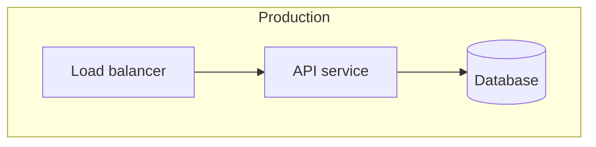

# Physical architecture and BOM: <design title>

<!-- Rules live in references/physical-bom.md. Delete the delta section for a
full BOM, and the full section for an architecture change. -->

## 1. Physical topology

Where does each deployment unit run?

| Environment | Region / zone | Network segment | Deployment unit | Resource | Count | Placement |
| --- | --- | --- | --- | --- | --- | --- |
| <prod> | <region / zone> | <public / private / data> | <unit from the design's deployment section> | <resource> | <n> | <spread across zones / single zone> |

<Plain flowchart only. No C4 keywords, no raw HTML, no semicolons in labels.>

## 2. Bill of materials

| Line | Deployment unit | Kind | Identifier | Tier / size | Qty | Unit price | Monthly | Price status | Source |
| --- | --- | --- | --- | --- | --- | --- | --- | --- | --- |
| 1 | <unit> | cloud service | <provider SKU and service identifier> | <tier> | <n> | <price per period> | <qty x price> | priced | <source, date, region> |
| 2 | <unit> | container image | `<registry>/<repository>:<tag>` | n/a | 1 | n/a | 0 | no direct cost | Placeholder: <team> publishes this image. Cost is carried by line 1. |
| 3 | <unit> | open-source library | `pkg:pypi/<name>@<version>` (<SPDX id>, version from the lock file) | n/a | 1 | n/a | 0 | no direct cost | Free to use: <SPDX id>. |
| 4 | <unit> | hardware | <vendor model or part number> | <CPU, memory, storage, network interface> | <n> | <price> | <qty x price> | priced | <source, date, region> |
| 5 | <unit> | network connection | <link type, endpoint A, endpoint B, port or circuit id> | <bandwidth> | 1 | <price> | <price> | priced | <source, date, region> |

## 3. Delta BOM (architecture change only)

| Line | Change | Deployment unit | Kind | Identifier | Tier / size | Qty | Unit price | Monthly | Price status | Source |
| --- | --- | --- | --- | --- | --- | --- | --- | --- | --- | --- |
| 1 | add | <unit> | cloud service | <provider SKU and service identifier> | <tier> | <n> | <price> | <+amount> | priced | <source, date, region> |

`Change` is add, remove, or resize. Removed lines show a negative `Monthly`.

## 4. Totals

- **Currency:** USD unless the user named another.
- **Per-environment total:** <environment: amount per month>
- **Unpriced lines:** <count> (left out of the total)
- **Excluded costs:** <data transfer, support, taxes, or none>
- **Net monthly change:** <amount, architecture change only>
