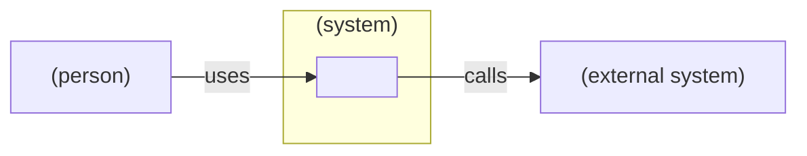
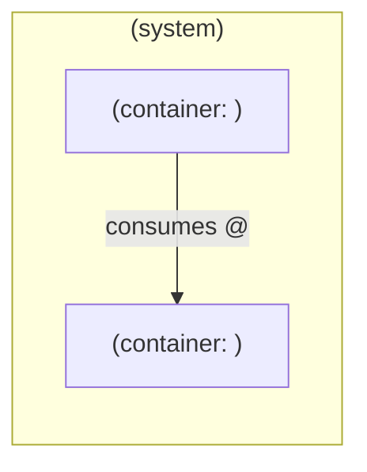

<!-- Solution reference architecture - the current architecture of a coordinating
     repo with no app code. Each section is proposed for accept / edit / decline
     before it is written. Replace every <placeholder>; link to contracts and to
     each component repo's reference.md rather than copying them. -->

# Solution Reference Architecture - <solution name>

**Status:** Draft | Accepted
**Last updated:** <YYYY-MM-DD>

## Scope

What does this solution cover, which component repos belong to it, and what is
outside it?

## System context

Who and what does the solution talk to?

## Component landscape

Which component repos make up the solution, and which APIs join them?

Draw each edge from consumer to provider, labelled with the API and version the
provider exposes.

## Domain boundaries

Which domain owns what, and how do the domains relate?

| Context | Owns | Component repos | Relationship |
| --- | --- | --- | --- |
| <domain> | <data and rules it owns> | <repo-a>, <repo-b> | <customer-supplier / conformist / anticorruption layer / partnership> |

## Shared contracts

Which contracts cross a repo boundary, and who may change them?

| Contract@version | Home | Provider | Consumers | Compatibility direction |
| --- | --- | --- | --- | --- |
| <contract>@<version> | <link to the contract home> | <repo> | <repo>, <repo> | <backward / forward / both> |

## Cross-cutting standards

Which standards hold for every component, and where is each defined?

- <standard>: <link to its source>

## Conformance

How does each component repo show it follows this reference? Each component
`reference.md` carries this link line:

> Conforms to the solution reference architecture: <link to this file>

## Coordination constraints

What does each coordination limit mean for the architecture? State the
consequence, not the limit.

- <limit in one phrase>: <consequence for contracts, sequencing or ownership>

## Open questions

- <question, owner, and the decision it blocks>
