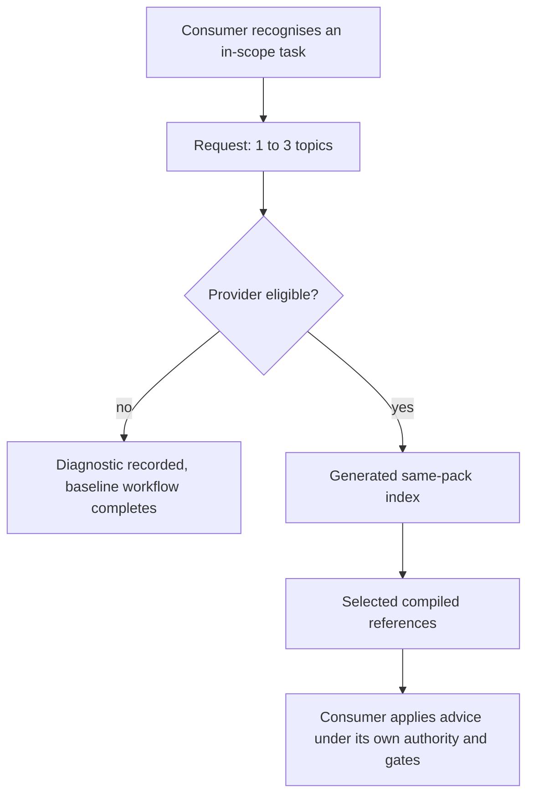

# Agent skill engineering architecture

> **STATUS: PARTLY IMPLEMENTED.** The
> `agent-skill-engineering` pack (version 0.4.3) ships the two workflows, the
> router, a 16-topic corpus, and the Claude Code runtime profile, and the
> sections below describe those as current. Four rows of the
> [brief](../product/briefs/agent-skill-engineering.md) remain unbuilt: `3c-r`
> claim-state reporting, `3d` the `runtime-package` mode, `5` self-host
> adaptation, and `6` pilot and closeout. Closeout promotes this page to
> **CURRENT** and records the verifying commit.
> [RFC-0097](../rfc/0097-agent-skill-engineering.md) is the decision;
> [INI-009](../product/initiatives/ini-009-agent-skill-engineering.md) owns delivery.

The `agent-skill-engineering` pack gives authors and agent loops a portable way
to author, review, and reason about Agent Skills. It has two user-facing
workflows, one inert router, and a compiled, same-pack knowledge corpus of 16
admitted topics against 36 named leaves.

`work-loop` and `architect-design`
reach the corpus through a versioned, read-only contract. Product-specific
runtime facts live in retrieval-dated profiles, and AgentBundle stays an
external delivery mechanism that the portable pack does not name.[^1]

## 1. Three concerns, two owners

The pack owns portable workflows and knowledge, plus product-specific runtime
facts held as dated claims. AgentBundle owns catalogue, adapter, projection, and
publication mechanics, and nothing in the pack depends on them.[^2]

| Concern | Owner | Must not become |
| --- | --- | --- |
| Author/update and review/optimize procedure | The pack | A catalogue-only workflow |
| Authoring source (OKF), generated indexes, compiled references | The pack | A runtime knowledge service |
| Consumer task authority and fallback | The invoking loop | Authority delegated to retrieved prose |
| Runtime capability facts | A retrieval-dated profile | A claim that all runtimes behave alike |
| AgentBundle metadata, adapters, projections, publishing | AgentBundle and catalogue owners | Portable skill doctrine |
| Repository safety, enforcement, exact commands | Existing repository owners | Optional retrieved knowledge |
| Provider integration declaration | Consuming pack metadata (`[[pack.integrations]]`) | A hidden dependency in portable instructions |

Dependencies run one way: consumer → installed provider → provider-owned
compiled references. Generated projections are never authoring dependencies. The
provider depends on no consumer and resolves no other pack's raw source.[^3]

## 2. Building blocks

```text
agent-skill-engineering pack
├── author-or-update-agent-skill     user-facing workflow (frame, create, update, knowledge-provider)
├── review-or-optimize-agent-skill   user-facing workflow
├── ase-okf-reference                inert router, read-only
├── compiled references              Markdown under the router's references/okf/
└── okf/agent-skill-engineering-foundation   build-time OKF source only

consumers: work-loop, architect-design
```

The router's name shares no vocabulary with the workflows' requests, so runtime
selection does not drift from the authoring workflow. A rename needs a rerun of
`agentbundle pack evals run`.[^4]

The author/update workflow runs in explicit modes and reports the mode it is
acting in. `frame`, `create`, and `update` ship, as does `knowledge-provider`,
which is entered read-only and gains write authority only after the user
authorizes it. **STATUS: PLANNED** — the `runtime-package` mode (`3d`) is not
active; a request for it returns the stable unavailable result.[^5]

Open Knowledge Format (OKF) is an authoring representation. The pack compiles it
at build time into ordinary references and indexes, and no runtime component
searches, interprets, or executes raw OKF.[^6]

## 3. The corpus covers 16 of 36 leaves, and absence is recorded

Every one of the 36 leaves in the taxonomy is in exactly one of two sets:
admitted (16) or declared absent (20). A declared-absent leaf records why it is
absent and what would admit it. Admission is evidence-limited, so the admitted
count stays below the taxonomy size.[^7]

The taxonomy groups leaves by task, not by source file:

- foundations: framing and triggers, instruction density, progressive
  disclosure, resources, scripts, and exit contracts;
- reusable pattern and usability topics, including knowledge providers, mode
  wayfinding, and progressive result presentation;
- evaluation: activation, behavior, construction, fixtures, isolation, cost;
- language topics: Python/pytest and TypeScript/Node;
- execution economics: pack and CI critical paths, process and filesystem cost,
  worktrees, state locks, shared-host admission;
- composition floors for skills with subagents, hooks, and plugin packages;
- runtime profiles: the taxonomy has one leaf per runtime, and only Claude Code is admitted;
- security and authority: trust boundaries and instruction provenance;
- maintenance: evidence promotion, applicability, measurement, retirement.

Each admitted topic carries claim groups with a basis, an applicability limit,
and a revalidation trigger. The measured admission and retrieval results are in
the pack's fixtures.[^8]

## 4. Provider and consumer flow

A consumer sends one bounded request, and the router answers from the compiled
corpus or says why it cannot.



The contract version is `agent-skill-engineering-reference/v1`. A request names
a task kind (`skill-authoring`, `skill-review`, `skill-eval-ci`, or
`agent-extension-design`), a bounded question, optional capabilities and exact
runtime, and a topic limit of 1 to 3. A response status is `ok`,
`out-of-scope`, `unavailable`, or `stale-profile`.[^9]

Provider use is optional. When the pack is absent, a consumer continues its
baseline workflow and records `knowledge provider unavailable`. It never searches
raw OKF and never claims equivalent validation.[^10]

## 5. Two consumers carry the seam

`work-loop` sends `skill-authoring` and `skill-eval-ci`. `architect-design`
sends `agent-extension-design` and `skill-eval-ci`. Each step inlines its own
request, makes one call with no refinement, and addresses the provider by
contract version, never by product name, install path, or generated router path.

Each step forbids locating the provider's implementation. Both packs declare the
seam as a `handoff` integration whose fallback repeats the diagnostic
verbatim.[^11]

Returned content is untrusted evidence. A candidate provider is eligible only
when its ownership manifest verifies, its declared identity and contract version
agree, it supports the task kind, and its authority is exactly
`filesystem_read_untrusted`.[^12]

## 6. Trust and execution boundary

Candidate skills, scripts, hooks, subagent definitions, plugins, OKF, and
external pages are untrusted input. Intake is passive and confined, and static
inspection precedes any execution.

The workflows never install, activate, or run
candidate components on their own. Any execution is a separate, approved action
under the active managed permission profile.[^13]

Authentication stays outside the model context. A workflow can request a
bounded capability or call a trusted tool that attaches credentials beyond the
model boundary, and it never reads, copies, persists, or prints raw credentials.

Compiled output is deterministic and confined: metadata is escaped, paths and
links are validated, and hostile input cannot write outside the build target.
Hooks stay executable runtime mechanisms, and managed enterprise policy and the
actually exposed tool surface override local configuration or corpus advice.[^13]

## 7. Runtime profiles hold dated claims in four states

The Claude Code profile is the only profile. It rolls up `complete-current` with
three `verified` rows and four `experimental` rows.[^14]

- `verified`: current official evidence plus a passing contract fixture or
  bounded manual probe.
- `experimental`: sourced but preview-only or not independently probed.
- `stale`: the verification window elapsed or the source changed; operative
  advice is withheld.
- `unavailable`: evidence conflicts, the capability is absent, or safe
  verification cannot be performed.

Each row records source URI, retrieval date, exposed source version, claim scope,
and last verification. The window runs from a source's retrieval date, so an
author cannot extend it by advancing a verification date.

A profile is
`complete-current` when every required row has current first-party evidence and a
state of `verified`, `experimental`, or `unavailable`. Any stale row makes it
`needs-revalidation`, and any missing required row makes it `incomplete`.[^14]

A knowledge profile is not an adapter-support claim. Adapter support is governed
and tested outside the pack. **STATUS: PLANNED** — the router's per-claim state
and roll-up reporting, and the provider response-contract change it needs,
belong to the `3c-r` row of `docs/product/briefs/agent-skill-engineering.md`,
scoped to the shipped ledger.

## 8. Self-hosting

**STATUS: PLANNED** — repository self-host adaptation is the brief's row `5`.
It proceeds add → integrate → route and compare → collapse. Existing guidance
stays authoritative until the installed provider and cold-agent task fixtures
show replacement coverage.

A footprint change is complete only when fixed task
checklists keep their correctness while always-loaded lines and median retrieved
bytes fall. Always-loaded safety, repository facts, exact commands, executable
checks, and fallback routes stay at their current owners.[^15]

## 9. Verification gates

RFC-0097 defines four gates: corpus and router, workflow behavior, runtime
profiles, and self-host footprint. The foundation slices of the first two block
the foundation release.

Expanded pattern slices and runtime profiles block M2,
and footprint failures block the matching deletion. The pack's own suites hold
the corpus, router, ledger, and failure-contract checks, and two repository
roster suites hold the checks that read outside the pack.[^16]

## 10. Governing records

- [RFC-0097 — Agent skill engineering](../rfc/0097-agent-skill-engineering.md)
- [ADR-0093 — OKF reference corpora remain governed build-time sources](../adr/0093-okf-reference-corpora-remain-governed-build-time-sources.md)
- [ADR-0097 — Knowledge access is capability-detected and provider-mediated](../adr/0097-knowledge-access-capability-detected-provider-mediated.md)
- [INI-009 — Agent skill engineering](../product/initiatives/ini-009-agent-skill-engineering.md)

## 11. Last verified

Verified 2026-11-04 against pack version 0.4.3 and `3fe5f2760`: 16 topics
admitted of 36 leaves, with 20 recorded as absent. Slice 3 now has portable
skills-and-subagents, hooks, and plugin-package floors, plus the Claude Code
runtime profile. Runtime profiles beyond Claude Code — Codex, GitHub Copilot,
Cursor, Kiro IDE, Kiro CLI, Gemini CLI and Google Antigravity — are retired to
open extension rather than delivery obligations.

The consumer seam is `agent-skill-engineering-reference/v1`, called by
`work-loop` and `architect-design` as described in § 5. The two composition
behavior fixtures `subagent-composition` and `hook-plugin-design` are declared in
`packs/agent-skill-engineering/.apm/skills/author-or-update-agent-skill/evals/evals.json`,
and their graded records sit in
`packs/agent-skill-engineering/tests/fixtures/behavior-results.json`. Whether
RFC-0097's Gate 2 M2 measure is met is the closeout slice's verdict.

[^1]: `packs/agent-skill-engineering/pack.toml` (`version`, `[pack.metadata.okf.bundles.provider]`); `packs/agent-skill-engineering/README.md`.

[^2]: `packs/agent-skill-engineering/tests/pack/test_pack_boundary.py`; [ADR-0093](../adr/0093-okf-reference-corpora-remain-governed-build-time-sources.md).

[^3]: `packs/core/pack.toml` and `packs/architect/pack.toml` (`[[pack.integrations]]`, id `skill-engineering-reference-handoff`, `kind = "handoff"`, provider `skill:ase-okf-reference`).

[^4]: Comment above `"router-skill"` in `packs/agent-skill-engineering/pack.toml`.

[^5]: `packs/agent-skill-engineering/.apm/skills/author-or-update-agent-skill/SKILL.md` (Modes); `tests/fixtures/unsupported-mode-cases.json`.

[^6]: `packs/agent-skill-engineering/okf/agent-skill-engineering-foundation/`; `.apm/skills/ase-okf-reference/references/okf/`.

[^7]: `packs/agent-skill-engineering/tests/fixtures/topology-leaves.json` (36), `topic-admission.json` (16 topics), `declared-absent-register.json` (20); `tests/pack/test_corpus_admission.py`.

[^8]: `tests/fixtures/topic-admission.json` (claim groups); `router-results.json`; `generic-negatives-results.json`; `activation-results.json`.

[^9]: `packs/agent-skill-engineering/tests/fixtures/provider-contract.json`; `tests/integration/test_provider_contract.py`.

[^10]: `tests/fixtures/provider-cases.json`; `packs/core/.apm/skills/work-loop/SKILL.md` and `packs/architect/.apm/skills/architect-design/SKILL.md` (knowledge-provider handoff blocks).

[^11]: `tests/roster/test_agent_skill_engineering_consumer_integrations.py`.

[^12]: Same two skill bodies, selection paragraph; `tests/fixtures/provider-cases.json` (seven diagnostics).

[^13]: `.apm/skills/author-or-update-agent-skill/references/security-boundaries.md` and `safety-and-authority.md`; `.apm/skills/ase-okf-reference/references/okf/concepts/trust-boundaries-and-instruction-provenance.md`.

[^14]: `packs/agent-skill-engineering/tests/fixtures/runtime-capability-ledger.json`; `tests/pack/test_runtime_capability_ledger.py`.

[^15]: [Brief](../product/briefs/agent-skill-engineering.md) row `5`; RFC-0097 Gate 4.

[^16]: `packs/agent-skill-engineering/tests/pack/`; `tests/roster/test_ase_composition_fixture_evidence.py`; `tests/roster/test_agent_skill_engineering_consumer_integrations.py`.
