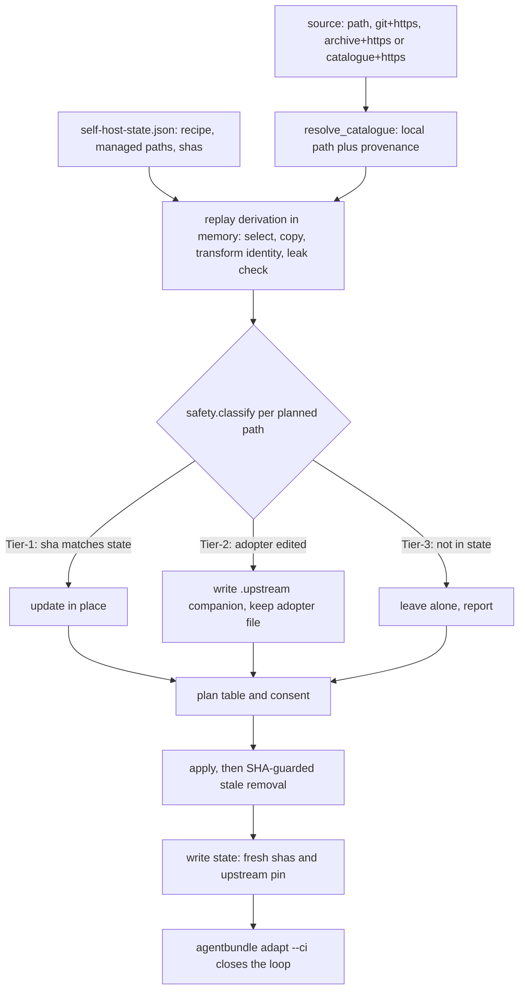

# Upstream sync for a derived catalogue

> `agentbundle catalogue sync` brings later upstream changes into a derived
> catalogue without overwriting adopter edits. It resolves the source, replays the
> recorded derivation in memory, classifies every planned path against the
> ownership state, takes consent, writes, removes stale paths under a hash guard,
> pins the new upstream, and restores a snapshot when a write fails. It covers
> packs, profiles, guides, and both `--package` destinations.

`sync` composes components that already exist: `resolve_catalogue`, the
derivation replay in `initialise_self_hosted`, `safety.classify`, and the shared
consent helper. It adds no file-safety mechanism and no fetch path.[^1] The
acceptance criteria are in [`docs/specs/catalogue-sync-dry-run/`](../../specs/catalogue-sync-dry-run/spec.md)
and [`docs/specs/self-host-state-schema-3/`](../../specs/self-host-state-schema-3/spec.md).
What `init` copies is in [`derived-catalogue.md`](derived-catalogue.md); the state
file fields are in [`state.md`](state.md).

## Invocation

`--source` is required on every run, and `target` defaults to the current
directory. `--format table|json` selects the output.[^2] Three modes are mutually
exclusive:

- `--dry-run` prints the plan and writes nothing.
- `--check` answers whether the tree is current and writes nothing.
- With neither flag, the run applies the plan. `--yes` skips the consent prompt.

| Exit | Meaning |
| --- | --- |
| 0 | Success, or `--check` found the tree current |
| 1 | `--check` found a difference |
| 2 | Malformed invocation |
| 3 | `--check` cannot answer |
| 4 | Apply failed |

`--attribution`, `--tooling`, and `--guides-mode` set the identity, tooling, and
guides modes for the run. A recorded mode never reaches a replay silently.

## Shape

`sync` runs four stages.



### Stage 1: resolve the source

`resolve_catalogue()` dispatches four source forms.[^3] The plan names the
fidelity of the form that resolved.

| Form | Integrity available | Pin recorded |
| --- | --- | --- |
| Local clone path | none beyond the filesystem | none |
| `git+https://github.com/<owner>/<repo>[@<ref>]` | TLS only | resolved ref |
| `archive+https://…#sha256=<64hex>` | verified `sha256` | `archive_sha256` |
| `catalogue+https://…` descriptor | verified `sha256` | `archive_sha256` and `source_revision` |

A force-pushed tag changes what a `git+https://` sync delivers, and no digest
exists to compare against.

### Stage 2: replay the derivation

Derivation state at schema 3 carries two groups beside the fields in
[`state.md`](state.md):

```
recipe   packs, profiles, guides, attribution, tooling, identity fields
pin      source_uri, source_revision, archive_sha256, synced_at
```

The recipe is a filter, not a floor. A bare `sync` refreshes the recorded
selection and never adds a pack that appeared upstream later. `--pack <new-name>`
syncs that pack and amends the recipe.[^4]

The identity transform and the in-memory leak check run unchanged over the
replayed byte map, so white-label safety is the code `init` uses. Under
`--attribution white-label` the pin omits `source_uri` (see [Pin](#pin)).

### Stage 3: classify, never overwrite

Every planned path passes through `safety.classify(relpath, root, state)` before
any write:

| Tier | Condition | Action |
| --- | --- | --- |
| Tier-1 | on-disk `sha256` matches state, or file absent | update in place |
| Tier-2 | on-disk `sha256` differs because the adopter edited it | `safety.write_companion` writes `<name>.upstream.<ext>` |
| Tier-3 | path absent from state | leave untouched, report |

A path absent from state is written when it belongs to a pack or profile the run
introduces. A pre-existing unmanaged file is a Tier-3 row in the plan. Every
write goes through `safety.write_jailed`, and source reads use the confined
helpers in `catalogue_tooling.file_safety`.[^5]

### Stage 4: plan, consent, apply, pin

Consent goes through `_common.confirm_or_refuse`. The prompt names the source
fidelity and names the source URI only under `attributed`. With no terminal and
no `--yes`, the run refuses.[^6]

A snapshot of the write set, bounded at 256 MiB, is taken before the prompt.
Writes apply in five groups: packs, profiles, guides, derivation-wide paths, then
packages. Stale removal runs after the writes land and keeps its `sha256` guard.

State is written last, with fresh hashes and the pin. A failed write restores the
snapshot.[^7]

`agentbundle adapt --ci` exits non-zero while any `.upstream.*` companion is
unresolved.

### `--check`

`--check` writes nothing and answers one of three ways: current, differs, or
cannot-answer.

- **Default.** Compares the recorded pin's `archive_sha256` against the resolved
  source's verified digest. A local path or `git+https://` source affords no
  digest, so the answer is cannot-answer before the pin is read. A recorded
  digest that is absent or not 64 lowercase hex characters is also cannot-answer.
- **`--compare-tree`.** Compares every recorded path against the tree and never
  reads the resolved source.[^8]

### Granularity

`--pack <name>` (repeatable), `--profile <name>`, `--guides`, and
`--package <name>` each restrict the run to that subtree. With none of the four,
the run covers the recorded recipe. `catalogue.toml`, `tests/conformance/`, and
the identity fields are derivation-wide and move only with a full sync.

`--guides` restricts scope to `guides/_shared/`. `--guides-mode none|selected` is
a separate flag that sets the replayed guides mode.

`--package` accepts two names:

| Name | Destination | Present when |
| --- | --- | --- |
| `agentbundle` | `.agentbundle/tooling/` | tooling mode is `vendored` |
| `credbroker` | `packages/credbroker/` | the `credential-brokers` pack is selected, in either tooling mode |

The `agentbundle` destination is the whole vendored tooling root because `init`
writes the engine subtree and the vendored `packs/catalogue-curation/` copy from
one mode decision. The engine subtree, `.agentbundle/tooling/agentbundle/`, is
the part an adopter `pip install -e`s and the part the self-replacement refusal
tests.

## Pin

The pin is written to `.agentbundle/self-host-state.json`, which the leak check
never scans. Each pin field must therefore be safe on its own. The rule and its
reason are in [`derived-catalogue.md`](derived-catalogue.md) § Identity and the
leak boundary.

| Field | `attributed` | `white-label` |
| --- | --- | --- |
| `source_pack_identity` | upstream name | the derived catalogue's name |
| `source_uri` | recorded | omitted |
| `source_revision` | recorded | recorded |
| `archive_sha256` | recorded | recorded |

`--check` compares digests, not URIs, so omitting `source_uri` does not affect
it.[^9] The sync pin names `source_uri` where `PackState` names `artifact_uri`;
the two vocabularies differ.

## Compatibility is warn-only

`sync` reports three advisory rows and never refuses on a signal it introduces.[^10]

| Signal | Source | Declared by |
| --- | --- | --- |
| Pack version moved | `[pack] version` | every default-selected pack |
| Adapter-contract version moved | `[pack.adapter-contract] version` against `SPEC_VERSION` | every pack |
| Declared dependency violated | `[pack.dependencies] required` or `conflicts` | the packs that declare an edge |

`check_spec_version_gate` in `commands/_common.py` compares major components
only. The CLI ships `SPEC_VERSION = 0.18` and the declaring packs spread across
`0.7` to `0.13`, so every comparison has major `0` and the gate passes. `sync`
still invokes it, so the first pack to declare major `1` is refused.

credbroker compatibility has no machine-readable signal. The detection hook is
the adopter's own `tests/conformance/`, which `init` copies into the derived
tree.

## Trust boundaries

1. **Remote fetch into a local tree.** `https_catalogue` enforces origin-locked
   redirects, size caps, member caps, safe extraction, and digest verification
   where the source form offers one.
2. **Writes into an adopter-owned tree.** `safety.write_jailed` jails every path.
   Confined reads raise `UnsafeContentError`.
3. **The white-label identity boundary.** The in-memory transform and leak check
   run before any write. The state file sits outside that check, which is why the
   pin is opaque.
4. **Self-replacement.** In vendored mode, `sync` can rewrite the `agentbundle`
   source that is executing it.

## Known risks

- **Companion flood.** A broadly edited tree produces many `.upstream.*` files in
  one run, and `adapt --ci` blocks until each is resolved. The plan table shows
  the count before consent, and `--pack` takes one pack at a time.
- **A real break ships silently.** Compatibility is warn-only.
- **`git+https://` carries no content integrity.** The plan prints the fidelity
  obtained.
- **Schema-1 states cannot self-heal.** Their `sha256: None` entries support
  neither Tier classification nor the removal guard. `sync` reports them as a
  named count with a recovery instruction.

### Self-replacement

Packages apply last, a failed package write restores the snapshot, and `sync`
refuses a vendored package sync when the target supplies the running
`agentbundle`.[^11]

The refusal reads two inputs:

- The editable-install check in `source_defaults` is bounded by an enclosing git
  repository. A derived catalogue that is not one returns nothing from it.
- The running package's own resolved location needs neither a PEP 610 record nor
  a git root, so it covers an adopter who ran `pip install -e` on the vendored
  engine in a plain directory.

The refusal covers `.agentbundle/tooling/agentbundle/`, the only part of a
derived tree that can supply a running interpreter. It does not cover
`packages/credbroker/`, a build input resolved by relative path. An adopter who
installed credbroker editable from the target falls outside the refusal.

[^1]: `packages/agentbundle/agentbundle/commands/catalogue_sync.py` (`replay_derivation` call, `plan_write_set`); `catalogue_tooling/initialise_self_hosted.py`; `safety.py` (`classify`, `write_companion`, `write_jailed`).

[^2]: `cli.py` (`catalogue sync` subparser); exit constants `_SUCCESS`, `_DIFFERENCE`, `_MALFORMED`, `_CANNOT_ANSWER`, `_APPLY_FAILED` in `commands/catalogue_sync.py`.

[^3]: `catalogue.resolve_catalogue`, `resolve_git_ref`; `https_catalogue.fetch_catalogue_archive`; `catalogue_sync.build_pin`.

[^4]: `catalogue_sync.select_write_set`, `_scope_subtrees`.

[^5]: `catalogue_sync._classify_planned_paths`; `safety.py`; `catalogue_tooling/file_safety.py`.

[^6]: `commands/_common.confirm_or_refuse`; the apply path's consent wrapper in `catalogue_sync.py`.

[^7]: `catalogue_sync.snapshot_write_set`, `restore_from_snapshot`, `_SNAPSHOT_BOUND_BYTES`, `write_order`, `select_removal_set`, `write_merged_state`.

[^8]: `catalogue_sync._check_digest_only`, `_check_compare_tree`, `_report_check_result`.

[^9]: `catalogue_tooling/initialise_self_hosted.py` (`SelfHostPin.to_dict`, `_source_pack_identity`); `config.PackState`.

[^10]: `catalogue_sync.compatibility_warnings`, `check_adapter_contract_gate`; `commands/_common.check_spec_version_gate`; `contracts/adapter.toml` and `packs/*/pack.toml` for the declared versions.

[^11]: `catalogue_sync._self_replacement_reason`, `_running_package_root`; `source_defaults._detect_editable_source`.
