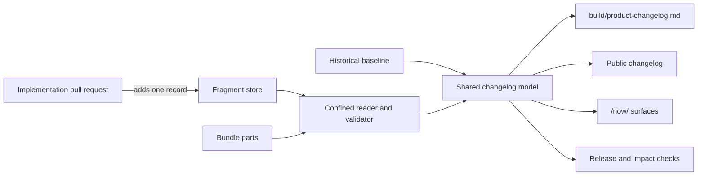

# Per-update changelog sources

**STATUS: PARTLY IMPLEMENTED.** New product changelog entries are authored as
one reviewed fragment per update, and the complete changelog and the `/now/`
surface are rendered from those fragments by one shared model. Monthly bundle
compaction ships in `tools/changelog.py`, but no bundle part exists yet.

Governing records: [ADR-0123](../adr/0123-product-changelog-per-update-sources-and-generated-views.md)
(fragments and generated views), [ADR-0143](../adr/0143-released-changelog-records-move-into-monthly-bundles.md)
(monthly bundles and retraction), and the
[`product-changelog-fragments` spec](../specs/product-changelog-fragments/spec.md).
Contracts, verification and build mapping are in the
[reference page](changelog-fragment-source-reference.md).

## 1. One fragment per update is the only authoring surface

A pull request adds one file under `docs/product/changelog.d/` and never edits
the aggregate, so concurrent updates cannot collide on a shared anchor.[^1]
`python3 tools/changelog.py new` creates the file with a UUIDv4 `id` and the
`anchor`; the reviewer approves its Highlights and sections in the same pull
request.[^2]

| Artifact | Location | Writer | State |
| --- | --- | --- | --- |
| Fragment | `docs/product/changelog.d/<id>.md` | `changelog.py new`, then the author | Shipped; 106 files |
| Historical baseline | `docs/product/changelog.md` | None after cutover | Shipped; read-only history with a migration notice |
| Bundle part | `docs/product/changelog.months/YYYY-MM-NN.bundle` | `compact` and `retract` only | Writer shipped; no part exists |
| Retraction list | `docs/product/changelog-retractions.toml` | `retract`, append-only | Shipped; no entries |
| Complete local view | `build/product-changelog.md` | `changelog.py render` | Ignored build output |

No generated view is tracked or read as input. An author or reviewer may use a
model to draft fragment text, but no model takes part in validation, assembly,
release or publication.

## 2. One model feeds every view, so content and order cannot drift

`tools/changelog.py` validates fragments, bundle parts and the baseline into
one model; the site build, the local render and the release checks all read
that model.[^3]

The diagram shows which component owns each step from authorship to
publication.

- **Order.** Output is sorted by `date` descending, then `id` ascending, before
  any view is built, so file enumeration order does not matter.
- **Highlights.** Each fragment's Highlights stay one atomic group. The
  assembler never merges or rewords them.
- **`/now/`.** The payload stays at `schemaVersion` 1, and five consumers
  reject any other version.[^4]
- **Release checks.** `check-core-release.py` and `check_release_impact.py`
  match changed fragments to release metadata instead of reading the
  aggregate's top entry.[^5]
- **Publish triggers.** `pages.yml` rebuilds on changes to the fragment
  directory, the bundle directory, the retraction list and the baseline.[^6]

## 3. Invalid input fails the build before anything publishes

The reader opens regular files only, through the repository's confined file
helpers, and never executes fragment content. A failure names the fragment
path, the field or invariant, and the expected correction.[^7]

| Bound | Value |
| --- | --- |
| Bytes per fragment, bundle part or retraction list | 1,048,576 |
| Records across fragments and bundles | 65,536 |
| Loose released fragments: warn / refuse | above 375 / above 500 |
| Pending fragments: warn | above 250 |

`changelog.py validate` compares each changed record by `id` against the merge
base across both storage forms. It rejects an edit to the `packages`, `date` or
`id` of a merged fragment, because those fields fix the published anchor and
the Atom `<id>`.[^8]

## 4. What is not built

- **Bundle parts.** `compact` moves released fragments into a monthly part and
  `retract` withdraws a record by `id` and category. Neither has run against
  this repository, so released records are still loose fragments. The warn
  threshold is the trigger to run `compact`.
- **Merge queue.** The repository does not configure one. The design avoids the
  conflict a queue would reject, because no generated aggregate enters the
  tracked merge surface.

## 5. Explicit non-goals

- Package-local changelogs keep their own ownership and release flow.
- The historical baseline is not split or reworded.
- The design adds no service, database, queue, bot writer or hosted
  infrastructure; every step runs in existing CI and the site build.

[^1]: [`docs/product/changelog.d/`](../product/changelog.d/); the conflict measurement is in [`tools/measure-changelog-conflicts.py`](../../tools/measure-changelog-conflicts.py).

[^2]: `tools/changelog.py` `create_fragment` and the `new` subcommand; template at [`docs/product/changelog-fragment-template.md`](../product/changelog-fragment-template.md).
[^3]: `tools/changelog.py` `collect_validated_fragments`, `assemble_changelog` and `project_fragment_now_highlights`; the site adapter is `tools/build-site.py`.

[^4]: `web/src/pages/now/index.astro`, `page/[page].astro`, `archive/index.astro`, `[release].astro` and `feed.xml.ts`, each of which throws on a `schemaVersion` other than 1.
[^5]: `tools/check-core-release.py` (`FRAGMENTS`) and `tools/repo/check_release_impact.py`.

[^6]: `.github/workflows/pages.yml` path filters.
[^7]: `tools/changelog.py` `_fragment_error`, `_read_fragment_text` and the `MAX_*` constants.

[^8]: `tools/changelog.py` `validate_fragment`, `_enforce_committed_identity` and `_resolve_merge_base_context`; tests in `tools/test_changelog.py`, `tools/test_changelog_bundles.py` and `tools/test_changelog_bundle_edges.py`.
