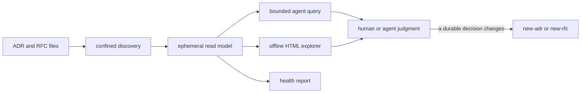

# Decision graph architecture

The decision graph is a read-only projection of the repository's ADRs and RFCs.
The `navigate-decisions` skill discovers the admitted records, builds an
in-memory read model, answers bounded queries, reports decision health, and
exports one offline HTML explorer. The canonical Markdown records stay the only
authority.

Every output is a disposable snapshot with provenance, and every
relationship carries a label for how far it can be trusted. `new-adr` and
`new-rfc` own authoring.

**STATUS: CURRENT**, except [§ 7](#7-context-check-flow), which is
**PLANNED**. The skill is governed by
[RFC-0105](../rfc/0105-artifact-derived-navigation-and-workspace-retirement.md)
and the [decision-navigation specification](../specs/decision-navigation/spec.md),
and shaped by [CAP-0002](../product/intents/CAP-0002-decision-graph.md)
and [FEAT-0033](../product/intents/FEAT-0033-decision-navigation.md). The pack
baseline is [Repository Governance design](../../packs/repo-governance/DESIGN.md).

## 1. Scope

The graph does not compile prose into rules or decide which policy applies to an
action. It gives a person or agent attributable context to check against. It
needs no policy language, persisted graph, database, or metadata retrofit.

## 2. Structure

`navigate-decisions` owns discovery, queries, health, and views.[^1] The
read model needs stable identity and kind, the exact lifecycle value (including
a missing or unfamiliar one), repository-relative provenance, admitted
structured fields, body availability and omission state, checked supersession
lineage with partial scope, contextual references outside the checked edge set,
and an inventory of supporting files. It exposes view-specific indexes in
memory only.

[^1]: `packs/repo-governance/.apm/skills/navigate-decisions/scripts/navigate_decisions.py` (CLI), `explorer.py` (HTML export), `file_safety.py` (confined reads).

## 3. Admitted corpus

The admitted population is every confined direct child of `docs/adr/` or
`docs/rfc/` whose basename matches `NNNN-*.md`, excluding `README.md`,
`*-research.md`, and support subdirectories. A candidate-shaped file that is
malformed or duplicates a kind-plus-ordinal identity fails the corpus. It is not
reclassified as support material.[^2]

[^2]: [decision-navigation spec § Corpus and query contract](../specs/decision-navigation/spec.md#corpus-and-query-contract).

## 4. Trust model

Five classes of relationship stay visibly different, and no view may promote one
to another.

| Class | Source | What a view may claim | `trust_class` value |
| --- | --- | --- | --- |
| Checked lineage | Validated reciprocal full or partial supersession metadata | A record replaces all or named parts of another | `checked` |
| Canonical record fact | An admitted field or exact lifecycle value | The record states this value at the exported revision | none: a record field, not a relationship |
| Contextual reference | Explicit but unchecked material such as `Related` | The source points here; no validated lineage | `contextual` |
| Caller assertion | An explicit query or view input | The caller asked to inspect this direction | `navigation_only`, with `resolution_state=caller_asserted` |
| Navigation grouping | A query, filter, shared area, or scope reading | The records are shown together; the grouping has no authority | none: a view grouping |

A supersession field that is one-sided or names an unresolved target carries
`trust_class=candidate` with `resolution_state=unresolved`. It is a contextual
claim and never becomes checked lineage.

Prose, filenames, dates, directory proximity, and model judgment create no
checked edge. A wider-to-narrower hierarchy appears only from an admitted
directional fact or a caller assertion. Contextual references and groupings
form a neutral co-view.

Each relationship carries `basis`, `source`,
`direction`, `trust_class`, and `resolution_state`, kept separate from the source
record and never written back. A semantic conflict is a caller or reviewer
observation unless canonical metadata records it. Promoting a contextual
relationship to checked authority, changing the public query contract, or adding
enforcement needs a decision record.[^3]

[^3]: `trust_class` and `resolution_state` assignment in `navigate_decisions.py` (`checked`, `candidate`, `contextual`) and `explorer.py` (`navigation_only`); [decision-navigation spec](../specs/decision-navigation/spec.md); [RFC-0105](../rfc/0105-artifact-derived-navigation-and-workspace-retirement.md).

## 5. Views and queries

Four peer views answer different questions over one fact model, and an agent
query returns the same identities, lifecycle, lineage, references, and
provenance in a bounded machine-readable result.

- **Corpus list.** Orientation: exact lifecycle and kind filters, search,
  summaries, corpus counts.
- **Lifecycle graph.** What replaced what, and whether whole or partial. Branches,
  cycles, partial scopes, and unfamiliar statuses display `unknown` or
  `conflict` at the affected record. Superseded records remain available.
- **Guidance context.** A wider decision beside narrower guidance, a lens over
  the trust model and not a new graph contract.
- **Record detail.** Full rationale, decision text, consequences, provenance, and
  a safe source handoff.

The CLI exposes `query` (operations `summary`, `search`, `record`, `lineage`,
`context`), `export`, and `health` (`decision-navigation.health.v1`).[^4]
Record-controlled values travel as marked untrusted data beneath repository and
user instructions. The producer's encoding prevents structural escape, and the
skill's consumption rule prevents record content from changing scope, workflow
selection, permissions, or tool use.

[^4]: Subcommands and `operation` choices in `navigate_decisions.py`.

## 6. Runtime and publication boundaries

Discovery stays inside the confined regular-file boundary. Unsafe, malformed,
ambiguous, or duplicate inputs fail before any result or artifact publishes.

The export is one self-contained HTML file with its data, styles, and scripts
embedded. It never fetches repository content at runtime. Files that are not
embedded are inventoried with a safe source reference.

- The default destination is the OS temporary directory. A non-default
  destination must come from the user's own request and may not sit inside the
  worktree.
- An estimated size over the 100 MiB `full` budget is refused as `over_budget`
  unless the caller confirms it.
- `bounded` mode omits record bodies and says so per record, so nothing drops
  silently.[^5]

Query and HTML agree at the fact boundary even though their implementations
differ.

The system fails honestly. A missing or unfamiliar lifecycle value stays distinct
from an accepted one. A one-sided relationship never becomes checked lineage.

Conflicting accepted records appear together with no winner. Omitted content
stays visible. No result is the complete policy for an action.

Record text stays
inert in browser and agent output. An unsafe destination publishes no partial
file.

[^5]: `BUDGET_BYTES`, `publish_explorer`, and the `--destination` handling in `explorer.py` and `navigate_decisions.py`.

## 7. Context-check flow

**STATUS: PLANNED**, governed by
[RFC-0105](../rfc/0105-artifact-derived-navigation-and-workspace-retirement.md)
and scoped by
[FEAT-0035](../product/intents/FEAT-0035-decision-context-checks.md). This
section fixes only the boundary navigation must keep. It does not
authorize a workflow integration or make context checks a dependency of decision
navigation.

A context check is a lightweight use of navigation, not a policy layer:

1. The caller supplies anchors: a record identifier, repository area, changed
   surface, or decision question.
2. Navigation returns canonical records, checked lineage, and separately
   labelled contextual evidence.
3. The result states the anchors, corpus revision, search boundary, omissions,
   conflicts, and unknowns.
4. A person or agent checks the proposed action against the cited records.
5. A change to a durable decision goes through `new-adr` or `new-rfc`.

Absence is not permission, retrieval relevance is not authority, and context
presence does not prove compliance. A workflow may require a receipt of
consulted records, and enforcement stays with that workflow's own controls.
