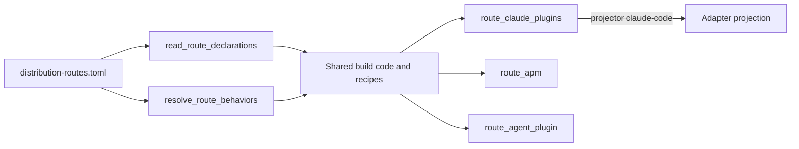

# Distribution routes and runtime-adapter projection

**Scope:** how a pack becomes an installable artifact for an external plugin
ecosystem (a *distribution route*) and for an agent runtime on disk (a
*runtime adapter*), and where the two layers meet.

Three distribution routes ship (`apm`, `claude-plugins`, `agent-plugin`), each
declared in one contract and built by one route-owned module. Eight runtime
adapters project the same pack primitives directly into a repository or user
home. A route may name one adapter as its projector but is never owned by one.

Everything else in this area (a Codex route, a Kiro Power profile, an MCP
primitive, an open route set) is planned and listed in
[§ 7](#7-planned-work-status-planned).

Decision records: [ADR-0090](../adr/0090-distribution-routes-separate-from-runtime-adapters.md)
(route and adapter are separate layers),
[ADR-0091](../adr/0091-kiro-power-route-supersedes-rejection.md) (Kiro is a route
profile, not a package),
[ADR-0107](../adr/0107-claude-plugin-route-serves-non-technical-adopters.md)
(per-pack Claude plugins serve non-technical adopters), and
[RFC-0092](../rfc/0092-first-class-distribution-routes.md).

## 1. One contract declares every route

`contracts/distribution-routes.toml` declares each route with six fields:
identity, package layout, manifest projector, component-capability map,
marketplace projector, and lifecycle trigger.[1]

| Route | Output under `dist/` | Pack admission | Adapter projector | Marketplace projector | Lifecycle trigger |
| --- | --- | --- | --- | --- | --- |
| `claude-plugins` | `claude-plugins/<pack>/` | `user-publishable-with-consent` | `claude-code` | `claude-marketplace` | session-start install marker |
| `apm` | `apm/<pack>/` | `all-packs` | none | none | session-start install marker |
| `agent-plugin` | `agent-plugins/<pack>/` | `skills-only` | none | none | none |

The component-capability map states, per primitive, whether the route carries
it natively or drops it. `claude-plugins` carries skills, agents, commands, hook
bodies and compiled hook wiring. `apm` carries every primitive.

`agent-plugin`
carries skills and drops the other eight.[1]

A dropped capability is recorded in
the contract, never inferred.

The JSON schema for the contract is closed: it requires exactly the three
routes above and rejects any other key, so a fourth route needs a schema edit
([§ 7](#7-planned-work-status-planned)).[2]

**Evidence**

1. `contracts/distribution-routes.toml`; `[route.*]` tables and their `component-capabilities`.
2. `contracts/distribution-routes.schema.json`; top-level `required` and `additionalProperties`.

## 2. Build dispatch reads the contract; route code lives in three modules

Shared build code never names a route. It reads declared facts through
`read_route_declarations()` and obtains behavior through
`resolve_route_behaviors()`, which returns exactly one registered behavior per
declared route.[1] A behavior recognises its declaration by projector semantics,
not by route name, and owns what the contract cannot state: admission checks,
hook-wiring compilation, the lifecycle-marker path, and build order.[2]

Build order is route-owned and load-bearing: `claude-plugins` runs first (0),
then `apm` (1), then `agent-plugin` (2), because the first route can refuse a
pack that publishes hooks without consent and that refusal must precede any
route's first write.[2] Default recipes are derived from the declared routes, so
a declared route with no recipe is never built.[3]

Adding a route touches four places, in order:

1. Declare it in the contract and admit it in the schema; sync both into the packaged `_data/` copies.
2. Add a per-pack recipe under `build/recipes/` naming the route.
3. Add `build/route_<name>.py` with `behavior_from_declaration()`.
4. Register that factory in `route_lookup.py`; the registration list is explicit and closed.

`tools/check_distribution_route_decisions.py` fails when shared build code
decides by route, whether it spells a route name or compares a
contract-derived route value. The checker is bounded: its value pass is
module-local, and it reports what it cannot interpret as coverage residue
rather than as clean.[4]

**Evidence**

1. `packages/agentbundle/agentbundle/build/route_lookup.py`; `read_route_declarations`, `resolve_route_behaviors`.
2. `build/route_claude_plugins.py`, `route_apm.py`, `route_agent_plugin.py`; `behavior_from_declaration`, `build_order`.
3. `build/main.py`; `default_recipes`; `build/recipes/per-pack-*.toml`.
4. `tools/check_distribution_route_decisions.py`; `tools/test_check_distribution_route_decisions.py`.

## 3. Routes and runtime adapters are separate layers

A route packages a pack for an external ecosystem. An adapter projects the
canonical primitives into one runtime's on-disk layout for direct install. Both
consume the same normalized pack model.

Neither imports the other, and no
lint enforces that edge; `tools/lint-adapter-layer-boundary.py` fixes only the
projection-to-adapter direction.[1]

`contracts/adapter.toml` declares eight adapters: `claude-code`, `codex`,
`copilot`, `cursor`, `gemini`, `kiro-ide`, `kiro-cli`, and `kiro` (a deprecated
alias of `kiro-ide`). Each declares, per primitive, a projection mode, a target
path, and a scope fence (`allowed-prefixes`) for repository and user scope.
Self-host builds project only `claude-code` and `codex`.[2]

The canonical primitive set is nine: `skill`, `agent`, `command`,
`hook-body`, `hook-wiring`, `kiro-ide-hook`, `shared-libs`,
`adapter-root-bins`, and `user-libs`. MCP is not a primitive.[2]

The `claude-plugins` route is the one place the layers touch: its manifest
projector names the `claude-code` adapter, whose plugin-target fields supply the
in-package paths. The `apm` and `agent-plugin` routes name no adapter.[3]

**Evidence**

1. `tools/lint-adapter-layer-boundary.py` (scans `build/adapters` and `build/projections` only); the `route_*.py` modules under `packages/agentbundle/agentbundle/build/` import no adapter; [ARCHITECTURE.md § 3](../../ARCHITECTURE.md).
2. `contracts/adapter.toml`; `[adapter.*]` and `[primitive.*]` tables; `build/recipes/self-host.toml`.
3. `contracts/distribution-routes.toml`, `[route."claude-plugins"]` `manifest-projector`.

## 4. The Claude plugin route publishes sixteen user-scope packs

The route builds one plugin per pack whose `allowed-scopes` admits `user`,
plus an aggregated `marketplace.json`, and the publish workflow pushes both to
the `claude-plugins-dist` branch.[1] Sixteen packs are published; seven are
repo-only and never carried.[2]

Publication has four enforcement points:

- **Roster.** `tools/lint-plugin-roster.py` holds the literal `PUBLISHED` and `NOT_PUBLISHED` sets, refuses an unrostered pack, and fails when the workflow's push allowlist and the roster disagree.[2]
- **Membership.** `tools/lint-plugin-membership.py` fails while a publishable pack is absent from the root marketplace.[3]
- **Workflow.** `publish-claude-plugins.yml` triggers on push to `main` filtered to an allowlist of published sources, runs under the `claude-plugin-publish` environment, holds `contents: read` on `GITHUB_TOKEN`, and mints a repository-scoped App token with `contents: write` for the branch push.[4]
- **Control evidence.** `tools/lint-claude-plugin-publish-control.py` checks the recorded publication-control evidence for freshness; the live ordinary-actor rejection canary is recorded as not run.[5]

Marketplace entries reference the mutable branch `claude-plugins-dist`; no
per-pack content digest is carried, and the entry schema types `ref` and `sha`
as unconstrained strings.[6]

The marketplace branch and description resolve from `catalogue.toml` in the
catalogue-tooling build path, while the self-host aggregate keeps its own
description default; a parity test pins the duplicated values.[7]

Source-flavor catalogue archives include `guides/_shared` and omit
pack-specific guides.[8]

**Evidence**

1. `.github/workflows/publish-claude-plugins.yml`; `tools/publish-claude-plugins.py`.
2. `tools/lint-plugin-roster.py`; `PUBLISHED`, `NOT_PUBLISHED`.
3. `tools/lint-plugin-membership.py`.
4. `.github/workflows/publish-claude-plugins.yml`; `permissions`, `jobs.publish.environment`, the App-token step.
5. `tools/lint-claude-plugin-publish-control.py`; `docs/specs/claude-plugin-hook-parity/publish-control-evidence.json`; field `live_branch_negative_tested`.
6. `contracts/marketplace-entry.schema.json`; `build/main.py` `_DIST_BRANCH`.
7. `packages/agentbundle/agentbundle/catalogue_tooling/build.py` (`_DIST_BRANCH`, `_MARKETPLACE_DESCRIPTION` rebinding); `build/self_host.py` `_aggregate_marketplace`; `tools/test_marketplace_envelope_parity.py`.
8. `packages/agentbundle/agentbundle/catalogue_tooling/package.py`; `_SOURCE_INCLUDE_SHARED_GUIDES`.

## 5. The Agent Plugin route emits a portable, offline-validated package

The `agent-plugin` route writes an Agent Plugins 1.0.0 package per skills-only
pack: a root manifest derived from `pack.toml` plus the `skills/` tree. It
builds from vendored, provenance-pinned schemas with no network access, admits
only reverse-domain extensions allocated in
`contracts/agent-plugin-extension-namespaces.toml`, and writes deterministically.[1]
Its golden trees are pinned by path, bytes, link target and mode alongside the
`apm` and `claude-plugins` trees.[2]

**Evidence**

1. `contracts/vendor/agent-plugins/1.0.0/`; `contracts/agent-plugin-extension-namespaces.toml`; [`docs/specs/portable-agent-plugin-projection/spec.md`](../specs/portable-agent-plugin-projection/spec.md).
2. `docs/specs/distribution-route-contract/`; `packages/agentbundle/tests/build_pipeline/test_distribution_route_golden.py`.

## 6. Hook projection differs per runtime, and three gaps are open

Every adapter projects `hook-body` to a script path and `hook-wiring` to that
runtime's configuration file. The runtime's documented contract decides whether
the projected hook delivers its session-start context, and the audit records
where it does not.[1]

| Runtime | Wiring target | Context output the runtime documents | Current projection |
| --- | --- | --- | --- |
| Claude Code | `.claude/settings.local.json` (repo), `.claude/settings.json` (user) | plain stdout | compatible; command path is relative to the working directory |
| Codex | `.codex/hooks.json` | plain stdout | compatible; command path is relative to the working directory |
| Copilot | `.github/hooks/<name>.json` | JSON with `additionalContext` | plain stdout is not delivered |
| Cursor | `.cursor/hooks.json` | JSON with `additional_context` | plain stdout is not delivered |
| Gemini CLI | `.gemini/settings.json` | one JSON object with `hookSpecificOutput.additionalContext` | plain stdout is not delivered |
| Kiro IDE and CLI | IDE: legacy `*.kiro.hook`; CLI: agent JSON | standalone `.kiro/hooks/*.json`, schema `v1` | both emit superseded formats |

The three open gaps are: command paths that break when a runtime starts below
the repository root, plain-stdout hooks on runtimes that parse JSON, and the
Kiro schema. All three are planned work ([§ 7](#7-planned-work-status-planned)).[1]

**Evidence**

1. [`docs/specs/codex-hook-adaptation-handoff/hook-adapter-audit.md`](../specs/codex-hook-adaptation-handoff/hook-adapter-audit.md); `contracts/adapter.toml` `projections.hook-body`, `projections.hook-wiring`; `.codex/hooks.json`.

## 7. Planned work (`STATUS: PLANNED`)

Each row is an intent in `docs/product/intents/`; the intent owns its status.
[CAP-0009](../product/intents/CAP-0009-first-class-distribution-routes.md) is the parent
capability under [RFC-0092](../rfc/0092-first-class-distribution-routes.md).

| Planned | What changes in this architecture | Intent |
| --- | --- | --- |
| Open route set | The schema stops pinning route names; capability `target-path` and `output-subdir` become confined free-form values; handler discovery needs an import-time trust boundary | [FEAT-0020](../product/intents/FEAT-0020-distribution-route-set-opening.md) |
| MCP primitive | A tenth canonical primitive with direct install and route projection in one change | [FEAT-0021](../product/intents/FEAT-0021-canonical-mcp-install-parity.md) |
| `codex-plugins` route | A fourth route with its own manifest, marketplace and publication parity with Claude | [FEAT-0022](../product/intents/FEAT-0022-codex-plugin-route.md) |
| `kiro-power` profile | A route profile over the `agent-plugin` bytes with Kiro admission, activation and support claims | [FEAT-0023](../product/intents/FEAT-0023-kiro-power-route-profile.md) |
| Manifest migration and support claims | Derive Claude manifest fields and public support claims from capability and verification records | [FEAT-0024](../product/intents/FEAT-0024-claude-manifest-migration-support-claims.md) |
| Registry-acquired MCP servers | Deferred behind RFC-0092 D7 until an acquisition trust model is approved | [FEAT-0025](../product/intents/FEAT-0025-registry-acquired-mcp-servers.md) |
| Cross-module route-decision analysis | Deeper checker; the bounded checker is the shipped shape | [route-decision-analysis-depth](../product/intents/route-decision-analysis-depth.md) |
| Plugin-root collision guard | The Claude route refuses a pack-owned top-level path that collides with a projected component root; the route has no such guard | [plugin-root-name-collision-guard](../product/intents/plugin-root-name-collision-guard.md) |
| Marketplace pack identity | Per-pack content digest in marketplace entries | [claude-marketplace-pack-identity](../product/intents/claude-marketplace-pack-identity.md) |
| Marketplace configuration authority | `catalogue.toml` becomes the single source for marketplace branch and description | [marketplace-config-single-authority](../product/intents/marketplace-config-single-authority.md) |
| Marketplace ingress validation | `ref` and `sha` validated as Git references; empty branch refused | [marketplace-ingress-validation](../product/intents/marketplace-ingress-validation.md) |
| Publication trust boundary | Publish gated on a successful build run, an approver preview, live canary evidence | [plugin-publish-trust-boundary](../product/intents/plugin-publish-trust-boundary.md) |
| Guide corpus in archives | Pack-specific guides join source-flavor archives | [catalogue-archive-guide-corpus](../product/intents/catalogue-archive-guide-corpus.md) |
| Shared pack-file projection | A declared source-to-destination projection inside `packs/**` | [shared-pack-file-projection](../product/intents/shared-pack-file-projection.md) |
| Hook delivery fixes | Root-stable commands, per-runtime context output, Kiro `v1` hooks | [adapter-hook-context-output](../product/intents/adapter-hook-context-output.md) |
