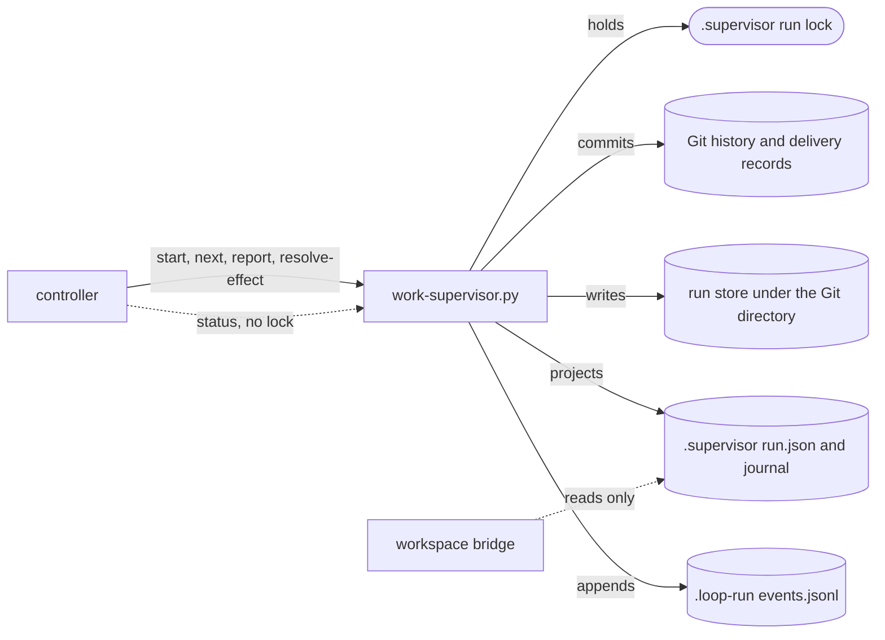
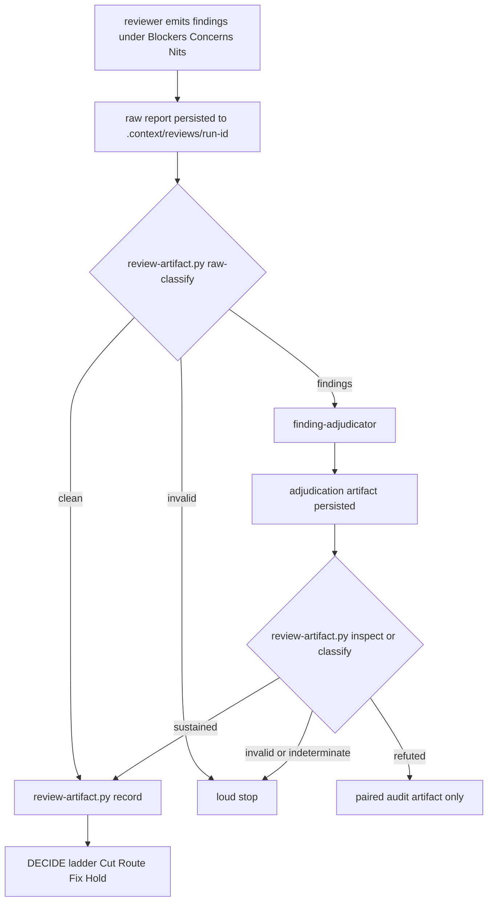

# Loop infrastructure

## 1. Purpose and boundary

The execution supervisor runs a full-mode `work-loop` delivery for one spec
directory. `work-supervisor.py` and its `_supervisor_*.py` siblings in
`packs/core/.apm/skills/work-loop/scripts/` are the only owner of full-mode
procedure: admission, task projection, ordering, dispatch, recovery, and
terminal handling ([ADR-0144](../adr/0144-work-loop-supervisor-owns-procedure.md)
D1). [Authority migration](work-loop-authority-migration.md) maps where each
former authority went.

The supervisor does not create requirements or implement work. It consumes an
approved spec and plan, issues one typed request at a time to the controller,
and commits what the controller reports. Light mode runs no supervisor
([ADR-0014](../adr/0014-rigor-scales-with-risk-work-loop-modes.md)).

The supervisor's mechanism — its modules, request order, request and step
kinds, stages, replanning, TDD guard, attempts, state, and exit codes — has one
home: the [execution supervisor](work-loop-execution-supervisor.md) design.
This page covers what sits around it: the sibling loops, how the scripts are
invoked, the linters, the run lock, and the review flow light mode and
pre-approval review use.

The boundary splits by **policy versus mechanism** rather than by topic.
`work-loop` decides when light or full mode applies, whether a simplify pass
runs, and how a session manages its context. Which reviewer roles a change
warrants is data in `work-loop/review-rules.json`, and caps and authority roles
are data in `work-loop/supervisor-policy.json`. The supervisor owns the
machinery that reads them. This page does not restate either file, because a
second copy would be falsified by the next edit with nothing comparing the two.

### Sibling loops, and why only this one has a supervisor script

`work-loop` is one of three loops, not the whole of the lifecycle.
`discovery-loop` sits upstream in `product-engineering` and `release-loop`
downstream in `release-engineering`, each run by its own supervisor agent —
`discovery-lead` and `release-lead` — that is a **peer** of `work-loop`'s
controller rather than a mode of it. They meet at numbered gates: discovery
hands off at **G3**, and the build hands off to release at **G4**, the point
where the build is locally done and deploy-ready.
[The three loops](../../guides/_shared/explanation/the-operating-model.md) is the
guide that reconciles the numbering across all three.

Neither sibling has a procedure script. `discovery-loop`'s transitions are file
edits on a typed sidecar; `release-loop` ships no executable engine. Both still
have an orchestrating agent and both keep state on disk; what neither has is a
program that advances it. Everything on this page — the supervisor, its
records, its run lock — is `work-loop`'s alone. They also differ in install
scope: discovery ships at user scope, while build and release are repo-scoped.

## 2. Entrypoints

- `work-supervisor.py`, full mode only. Every verb prints one JSON object.
  - `start <spec-dir> --intent code|spec-plan --code-trust trusted|untrusted
    --authority-ref owner[:<hex>] --review-authority-ref plan-reviewer[:<hex>]`
    admits the approved pair.
  - `next <spec-dir>` derives and prints the current request.
  - `report <spec-dir> <result.json>` admits that request's result and commits
    it.
  - `status <spec-dir> [--json] [--check]` shows the run.
  - `resolve-effect <spec-dir> --operation <key> --decision
    effect-confirmed|do-not-retry|retry-authorized --authority-ref
    effect-authority[:<hex>]` records a named human's effect decision.
- `review-artifact.py`: `validate`, `classify`, `raw-classify`, `inspect`, and
  `record`. Light mode and pre-approval review use these verbs. Full-mode code
  review does not decide closure through them (§ 4).
- `check-spec-status.py`: validates a requested status in `spec.md` or
  `plan.md`.

Exit codes and the refusal shape are in the supervisor design's
[exit codes](work-loop-execution-supervisor.md#exit-codes).

### How these scripts are invoked

`<skill-dir>` is the installer- or harness-supplied directory holding the active
`SKILL.md`. It is not a fixed repository path — an adopter's install location
differs from this repository's, and a harness may supply its own. So every
invocation resolves it and passes the script as one quoted argument from the
repository root:

```
python '<skill-dir>/scripts/work-supervisor.py' next docs/specs/<feature>
python '<skill-dir>/scripts/lint-spec-status.py' --root .
```

A bare-relative `python scripts/work-supervisor.py` is rejected by the
work-loop evaluation contract, because it silently resolves against the
caller's working directory rather than the installed skill.

The supervisor runs on the Python standard library alone and loads only its
sibling scripts, by path, on every platform full mode supports, Windows
included. It never imports `tools/`, `packages/`, or another installed package
(ADR-0144 D2). Before loading any sibling, every verb hashes the installed
supervisor files and compares them with the digests the first admitted `start`
pinned; a difference refuses `supervisor-changed`.

These instructions are byte-identical across the generated Codex and Claude
projections; they are one source projected twice, not two copies to keep in
step.

### Three linters ship here, reached three different ways

A skill's `scripts/` directory is a first-class projecting surface, so
everything here reaches an adopter's tree. Three of these files are
linters — `lint-knowledge.py`, `lint-spec-status.py` and
`lint-traceability.py` — and the directory listing makes them look like peers.
They are not: each is reached by a different route, no route is discoverable
from the tree, and the routes disagree with the files' own headers in at least
one case.

Resolve the question per linter against the routes themselves — the shipped
`pre-pr.py` hook, the `work-loop` skill's finish-time checklist, other packs'
skills, and `tools/repo/build_gate_chain.py` for what this catalogue's CI
runs. Do not infer a linter's route from a sibling's, and do not infer it from
the linter's own module docstring.

Two facts do hold across all three. CI runs the **projected** copy rather than
the pack source. And none of it is a literal Makefile line, so grepping the
Makefile and finding nothing is not evidence that a linter is ungated.

## 3. State and concurrency

The supervisor's committed records, local state, and run store are listed in
the supervisor design's [data and state](work-loop-execution-supervisor.md#5-data-and-state)
table. Only supervisor commits and committed `delivery/` records are authority;
deleting `<spec>/.supervisor/` loses no fact.

### The run lock

One exclusive run lock under `<spec>/.supervisor/` serialises `start`, `next`,
`report`, and `resolve-effect` for a spec. `status` reads without it. The lock
is taken through `_statelock.py`
([ADR-0074](../adr/0074-the-work-loop-owns-its-state-lock.md)). Its timing is
policy data in `supervisor-policy.json`: a contender waits
`run_lock_timeout_seconds`, the longest hold is bounded by the red-proof
budget, and a lock older than `run_lock_stale_seconds` is stale. Admission
refuses a policy file that breaks `timeout < hold < stale`.

There is one writer and one lock, so no lock ordering exists to get wrong.



## 4. Review flows

Full-mode code review closes inside the supervisor, from structured review
readiness alone (ADR-0144 D8); the supervisor design's
[review and readiness](work-loop-execution-supervisor.md#review-and-readiness)
section owns that rule. A new reviewer joins through one `review-rules.json`
entry and a typed report, with no change to skill procedure or supervisor code.

Light mode and pre-approval review keep the report classifier on
`review-artifact.py`:



Each recorded round becomes one artifact,
`.context/reviews/<run-id>/<round>-record.md`, so the next round and the review
budget read from artifacts alone.

The adjudicator may **lower** a reviewer's severity and may not raise it. Its
fifth predicate is what lowers a consequence to advisory: a defect nothing
external establishes, or a citation whose every surface the target marks as
working material rather than contract. A disposition-changing severity conflict
returns `indeterminate` for owner direction. That test reads the defect, not
the remedy: a finding several defensible repairs could fix is still
established, and stays eligible for blocking severity.

That ceiling is honoured in practice. Across 2,062 adjudicator entries declaring
a consequence advisory, 98% sustained at Concern or Nit; per run, 13 of 15 runs
with at least 20 such entries were perfectly compliant.
[`review-loop-nonconvergence-survey.md`](../product/research/review-loop-nonconvergence-survey.md)
holds the re-labelling runs and what each established.

## 5. TDD and replanning

The red test is written at EXECUTE
([ADR-0150](../adr/0150-tdd-red-test-is-written-at-execute-and-mechanism-lives-in-the-plan-design.md)).
PLAN creates no repository test file; a task's `Tests:` names the behavior, the
boundary, and the verification mode. The stub-fence sequence, the not-red
recovery, and the replanning rules are in the supervisor design's
[TDD guard](work-loop-execution-supervisor.md#tdd-guard) and
[replanning](work-loop-execution-supervisor.md#replanning) sections.

## 6. Observability

The supervisor is the only producer of `.loop-run/events.jsonl`
([ADR-0144](../adr/0144-work-loop-supervisor-owns-procedure.md) D10). The
bridge's tail, filter, and reset rules are unchanged
([ADR-0064](../adr/0064-events-jsonl-as-fsm-event-source.md) D3, D4, D7). The
line's fields, its export posture, and what a backend can do with it are in
[telemetry](telemetry.md).

The pre-PR hooks run `work-supervisor.py status --check` for each spec holding
`delivery/approvals.jsonl` and fail on any non-zero exit. A light-mode run
invokes no `work-supervisor.py` command and creates no `<spec>/.supervisor/`.

## 7. Relevant ADRs

Measured behaviour of the review loop — round depth, cap firings, repair-origin
rate, and what does and does not bound a loop — is recorded in
[the review-loop non-convergence survey](../product/research/review-loop-nonconvergence-survey.md).
Consult it before proposing a new bound; it records eleven mechanisms tested and
not shipped.

- [ADR-0144 — Work-loop supervisor owns procedure](../adr/0144-work-loop-supervisor-owns-procedure.md)
- [ADR-0151 — Post-lock routes for the stub fence and implementation-discovered means](../adr/0151-post-lock-routes-for-the-stub-fence-and-implementation-discovered-means.md)
- [ADR-0150 — The TDD red test is written at EXECUTE](../adr/0150-tdd-red-test-is-written-at-execute-and-mechanism-lives-in-the-plan-design.md)
- [ADR-0064 — Events JSONL as FSM event source](../adr/0064-events-jsonl-as-fsm-event-source.md) (D3, D4, D7 in force)
- [ADR-0074 — Work loop owns its state lock](../adr/0074-the-work-loop-owns-its-state-lock.md)
- [ADR-0014 — Rigor scales with risk](../adr/0014-rigor-scales-with-risk-work-loop-modes.md)
- [ADR-0061 — Loop infrastructure](../adr/0061-loop-infrastructure-phase-1.md) (superseded in part by ADR-0144)

## 8. Last verified against commit

This page describes the Core 4.0.0 switch state. It was verified against the
supervisor sources at `7dc7e9231` together with the removals the
[execution supervisor cutover](../specs/execution-supervisor-cutover/spec.md)
makes.
