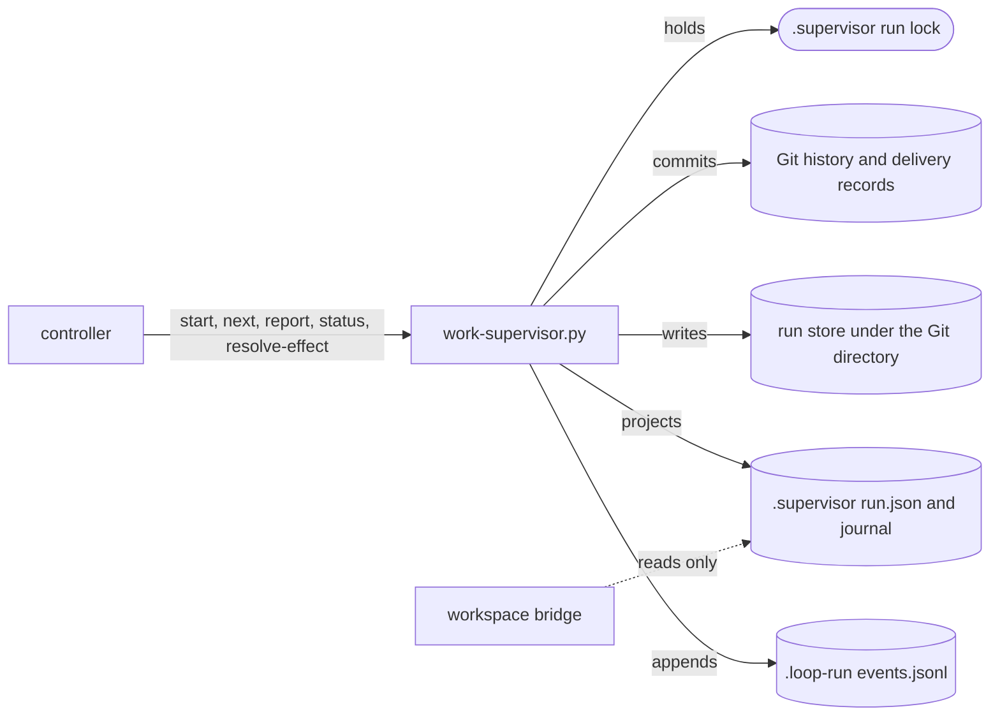
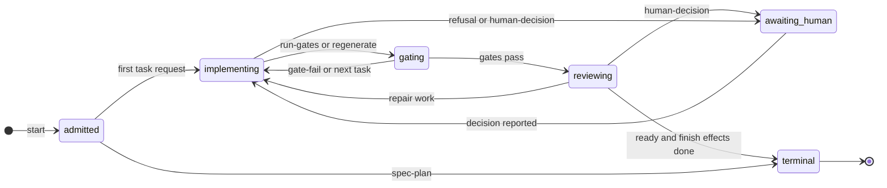
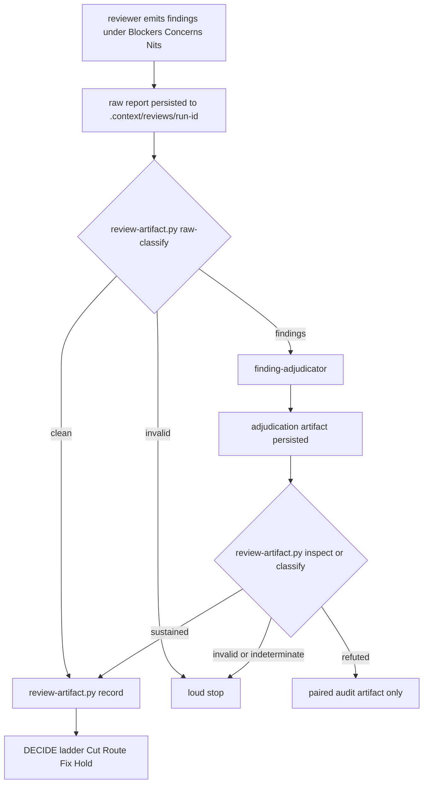

# Loop infrastructure

## 1. Purpose and boundary

The execution supervisor runs a full-mode `work-loop` delivery for one spec
directory. `work-supervisor.py` and its `_supervisor_*.py` siblings in
`packs/core/.apm/skills/work-loop/scripts/` are the only owner of full-mode
procedure: admission, task projection, ordering, dispatch, recovery, and
terminal handling ([ADR-0144](../adr/0144-work-loop-supervisor-owns-procedure.md)
D1). Core 4.0.0 replaced the phase engine and cohort writer with it.

The supervisor does not create requirements or implement work. It consumes an
approved spec and plan, issues one typed request at a time to the controller,
and commits what the controller reports. Light mode runs no supervisor
([ADR-0014](../adr/0014-rigor-scales-with-risk-work-loop-modes.md)).

The boundary splits by **policy versus mechanism** rather than by topic.
`work-loop` decides when light or full mode applies, whether a simplify pass
runs, and how a session manages its context. Which reviewer roles a change
warrants is data in `work-loop/review-rules.json`, and caps and authority roles
are data in `work-loop/supervisor-policy.json`. The supervisor owns the
machinery that reads them. This page does not restate either file, because a
second copy would be falsified by the next edit with nothing comparing the two.

### Sibling loops, and why only this one has a supervisor script

`work-loop` is one of three loops, not the whole of the lifecycle.
`discovery-loop` sits upstream in `product-engineering` and `release-loop`
downstream in `release-engineering`, each run by its own supervisor agent —
`discovery-lead` and `release-lead` — that is a **peer** of `work-loop`'s
controller rather than a mode of it. They meet at numbered gates: discovery
hands off at **G3**, and the build hands off to release at **G4**, the point
where the build is locally done and deploy-ready.
[The three loops](../../guides/_shared/explanation/the-operating-model.md) is the
guide that reconciles the numbering across all three.

Neither sibling has a procedure script. `discovery-loop`'s transitions are file
edits on a typed sidecar; `release-loop` ships no executable engine. Both still
have an orchestrating agent and both keep state on disk; what neither has is a
program that advances it. Everything on this page — the supervisor, its
records, its run lock — is `work-loop`'s alone. They also differ in install
scope: discovery ships at user scope, while build and release are repo-scoped.

## 2. Entrypoints

- `work-supervisor.py`, full mode only. Every verb prints one JSON object.
  - `start <spec-dir> --intent code|spec-plan --code-trust trusted|untrusted
    --authority-ref owner[:<hex>] --review-authority-ref plan-reviewer[:<hex>]`
    admits the approved pair.
  - `next <spec-dir>` derives and prints the current request.
  - `report <spec-dir> <result.json>` admits that request's result and commits
    it.
  - `status <spec-dir> [--json] [--check]` shows the run.
  - `resolve-effect <spec-dir> --operation <key> --decision
    effect-confirmed|do-not-retry|retry-authorized --authority-ref
    effect-authority[:<hex>]` records a named human's effect decision.
- `review-artifact.py`: `validate`, `classify`, `raw-classify`, `inspect`, and
  `record`. Light mode and pre-approval review use these verbs. Full-mode code
  review does not decide closure through them (§ 5).
- `check-spec-status.py`: validates a requested status in `spec.md` or
  `plan.md`.

Exit codes are shared across supervisor verbs: 0 success, 1 refusal, 2 usage
error. `status --check` exits 3 when the implementation retry cap is reached on
a non-terminal run, and 3 takes precedence over 1. A refusal prints
`{"refusal": {"code", "owner", "detail"}}`.

### How these scripts are invoked

`<skill-dir>` is the installer- or harness-supplied directory holding the active
`SKILL.md`. It is not a fixed repository path — an adopter's install location
differs from this repository's, and a harness may supply its own. So every
invocation resolves it and passes the script as one quoted argument from the
repository root:

```
python '<skill-dir>/scripts/work-supervisor.py' next docs/specs/<feature>
python '<skill-dir>/scripts/lint-spec-status.py' --root .
```

A bare-relative `python scripts/work-supervisor.py` is rejected by the
work-loop evaluation contract, because it silently resolves against the
caller's working directory rather than the installed skill.

The supervisor runs on the Python standard library alone and loads only its
sibling scripts, by path, on every platform full mode supports, Windows
included. It never imports `tools/`, `packages/`, or another installed package
(ADR-0144 D2). Before loading any sibling, every verb hashes the installed
supervisor files and compares them with the digests the first admitted `start`
pinned; a difference refuses `supervisor-changed`.

These instructions are byte-identical across the generated Codex and Claude
projections; they are one source projected twice, not two copies to keep in
step.

### Three linters ship here, reached three different ways

A skill's `scripts/` directory is a first-class projecting surface, so
everything here reaches an adopter's tree. Three of these files are
linters — `lint-knowledge.py`, `lint-spec-status.py` and
`lint-traceability.py` — and the directory listing makes them look like peers.
They are not: each is reached by a different route, no route is discoverable
from the tree, and the routes disagree with the files' own headers in at least
one case.

Resolve the question per linter against the routes themselves — the shipped
`pre-pr.py` hook, the `work-loop` skill's finish-time checklist, other packs'
skills, and `tools/repo/build_gate_chain.py` for what this catalogue's CI
runs. Do not infer a linter's route from a sibling's, and do not infer it from
the linter's own module docstring.

Two facts do hold across all three. CI runs the **projected** copy rather than
the pack source. And none of it is a literal Makefile line, so grepping the
Makefile and finding nothing is not evidence that a linter is ungated.

## 3. Owned state and write authority

State falls into three classes. Only the first is authority.

| State | Location | Write authority | Readers |
| --- | --- | --- | --- |
| Committed delivery records | `docs/specs/<feature>/delivery/`: `approvals.jsonl`, `evidence.jsonl`, `review-selections.jsonl`, `review-decisions.jsonl`, `effect-resolutions.jsonl` | The supervisor, through its own commits | The supervisor, pre-PR hooks, the delivery fact feed |
| Supervisor commits | Git history on the working branch, one operation per commit | The supervisor | The supervisor, which re-derives completion from them |
| Run store | Under the Git directory: attempt manifests, issuance marks, pinned supervisor digests, the owed not-red confirmation | The supervisor | The supervisor (attempt-security trust root) |
| Local status | `<spec>/.supervisor/` (ignores itself in Git): `run.json`, advisory `journal.jsonl`, `security-events.jsonl`, the run lock | The supervisor | Workspace bridge, operators |
| Step events | `.loop-run/events.jsonl` (ephemeral) | The supervisor, sole producer | Workspace MCP, telemetry export |

Completion, red proof, the implementation retry count, and effect state are
derived from supervisor commits and `delivery/` records on every call. The
journal is never read for a decision, and deleting `.supervisor/` loses no
fact.

The controller — the agent following `SKILL.md` — is trusted. Worker attempts,
meaning implementer and reviewer subagents, are untrusted. A worker result that
changes a trusted file (the spec, its plan, the records it cites, or the
installed skill), Git control state, or committed `delivery/` records is
refused, and `HEAD` may move only by commits the supervisor made (ADR-0144
D11).

### Concurrency control

One exclusive run lock under `<spec>/.supervisor/` serialises every supervisor
verb for a spec, taken through `_statelock.py`
([ADR-0074](../adr/0074-the-work-loop-owns-its-state-lock.md)). Its timing is
policy data: a contender waits `run_lock_timeout_seconds`, the longest hold is
bounded by the red-proof budget, and a lock older than
`run_lock_stale_seconds` is stale. Admission refuses a policy file that breaks
`timeout < hold < stale`.

There is one writer and one lock, so no lock ordering exists to get wrong.



## 4. Dependencies and allowed edges

`work-supervisor.py` loads its siblings by path. Each has one job:

| Module | Owns |
| --- | --- |
| `_supervisor_admission.py` | The run's workspace, the approval pair, and `start` |
| `_supervisor_projector.py` | Plan grammar, task projection, and envelope references |
| `_supervisor_loop.py` | Deriving the current request, committing steps, recovery |
| `_supervisor_attempt.py` | The attempt manifest, the open-attempt check, and residue |
| `_supervisor_tdd.py` | The red-before-green guard and task attempts |
| `_supervisor_recovery.py` | Recovery after a stub result that is not red |
| `_supervisor_effects.py` | External effects that never repeat |
| `_supervisor_review.py` | Reviewer selection, the policy resolver, and review dispositions |
| `_supervisor_readiness.py` | Readiness derived from durable facts |
| `_supervisor_commit.py` | The Git port and commit builder |
| `_supervisor_git.py` | The one hardened helper every supervisor `git` call uses |
| `_supervisor_journal.py` | Local, deletable state and event projection |

The supervisor also consumes the acceptance, evidence, content-safety, and
structured-review modules that ship beside it (`_acceptance.py`,
`_evidence_store.py`, `_content_safety.py`, `_review_*.py`) without redefining
their contracts. `check-spec-status.py` imports the canonical status parser
from `lint-spec-status.py`. No other script writes procedure state.

## 5. Primary flows

1. `start` checks that the spec is `Approved` or `Implementing`, the plan is
   `Approved` or `Executing`, and `--intent` matches `## Terminal Intent`. It
   commits one `delivery/approvals.jsonl` line holding an `approval-record.v1`
   and an `initial-plan-review.v1`. That line binds the reviewed-execution
   envelope fingerprint, terminal intent, code-trust classification, run id,
   and both authority references.
2. `next` derives the current request from committed facts. It first commits
   any pending controller edit to the spec, plan, or cited records as one
   `replan` step. It then picks, in order: the retry cap, the first incomplete
   task, open effects of completed tasks, gates and review, finish effects,
   then terminal.
3. The controller executes the request — itself, or through a worker
   subagent — and writes an `execution-result.v1`.
4. `report` re-derives, refuses a result that is not for the current request,
   and otherwise commits it through the builder.
5. Steps 2 to 4 repeat until readiness holds and the run reaches `terminal`.

Under `spec-plan` intent the run makes exactly two commits, `approval` then
`terminal`, and issues no request (ADR-0144 D4).

**Request kinds** form a closed set: `implement-task`, `write-stub`,
`run-gates`, `review-role`, `assess-finding`, `external-effect`,
`effect-query`, `regenerate`, and `human-decision`.

**Step kinds.** Each supervisor commit carries exactly one operation and emits
one event: `approval`, `replan`, `stub`, `red`, `implement`, `evidence`,
`gate-fail`, `review`, `effect-intent`, `effect-dispatch`, `effect-receipt`,
`claim`, `resolution`, or `terminal`.

### The stage set

`run.json`'s `stage` follows the current request. The human waits only in
`awaiting-human`; every other stage is agent work.



`awaiting_human` in the diagram is the `awaiting-human` stage. `write-stub`,
`external-effect`, and `effect-query` requests run in `implementing`;
`review-role` and `assess-finding` run in `reviewing`.

### Review closure

Full-mode code review closes only on structured review readiness: every
selected obligation has a current typed `review-report.v1`, every finding has a
current actual-failure assessment, and every supported finding is disposed
(ADR-0144 D8). `review-rules.json` decides which roles are selected. A new
reviewer joins through one entry there and a typed report, with no change to
skill procedure or supervisor code.

Light mode and pre-approval review keep the report classifier on
`review-artifact.py`:



Each recorded round becomes one artifact,
`.context/reviews/<run-id>/<round>-record.md`, so the next round and the review
budget read from artifacts alone.

The adjudicator may **lower** a reviewer's severity and may not raise it. Its
fifth predicate is what lowers a consequence to advisory: a defect nothing
external establishes, or a citation whose every surface the target marks as
working material rather than contract. A disposition-changing severity conflict
returns `indeterminate` for owner direction. That test reads the defect, not
the remedy: a finding several defensible repairs could fix is still
established, and stays eligible for blocking severity.

That ceiling is honoured in practice. Across 2,062 adjudicator entries declaring
a consequence advisory, 98% sustained at Concern or Nit; per run, 13 of 15 runs
with at least 20 such entries were perfectly compliant.
[`review-loop-nonconvergence-survey.md`](../product/research/review-loop-nonconvergence-survey.md)
holds the re-labelling runs and what each established.

### TDD stub fence

The red test is written at EXECUTE. PLAN creates no repository test file; a
task's `Tests:` names the behavior, the boundary, and the verification mode
([ADR-0150](../adr/0150-tdd-red-test-is-written-at-execute-and-mechanism-lives-in-the-plan-design.md)).
For a supervisor TDD task, the controller writes the task's `stub` fence as a
task-start revision: after the previous request's result is reported, and
before the `next` that issues the task's first request
([ADR-0151](../adr/0151-post-lock-routes-for-the-stub-fence-and-implementation-discovered-means.md)
D1). The supervisor commits it as a `replan`, issues `write-stub`, and
observes the exact stub bytes fail before it admits any production change for
the task (ADR-0144 D5). A fence written by a worker attempt is refused.

When the stub is not red, the `stub-not-red` refusal closes that `write-stub`
attempt with nothing from it committed. The next trusted-file change then opens
a `human-decision` carrying the diff and a digest of its exact bytes. It
commits as a `replan` only when a named human confirms it and the bytes still
match (ADR-0151 D3).

## 6. Failure and recovery behavior

A refusal writes no commit, ref, lease, journal line, event, or tracked file.
Its code and owner reach the controller through the verb's output and
`run.json`'s `refusal` field.

### Replanning after initial review

There is no whole-plan lock. The accepted `initial-plan-review.v1` is bound to
the reviewed-execution envelope: six protected references derived from the
spec — `spec_policy`, `scope_and_non_goals`, `authority_and_security`,
`public_contracts`, `durable_outputs`, and `accepted_risk` — plus the terminal
intent.

| Change after initial review | Route |
| --- | --- |
| Any edit that leaves every protected reference and the terminal intent unchanged: reorder, split, merge, replace, or delete tasks; change tests, stubs, effects, or the plan's `## Design (LLD)`; bookkeeping | Committed as one `replan` step with no approval; unintegrated attempts of superseded tasks cancel; completed work stays complete |
| An edit to a protected reference or the terminal intent | Refused; the refusal names the spec-amendment, decision, contract, risk, or plan-review owner |
| A plan edit while an attempt is open | That attempt is refused with `attempt-residue` |

So a controller plan edit is in-envelope only after the open request's result
is reported and before the next `next`. The grounding of an
`implementation-discovered` seam or design means, and each later correction,
is such an edit to the plan's `## Design (LLD)` (ADR-0151 D2). The
verification ledger keeps execution observations only.

### Re-derivation instead of replay

Every identity is derived from committed facts reachable from `HEAD`: a task is
complete when an `implement` commit exists for its current revision, and red
proof is a `stub` or `red` commit for its stub digest. Request ids are
deterministic, so `next` re-issues the current request until it is reported or
superseded. A crash at any point converges to the uninterrupted run's result,
and `next` repairs a lost or duplicated event line from the commits.

An external effect whose outcome the source cannot establish is never repeated
automatically. It waits for a named-human `effect-resolution.v1` decision
recorded through `resolve-effect`. An effect the source shows never happened
may be dispatched again, at most three times in all, before a human decides
(ADR-0144 D6).

A run whose durable state predates the supervisor is re-derived from the spec,
plan, Git history, evidence, and review facts. No compatibility reader exists,
and reversal is reinstalling the prior Core release (ADR-0144 D7).

## 7. Observability and evidence

`status --json` prints the run. `run.json` holds `run_id`, `active`, `stage`,
`gate_pending`, `gate_question`, and `refusal`; the workspace bridge reads it
and only displays it. A human answer reaches the supervisor only through the
supervisor's own `human-decision` request.

The supervisor is the only producer of `.loop-run/events.jsonl`. It appends one
line per supervisor step in the unchanged `loop-run-event.schema.json`
envelope, with the step kind in `event`, and derives the lines from its own
commits so they stay crash-consistent (ADR-0144 D10). The bridge's tail,
filter, and reset rules are unchanged
([ADR-0064](../adr/0064-events-jsonl-as-fsm-event-source.md) D3, D4, D7).

Every writer-authority allow and denial is stored as a `security-event.v1`
line in `<spec>/.supervisor/security-events.jsonl`.

The pre-PR hooks run `work-supervisor.py status --check` for each spec holding
`delivery/approvals.jsonl` and fail on any non-zero exit.

The envelope's field set, its export posture, its configuration route and what
a backend can do with it are a cross-cutting concern: see
[telemetry](telemetry.md).

## 8. Mechanical invariants

- `start` admits only an `Approved` or `Implementing` spec with an `Approved`
  or `Executing` plan, and only authority references of the role its flag
  accepts.
- No production change for a stub-declaring task is admitted before the
  supervisor observed its current stub bytes fail.
- A refusal writes no tracked state.
- Only supervisor commits move `HEAD` during a run; a worker result touching a
  trusted file, Git control state, or `delivery/` records is refused.
- The implementation retry cap (5) and the effect dispatch cap (3) come from
  `supervisor-policy.json`; `status --check` exits 3 at the retry cap.
- A light-mode run invokes no `work-supervisor.py` command and creates no
  `<spec>/.supervisor/`.
- Deleting the journal, `run.json`, or `security-events.jsonl` neither reopens
  a closed attempt nor clears an owed not-red confirmation, because both live
  in the run store under the Git directory.

## 9. Relevant ADRs

Measured behaviour of the review loop — round depth, cap firings, repair-origin
rate, and what does and does not bound a loop — is recorded in
[the review-loop non-convergence survey](../product/research/review-loop-nonconvergence-survey.md).
Consult it before proposing a new bound; it records eleven mechanisms tested and
not shipped.

- [ADR-0144 — Work-loop supervisor owns procedure](../adr/0144-work-loop-supervisor-owns-procedure.md)
- [ADR-0151 — Post-lock routes for the stub fence and implementation-discovered means](../adr/0151-post-lock-routes-for-the-stub-fence-and-implementation-discovered-means.md)
- [ADR-0150 — The TDD red test is written at EXECUTE](../adr/0150-tdd-red-test-is-written-at-execute-and-mechanism-lives-in-the-plan-design.md)
- [ADR-0064 — Events JSONL as FSM event source](../adr/0064-events-jsonl-as-fsm-event-source.md) (D3, D4, D7 in force)
- [ADR-0074 — Work loop owns its state lock](../adr/0074-the-work-loop-owns-its-state-lock.md)
- [ADR-0014 — Rigor scales with risk](../adr/0014-rigor-scales-with-risk-work-loop-modes.md)
- [ADR-0061 — Loop infrastructure](../adr/0061-loop-infrastructure-phase-1.md) (superseded in part by ADR-0144)

## 10. Last verified against commit

This page describes the Core 4.0.0 switch state. It was verified against the
supervisor sources at `7dc7e9231` together with the removals the
[execution supervisor cutover](../specs/execution-supervisor-cutover/spec.md)
makes.
