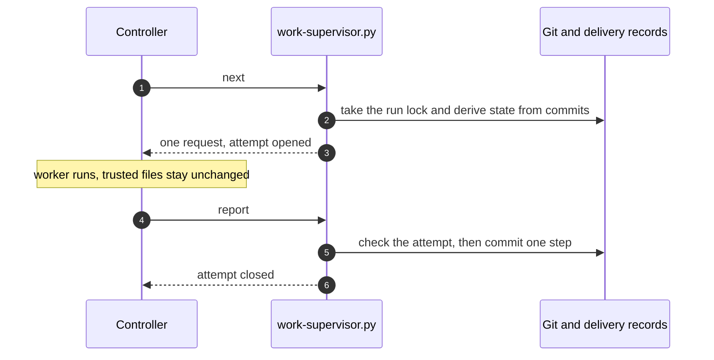

# Loop concurrency and plan width

**STATUS: § 1 implemented; §§ 2 and 3 planned for Slice 7.**

Full-mode `work-loop` runs one request at a time. The
[execution supervisor](work-loop-execution-supervisor.md) owns that procedure,
and nothing in Core dispatches two tasks at once. This page states what keeps
one run consistent today, what parallel work still waits on, and the plan-shape
facts that bound how much parallelism a plan could offer.

## 1. Concurrency inside one run today

The supervisor (`work-loop/scripts/work-supervisor.py` and its
`_supervisor_*.py` siblings) is the only writer of procedure state
([ADR-0144](../adr/0144-work-loop-supervisor-owns-procedure.md) D1). Four rules
keep a run consistent without waves or cohort state.

- **One request at a time.** `next` issues the first incomplete task whose
  dependencies are complete, and it issues a new attempt only after the current
  one is reported or superseded. Otherwise it re-issues the current attempt
  unchanged. A plan whose unfinished tasks all wait on each other refuses with
  `dependency-cycle`, owned by the plan author.
- **One run lock.** `start`, `next`, `report`, and `resolve-effect` take an
  exclusive lock under `<spec>/.supervisor/`; `status` reads without it. `supervisor-policy.json` sets its wait and
  stale windows. The stale window is longer than the red-proof budget, so a
  live holder is never judged dead.
- **An open attempt freezes trusted files.** While an attempt is open, any
  change to the spec, the plan, the records it cites, the installed skill, Git
  control state, or committed `delivery/` records refuses that attempt with
  `attempt-residue`. The supervisor page lists
  [which requests open an attempt](work-loop-execution-supervisor.md#attempts). A controller plan edit is therefore in-envelope only between
  a `report` and the next `next`
  ([ADR-0151](../adr/0151-post-lock-routes-for-the-stub-fence-and-implementation-discovered-means.md)).
- **Recovery re-derives from commits.** Each supervisor step is one Git commit
  carrying one operation. Completion, red proof, the retry count, and effect
  state are read back from those commits and the spec's `delivery/` records.
  The local journal and `run.json` are deletable caches, so a crash at any
  point converges to the uninterrupted run's result.

### Retired mechanisms

Where the earlier transition protocol, the cohort effect registry, and the
wave-decision screen went is recorded once, in
[authority migration](work-loop-authority-migration.md) and
[ADR-0144](../adr/0144-work-loop-supervisor-owns-procedure.md).

## 2. Parallel scheduling is Slice 7's

Plans declare dependencies and isolation, not waves. Turning that into
concurrent dispatch belongs to Slice 7 of the
[acceptance-centred work loop](acceptance-centered-work-loop.md), and three
things still hold dispatch sequential until it lands:

- [ADR-0061](../adr/0061-loop-infrastructure-phase-1.md) D5 still defers
  parallel orchestration. Lifting it needs a record that supersedes it in part.
- [ADR-0005](../adr/0005-supervisor-topological-default-and-write-gate.md) parallel-write gating is
  unchanged (ADR-0144 D9).
- The product result stays the execution-root worktree. Moving it to a
  protected ref belongs to
  [result integration](work-loop-result-integration.md).

Slice 7 also owns the reserved owner decision on what parallel admission
requires, recorded in
[authority migration](work-loop-authority-migration.md).

RFC-0015's 2026-09-25 erratum *"a measurement on nested worktrees"* records the
nested-worktree destruction path and binds no layout constraint, because doing
so would narrow ADR-0005 D7. A constraint requiring task worktrees to be peers
needs a record superseding ADR-0005 in part.

## 3. Plan width

How much a plan could run in parallel is a property of its `**Depends on:**`
graph. These levers are proposals for Slice 7's inputs; none is built.

**Two effects are easy to confuse.** `Depends on:` decides **scheduled width**:
which tasks could be ready together. `**Touches:**` decides **usable width**:
which of those could safely run together. A lever acts on one, never both.

**How the supervisor reads the fields today.** The task projector reads
`Depends on:` through the shared plan grammar in `_loop_guards.py`. Cross-spec
forms such as `spec:<slug>/T<n>` are recorded but never scheduled against.
`Touches:` is a pinned field: it is part of a task's revision, so editing it
re-requests that task. Nothing reads `Touches:` to decide order.

### Scheduled width

- **Report width during authoring.** An author sees a plan's shape only by
  reading it. A read-only width report, as a `new-spec` lint or a supervisor
  status field, is a change this design owes and has not specified.
- **Ask for a reason on each `Depends on:` edge.** The reason goes in the
  parenthetical the parser already drops at `(`, which the template allows
  today. An unparenthesised trailing reason is unsafe: a reason naming any
  `T<n>` invents an edge. `Depends on: none` need not carry one. This does not
  reverse RFC-0015's `Depends on:` grammar decision, whose axis is parser
  strictness. RFC-0015's 2026-09-25 erratum *"decision N is ambiguous"* records
  that the RFC numbers two lists and that a citation must name its own.

### Usable width

**Make `Touches:` mandatory.** This widens nothing. It makes a disjointness
check able to run at all, which today it cannot for most tasks. Completing the
field can also show overlap: RFC-0015 measured about 45% file overlap among
declared-independent tasks, so a mandate is expected to *narrow* usable width on
a large minority. A finding at authoring still beats a collision at merge. The
field stays a serialise-only input, never a write authority, because tasks
under-name what they touch.

| Contract | Owner | Proposed change |
| --- | --- | --- |
| `Touches:` optionality | `packs/core/.apm/skills/new-spec/assets/plan.md` | optional becomes required for new plans |
| Plan-authoring obligations | `packs/core/.apm/skills/new-spec/SKILL.md` | the width report becomes an authoring step |

No lever removes an edge automatically. A false "ordered" costs throughput; a
false "independent" ships a break.

## Open questions

| Question | Who decides |
| --- | --- |
| What a parallel batch does when one task fails — task or batch blast radius | Slice 7 owner |
| Whether the measured nesting hazard reopens RFC-0015 open question 2, whose substrate choice is already resolved as delegate-to-driver | RFC-0015 approver |
| Whether task-cutting guidance belongs in the plan template | `new-spec` owner |
| Where the read-only width report lives — a `new-spec` lint or a supervisor status field | `new-spec` owner |

## Evidence

Probes against this repository on git 2.50.1 on 2026-09-22, none recorded as a
re-runnable harness.

**Worktree topology.** All worktrees are peers on one common `.git`. One
worktree measured 89 MB over 6,521 files.

**Dependency shape**, over 392 plans and 2,543 tasks: 1,083 tasks declare exactly
one dependency; 681 of those (62.9%) name the immediately preceding task in
authoring order, which is 26.8% of all tasks; 1,438 (56.5%) declare no
`Touches:`. These are historical plans, so the figures measure authoring habit.

**Graph width**, over the 359 plans carrying a complete dependency declaration.
Width is the most tasks that could be ready at once.

| | actual | if previous-task edges dropped |
| --- | ---: | ---: |
| median maximum width | 2 | 3 |
| median depth | 4 | 3 |
| plans that cannot parallelise at all | 23.7% | 0.8% |
| plans whose width would increase | — | 65.2% |

The second column is a ceiling, not a forecast: it assumes every previous-task
edge inside these 359 plans is spurious, and some are genuinely sequential work
written in order. The two cases produce identical text.
