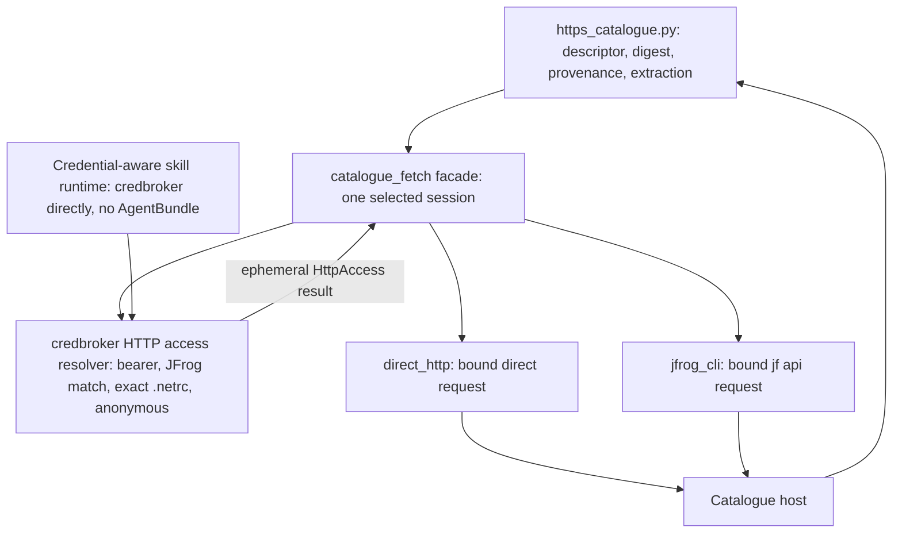
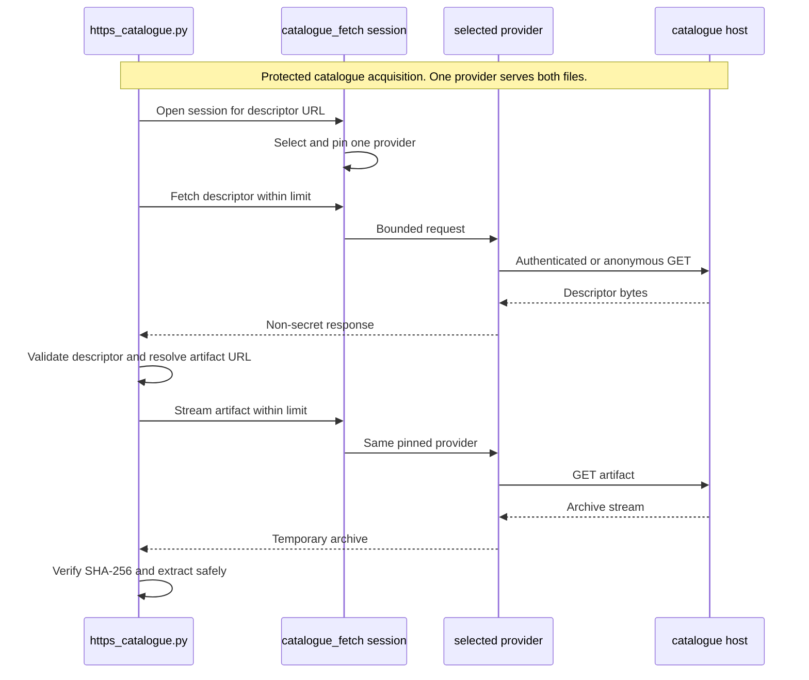
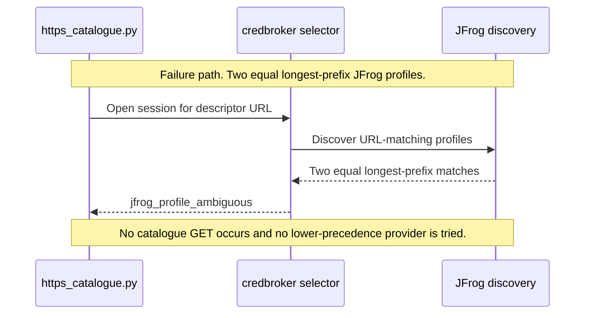

# Portable Catalogue Authentication

How `agentbundle` authenticates to a remote catalogue, and where each part of
that work lives. A remote catalogue is a `catalogue+https://` or
`archive+https://` source. `agentbundle` reaches a protected one with
credentials the user already manages: an exact-host `.netrc` entry or a matching
JFrog CLI profile.

The explicit bearer token override wins over both.

**Status:** Implemented. Governing decisions:
[ADR-0135](../adr/0135-catalogue-auth-resolves-through-credbroker.md),
[ADR-0136](../adr/0136-catalogue-netrc-uses-exact-machine-matches.md),
[ADR-0137](../adr/0137-catalogue-jfrog-auth-delegates-to-jfrog-cli.md), and
[ADR-0138](../adr/0138-catalogue-auth-selects-one-provider-without-fallback.md).

**Related:** [AgentBundle design](../../packages/agentbundle/DESIGN.md),
especially [catalogue capability](../../packages/agentbundle/DESIGN.md#2-catalogue-capability),
[distribution mechanisms](../../packages/agentbundle/DESIGN.md#distribution-mechanisms),
and [Artifactory enterprise distribution](../../packages/agentbundle/DESIGN.md#artifactory-enterprise-distribution).
[Credentials and trust boundaries](credentials.md) owns the credential
boundary this page works within.

## 1. Scope

| Concern | Owner |
| --- | --- |
| Choosing credentials for a target URL | `credbroker.resolve_http_access` in [`_http_access.py`](../../packages/credbroker/credbroker/_http_access.py) |
| Bounded network acquisition from the chosen credentials | [`agentbundle/catalogue_fetch/`](../../packages/agentbundle/agentbundle/catalogue_fetch/): the facade and error type in `__init__.py` and `models.py`, the direct provider in `direct_http.py`, the JFrog provider in `jfrog_cli.py` |
| Descriptor validation, artifact URL choice, digest check, safe extraction | [`https_catalogue.py`](../../packages/agentbundle/agentbundle/https_catalogue.py) |
| Catalogue source precedence and URI forms | [Catalogue resolution](catalogue/README.md#resolution) |
| Required `credbroker` dependency | `packages/agentbundle/pyproject.toml` |
| Credential-boundary test | `packages/agentbundle/tests/contracts/test_catalogue_fetch_credential_boundary.py` |
| Resolver tests | `packages/credbroker/tests/unit/test_http_access*.py` |
| Publisher CI upload identities (`ARTIFACTORY_USER`, `ARTIFACTORY_TOKEN`) | The CI secret store, a separate trust boundary |

`catalogue.toml` may hold non-secret Artifactory publication coordinates, and
an organization may distribute a non-secret `catalogue+https://` source through
install defaults. Consumer usernames, passwords, and tokens never appear in
`catalogue.toml`, AgentBundle config, install state, logs, or provenance.
`agentbundle` stores no token and copies nothing from user-owned tools.

Browser SSO, interactive login, generic helper commands, and a public
provider-plugin API do not exist.

## 2. Structure

```text
packages/agentbundle/agentbundle/
├── catalogue_fetch/
│   ├── __init__.py       # fetch-session facade: open_fetch_session, FetchSession
│   ├── models.py         # CatalogueFetchError and its closed code set
│   ├── direct_http.py    # bound bearer, Basic, and anonymous HTTPS
│   └── jfrog_cli.py      # bounded `jf api` execution
└── https_catalogue.py    # descriptor, digest, provenance, and extraction

packages/credbroker/credbroker/
├── __init__.py           # public `resolve_http_access` export
└── _http_access.py       # selection, .netrc, and JFrog profile discovery
```



The facade accepts a validated HTTPS URL, a byte limit, a timeout, and an output
mode. It returns bytes or a fully written temporary file plus non-secret
response metadata. It never returns credential material.

Providers own authentication and network mechanics. They do not parse
descriptors, choose artifact URLs, verify digests, or extract archives.
`https_catalogue.py` owns the descriptor-to-artifact step and gives the same
session both URLs, so the artifact fetch cannot start a new provider search or
change credential mechanism mid-install.

`credbroker.resolve_http_access` reads the environment, parses `.netrc`,
discovers JFrog profiles, selects one provider, and returns an ephemeral typed
result (`BearerHttpAccess`, `NetrcHttpAccess`, `JfrogCliHttpAccess`, or
`AnonymousHttpAccess`). The result goes back to the facade and never calls into
AgentBundle. It carries a non-secret provider class and target binding, plus
one of:

- derived in-process Authorization bytes for a direct request;
- pinned non-secret JFrog server and URL fields; or
- no authentication, for anonymous access.

The direct provider never opens `.netrc`, never reads the bearer variable, and
never receives a raw username, password, or token. The JFrog provider receives
no credential, only the pinned fields it needs to run `jf api`.

`agentbundle` declares `credbroker>=0.7,<0.8` and imports only public
`credbroker` names, and only from the catalogue-fetch modules. `credbroker`
does not depend on `agentbundle`. Credential-aware skills import `credbroker`
directly, and ordinary skills import neither package.

AgentBundle's
package-manager environment and the credential-brokers pack's user-library
floor are separate deployment paths. When both exist in one Python
environment, Python prefers the `site-packages` distribution.

## 3. Provider selection

Selection runs once per acquisition, highest precedence first, first match wins:

1. `AGENTBUNDLE_HTTP_BEARER_TOKEN`, the explicit compatibility override.
2. One URL-matching JFrog CLI profile.
3. One exact-machine `.netrc` record.
4. Anonymous HTTPS.

An HTTP 401 or 403, a subprocess failure, a timeout, or any other retrieval
error from the selected provider is terminal. No lower-precedence provider is
tried.

A provider is **unavailable**, and selection moves on, when:

- the bearer variable is absent;
- `jf` is absent and `JFROG_CLI_SERVER_ID` is unset;
- JFrog discovery succeeds with no match; or
- `.netrc` is absent or has no exact match.

A provider is **configured but broken**, and selection fails closed, when:

- `jf` is absent and `JFROG_CLI_SERVER_ID` is set;
- discovery output is malformed;
- two profiles tie, or an explicit server ID does not match;
- `.netrc` is unreadable or insecure; or
- the JFrog CLI is below the minimum version.

Both authenticated providers apply to `catalogue+https://` and standalone
`archive+https://`. The source fragment that pins an archive digest is removed
before selection and is never sent to a server or subprocess.





## 4. Direct HTTP provider

The direct provider ([`direct_http.py`](../../packages/agentbundle/agentbundle/catalogue_fetch/direct_http.py))
is HTTPS-only and honors proxy and CA-bundle settings. Its
`_DirectHttpRedirectHandler` allows same-origin HTTPS redirects and forwards
Authorization on them. It rejects cross-origin redirects, scheme downgrades,
and redirect URLs with user-info before any request reaches the redirect
target.

Bearer authorization stays locked to the origin of the original request
for both source forms.

For `.netrc`, `credbroker` follows Python's
[standard user-file and POSIX permission contract](https://docs.python.org/3.13/library/netrc.html).
It reads the exact machine map, checks `host:port` first for a non-default port
and then `host`, and ignores the ambient `default` record. A match must supply
a login and a password.

`credbroker` builds an ephemeral HTTP Basic value
in-process for the bound direct provider. Neither the inputs nor the derived
value reach a URL, argument, state file, provenance field, log, or diagnostic.
A `.netrc` file over 1 MiB is refused.

## 5. JFrog CLI provider

**Discovery.** `credbroker` runs
[`jf config show --format=json`](https://docs.jfrog.com/integrations/docs/jf-config-show)
without a shell. Output is size-limited, and unmasked credentials are never
requested.

After bounded JSON parsing, `credbroker` keeps only `serverId`,
platform `url`, `artifactoryUrl`, and `isDefault`, and discards every other
field at once.

**Matching.** A profile matches when its normalized `artifactoryUrl` is an
origin-equal, path-segment-aligned prefix of the initial fetch URL. The longest
base path wins.

Equal longest matches are ambiguous unless the user-local
`JFROG_CLI_SERVER_ID` names one of them.

**Topology.** A profile is eligible only when its normalized `artifactoryUrl`
is an origin-equal, path-segment-aligned descendant of its normalized
`platformUrl`. A matching profile that fails this check ends selection with
`unsupported_jfrog_topology`.

**Pinning.** The session pins `{serverId, platformUrl, artifactoryUrl}`. The
named server must still URL-match.

AgentBundle persists neither the ID nor
profile data.

**Endpoint confinement.** Before each JFrog invocation, the descriptor or
artifact URL must remain an origin-equal, segment-aligned descendant of the
pinned `artifactoryUrl`. `credbroker` validates the initial target during
resolution, and AgentBundle revalidates each fetch URL before endpoint
conversion.

These are rejected: user-info, query, fragment, literal and encoded
dot segments, encoded path separators, backslashes, and decoded control
characters. The
[`jf api` contract](https://docs.jfrog.com/integrations/docs/use-api-endpoints-via-cli)
prepends the configured platform base, so AgentBundle derives the CLI endpoint
relative to the pinned `platformUrl`. The stricter `artifactoryUrl` check stays
the authorization boundary.

**Invocation.**

- The endpoint and server ID go in an argument vector, never a shell string.
- The process receives no credential, no credential-bearing URL, and no
  unrelated full URL. Standard input is closed.
- The child environment comes from a closed allowlist: `PATH` and `HOME` on
  POSIX, a Windows set on Windows, and `SSL_CERT_FILE` and `SSL_CERT_DIR` on both.
- `jf api` ignores the CLI's own trust store and, on Linux, reads trust anchors
  from those two Go variables, so a corporate CA reaches the delegated leg through
  them. On macOS `jf api` trusts only the system keychain, which is a stated
  residual. Both variables hold file paths, not secrets.
- A session runs at most two `jf api` processes, one per fetch.

**Version.** After a profile matches, `credbroker` runs `jf --version` with
closed standard input, an 8 KiB cap on each of stdout and stderr, and a 5-second
timeout. A version below 2.105.0 fails as `incompatible_jfrog_cli`.

JFrog
documents `jf api` from
[2.100.0](https://docs.jfrog.com/integrations/docs/use-api-endpoints-via-cli)
and the required [`--format` output option from 2.105.0](https://docs.jfrog.com/integrations/docs/jfrog-cli-command-reference),
so the combined discovery and fetch contract needs 2.105.0 or later.

**Delegation.** The JFrog CLI owns configured authentication, token refresh,
proxy behavior, and redirect handling. AgentBundle constrains the server and
endpoint, but it cannot apply the direct provider's per-redirect hook inside
another process.

**Output limits.** Descriptor stdout is capped at 1 MiB plus one byte. Archive
stdout streams to a temporary file capped at 256 MiB plus one byte.

The extra
byte allows for the trailing `0x0a` that `jf api` appends when the body does not
already end in it. Output at exactly the cap plus one is accepted only if its
last byte is `0x0a`, and that byte is then removed, so no more than the cap
reaches parsing, digest checking, or extraction. For archives,
`_verify_jfrog_archive_sha256` accepts either the exact bytes or the bytes
trimmed by one `0x0a`, and truncates the file to the verified candidate before
extraction.

Stderr is capped at 64 KiB per subprocess and never appears in
diagnostics.

## 6. Limits and failure codes

| Limit | Value |
| --- | --- |
| Descriptor | 1 MiB |
| Archive | 256 MiB |
| Direct HTTP socket timeout | 30 seconds per fetch, an inactivity bound and not a total deadline |
| JFrog discovery | 10 seconds, 1 MiB stdout, 64 KiB stderr |
| JFrog version probe | 5 seconds, 8 KiB per stream |
| Each `jf api` fetch | 30 seconds, at most two per session |
| Aggregate subprocess budget | 75 seconds: 10 + 5 + 30 + 30 |

Expiry terminates the process, waits for cleanup, and removes partial output.
The complete install has no front-door duration bound. Direct streaming can
stay active while data arrives, and digest checking and extraction are
size-bounded rather than time-bounded.

Work runs in one local AgentBundle
process with at most one JFrog subprocess at a time. No daemon or shared
service exists.

Failures carry a stable code from a closed set and never carry input values.
`credbroker` raises `HttpAccessError` with a provider class (`target`,
`bearer`, `jfrog`, or `netrc`) and one of these codes:

- Bearer and target: `invalid_bearer`, `invalid_target_host`.
- JFrog discovery: `jfrog_discovery_failed`, `jfrog_discovery_timeout`,
  `jfrog_discovery_too_large`, `jfrog_discovery_malformed`.
- JFrog matching and topology: `jfrog_profile_ambiguous`,
  `jfrog_profile_mismatch`, `unsupported_jfrog_topology`.
- JFrog CLI: `incompatible_jfrog_cli`, `jfrog_probe_too_large`,
  `jfrog_probe_timeout`, `jfrog_probe_failed`, `jfrog_cli_not_executable`.
- `.netrc`: `netrc_unreadable`, `netrc_unsafe`, `netrc_malformed`,
  `netrc_incomplete`.

`agentbundle` raises `CatalogueFetchError`, a `CatalogueError` subclass, with one
of: `jfrog_fetch_stderr_too_large`, `descriptor_too_large`,
`archive_too_large`, `jfrog_fetch_timeout`, `jfrog_fetch_failed`,
`redirect_not_permitted`, `endpoint_not_permitted`.

Diagnostics may name the non-secret provider class (`bearer`, `jfrog`,
`.netrc`, or `anonymous`) and a failure code. They never include a JFrog server
ID, authorization values, `.netrc` fields, usernames, discovery payloads,
credential-bearing URLs, or unbounded stderr.

## 7. Invariants

| Invariant | Enforcement |
| --- | --- |
| Consumer credentials are user-owned. None appears in catalogue config, AgentBundle config, state, provenance, or docs | Schema and config negative tests, secret-pattern checks |
| `agentbundle` reads no credential source. It imports only the public `credbroker` API, depends on `credbroker>=0.7,<0.8`, and only `jfrog_cli.py` builds a `jf api` command | [`test_catalogue_fetch_credential_boundary.py`](../../packages/agentbundle/tests/contracts/test_catalogue_fetch_credential_boundary.py) checks the packaged source by AST |
| Derived Authorization bytes travel only in the in-process typed result, never in a URL, argument, persistent state, log, or diagnostic | Same test, plus `credbroker` secret-canary tests |
| Skills do not depend on `agentbundle`. Credential-aware skills import `credbroker` directly | [ADR-0003](../adr/0003-credential-broker-contract.md), [credentials](credentials.md#2-dependency-edges-run-one-way) |
| Provider precedence is closed. One provider serves both descriptor and artifact, and a retrieval error is never retried on another provider | `credbroker` unit tests `test_http_access*.py` under `packages/credbroker/tests/unit/` |
| `.netrc` matching is exact: `host:port`, then `host`, never `default` | `test_http_access_netrc.py` |
| JFrog profile binding, topology, endpoint confinement, and minimum CLI version | `test_http_access_jfrog.py` and `test_http_access_version.py` |
| Descriptor, digest, provenance, and extraction stay in `https_catalogue.py` | Import-boundary assertions and the HTTPS catalogue suites |

`agentbundle` adds no consumer `ARTIFACTORY_USER` or `ARTIFACTORY_TOKEN`
setting. Those names stay in publisher CI. Users may already hold a standard
`.netrc` record or a JFrog profile from their organization's login flow.

AgentBundle re-reads those local settings on every run.

## 8. State

No AgentBundle state holds a catalogue credential. AgentBundle config, install
state, and `catalogue.toml` carry none. `.netrc` and JFrog profiles are external
files that AgentBundle reads and never creates, edits, imports, or deletes.

AgentBundle does not persist a provider choice or a server ID.
