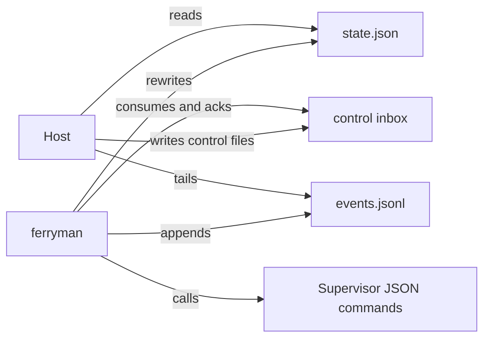
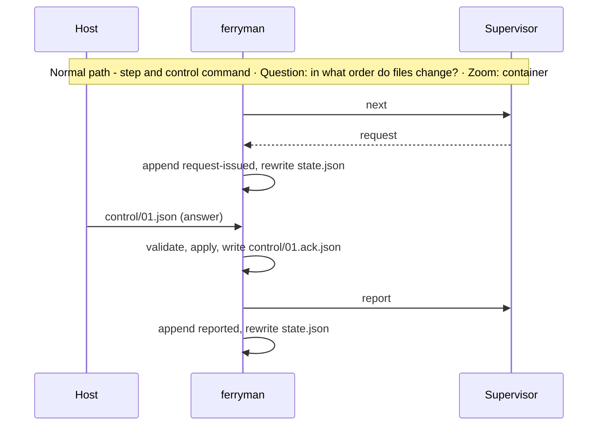
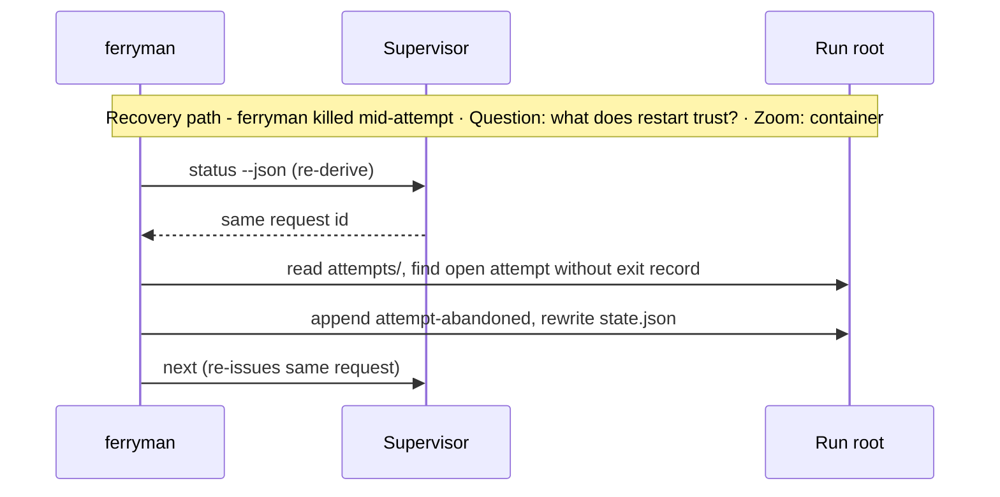

# Subsystem Design — Run contracts and data

**Decision sought:** Approve twelve versioned contracts under `contracts/ferryman/`, none naming a host product, and the run-root files that carry them.

Any host can read run state and send commands if the contracts stay neutral, for three reasons:

- One writer per file means no lock.
- Projection files can be deleted without loss, and recovery records (`scribe/` and open `attempts/`) are kept while open.
- A reader refuses an unknown version, so a mismatch is loud.

**Author(s):** Repository owner (draft)
**Status:** Draft
**Last updated:** 2026-11-07
**Reviewers:** Repository maintainers, host owners

Part of the [set index](README.md).

## 1. Scope and Context

The contracts own shapes and versions, and neighbours own meaning and rendering.

| In scope | Out of scope | Why |
| --- | --- | --- |
| Schema, version, and compatibility of the twelve contracts | Meaning of a supervisor request kind | `contracts/delivery/execution-request.v1.schema.json` owns it; `ferryman` passes it through |
| Run-root file layout hosts read and write | How a host renders state | [Page 07](07-host-and-ui-seam.md) |
| Local state files and their lifecycle | Committed supervisor ledgers | [Page 05](05-supervisors-and-gates.md) |

**Goals**
- A host that reads only `run-state.v1` and `run-event.v1` shows run, stage, parked gates, and the current request, proved by a fixture conformance test.
- No file under `contracts/ferryman/` contains the name Studio, VelaTerm, Orca, tmux, Claude, Codex, or Cursor. A test greps for them.
- A reader refuses an unknown `schema_version` with a named code, tested with a future version of each contract.

**Non-goals**
- Not a transport: files only, no socket or port, per [ADR-0062](../../adr/0062-workspace-mcp-per-session-only-constraint.md).

*Question: who reads and writes each contract file? Zoom: container.*



## 2. Structural Model

Twelve contracts and one run root make up the model.

| Element | Type | Responsibility | Zoom |
| --- | --- | --- | --- |
| `run-state.v1` | contract and file | One run's projection: `route` (`supervisor` or `session`), supervisor (null on a session run), subject, stage, current request, parked gates, worker status (executor, handle, lease, node, `enforcement`), refusal | container |
| `run-event.v1` | contract and file | One append-only line per ferryman step, with a rising `seq` and a source tag | container |
| `run-control.v1` | contract and files | Closed host commands: `answer`, `signal`, `pause`, `resume`, `stop`, `retry-worker`, `attach-done` | container |
| `frontier.v1` | contract | One read-only answer: next work, decision, optional waves, and the `light_candidates` list ([04](04-frontier-and-waves.md)) | container |
| `supervisor-manifest.v1` | contract, core-owned, consumed by `ferryman` | A supervisor's id, subject kind, commands, request kinds with worker mode, delegations | container |
| `tracker-adapter.v1` | contract | Commands a tracker shim exposes ([06](06-tracker-integration-and-authority.md)) | container |
| `approval-attribution.v1` | contract and committed record | Who approved or rejected a gate, by which channel, with which evidence | container |
| `approval-fields.v1` | contract | Two lists the guard reads: approval-bearing fields, and protected paths (the trusted configuration set, [05b](05b-approval-integrity-and-trusted-configuration.md)) | container |
| `launch.v1` | contract | A pool launch file: subject, the subject claim, expected digests (protected and executed paths), the digest of the allowed-signers file (the file itself is provisioned through TB5 on [page 11](11-remote-agent-pool-seams.md), its one home), `profile_digests` (the user config and each named profile, which the control plane provisions), `expected_checkpoint`, epoch, the `.git/config` template digest, budget (`max_tokens`, `max_cost`, `max_wall_seconds`, tokens the primary unit), `trace_id`, `mode`, probe-record digest (compared as [page 12](12-pool-state-integrity-and-signals.md) states), `grant` (the control plane's run-grant values, the D34 pool facet), `data_policy_ref`, and package and image integrity (the distribution file-hash record digest plus the pinned agent CLI binaries; the control plane is the one verifier, D73) | container |
| `checkpoint-manifest.v1` | contract | One checkpoint: sequence, epoch, `node_id`, a copy of consumed `(key_id, nonce)` pairs and command ids, retry counters per request id, cumulative usage, store digest, `attempts/` digest | container |
| `remote-transport.v1` | contract | The four remote worker commands, the pool agent-sandbox attestation that `spawn` returns, and the sidecar's forwarding cursor | container |
| `ferryman-config.v1` | contract | Repository-owned settings in `ferryman.toml` | container |
| Run root `<git-dir>/ferryman/runs/<run-id>/` | directory | `state.json`, `events.jsonl`, `control/`, `attempts/`, `scribe/` | container |

| From | To | Nature | Protocol |
| --- | --- | --- | --- |
| Ferryman | `state.json` | owns, atomic rewrite | temp file, then rename |
| Ferryman | `events.jsonl` | appends one JSON object per line | `O_APPEND` write |
| Host | `control/<id>.json` | creates once | temp file, then rename |
| Ferryman | `control/<id>.ack.json` | creates once | temp file, then rename |

The run root sits under the Git directory, beside the supervisor store `agentbundle-supervisor`, and a linked worktree resolves `--absolute-git-dir` to its own directory, so its run root is per worktree.[^1]

Every `run-event.v1` line also carries `epoch`, `node_id`, `attempt_id`, `checkpoint_seq`, and `trace_id`, and events order by `(epoch, seq)`. A `terminal` event carries `head_sha`, `checkpoint_seq`, `epoch`, and `base`.

`run-control.v1` `answer` carries `gate`, its digest, `decision` (`approve`, `reject`, or `request-changes`), an `actor` claim, and an optional `note`.

A `signal` command carries a tracker evidence bundle ([page 11](11-remote-agent-pool-seams.md) owns the signature, [page 12](12-pool-state-integrity-and-signals.md) the signal). The note is untrusted text.

`ferryman-config.v1` keys, all in `ferryman.toml`:

| Table and key | Type | Default | Owning page |
| --- | --- | --- | --- |
| `[ordering] mode`, `list`, `kind_order` | string, list, list | `ask`, empty, finish-before-start | [04](04-frontier-and-waves.md) |
| `[workers.<role>] profile`, `independent_of` | string, string | none | [03](03-ferryman-runtime.md) |
| `[limits] max_respawns`, `wall_seconds`, `poll_interval_ms`, `control_retention_hours` | int | 2, 3600, 1000, 72 | [03](03-ferryman-runtime.md) |
| `[adapters] skill_home.<adapter>` | path | none | [02](02-install-trust-and-detection.md) |
| `[gates.<gate>] accept`, `approvers` | list of levels, list of role refs | `accept = ["session-attested"]`, empty | [05b](05b-approval-integrity-and-trusted-configuration.md) |
| `[authority] owner_ref`, `plan_reviewer_ref` | string | none | [05b](05b-approval-integrity-and-trusted-configuration.md) |
| `prompt_timeout_seconds` | int | 900 | [05b](05b-approval-integrity-and-trusted-configuration.md) |
| `schema_version` | string | `"1"` | [01](01-contracts-and-data.md) |
| `[intake] allow`, `destination`, `authority_mode`, `processor`, `max_per_day` | bool, path, string, string, int | `allow = false` | [05](05-supervisors-and-gates.md) |
| `[identities.<role-ref>] tracker_ids`, `logins`, `git_emails`, `control_plane_subjects` | list, list, list, list of issuer and subject | none | [06](06-tracker-integration-and-authority.md) |
| `[tracker] adapter`, `locator`, `labels`, `shapers`, `poll_interval_s`, `max_requests_per_hour`, `mode` (`direct` or `relayed`) | mixed | `direct`, 60, 1000 | [06](06-tracker-integration-and-authority.md) |
| `[frontier] light_label` | string | `light` | [04](04-frontier-and-waves.md) |
| `[control] require_signature` | bool | `false` | [11](11-remote-agent-pool-seams.md) |
| `[pool] principals` (read only when `mode = pool`) | list | empty | [11](11-remote-agent-pool-seams.md) |
| `[checkpoint] enabled`, `remote` (single machine only; a pool node configured with one is refused `pool-config-incomplete`) | bool, string | `false` | [12](12-pool-state-integrity-and-signals.md) |
| `[claims] enabled`, `lease_seconds` (single machine only, pool claims do not expire) | bool, int | `false`, 900 | [12](12-pool-state-integrity-and-signals.md) |
| `[integrity] expected_digests_file` | path | none | [12](12-pool-state-integrity-and-signals.md) |

The defaults are design defaults, and `approvers` and `shapers` name role refs that resolve through `[identities]`.

## 3. Runtime Model

Files change in a fixed order, and a restart trusts the supervisor alone.

| Scenario | Trigger | Path |
| --- | --- | --- |
| Project a step | `report` commits | normal |
| Accept a control command | host drops a file | normal |
| Recover after a `ferryman` process crash | ferryman restarts | failure / recovery |
| Command written while no ferryman runs | host writes after exit 10 | failure / recovery: the file waits, the next `run` applies it first and emits `control-applied-late`, and a stale digest is refused |





Restart never reads `state.json` to decide, and a repeated `next` re-issues the same request id.[^2] [Page 03](03-ferryman-runtime.md) owns kill points.

## 4. Contracts and Invariants

Each contract has one writer, one compatibility rule, and one refusal.

| Semantic name | Parties | Inputs/outputs | Identity | Compatibility | Failure semantics | Invariant | Enforcement | Verification |
| --- | --- | --- | --- | --- | --- | --- | --- | --- |
| run-state.v1 | ferryman to host | JSON object | `run_id`, `supervisor_id` (null when `route` is `session`), `subject` | `route` and a nullable `supervisor_id` are minor-version changes. Optional fields in a minor version; remove or retype only in a new major | reader refuses unknown major with `unsupported-schema` | derived, never authoritative | writer validates before rename | fixture-run conformance test |
| run-event.v1 | ferryman to host | one JSON line | `seq` per run | same | a `seq` gap marks a lost line, readers resync from `state.json` | append-only | `O_APPEND`, single writer | truncated-file replay test |
| run-control.v1 | host to ferryman | command object: `id`, `command`, `actor` (display string, never an input to a decision), `args` (an `answer` carries a per-gate-kind `args.payload`: `intake-confirm` {destination, authority_mode}, human-decision {option}, discovery {verdict} from the enum), optional `key_id`, `sig`, `expires_at`. The canonical signed bytes are the fixed lines `ferryman-control-v1`, then `run_id`, `epoch`, `id`, `command`, `args_sha256` (the hash of the exact `args_json` bytes), `nonce`, `expires_at`, `actor_issuer`, `actor_subject`, `actor_kind`, `auth_method`, `authenticated_at`, and `session_id`, each as `name=value` ending in a newline. Verification runs `ssh-keygen -Y verify` with `-I` set to the committed control-plane principal (D68), never read from the control file | `id` is the idempotency key | closed command enum | unknown command acked `refused`; unparsable file moved to `control/rejected/`; a signed command whose actor lines differ from the control file is refused `signature-invalid` | an `answer` applies only if its digest matches the current gate, and a signed one only for the signed actor | schema plus digest check | stale-digest, replay, and actor-swapped tests |
| supervisor-manifest.v1 | supervisor to ferryman | TOML | `id` | additive; `manifest_version` bumps on change | ferryman refuses an unknown manifest or version | request kinds listed equal request kinds emitted | pack test per supervisor | pack tests |
| frontier.v1 | ferryman to caller | JSON | `item.ref` | additive | `ask` stays a decision, never an error | read-only | no write calls | determinism test |
| tracker-adapter.v1 | ferryman to shim | CLI commands, JSON | `ref`, an opaque string | additive | non-zero exit with a refusal object | `ferryman` passes no credential | argv allowlist | shim contract test |
| approval-attribution.v1 | scribe to repository | JSON line: `gate`, `artifact`, `digest`, `decision`, `actor`, `verification`, `channel`, `at`, optional `tracker` object | `approval_id` | additive | a record without verification evidence is invalid | one record per approval edit, same commit | scribe writes both or neither | commit-shape test |
| approval-fields.v1 | guard readers | `fields` and `protected_paths` lists | `fields_version` | additive; removal is a new major | reader refuses an unknown major | under `ferryman`, guard and sibling `report` read one list | both read the `new-spec` copy | drift test against `contracts/ferryman/` and `_data/` |
| launch.v1 | control plane to ferryman | TOML or JSON launch file | `trace_id` | additive | with `mode = pool`, `ferryman` refuses `pool-config-incomplete` unless all of these hold: `require_signature`, control-plane checkpointing, no node checkpoint remote or credential, a non-shallow clone, every role's profile has `kind = remote`, an expected-digest file, the subject claim, relayed tracker mode when a tracker is configured, gates that accept `control-plane-signed`, and a passing pool agent-sandbox attestation at each `spawn`. `ferryman` also forces `enforcement_required = true` in pool mode whatever a profile sets, so an `unenforced` worker refuses `enforcement-required`. This is the one list | the launch file is read before the first command | one read at start | pool corpus, one case per list item, including a local-kind profile |
| checkpoint-manifest.v1 | ferryman to control plane | JSON in the `store` ref, whose tree snapshots the whole supervisor directory, with `head_sha`, `product_sha`, and `terminal` on every manifest | `(epoch, sequence)` | additive | a restore rejects a set whose sequence or epoch does not match or whose `attempts/` listing differs from its digest (`checkpoint-conflict`), and the `store` ref carries the epoch so a push with a stale lease fails | consumed nonces and retry counters travel with the run | written with each checkpoint | restore test |
| remote-transport.v1 | ferryman to control-plane transport | argv in, JSON out for `spawn`, `status`, `cancel`, `result` | `handle` | additive | a non-JSON answer is a `transport-protocol` refusal | one JSON object per command | strict parse | fake-transport test |
| ferryman-config.v1 | owner to ferryman | TOML | file path | additive | unknown key refused | repository-owned and pinned per run ([05b](05b-approval-integrity-and-trusted-configuration.md)) | schema | schema tests |

Call sites:

```text
ferryman status --json          -> {"run_root": "...", "stage": "awaiting-human", "gates": [...]}
write control/.01.tmp, then rename to control/01.json:
  {"id":"01","command":"answer","actor":"host:ui-1/user","args":{"gate":"spec-approved","digest":"<hex>","decision":"approve"}}
```

**Refusal-code registry.** This table is the one registry of refusal and park codes. Other pages cite a code and link here, and a new code is added here first.

[Page 14](14-installation-and-adoption-experience.md) gives each group's next action. A flag is not a refusal: `weak` ([05](05-supervisors-and-gates.md)) marks a round whose author and reviewer share an agent definition and blocks nothing.

| Code | Raised by | Meaning |
| --- | --- | --- |
| `unsupported-schema` | any reader ([01](01-contracts-and-data.md)) | a contract file carries an unknown `schema_version` |
| `skill-missing`, `pack-missing` | `doctor`, `run` ([02](02-install-trust-and-detection.md)) | a required pack is not installed, or one of its skills is absent |
| `worker-skill-missing` | launch ([03b](03b-headless-worker-launch.md)) | the worker's init event lacks a required skill |
| `unsupported-state-schema` | state-file reader ([02](02-install-trust-and-detection.md)) | the `agentbundle` state file has an unknown `schema-version` |
| `probe-failed` | `doctor --probe` ([03b](03b-headless-worker-launch.md)) | a CLI fails a probe step, naming both versions |
| `credential-env-refused` | profile load ([03b](03b-headless-worker-launch.md)) | a profile lists a credential variable in `env_allow` |
| `profile-unprobed` | `run` ([03b](03b-headless-worker-launch.md)) | no probe record exists for the profile's `cli_version`, and no acknowledgement was given |
| `enforcement-required` | `run` ([03b](03b-headless-worker-launch.md)) | `enforcement_required` is true and the level is not `enforced` |
| `needs-attention` | loop ([03](03-ferryman-runtime.md)) | the park state and event for any run that needs a human but no gate |
| `untrusted-request-changes` | tracker verifier ([06](06-tracker-integration-and-authority.md)) | an unverified `changes-requested` only pauses the run |
| `path-occupied` | worktrees ([08](08-worktree-and-concurrency.md)) | a materialize target exists and is kept |
| `not-main-worktree`, `base-not-default`, `base-not-committed` | brief-level runner ([04](04-frontier-and-waves.md)) | the verb ran outside the main worktree at the fetched tip, or `docs/` differs from base |
| `exec-root-not-worktree` | `--exec-root` ([07](07-host-and-ui-seam.md)) | the path is not a registered worktree of this repository |
| `intake-cap-reached` | intake ([05](05-supervisors-and-gates.md)) | the supervisor refuses past `[intake] max_per_day` |
| `grant-refused` | pool start ([10d](10d-folded-decisions-and-defaults.md) D34) | a pool run refuses a brief that carries a run grant when `launch.v1` supplies none |
| `unknown-descriptor` | descriptor lookup ([02](02-install-trust-and-detection.md)) | the installed skill version is outside the declared range |
| `unknown-request-kind` | loop ([03](03-ferryman-runtime.md)) | a supervisor emitted a kind its manifest does not list |
| `supervisor-protocol` | command client ([03](03-ferryman-runtime.md)) | non-JSON, multi-object, or trailing output |
| `no-human-answer` | sibling `report` ([05](05-supervisors-and-gates.md)) | a `consent` result with no human answer record |
| `parked` | sibling `next` ([05](05-supervisors-and-gates.md)) | a gate waits for a human, so no request issues |
| `attempt-residue` | supervisor `next` ([12](12-pool-state-integrity-and-signals.md)) | a restored store with an open attempt lacks the product ref or `.git/config` match |
| `request-consumed`, `result-fact-refused` | supervisor ([03](03-ferryman-runtime.md)) | a second call on one request, or a forbidden fact in `report` |
| `refused-in-attempt` | inbox ([03](03-ferryman-runtime.md)) | an `answer` first appeared inside an attempt window |
| `orphan-worker` | restart ([03](03-ferryman-runtime.md)) | a recorded worker pid is still alive |
| `supervisor-changed`, `supervisor-digest-mismatch` | pin check ([05b](05b-approval-integrity-and-trusted-configuration.md)) | a supervisor file differs from its pin or expected digest |
| `trust-set-dirty`, `trust-set-changed`, `trust-set-changed-in-attempt` | trust check ([05b](05b-approval-integrity-and-trusted-configuration.md)) | a trusted file differs from `HEAD`, from the run pin, or changed during an attempt |
| `worker-set-approval`, `worker-commit`, `worker-moved-ref` | guard ([05b](05b-approval-integrity-and-trusted-configuration.md)) | a worker changed an approval field, committed, or moved a ref |
| `secret-in-diff` | guard ([05b](05b-approval-integrity-and-trusted-configuration.md)) | a returned patch or checkpoint holds a token shape or a stripped credential value |
| `actor-not-approver`, `level-not-accepted`, `no-tty` | approval path ([05b](05b-approval-integrity-and-trusted-configuration.md)) | the actor, the level, or the terminal does not satisfy the gate |
| `scribe-intent-missing`, `scribe-unrecoverable` | scribe recovery ([05b](05b-approval-integrity-and-trusted-configuration.md)) | the write-ahead intent is absent or cannot be rolled forward or back |
| `stale-digest` | `answer` handler ([07](07-host-and-ui-seam.md)) | the answer's gate digest is not the current one |
| `destination-required` | intake ([05](05-supervisors-and-gates.md)) | `[intake] destination` is absent |
| `source-revision-drift`, `mirror-drift` | tracker verifier ([06](06-tracker-integration-and-authority.md)) | the source revision or a mirrored field changed |
| `rate-limited`, `tracker-unavailable` | tracker adapter ([06](06-tracker-integration-and-authority.md)) | the tracker refused or cannot be reached |
| `ferryman-locked`, `chain-ambiguous` | locks and chain ([03c](03c-run-chain-locks-and-process-boundary.md)) | another process holds the subject, or the restart derivation found zero or several matches |
| `default-branch-refused`, `checkout-dirty`, `branch-changed`, `subject-branch-unmerged` | checkout policy ([03c](03c-run-chain-locks-and-process-boundary.md)) | the v1 single-checkout rules, with the last one meaning the same subject already has another unmerged branch |
| `session-interrupted`, `light-escalated` | session route ([05](05-supervisors-and-gates.md)) | a kill at a session boundary parked the run with the tree kept, or the worker returned `escalate-full` or `needs-human` |
| `local-tier-pool-refused`, `local-tier-level-refused`, `local-ledger-corrupt` | tier B ([03c](03c-run-chain-locks-and-process-boundary.md)) | pool mode, a level other than `session-attested`, or a broken ledger chain in the local discovery tier |
| `pool-config-incomplete`, `signature-invalid`, `transport-protocol` | pool start and inbox ([11](11-remote-agent-pool-seams.md)) | the launch file lacks a required item, a signature or its actor lines fail, or the transport misbehaves |
| `session-pool-refused` | `ferryman session` step 1 ([11](11-remote-agent-pool-seams.md)) | a committed `[pool]` table or a node marker is present |
| `execution-boundary-unset` | pool runtime ([11](11-remote-agent-pool-seams.md)) | D55 names no boundary and a post-guard step would run repository or patch code |
| `budget-exhausted`, `lease-lost` | pool runtime ([11](11-remote-agent-pool-seams.md)) | the run budget is spent, or a worker lease lapsed |
| `checkpoint-conflict`, `claimed-by-other`, `checkpoint-held` | checkpoints and claims ([12](12-pool-state-integrity-and-signals.md)) | another node holds the checkpoint or claim, or a checkpoint push is held back under D57 |

**`launch.v1` fields.** The committed `[pool]` table in `ferryman.toml` applies only when `mode = pool`. Each launch field is settable by the launch file within that table, or data-only.

| Field | Launch file may |
| --- | --- |
| `mode`, `subject`, `epoch`, `budget`, `grant`, `expected_checkpoint` | set it |
| checkpoint remote or credential | none: control-plane only |
| allowed-signers file | none: TB5 provisions it, and the launch file carries only its digest |
| `trace_id`, `data_policy_ref`, `profile_digests`, the `.git/config` template digest, package and image integrity | carry it as data only |
| probe-record digest | carry it as a value that `ferryman` compares |


**One approval-fields copy.** The `new-spec` copy of `approval-fields.v1` is authoritative and `ferryman` adopts it (D14). The `ferryman` guard and each sibling's `report` open that copy.

The drift test compares the `contracts/ferryman/` schema and the bundled `_data/` copies with it, every copy refuses a different `fields_version`, and the trusted set pins the copy read ([05b](05b-approval-integrity-and-trusted-configuration.md)).


## 5. Data and State

Every element declares its state, and only decision-free files sit under the run root.

| Element | State it owns | Lifecycle | Consistency requirement |
| --- | --- | --- | --- |
| Ferryman process | stateless | n/a | n/a |
| `state.json` | projection of one run | rewritten each step, deleted with the run root | readers never see a partial file (rename is atomic on one filesystem; network filesystems are an assumption)[^3] |
| `events.jsonl` | step history | appended, removed with the run root | one writer; readers skip a torn last line |
| `control/` | pending and acked commands | host creates, ferryman acks, pruned after `control_retention_hours` | an `id` applies at most once |
| `attempts/` | recovery state while open: one record per worker spawn: profile id, executor, handle, pid or lease, `enforcement` ([03b](03b-headless-worker-launch.md)), start and exit times, deadline, budget, optional usage, result path, pre-attempt `HEAD` and ref snapshot, `control/` snapshot | created at spawn, closed at exit | an open record means the worker may still run |
| `scribe/` | recovery state while open: one write-ahead intent per approval edit ([05b](05b-approval-integrity-and-trusted-configuration.md)) | created before edits, removed after commit | at most one open intent |
| Supervisor ledgers | owned by [page 05](05-supervisors-and-gates.md) | n/a | n/a |


## 6. Deployment and Operations

Contract files ship as source, and the run root is local.

| Deployment unit | Runs as | Scaling | Observability |
| --- | --- | --- | --- |
| Contract files | static files in `contracts/ferryman/`, copied into the package at build[^4] | none | registry entry and copy-drift test |
| Run root | local directory | one per run, one run per checkout in v1 | size of `events.jsonl`, count of `control/` files without an ack |

## 7. Quality Scenarios and Verification

Four scenarios cover torn reads, stale answers, name leaks, and crashes.

| Source | Stimulus | Environment | Artifact | Response | Measurable target | Business consequence | Mechanism | Verification |
| --- | --- | --- | --- | --- | --- | --- | --- | --- |
| Host | reads during a step | normal | `state.json` | whole document | 0 partial reads in 10,000 read-write cycles (design target) | host shows a false stage | temp file plus rename | stress test |
| Host | sends a stale answer | gate changed after display | run-control | refused `stale-digest` | 100% of corpus refused | wrong spec approved | digest equality | corpus test |
| Maintainer | adds a host name to a contract | review | contract files | build fails | 1 failing check per occurrence | contracts stop being swappable | name grep | CI |
| Ferryman | killed at each of 31 boundaries ([03](03-ferryman-runtime.md)) | recovery | run root | 26 run boundaries resume with the same request id and no duplicate or lost step, and 5 session boundaries park `session-interrupted` with the work kept | 31 of 31 | duplicate or lost work | derive from supervisor, park a session | kill-point test |

## 8. Implementation Mapping

Contracts live in `contracts/ferryman/`, and `ferryman` validates.

| Semantic element | Source owner | Build unit | Deployable | Verification |
| --- | --- | --- | --- | --- |
| Twelve contracts | `contracts/ferryman/*.v1.schema.json`, `ferryman-contracts.toml` | contract files | none | `contracts/REGISTRY.md` entry, schema tests |
| Validator and writers | `packages/ferryman/ferryman/contracts.py`, `state.py` | `ferryman` | CLI | package tests |
| Bundled schema copies | `packages/ferryman/ferryman/_data/` | same | same | copy-drift test |

`ferryman` validates with a small checker for the JSON Schema subset the contracts use, because a third-party validator breaks the stdlib-only rule.[^5] A test runs the same fixtures through it and a full validator in the repository's test environment.

## 9. Decisions, Alternatives, and Risks

[Page 10](10-decisions-and-records.md) owns decisions and alternatives, and [page 13](13-rollout-spikes-and-risks.md) owns risks.

## 10. Rollout, Migration, and Reversal

[Page 13](13-rollout-spikes-and-risks.md) owns them, and no migration applies.

## 11. Open Questions

- Home of `supervisor-manifest.v1` and envelope (no decision number). Default: core owns it, `ferryman` adopts it.
- Unverified: whether `catalogue-spec.toml` needs an entry for `contracts/ferryman/`.[^6]
- Unverified: whether `O_APPEND` single-line appends stay atomic on Windows, which a Windows-runner test answers.

## Evidence

[^1]: `packs/core/.apm/skills/work-loop/scripts/_supervisor_git.py` (`_discover`, `rev-parse --absolute-git-dir --git-common-dir`) — verified.

[^2]: `docs/architecture/work-loop-execution-supervisor.md` § 3, normal sequence step 2 — verified.

[^3]: Atomic rename on network filesystems — assumption.

[^4]: `contracts/README.md`, `_data/` copy rule — verified.

[^5]: `docs/architecture/reference.md` constraints (stdlib-only portable code) — verified.

[^6]: `contracts/catalogue-spec.toml` was not read for this page — unverified.
