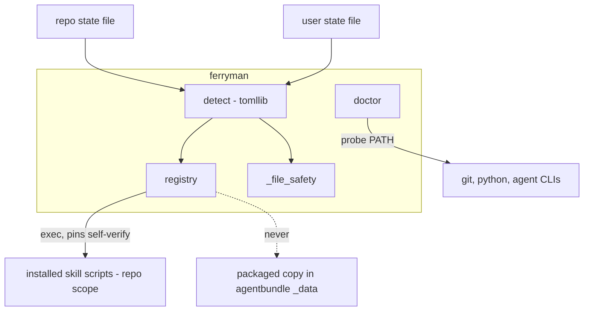
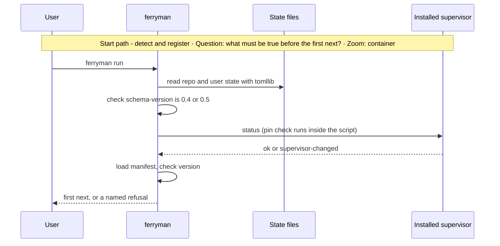
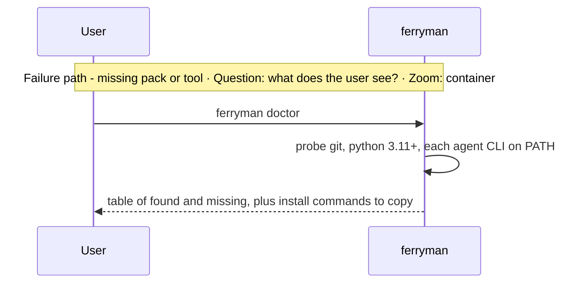

# Architecture Change — Install, trust, detection, and confined files

**Decision sought:** Approve that `ferryman` calls the repository's own supervisor copies, detects packs by reading install state with `tomllib`, never imports `agentbundle`, installs nothing, and carries its own confined-file helpers.

`ferryman` stays safe without the installer by trusting only what the repository already pins. It rests on three points:

- The repository copy of each supervisor checks its own hashes.
- State-file reading is read-only and refuses unknown versions.
- `ferryman`'s own helpers refuse links and swapped files on every path it touches.

**Author(s):** Repository owner (draft)
**Status:** Draft
**Last updated:** 2026-11-07
**Reviewers:** Repository maintainers, security reviewer

**Baseline — current architecture:** [Agentbundle](../agentbundle.md) § 2 (install state per scope), [catalogue state](../catalogue/state.md#install-state), [workspace-mcp](../workspace-mcp/design.md) § 2 (control-plane trust domain), and the self-verifying supervisor in [supervisor](../work-loop-execution-supervisor.md).

Part of the [set index](README.md).

## 1. Scope and Baseline

Five items change, and the launcher import in `workspace_mcp_server.py` does not.

| Delta item | In scope | Why it changes |
| --- | --- | --- |
| Ferryman reads install state without `agentbundle` | yes | `ferryman` must run where `agentbundle` is absent |
| Which supervisor copy `ferryman` executes | yes | A repository copy and a packaged copy both exist |
| `doctor` prints missing tools and install commands, and `doctor --probe` runs the opt-in CLI marker test ([03b](03b-headless-worker-launch.md), [13](13-rollout-spikes-and-risks.md)) | yes | Packs cannot install system software |
| Ferryman scope (user or repo) | yes | Core is repo-only; `product-engineering` defaults to user scope |
| Confined file handling in `ferryman` | yes | The import ban removes the blessed helpers |
| `workspace_mcp_server.py` import of `agentbundle` | no | Separate decision |

| Unchanged context | Link |
| --- | --- |
| State file names and schema rule | [catalogue state](../catalogue/state.md#install-state) |
| Supervisor hash pinning and `supervisor-changed` | [supervisor](../work-loop-execution-supervisor.md) |
| Per-adapter skill homes | `contracts/adapter.toml`[^1] |

This design adds no importer of `agentbundle`, so the launcher import stays a separate matter.

The session route ([05](05-supervisors-and-gates.md)) needs no supervisor descriptor and works in a repository without the core pack in principle. v1 documents core at repo scope as the supported install, and third-party supervisors and non-core repositories stay an open question, not designed.

A supervisor can ship in user scope (`discovery-supervisor`) while the intake scripts it calls ship in core at repo scope. This page owns that detection, and v1 requires the core pack for E2.

`doctor` prints `session route: ready` or `session route: blocked (<reason>)`.

## 2. Structural Change

`ferryman` gains three modules and one rule: it executes the repository copy and never the packaged one.

| Element or relationship | Change type | Baseline reference |
| --- | --- | --- |
| `ferryman.detect` (state-file reader) | added | new |
| `ferryman.registry` (supervisor discovery, manifest check) | added | new |
| `ferryman.doctor` | added | new |
| `ferryman._file_safety` (confined reads and writes) | added | `agentbundle.catalogue_tooling.file_safety`[^2] |
| Ferryman to supervisor call, repository copy only | added | [supervisor](../work-loop-execution-supervisor.md) § 2 |
| Ferryman to `agentbundle` import | removed by rule | `ARCHITECTURE.md` allowed edges gain none |

*Question: which copy does `ferryman` trust, and what does it read to find it? Zoom: component.*



A state row names a pack and an adapter. `ferryman` maps the adapter to its skill home with a table in `ferryman-config`, because it cannot import the adapter contract.

The repository copy is the right one for three reasons. It hashes its own installed files against digests pinned at the first admitted `start`, and it refuses on a difference.[^3] It is installed with the repository and reviewed with it.

A packaged copy would bypass the pin check and split `ferryman` from the copy the run was admitted under.

Descriptors are per skill version. A descriptor records each command's arguments, including `start --launcher` and `--launcher-sha256`, and the rule that a selection declares `protected_classes`.[^9] An unknown skill version or request kind is a stop: the run parks `unknown-descriptor`.

`status --json` carries no supervisor version field, and Slice 7 did not add one, so the descriptor selection rule reads the version from `packs/core/pack.toml` or the installed plugin manifest.[^10] The version rule is the one rule for the whole set (D53). A descriptor is keyed by a minor version (`major.minor`) and lists the patch versions tested in it.

`ferryman` accepts any patch inside a listed minor and refuses `unknown-descriptor` for any version outside the declared range, and an unknown version is a stop, never a warning. Pages 10d D53 and 14 link here. The adopter-side version source is the version in the install-state row for the skill if that row carries one, which is unverified until the install-state file is read, and otherwise the installed plugin manifest.

A second coupling exists: `fields_version` of `approval-fields.v1` must match between a `ferryman` release and a core release, and a mismatch refuses ([01](01-contracts-and-data.md)). No verb output carries a version identifier.

The supervisor's `lease` key means supervision policy, and `ferryman`'s claims are real time-bounded leases.

`workspace-mcp` uses the packaged copy because it runs in the control plane's trust domain and must not execute repository code.[^4] `ferryman` runs in the user's own session, in a repository the user chose. It runs the scripts the user's controller agent runs today.

## 3. Runtime Change

A start verifies state and pins before the first `next`, and a missing pack ends in a named refusal.

| Journey or scenario | Change type | Baseline reference |
| --- | --- | --- |
| Ferryman start: detect, verify, register | new | new |
| `doctor` | new | new |
| Unknown schema version | new refusal | [catalogue state](../catalogue/state.md#install-state) |





The refusal names the pack and the command the user runs (`agentbundle install <pack>`). `ferryman` prints it and runs nothing. The same holds for system tools.

## 4. Contract and Invariant Change

Four rules are new, and confined file handling is the fifth.

| Semantic name | Change type | Baseline reference | Compatibility during transition | Enforcement | Verification |
| --- | --- | --- | --- | --- | --- |
| State-file reader | new, read-only | state files are written only by `install`, `upgrade`, `uninstall`, `init-state` | accepts `schema-version` "0.4" and "0.5"; any other value or none is refused `unsupported-state-schema`[^5] | allowlist in `detect` | fixtures per version plus a future version |
| Import ban | new | installer and runtime stay separate | none needed | import-graph test | fails on `import agentbundle` |
| Supervisor-copy rule | new | supervisor self-verification | an installed supervisor without a manifest uses the built-in descriptor if its skill version is listed, else is refused | `registry` | descriptor test per known version |
| No-install rule | new | packs cannot install system software | none | no install code path | absence test over subprocess argv |
| Confined file handling | new | `agentbundle.catalogue_tooling.file_safety` | none; the helpers are new copies | `_file_safety` on every listed path | equal-behaviour test, below |

**Confined file handling.** `ferryman` reads and writes only through its own `_file_safety` helpers. The set of paths and the rule for each:

| Path class | Operation | Rule |
| --- | --- | --- |
| Repo state file, `ferryman.toml`, `.work-intake.toml`, policy JSON | read | inside the repository root, regular file, one hard link, identity unchanged between open and read |
| User state and user config | read | regular file, no symlink at the final component, one hard link, size cap |
| Run root (`state.json`, `events.jsonl`, `attempts/`, `scribe/`, receipts) | create, write | directory mode 0700; files created with exclusive create and no symlink follow; confined to the Git directory |
| Control inbox | read | regular file, one hard link, 64 KiB cap, strict parse; a violation moves the file to `control/rejected/` |
| Worker result file | read | inside `attempts/<id>/`, regular file, 16 MiB cap[^6] |
| Peer worktree path | create, remove | outside the repository root by design ([08](08-worktree-and-concurrency.md)): confined to `ferryman`-created peer root, never to user-supplied text |

Every helper refuses a symlink, a reparse point, a hard-linked file, a non-regular file, an oversize file, an out-of-root path, and a file whose device or inode changed between open and read.

The peer root is `<repo-parent>/.ferryman-worktrees/<repo>/`. `ferryman` creates it with mode 0700 and refuses it if a component is a symlink or is owned by another user. A path under it derives from the owner id only, so no ticket or worker text reaches it.

The helpers are copies, not imports. The work-loop scripts already carry such copies beside the supervisor, so the pattern exists.[^7] An equal-behaviour test runs the same hostile fixtures through `_file_safety` and through the blessed module and compares the refusals.

It lives in the repository's own tests, where `agentbundle` imports, and not in the package, which must not import it.

Call sites:

```text
ferryman doctor                 -> "git 2.45 ok; python 3.12 ok; codex: missing - install with <vendor command>"
ferryman run --supervisor work  -> refusal {"code":"pack-missing","detail":"core not installed at repo scope"}
_file_safety.read_regular(root, "ferryman.toml", max_bytes) -> bytes, or Refused("link")
```

The compatibility rule holds because the reader is stricter than the writer. A state file `ferryman` cannot read stops the run before any supervisor call. A newer `agentbundle` that raises the version makes `ferryman` refuse until its allowlist updates.

Unverified: whether `agentbundle` ever writes versions beyond 0.5.

## 5. Data/State Migration

No installed state changes, and `ferryman`'s user config is a new optional file.

| Data element | Old shape | New shape | Migration mechanism | Rollback |
| --- | --- | --- | --- | --- |
| Install state | unchanged | unchanged | none; read-only | none |
| Ferryman user config | none | `~/.ferryman/config.toml` (CLI paths, profiles) | the user creates it; `doctor` prints a template | delete the file |

`agentbundle` stays the only writer of install state.

## 6. Deployment/Operational Change

Scope follows the supervisors `ferryman` drives.

| Deployment unit | Change type | Baseline reference |
| --- | --- | --- |
| `ferryman` distribution | new | new |

Core has `allowed-scopes = ["repo"]`, so the work and spec supervisors are repository copies.[^8] `product-engineering` defaults to user scope and allows repo, so the discovery supervisor is found at either scope. `ferryman` prefers the repository copy when both exist.

Operators watch the `doctor` output and the first refusal code.

## 7. Quality Regression and Verification

Three attributes are at risk, and each has a test that fails on regression.

| Attribute at risk | Baseline target | Stimulus that could regress it | Verification |
| --- | --- | --- | --- |
| Supervisor integrity | every command refuses on a changed installed file | ferryman copies, patches, or caches a supervisor | edit one installed file, expect `supervisor-changed` through `ferryman` |
| Installer separation | no runtime import of the installer | a convenience import | import-graph test, 0 imports |
| File confinement | blessed helpers refuse links and swaps | a `ferryman` process helper accepts a hostile file | equal-behaviour test, 0 differing refusals over the hostile fixture set |
| Detection | state-file schema rule | a new state version ships | fixture for `0.6` refused in 100% of runs |

**Open question** (no decision number): a discovery supervisor without the core pack. Default: refuse with `pack-missing` and no fallback in v1.

## 8. Build Mapping

Four modules carry the work.

| Semantic element | Change type | Source owner | Build unit | Deployable | Verification |
| --- | --- | --- | --- | --- | --- |
| `detect` | new | `packages/ferryman/ferryman/detect.py` | `ferryman` | CLI | fixture tests |
| `registry` | new | `.../registry.py`, `descriptors/work-supervisor.toml` | `ferryman` | CLI | descriptor tests |
| `doctor` | new | `.../doctor.py` | `ferryman` | CLI | PATH-fixture tests |
| `_file_safety` | new | `.../_file_safety.py` | `ferryman` | CLI | equal-behaviour test in `tests/` |

The `work-supervisor` descriptor lives in `ferryman` because the pinned script cannot gain a manifest. New supervisors ship `supervisor.toml` beside the script, and the spec supervisor ships in `new-spec` with its own manifest, policy file, and store.

## Evidence

[^1]: `contracts/adapter.toml` skill homes `.claude/skills/` and `.agents/skills/` — verified.

[^2]: `packages/agentbundle/agentbundle/catalogue_tooling/file_safety.py` — verified; root `AGENTS.md` names it the blessed confinement helper.

[^3]: `work-supervisor.py` module docstring, pin comparison and `supervisor-changed` — verified.

[^4]: `docs/architecture/workspace-mcp/design.md` § 2 — verified.

[^5]: `packages/agentbundle/agentbundle/config.py` lines 36-48 and 485-500 (`SUPPORTED_STATE_SCHEMA_VERSIONS`, key `schema-version`) — verified.

[^6]: `work-supervisor.py` `_MAX_RESULT_BYTES = 16 MiB`, and `supervisor.md` "write the result to a file outside the spec directory" — verified. The 64 KiB inbox cap is a design default.

[^7]: `packs/core/.apm/skills/work-loop/scripts/_file_safety.py` and `file_safety.py` exist beside the supervisor — verified by listing; their equality with the blessed module is not checked here.

[^8]: `packs/core/pack.toml` `allowed-scopes`, `packs/product-engineering/pack.toml` — verified.

[^9]: `work-loop/references/supervisor.md` ("Every selection answer declares `protected_classes`") — verified (read). `start --launcher` and `--launcher-sha256`, both optional, are verified (read, merged). The per-version descriptor plan is an assumption of this design.

[^10]: `status --json` top-level keys (`readiness`, `recovery_decisions`, `recovery_leftovers`, `refusal`, `request`, `retry_cap`, `retry_count`, `run`, `tasks`, `terminal`, `verification`, and `concurrency` under a concurrent policy) in `_supervisor_loop.py` and `work-supervisor.py` — verified (read, merged, core 4.0.29). None is a version.
