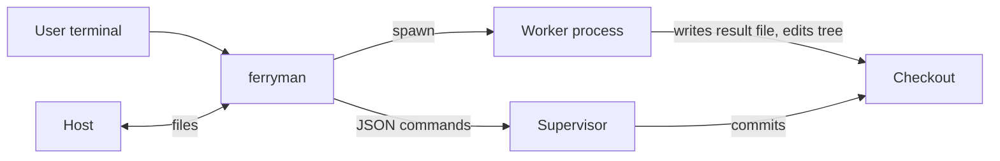
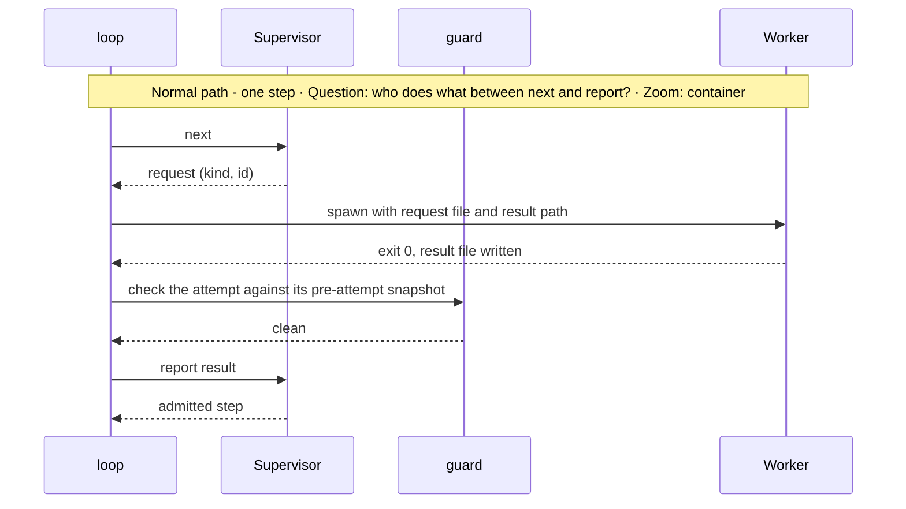
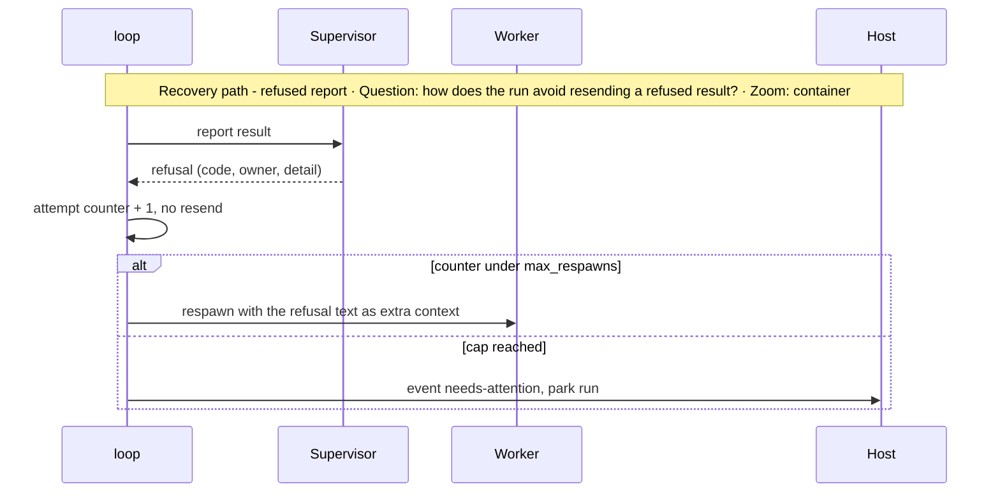

# Subsystem Design — Ferryman runtime

**Decision sought:** Approve `ferryman`, a foreground, stdlib-only program that does the controller's mechanical half (`next`, spawn a worker, `report`), stops at parked gates, and is written against generic supervisor commands.

`ferryman` is safe to leave running because it holds no decision state and fences its workers, by two properties:

- Every decision re-derives from the supervisor, `HEAD`, and committed records.
- Workers run in their own session, inside an attempt window `ferryman` checks before it reports.

**Author(s):** Repository owner (draft)
**Status:** Draft
**Last updated:** 2026-11-07
**Reviewers:** Repository maintainers, work-loop owners

Part of the [set index](README.md).

## 1. Scope and Context

`ferryman` owns the loop and nothing about what counts as done.

| In scope | Out of scope | Why |
| --- | --- | --- |
| Call `next`, run the request, call `report`, repeat | Deciding completion | The supervisor derives it from committed facts ([supervisor](../work-loop-execution-supervisor.md) § 1) |
| Spawn one worker per request from a TOML profile | Judgment on a request | A worker session does the judgment half |
| Stop at a parked gate and wait | Approving anything | Only a human decision approves ([page 05b](05b-approval-integrity-and-trusted-configuration.md)) |
| Write run-state and events, read the control inbox | Rendering | [Page 07](07-host-and-ui-seam.md) |
| Run light mode as one supervisor-less worker session (D75) | Choosing the work or publishing the result | A human launches and publishes ([page 05](05-supervisors-and-gates.md)) |
| `--watch` polling in the foreground | A daemon, port, or run registry | [ADR-0062](../../adr/0062-workspace-mcp-per-session-only-constraint.md), Charter Principle 3 |

**Goals**
- After a kill at any of 26 run boundaries (B1 to B7 and B11 for the loop, B8 to B10 for the chain, B-S1 to B-S6 for the scribe, B-D1 and B-D2 for the discovery write, B-L1 for the local ledger, B-P1 to B-P6 for a pool), `ferryman run` resumes with the same request id, in 26 of 26 kill-point tests.
- After a kill at any of 5 session boundaries (B-X1 to B-X5), `ferryman session` parks `session-interrupted`, keeps the tree and the product checkpoint, and refuses a silent rerun, in 5 of 5 tests.
- A worker past its wall-clock limit is stopped and recorded within 5 seconds of the limit.
- A parked run answers a control command within 2 poll intervals (default 1 s).

**Non-goals**
- Not a scheduler. One `ferryman` drives one run in one checkout in v1, and the control plane schedules a pool ([page 11](11-remote-agent-pool-seams.md)).

*Question: what sits around `ferryman`? Zoom: container.*



## 2. Structural Model

Seven components split the duties.

| Element | Type | Responsibility | Zoom |
| --- | --- | --- | --- |
| `cli` | component | Parse commands: `run`, `session`, `status`, `frontier`, `doctor`, `answer` | component |
| `loop` | component | The frontier step, then the `next`, spawn, `report` cycle and stop rules ([03c](03c-run-chain-locks-and-process-boundary.md) owns the chain) | component |
| `workers` | component | Load profiles, run headless, attach, tmux, or remote executors behind one interface, enforce limits | component |
| `projector` | component | Rewrite `state.json`, append `events.jsonl` ([01](01-contracts-and-data.md)) | component |
| `inbox` | component | Read, validate, apply, and ack control commands | component |
| `guard` | component | Call the approval guard before `report` ([05b](05b-approval-integrity-and-trusted-configuration.md)) | component |
| `registry`, `lock` | component | Supervisor descriptors ([02](02-install-trust-and-detection.md)) and run locks ([03c](03c-run-chain-locks-and-process-boundary.md)) | component |

| From | To | Nature | Protocol |
| --- | --- | --- | --- |
| `loop` | `registry` | calls | in-process |
| `loop` | supervisor | calls commands | subprocess, JSON on stdout |
| `loop` | `workers` | calls | in-process |
| `workers` | worker CLI | spawns | subprocess, list-form argv, no shell, new session |
| `inbox` | `loop` | signals | in-process queue drained between steps |

| Controller duty today | Owner after the split |
| --- | --- |
| Call `next`, `report`, `status` | ferryman |
| Dispatch subagents, run the project's gates, write plan edits under the replan rules | worker, inside its own session |
| Carry a named human's answer to `report` | ferryman, from a verified control command |
| Decide a `human-decision` | human only |

Every executor implements one interface: `spawn(order) -> handle`, `status(handle)`, `cancel(handle)`, and `result(handle)`. A `remote` handle carries a lease ([page 11](11-remote-agent-pool-seams.md)).

A worker profile is a TOML file with these keys:

| Profile key | Type | Meaning |
| --- | --- | --- |
| `id`, `version` | string | Identity and schema version |
| `kind` | `headless`, `tmux`, `attach`, or `remote` | Executor |
| `argv` | list | Command with `{prompt_file}` and `{cwd}` placeholders |
| `prompt_via` | `file` or `stdin` | How the briefing reaches the worker |
| `env_allow` | list | Environment names passed through, and nothing else. A credential name is refused ([03b](03b-headless-worker-launch.md)) |
| `wall_seconds` | int | Limit, falling back to `[limits]` |
| `cli_version` | string | The CLI version the profile was probed against. A different version fails `doctor --probe` |
| `model` | string | The model named in the command line, never inherited from the CLI default |
| `allow` | list | The explicit grants for the role. A request that needs more is denied |
| `setting_sources` | string | Claude only: restricts which settings and skill sources load. Other CLIs isolate user-level config by a config-dir rule (unverified)[^8] |
| `enforcement_required` | bool | Refuse a level below `enforced`. Default `false`, `true` in a pool ([03b](03b-headless-worker-launch.md)) |
| `reviewer_available` | bool | Whether the profile can dispatch reviewers |
| `spawn`, `status`, `cancel`, `result` | lists | For `remote` only: list-form commands that implement the interface, supplied by the control plane's transport ([11](11-remote-agent-pool-seams.md)) |
| `roles` | list | Request kinds the profile may serve |

Profiles come from the `ferryman` package, overridden by `~/.ferryman/config.toml`, and chosen by role in `ferryman.toml`. `independent_of` lives only in `[workers.<role>]`, and [page 03b](03b-headless-worker-launch.md) owns the launch contract.

`ferryman` treats request text and worker output as untrusted and reads only `kind`, `request_id`, and `worker_mode`.

## 3. Runtime Model

A step is `next`, spawn, guard, `report`, and recovery depends on thirty-one boundaries. A restart calls `status` first and reports only while that `request_id` is open.

| Scenario | Trigger | Path |
| --- | --- | --- |
| One step | `run` | normal |
| Park at a gate | `human-decision` or parked gate | normal; ends the run unless `--watch` |
| Blocking verb | `run-concurrent` request | `ferryman` calls the verb and waits, with no worker of its own. Documented stop until a descriptor lists the kind |
| Attach a human session | `attach` role | normal, hybrid |
| Worker crash, timeout, or refused report | missing result, limit, refusal | failure / recovery |
| Session route | `ferryman session` | one worker, no `next` or `report`, no supervisor ([05](05-supervisors-and-gates.md)). Takes start steps 1, 2, 4, 5, 8, and 9 below, and step 1 first refuses `session-pool-refused` on a committed `[pool]` table or a node marker ([11](11-remote-agent-pool-seams.md)). The D76 floor refuses as `run` does (`profile-unprobed`, `credential-env-refused`, `enforcement-required`) |
| Restart finds an attempt record whose pid is alive | ferryman killed, worker left running | failure / recovery: no respawn, the run parks `needs-attention` with event `orphan-worker`, and a human stops it or sends `retry-worker` |





A refused report commits nothing, and the same result is never resent.[^1] `ferryman` adds a bounded respawn with the refusal text, then parks.

**Start-of-run sequence.** Every `run` takes these steps in this order, and other pages link here instead of restating it.
1. Take the subject lock, then the ticket and tracker locks that apply ([03c](03c-run-chain-locks-and-process-boundary.md)).
2. Apply the v1 checkout policy: default branch, clean tree, branch.
3. Detect the packs and pin the supervisor scripts ([02](02-install-trust-and-detection.md)).
4. Pin the trusted configuration set ([05b](05b-approval-integrity-and-trusted-configuration.md)).
5. Recover an open attempt record, with no respawn if the pid lives.
6. Recover an open scribe intent.
7. Derive the chain and the current subject.
8. Apply pending control files (`stop`, `pause`, `retry-worker`).
9. Show the D54 consent display, on the first real run only.
10. Show the approval prompt for a parked gate, then call `next`.

Kill points. The tests kill `ferryman` at each boundary and restart it.

| Id | Boundary | Restart result |
| --- | --- | --- |
| B1 | `next` answered | request re-issued |
| B2 | attempt record written, no spawn | record closed `abandoned`, request re-issued |
| B3 | worker running, or exited with no result file | `orphan-worker` park if the pid lives, else abandoned and the request re-issued |
| B4 | worker exited, result file present | `status` first, then the guard runs, then report |
| B5 | guard passed, no `report` sent | `status` first, the guard re-runs, then report while the request is open |
| B6 | `report` answered, no projection | projection rewritten |
| B11 | `report` sent, no answer seen | `status --json` first. A `refusal` for that `request_id` takes the refused-report path (counter plus 1, then respawn or park) and the result is never resent. Otherwise a closed request means the projection is rewritten, and an open one means report again with the same result[^7] |
| B7 | killed during a blocking verb | `ferryman` calls `status`, then the verb or `next` again, and the supervisor recovers. No respawn |
| B8 | intake committed, no discovery directory | `start --adopt` creates it from the committed intent |
| B9 | ticket lock and directory lock both held | the pid rule reclaims the stale locks, and the chain re-derives |
| B10 | scribe closed, delegated `park` or `start` not yet called | the next `next` re-issues the delegated command |
| B-S1 | intent fsynced, no edit | abandoned, event `scribe-abandoned` |
| B-S2 | first planned file edited | restore or complete per the rule in [05b](05b-approval-integrity-and-trusted-configuration.md) |
| B-S3 | all files edited, none staged | same rule |
| B-S4 | files staged, no commit | same rule |
| B-S5 | commit made, intent open | intent closed, no second commit |
| B-S6 | intent closed, no projection | projection rewritten |
| B-D1 | discovery gate: verdict row and slot status edited, no commit | the discovery-supervisor's own recovery completes or abandons the single commit, and `ferryman` re-reads `status` |
| B-D2 | discovery gate: commit made, `ferryman` projection not written | projection rewritten from the committed ledger |
| B-L1 | tier B: a ledger append torn at the tail | the reader truncates to the last good hash and the supervisor re-issues the request. A chain broken before the tail refuses `local-ledger-corrupt` |
| B-P1 | pool: checkpoint pushed, `checkpoint-pushed` event not written | the control plane reconciles from the `store` ref and the manifest chain, then relaunches |
| B-P2 | pool: `store` compare-and-swap done, `next` not called | the node proceeds from the restore and the same request id, and a restart that finds its own `node_id` and epoch does not compare-and-swap against itself |
| B-P3 | pool, only if D69's alternative is taken: `effect-intent` committed, checkpoint not pushed | the push repeats, and with no push the effect is not dispatched (D69 as decided parks the effect) |
| B-P4 | pool: claim pushed, `start` not called | the restart re-pushes the claim naming its own value, then calls `start` |
| B-P5 | pool: a command that arrived during an attempt is checkpointed at the next boundary, not applied | the nonce stays consumed, and the control plane re-delivers the command re-signed with a new nonce |
| B-P6 | pool: store written, product ref or config not restored | the restore repeats from the same checkpoint before any `next` |
| B-X1 | session: order written, no spawn | parks `session-interrupted`, no worker ran |
| B-X2 | session: worker running or orphaned | parks `session-interrupted`, no respawn, live pid named in the event |
| B-X3 | session: worker exited, guard not run | parks `session-interrupted`, tree kept |
| B-X4 | session: guard passed, product ref not written | parks `session-interrupted`, tree kept |
| B-X5 | session: product ref written, run not marked done | parks `session-interrupted`, tree and ref kept |

A session boundary never resumes: a human publishes, discards, or deletes the kept branch before a new session on that subject.

**Failure classes and retries.** `ferryman` reports every failed `implement-task` dispatch to the supervisor as `{"gate":{"passed":false}}` before it classifies the failure. The brief-level runner's `classify` takes four classes and sends any other to a human.[^6]

| Worker outcome | Class |
| --- | --- |
| The CLI reports a context or output limit | `cap-hit` |
| A network or transport error | `network` |
| A denied or failing tool call | `tool-error` |
| No new side effect past the role's stuck-after time | `stuck` |
| Anything else | `surface-to-human` |

An external effect is never retried under this rule. Other dispatch kinds stop at the lease `retry_budget` of 2 per session and then go to a human, and `max_respawns` reads the lease value when it exists (D33, D62).

**Blocking verbs.** Under a concurrent `concurrency` policy, `next` returns one `run-concurrent` request with a `tasks` list. The shipped policy is `sequential`, so `next` never issues it today.[^4]

For this kind `ferryman` spawns no worker and holds no worker pid. It calls `work-supervisor.py run-concurrent <spec-dir> --request <id>`, which blocks while the supervisor spawns the pinned launcher per task, verifies the attestations, ingests, and integrates in floor order. Then `ferryman` calls `report` with completion only.

A request runs once, so a second call refuses `request-consumed`, and any attestation, read, write, or binding fact in `report` refuses `result-fact-refused`. The supervisor recovers a dead `run-concurrent` itself, so after a kill `ferryman` calls the verb or `status` again and never respawns.

The one-open-attempt rule covers ferryman-spawned workers only, and a blocking verb's attempt record holds `kind`, `request_id`, `verb`, `started_at`, and `exit`, with no pid, handle, or lease. A request kind the descriptor does not list parks `unknown-request-kind`.

For an `attach` request `ferryman` writes a work order (request, briefing, result path), emits `attention-requested`, and waits for the result file or an `attach-done` command.

`run` exits 0 at terminal, 10 when parked and waiting (not under `--watch`), 1 on a supervisor refusal it could not clear, 2 on usage error, and 11 at the supervisor's retry cap.[^5]

`session` exits 0 on `handoff` with the result file written, 10 on `needs-human`, 12 on `escalate-full`, 13 on `session-interrupted`, 14 on `blocked`, and 2 on a refusal before spawn (`session-pool-refused`, `checkout-dirty`, `profile-unprobed`). A host reads the result file for the reason, since a worker's exit 0 means nothing ([05](05-supervisors-and-gates.md)).

## 4. Contracts and Invariants

Six rules fence the loop, the inbox, the lock, and the worker.

| Semantic name | Parties | Inputs/outputs | Identity | Compatibility | Failure semantics | Invariant | Enforcement | Verification |
| --- | --- | --- | --- | --- | --- | --- | --- | --- |
| Supervisor command client | ferryman, supervisor | argv in, one JSON object out | command plus `request_id` | commands and exit codes of the manifest | non-JSON or multi-object output is a `supervisor-protocol` refusal | one JSON object per command | strict parse, reject trailing bytes | fake-supervisor tests |
| Worker launch | ferryman, worker | request file path, result path, cwd, stdin set to the null device | attempt record | profile `version` and `cli_version` | timeout kills the process group, records `killed` | no credential in the worker environment, and no `report` access | `env_allow`, no tracker env by default, new session | env-leak test |
| Step order | ferryman | none | none | none | a crash replays from the supervisor | `report` is called at most once per attempt record | record written before spawn | kill-point tests |
| Stop rule | ferryman | none | none | none | on `awaiting-human` or the retry cap `ferryman` stops | never proceeds past an unanswered gate | `loop` checks `stage` after each command | gate tests |
| Inbox window rule | host, ferryman | `answer` control files | `id` | none | an `answer` file that first appears between the attempt-open and attempt-close snapshots is acked `refused-in-attempt` and not applied | no `answer` that appears during an attempt applies; `pause`, `stop`, `retry-worker`, `attach-done` are unaffected | `inbox` lists `control/` (names and inodes) at attempt open and at close | spoof test with a fake worker |

Locks, the v1 checkout policy, and the process boundary are on [page 03c](03c-run-chain-locks-and-process-boundary.md).

Call sites:

```text
ferryman run --supervisor work docs/specs/example-feature          # foreground until a gate or terminal
ferryman run --supervisor work docs/specs/example-feature --watch  # parks and polls the inbox, still foreground
ferryman answer <run_root> --gate spec-approved --digest <hex> --decision approve --actor "user:local"
```

`answer` writes the control file a host writes, recorded as `host-attested`, and the default `accept` list refuses it `level-not-accepted`, since `session-attested` is the terminal prompt ([05b](05b-approval-integrity-and-trusted-configuration.md), D20).

**CLI surface.** Every verb and flag appears here with its owner page, and a new flag is added here first.

| Verb or flag | Owner page |
| --- | --- |
| `run` with no subject (resume) | [03c](03c-run-chain-locks-and-process-boundary.md) |
| `run --supervisor <id> <subject>` | [03c](03c-run-chain-locks-and-process-boundary.md) |
| `run --from-ticket <ref>`, `run --next` | [03c](03c-run-chain-locks-and-process-boundary.md) |
| `run --watch` | [03](03-ferryman-runtime.md) |
| `run --branch` | [03c](03c-run-chain-locks-and-process-boundary.md) |
| `done <branch>` | [03c](03c-run-chain-locks-and-process-boundary.md) |
| `run --exec-root <dir>` | [07](07-host-and-ui-seam.md) |
| `run --launch <file>`, and the pool prelude before start step 1 | [12](12-pool-state-integrity-and-signals.md) |
| `run --demo` | [14](14-installation-and-adoption-experience.md) |
| `run --accept-unprobed` | [03b](03b-headless-worker-launch.md) |
| `session [--ticket <ref>] <prompt-or-request-file>` | [05](05-supervisors-and-gates.md) |
| `status`, `status --json` | [01](01-contracts-and-data.md) |
| `frontier` | [04](04-frontier-and-waves.md) |
| `gates` | [05](05-supervisors-and-gates.md) |
| `answer` | [07](07-host-and-ui-seam.md) |
| `claim` | [12](12-pool-state-integrity-and-signals.md) |
| `doctor` | [02](02-install-trust-and-detection.md) |
| `doctor --probe` | [03b](03b-headless-worker-launch.md) |
| `init`, `init --upgrade-plan` | [14](14-installation-and-adoption-experience.md) |
| `init --create-labels` | [06](06-tracker-integration-and-authority.md) |
| `clean`, `clean --plan` | [14](14-installation-and-adoption-experience.md) |

## 5. Data and State

Only attempt records and lock files hold state, and both are disposable.

| Element | State it owns | Lifecycle | Consistency requirement |
| --- | --- | --- | --- |
| `loop` | stateless | n/a | n/a |
| `workers` | open attempt records in the run root | created at spawn, closed at exit | an open record means the worker may still run, so check the pid before respawn |
| `projector` | projection files | rewritten each step | derived, never authoritative |
| `inbox` | stateless apart from files | a command applies once by `id` | idempotent by `id` |
| `lock` | lock files | created at run start, removed at exit | one live holder per key |
| `registry` | stateless | n/a | n/a |

A run root with no open intent or attempt can be deleted at no cost beyond observability.

## 6. Deployment and Operations

`ferryman` is one foreground process, so closing the terminal ends it.

| Deployment unit | Runs as | Scaling | Observability |
| --- | --- | --- | --- |
| `ferryman run` | foreground process in a terminal or a host-spawned child | one per run, one run per checkout | exit code, `events.jsonl`, `state.json` |

## 7. Quality Scenarios and Verification

Four scenarios cover crashes, hangs, forged input, and latency, all design targets.

| Source | Stimulus | Environment | Artifact | Response | Measurable target | Business consequence | Mechanism | Verification |
| --- | --- | --- | --- | --- | --- | --- | --- | --- |
| Operator | kills `ferryman` at a boundary | any | `loop`, scribe | every run boundary resumes and every session boundary parks, with no duplicate work | 31 of 31 boundaries | repeated commits, lost steps, or a silent rerun | derive from supervisor, write-ahead intent, session park | kill-point tests |
| Worker | hangs | unattended | `workers` | process group killed, attempt recorded | within 5 s of `wall_seconds` | an overnight run stalls | timers, group kill | fake hanging worker |
| Worker | writes an approval, edits trusted configuration, commits, or writes a control file | any | `guard`, `inbox` | report or command refused, run parked | 100% of the 26 corpus shapes ([05b](05b-approval-integrity-and-trusted-configuration.md)) | forged approval | guard, inbox window rule | corpus test |
| Host | sends a command while parked | `--watch` | `inbox` | ack written | within 2 s | a human waits on a stuck UI | poll interval | latency test |

## 8. Implementation Mapping

All ferryman code lives in one package.

| Semantic element | Source owner | Build unit | Deployable | Verification |
| --- | --- | --- | --- | --- |
| `cli`, `loop` | `packages/ferryman/ferryman/{cli,loop}.py` | `ferryman` | CLI | fake-supervisor tests |
| `workers`, profiles | `.../workers.py`, `profiles/*.toml` | `ferryman` | CLI | fake-worker tests |
| `projector`, `inbox` | `.../state.py`, `.../inbox.py` | `ferryman` | CLI | file-order tests |
| `guard` | `.../guard.py` | `ferryman` | CLI | corpus test |
| `lock` | `.../lock.py` | `ferryman` | CLI | two-ferryman and stale-lock tests |

The package follows the `packages/` rules.[^2] Unverified: inventory registration.

## 9. Decisions, Alternatives, and Risks

[Page 10](10-decisions-and-records.md) owns decisions and alternatives, and [page 13](13-rollout-spikes-and-risks.md) owns risks.

## 10. Rollout, Migration, and Reversal

[Page 13](13-rollout-spikes-and-risks.md) owns them.

## 11. Open Questions

- Is a headless worker's Surface-and-stop representable as `needs-human` on every CLI? The work-loop owners' ruling on a local human launch is a PL gate ([page 13](13-rollout-spikes-and-risks.md)).
- Does any request kind need an interactive controller capability that a headless worker lacks? The work-loop owners can answer by walking the nine request kinds.[^3]
- The open CLI verification items are on [page 03b](03b-headless-worker-launch.md).

## Evidence

[^1]: `packs/core/.apm/skills/work-loop/references/supervisor.md`, *The loop*, step 4 — verified.

[^2]: `packages/AGENTS.md` (cross-package traps, test conventions) — verified.

[^3]: `contracts/delivery/execution-request.v1.schema.json`, `kind` enum with nine values — verified.

[^4]: Slice 7 behaviour (shipped policy `sequential`, the `run-concurrent` request and blocking verb, `request-consumed`, `result-fact-refused`, recovery by the supervisor, one new verb) — stated by the Slice 7 owner (2026-11-07), not independently checked. The spec `verified-infrastructure-parallelism`, unmerged, was read for AC-0017 and AC-0020.

[^5]: `work-supervisor.py` module docstring: exit 0 success, 1 refusal, 2 usage error, and 3 only from `status --check` — verified.

[^6]: Brief-level runner reference (`classify` takes `cap-hit`, `network`, `tool-error`, `stuck`; `surface-to-human` otherwise; failed `implement-task` dispatches are reported first; past `lease.retry_budget` failed attempts the action is `abandon-and-replan`) — verified (read, merged, core 4.0.22).

[^7]: The `refusal` key of `status --json` for a request id — stated by the work-loop owner, and not verified in the supervisor code here.

[^8]: Claude Code runs with project-only setting sources — verified (tested, single run, 2026-11-07). Config isolation for other CLIs was not run: unverified.
