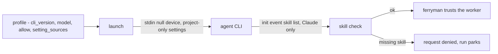
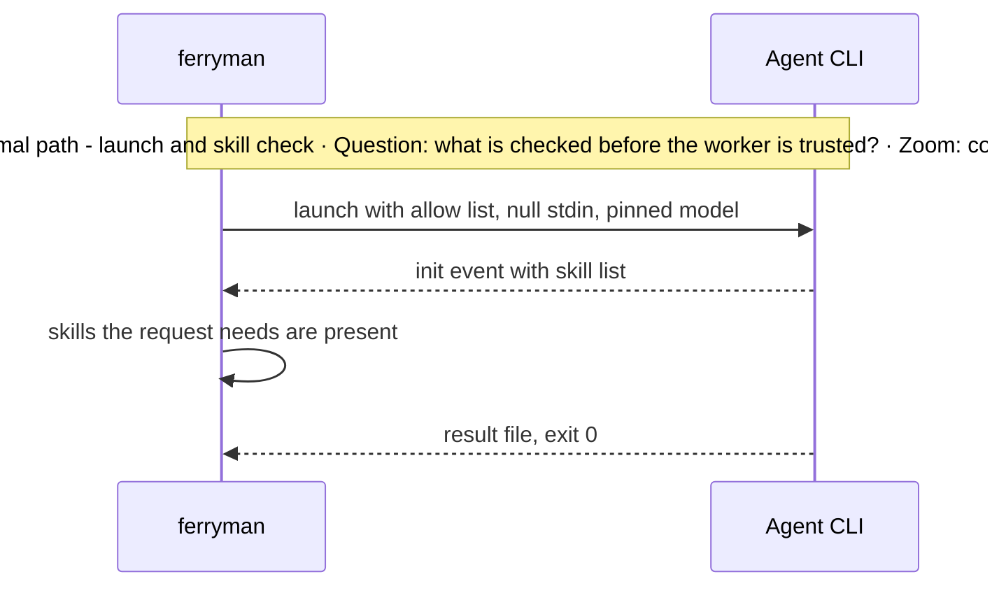
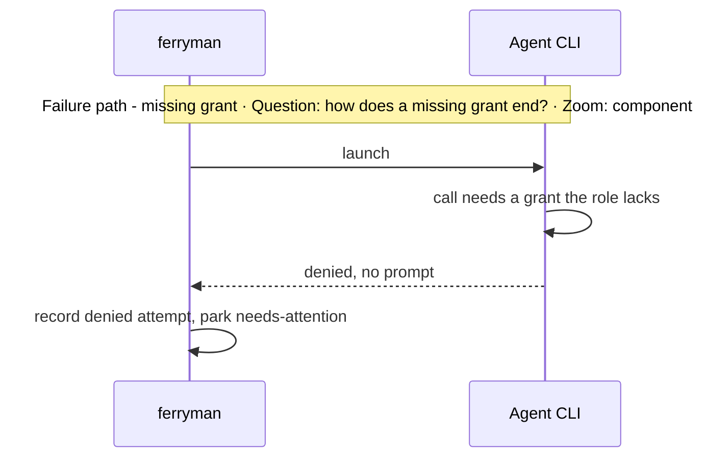

# Subsystem Design — Headless worker launch

**Decision sought:** Approve a per-profile launch contract for headless agent CLIs: an explicit allow list, a pinned version, a named model, null stdin, project-only settings, and an opt-in `doctor --probe`.

A headless worker is trustworthy only if a profile fixes everything the CLI would otherwise decide. Three choices carry that:

- Every grant is explicit, so a missing grant is a denied request and never a hang.
- Version and model are pinned, so an upgrade fails the probe and not a run.
- A worker's skill list is checked before `ferryman` trusts it, for the CLI that exposes one.

**Author(s):** Repository owner (draft)
**Status:** Draft
**Last updated:** 2026-11-07
**Reviewers:** Repository owner

Part of the [set index](README.md). [Page 03](03-ferryman-runtime.md) owns the worker interface and the profile keys. [Page 13](13-rollout-spikes-and-risks.md) owns the probe procedure.

## 1. Scope and Context

This page owns what a headless launch must set, and the CLI vendors own their flags.

| In scope | Out of scope | Why |
| --- | --- | --- |
| Launch settings every profile fixes | The worker interface and profile keys | [Page 03](03-ferryman-runtime.md) |
| Tested facts for four CLIs | Flags the spike did not verify | Unverified flags stay out of the pages |
| The probe's pass rule | The probe's schedule and phases | [Page 13](13-rollout-spikes-and-risks.md) |

**Goals**
- A profile run against a CLI version other than its recorded `cli_version` fails `doctor --probe` in 100% of fixture runs.
- A request that needs a grant the role lacks ends as a denied request within the wall-clock limit, in 100% of fixture runs.

**Non-goals**
- Not a list of every CLI flag. Only the flags verified in the spike appear, each with its CLI version.
- Not a guarantee for untested CLIs. The documented-only CLIs stay open items.

*Question: what does a launch fix, and what does `ferryman` check? Zoom: component.*



## 2. Structural Model

A profile, a launch, a skill check, and a probe make up the model.

| Element | Type | Responsibility | Zoom |
| --- | --- | --- | --- |
| Profile launch settings | data | `cli_version`, `model`, `allow`, `setting_sources` ([03](03-ferryman-runtime.md) owns the keys) | component |
| Launch | component | Starts the CLI with stdin on the null device and the settings above | component |
| Skill check | component | Compares the init event's skill list with the skills the request needs, Claude only | component |
| `doctor --probe` | command | Re-runs a marker test and records the CLI version | component |

The launch facts below were tested on one run each, with a trivial prompt, in scratch directories outside the repository.[^1]

| CLI and version | Tested result | Flags |
| --- | --- | --- |
| Claude Code 2.1.311 | Loads a project skill. With only `Read` allowed, a shell write was denied, and with `Bash` allowed it wrote | `claude -p`, `--permission-mode dontAsk`, `--allowedTools`, `--setting-sources project` |
| Copilot CLI 1.0.103 | Loads `.github/skills`. A write is denied by default and works with the write grant | `copilot -p --trust-folder`, `--allow-tool=write` |
| Pi 1.5.0 | Loads a skill by flag and by discovery. With only `read` enabled no write tool remains | `pi -p`, `--skill`, `--tools read` |
| Codex 0.164.0 | Loads a project skill from `.codex/skills` and `.agents/skills`, and project `AGENTS.md`. An outside-repository write and `git commit` are denied | `codex exec -C`, `--json`, `-o`, `--sandbox`, `-c 'approval_policy="on-request"'` |

Six consequences follow for every profile:
- Claude loads user-level skills by default: 169 in the init event's list against 21 with `--setting-sources project`, with the project skill in both. The profile passes the project-only source, and `ferryman` compares the init event's skill list with the skills the request needs before it trusts the worker. This check is Claude only.
- `--bare` skips skills, hooks, commands, plugins, MCP servers, and `CLAUDE.md`, and the docs plan to make it the `-p` default (documented).[^2] It failed here with "Not logged in" under a subscription login (tested). Profiles avoid it, pin `cli_version`, and name `model`, because the headless default observed was `claude-sonnet-5-5`.
- `doctor --probe` re-runs the marker test after an upgrade.
- Claude prints a 3 second warning unless stdin is redirected, so launch sets stdin to the null device.
- Claude and Copilot deny any call that needs approval in headless mode, and Gemini does too (documented).[^3] Each role therefore needs an explicit allow list, and a missing grant is a denied request and never a hang.
- A permitted shell can still commit or edit headers, so the guard and the pre-attempt comparison stay required ([05b](05b-approval-integrity-and-trusted-configuration.md)).

**Codex launch.** The recipe is `codex exec -C <repo> -m <model> --json -o <file> --sandbox workspace-write -c 'approval_policy="on-request"'` with stdin on the null device, where `<model>` is the profile's `model` value (`-m` or `-c model="<model>"`, the exact flag unverified).[^7] The profile does not assume an approval value or a sandbox wider than it needs, and it names the model in the command line like every other CLI, while a configuration can still override the model, sandbox, or approval policy, so `enforcement` and the probe record keep what ran.

Seven Codex facts shape that recipe:[^7]
- Loading: a control run without the skill does not return the marker. Precedence when both skill paths exist is unverified.
- Stdin: an open stdin pipe hung for more than 60 s.
- Approval: `codex exec` has no `-a` flag, and approval is set with `-c 'approval_policy="..."'`. Whether a value is accepted depends on the configuration in force, and the probe record keeps the value that ran.
- Sandbox: the `read-only` and `workspace-write` sandboxes were tested. Under both, an outside-repository write and `git commit` were denied (`operation not permitted`, `.git` protected, no `index.lock`), and a write to `$HOME` was denied. A write under `/tmp` is allowed in `workspace-write`, so outside-write denial is not guaranteed inside `/tmp`.
- Escalation: under `on-request` with no human, a request fails as 'approval request failed' with no hang. `ferryman` matches that signature, `denied-git-failed` and a sandbox-denied write before it classifies, and parks `policy-blocked` with the attempt's effective sandbox and approval values and no retry. A session reports it with exit 14.
- Output: `--json` gives JSONL ending in `turn.completed` with usage. `-o FILE` gives the final message only.
- Exit: the code is 0 for every completed run including a stop, so a stop is told apart only by a required result file or token. The `turn.failed` exit codes were never triggered: unverified.

Two launch facts come from the resume test on the real `work-supervisor.py`:[^9]
- Codex: in a linked worktree under `workspace-write`, every git write fails (`merge`, `rebase`, `add`, `commit`, and the supervisor's `next` with `denied-git-failed`), because the worktree's git directory sits under the main repository's `.git`. Adding `--add-dir <main>/.git` did not help. Adding `--add-dir <main>/.git/worktrees/<name>` made a clean merge, a hand-resolved conflicted merge, and a rebase all work, but it also let the worker create a branch, move `main`, write a hook and set `core.hooksPath` in the shared repository. `ferryman` therefore runs `git add`, `commit`, `merge` and `rebase` itself and leaves the worker to edit files, or it hashes the shared git directory's refs, hooks and config before and after each attempt (RFC-0117). Recursive delete is also blocked as `rm -rf` but passes as `rm -r` Under `read-only` a direct edit fails, but a worker can return a unified diff as its final message, and `git apply` accepted one and a two-file one with a new file. `ferryman` then applies it after the guard and runs the checks, since the worker cannot run its own patch.[^10]
- Copilot: an allow-tool pattern needs an exact match, so `shell(python3 /path/script:*)` was denied while a bare executable path and the broad `shell(python3:*)` worked, and the broad one lets the worker run any python.

The reviewer agent definition was converted to `.codex/agents/*.toml` by guess, so the custom-agent format is unverified.

**Worker floor additions (D76).** The v1 floor stays the per-profile allow list, the allow-listed environment, and the guard. Three launch rules narrow it here, two guard checks narrow it on [page 05b](05b-approval-integrity-and-trusted-configuration.md), and a contained floor is a later item ([page 11](11-remote-agent-pool-seams.md)).

The floor applies to `ferryman session` as to `run`: `session` raises `profile-unprobed`, `credential-env-refused`, and `enforcement-required` and shows the D54 first-run consent display ([page 03](03-ferryman-runtime.md) lists its start steps and exit codes).

**Credential stripping at spawn.** A worker never receives `GH_*`, `GITHUB_TOKEN`, `SSH_AUTH_SOCK`, or another forge or host credential. A profile that lists one in `env_allow` is refused at load with `credential-env-refused`.

Git inside the worker reads a run-owned config file: `GIT_CONFIG_GLOBAL` names it, `GIT_CONFIG_SYSTEM=/dev/null`, and `GIT_CONFIG_NOSYSTEM=1`. The one key that alone makes `git push origin HEAD` fail, to ssh, https, git, ext, and local-path URLs, is `[protocol] allow = never`. It also blocks fetch and clone from local paths, and local worktrees, `status`, `diff`, and `log` keep working.[^8]

The allow list denies the forge CLIs `gh`, `glab`, and `az`.

Alone, each of these leaves a push to a local path working: any single `protocol.<name>.allow = never` for `ssh`, `ext`, `git`, or `https`, an empty `credential.helper`, `push.default = nothing` (an explicit `HEAD` refspec bypasses it), a `core.hooksPath` to an empty directory, and an empty file. A `remote.origin.pushurl` set invalid or a `url.<x>.pushInsteadOf` rewrite blocks only that one path.

A stripped environment lacks `GH_*`, `*_TOKEN`, `*_KEY`, and `SSH_AUTH_SOCK`. Copilot, Pi, and Codex still answer and need no stripped variable, and Claude Code is inconclusive: its login failed intermittently in the baseline too, with 2 of 7 runs passing in each mode and the cause not found, so it is untested and not a pass.[^4]

Pi exits 0 even when its model login fails, so the runner reads Pi's JSON `stopReason` (`error` with an `errorMessage`) and never the exit code or the echoed prompt. Codex's own shell sets `GH_PAGER`, which is not a credential, so an environment-count check excludes it.

This narrows the same-OS-user credential risk and does not remove it, because a worker can still read home files ([page 13](13-rollout-spikes-and-risks.md)). The model credential a CLI needs to run, such as Claude Code's login, is the explicit exception, and its exposure stays an accepted risk.

Unverified: that `GIT_ALLOW_PROTOCOL`, `GIT_SSH`, or `GIT_CONFIG_COUNT` cannot override the file, and that a CLI's own git calls honour it.

**Enforcement level.** Each attempt record and `run-state` carries `enforcement`:
- `enforced`: the profile's tool limit was expressed to the CLI, and a probe record exists for that `cli_version`. A `remote` worker also needs a verified control-plane sandbox claim ([11](11-remote-agent-pool-seams.md)).
- `unenforced`: the CLI cannot express the limit, as Pi cannot deny a single git command.[^5]
- `unverifiable`: no probe record exists, or the CLI version differs.

A run proceeds at the last two levels only when the profile sets `enforcement_required = false`. The default is `false` in local mode. In pool mode `ferryman` forces `true` whatever the profile sets, and a pool worker at any other level is refused `enforcement-required`.

Hosts see the level ([page 07](07-host-and-ui-seam.md)).

**Probe record before a run.** `ferryman run` refuses `profile-unprobed` when no `doctor --probe` record exists for the profile's `cli_version`, unless the operator passes `--accept-unprobed`. The probe stays opt-in because it costs model calls, and it runs once per CLI version and not per attempt.

A model-free launch canary needs a contained floor and is not claimed for allow-list floors. The canary fails an out-of-tree write and denies a connection to a probe port.[^6]

## 3. Runtime Model

A launch either runs inside its grants or ends as a denied request.

| Scenario | Trigger | Path |
| --- | --- | --- |
| Launch with a full grant | request within the role's `allow` list | normal |
| Request needs a missing grant | the CLI denies the call | failure / recovery: the attempt ends denied, and `ferryman` never waits on a prompt |
| CLI upgrade | installed version differs from `cli_version` | failure / recovery: `doctor --probe` fails the profile |





**Git writes and restricted workers.** A worker in a linked worktree gets no git write grant by default, so it edits files and `ferryman` runs `git add`, commit, merge and rebase itself.

For a conflict, `ferryman` starts the merge or rebase, launches the worker on the conflicted tree to remove the markers, checks that none remain, and finishes the step. The request shape for that hand-off is settled in the P1 spec.

A profile may opt in to `--add-dir <main>/.git/worktrees/<name>` as a recorded exception. The guard then also hashes the common directory's refs, the hooks directory's contents and its config, because the grant reaches all of them.

A role whose sandbox is `read-only` returns a unified diff as its final message. `ferryman` runs `git apply --check` and the guard, applies it, and runs the checks. A role that must run its own tests there parks `policy-blocked`.

## 4. Contracts and Invariants

Five rules fix the launch, and the probe tests them.

| Semantic name | Parties | Inputs/outputs | Identity | Compatibility | Failure semantics | Invariant | Enforcement | Verification |
| --- | --- | --- | --- | --- | --- | --- | --- | --- |
| Launch settings | ferryman, CLI | argv, null stdin, project-only settings | profile `id`, `cli_version` | profile `version` | a different version fails the probe | no inherited model, no inherited settings | profile validation | fixture test |
| Explicit grants | role, CLI | `allow` list | role | additive | an ungranted call is denied, never prompted | a missing grant never hangs | headless deny behaviour (tested for Claude, Copilot, and Codex) | limit and control probe |
| Skill check | ferryman | init event skill list | request kind | Claude only | a missing skill denies the request | the worker has the skills the request needs | ferryman compares the lists | fake-init test |
| Floor additions | ferryman, CLI | stripped environment, run-owned git config, `enforcement`, probe record | profile `id`, `cli_version` | profile `version` | `credential-env-refused`, `profile-unprobed`, `enforcement-required` | no forge credential reaches a worker, and the level is recorded | profile validation, launch | fixture test |
| Probe | `doctor` | marker request, limit request, control | profile | opt-in | a failed step fails the profile | the probe is the standing acceptance check | `doctor --probe` | probe run |

Call sites. The rows follow from them.

```text
ferryman doctor --probe                 -> "claude 2.1.311: marker ok, limit ok, control ok"
profile.launch(request)                    -> handle, or Refused("worker-skill-missing")
```

## 5. Data and State

The launch holds no state, and the probe's record lives with the profile.

| Element | State it owns | Lifecycle | Consistency requirement |
| --- | --- | --- | --- |
| Launch, skill check | stateless | n/a | n/a |
| Probe record | recorded `cli_version` per profile in the user config | written by `doctor --probe` | a profile whose record differs from the installed version fails |

## 6. Deployment and Operations

The probe runs on the user's machine and costs model calls, so it is opt-in.

| Deployment unit | Runs as | Scaling | Observability |
| --- | --- | --- | --- |
| `doctor --probe` | foreground command | one per profile | pass or fail per step, with the version |

## 7. Quality Scenarios and Verification

Two scenarios guard version drift and missing grants.

| Source | Stimulus | Environment | Artifact | Response | Measurable target | Business consequence | Mechanism | Verification |
| --- | --- | --- | --- | --- | --- | --- | --- | --- |
| Operator | upgrades the CLI | any | profile | probe fails the profile | 100% of fixture upgrades | a changed default silently changes behaviour | pinned version | fixture |
| Worker | calls an ungranted tool | unattended | launch | denied, no hang | within `wall_seconds` | an overnight run stalls | explicit allow list | limit probe |

## 8. Implementation Mapping

The launch lives with the workers and the probe with `doctor`.

| Semantic element | Source owner | Build unit | Deployable | Verification |
| --- | --- | --- | --- | --- |
| Launch, skill check | `packages/ferryman/ferryman/workers/launch.py` | `ferryman` | CLI | fake-CLI tests |
| Probe | `.../doctor.py` | `ferryman` | CLI | probe fixtures |

## 9. Decisions, Alternatives, and Risks

[Page 10](10-decisions-and-records.md) owns decisions, and [page 13](13-rollout-spikes-and-risks.md) owns risks.

## 10. Rollout, Migration, and Reversal

[Page 13](13-rollout-spikes-and-risks.md) owns them.

## 11. Open Questions

- Unverified: which discovery path Pi used, Copilot outside a Git repository, Codex skill precedence, the Codex custom-agent format, and Codex `turn.failed` exit codes.

## Evidence

[^1]: Headless spike run on 2026-11-07, single runs, trivial prompt, scratch directories outside the repository: Claude Code 2.1.311, Copilot CLI 1.0.103, and Pi 1.5.0 — verified (tested). Codex 0.164.0 is footnote 7.

[^2]: Claude Code programmatic docs on `--bare` and its planned default — https://code.claude.com/docs/en/headless — documented. The login failure under `--bare` is verified (tested).

[^3]: Gemini CLI treats an approval prompt as a deny in headless mode — documented, not installed here: unverified.

[^4]: Credential-stripping test, 2026-11-07, git 2.56.0, four CLIs, trivial prompt, `HOME` unchanged: Copilot, Pi, and Codex answered — verified (tested, single run, 2026-11-07). Claude Code's login failed intermittently and `--bare` failed with "Not logged in" (footnote 2): inconclusive, untested. Whether the CLIs' own git calls honour the run-owned config: unverified.

[^5]: Spike S2, 2026-11-07, Claude Code, Copilot and Pi, single run each: tool surfaces differed, since Copilot dispatched the reviewer, Claude on Haiku did not, and Pi lacked the review tool — verified (tested, single run, 2026-11-07). That Pi limits by tool name and so cannot deny one git command is inferred from its `--tools` flag and was not run: unverified.

[^6]: wicked-core runs a launcher canary before the CLI (an out-of-tree write must fail, a connection to a probe port must be denied) and strips `GH_*` and `SSH_AUTH_SOCK` with seat-owned git config — verified (read, wicked-core clone 2026-11-07), not run. Our versions of these changes are unverified.

[^7]: Codex 0.164.0, 2026-11-07, logged in, one run per case, sandbox, approval, stdin, escalation, and output cases — verified (tested, single run, 2026-11-07). Skill precedence, `turn.failed` exit codes, the `.codex/agents/*.toml` custom-agent format, and the model flag (`-m` or `-c model=...`): unverified.

[^8]: Git run-owned config test, 2026-11-07, git 2.56.0, local scratch: `[protocol] allow = never` was the only single key that made `git push origin HEAD` fail for every URL kind, and the other keys listed left a local-path push working — verified (tested, single run, 2026-11-07).

[^9]: Real-supervisor resume test, 2026-11-07, Codex and Copilot launches, and Claude Code's intermittent login failure in a fresh headless session (cause not found, environment) — verified (tested, single run each, 2026-11-07). Which configurations allow `--add-dir`: unverified.

[^10]: Codex 0.164.0 spike, 2026-11-10, `workspace-write` with `on-request`, single runs in scratch repositories — verified (tested): git writes in a linked worktree, the two `--add-dir` grants, the shared-repository writes the narrow grant allowed, `rm -rf` against `rm -r`, `find -delete` and `shutil.rmtree`, and diff return under `read-only`. Unverified whether a default install behaves the same.
