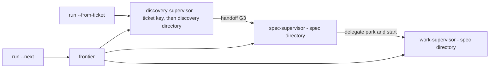
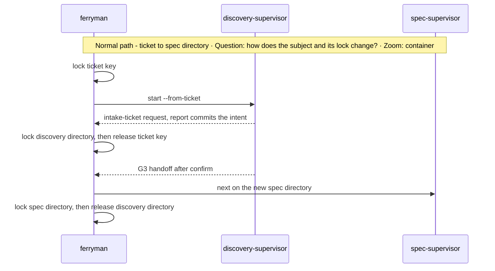
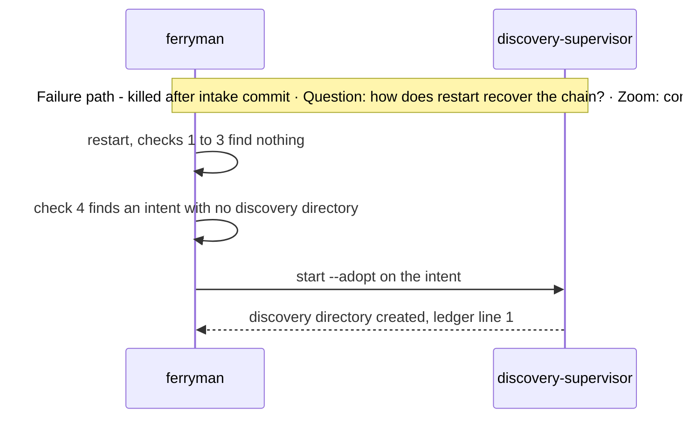

# Subsystem Design — Run chain, locks, and process boundary

**Decision sought:** Approve a run chain that carries one run from a ticket through discovery and spec authoring to work, keyed on subjects found in committed records, with per-subject locks, a v1 single-checkout policy, and a stated process boundary.

A run can restart anywhere in the chain because the current subject always re-derives from committed records or, in the local tier B, from local durable records. Three choices carry that:

- `ferryman` holds no chain state, and each step asks the frontier or the current supervisor.
- Every subject change holds the old lock until the new one is taken.
- The v1 checkout policy refuses the situations the supervisors cannot classify.

**Author(s):** Repository owner (draft)
**Status:** Draft
**Last updated:** 2026-11-07
**Reviewers:** Repository owner

Part of the [set index](README.md). [Page 03](03-ferryman-runtime.md) owns the loop, the worker interface, and the kill-point table. [Page 04](04-frontier-and-waves.md) owns the frontier.

## 1. Scope and Context

This page owns how a run changes subject and how two runs are kept apart.

| In scope | Out of scope | Why |
| --- | --- | --- |
| CLI entry points that start or continue a run | The supervisors' own commands | [Page 05](05-supervisors-and-gates.md) |
| Choosing the next supervisor and subject | Frontier derivation | [Page 04](04-frontier-and-waves.md) |
| Re-keying from ticket to discovery directory to spec directory | Intake inputs | [Page 05](05-supervisors-and-gates.md) |
| Subject and tracker locks, the v1 checkout policy | The Git-mutation lock and worktrees | [Page 08](08-worktree-and-concurrency.md) |
| Process boundary and its limits | Headless launch settings | [Page 03b](03b-headless-worker-launch.md) |

**Goals**
- After a kill at any chain boundary (B8 to B10 on page 03), `ferryman run` finds the current subject from committed records in 100% of fixture runs, with no read of `state.json`.
- A second `ferryman` on one subject is refused `ferryman-locked` in 100% of lock tests.

**Non-goals**
- Not a workflow engine. The chain is a derived order, and no file records it.
- Not a multi-run scheduler. One `ferryman` drives one run in one checkout in v1.

*Question: which entry point starts which supervisor, and how does the subject change? Zoom: container.*



## 2. Structural Model

Four entry points and one derivation make up the chain, and the fourth entry point is a bare `ferryman run` that resumes.

| Element | Type | Responsibility | Zoom |
| --- | --- | --- | --- |
| `run --from-ticket <ref>` | entry point | Starts the discovery-supervisor from a tracker ticket | component |
| `run --next` | entry point | Asks the frontier for one item and maps its kind to a supervisor and subject | component |
| `run --supervisor <id> <subject>` | entry point | Names the supervisor and subject explicitly, as a pool control plane does | component |
| `run` (no subject) | entry point | Resumes: derives the current subject by the five checks below | component |
| Subject derivation | component | Finds the current subject after a restart or a terminal state | component |
| `lock` | component | Subject, ticket, and tracker locks | component |

| Item kind from the frontier | Supervisor | Subject |
| --- | --- | --- |
| `shape-intent` | discovery | ticket key, then discovery directory |
| `author-brief`, `author-spec`, `review` | spec | spec directory |
| `run-spec` | work | spec directory |

`run-state.v1` lists the chain as `chain: [{supervisor_id, subject, state}]` with `state` one of `done`, `current`, or `waiting`, and a `current` entry. The single `supervisor_id` field stays as an alias of `current.supervisor_id`.

A session run ([05](05-supervisors-and-gates.md)) has one `chain` entry with no supervisor id and none of the five checks below. It takes the subject lock on `session-<hash>`, and its branch follows the same D58 and D59 rule.

After a terminal state or an approved status, the loop asks the frontier again. It carries no memory of the previous subject.

## 3. Runtime Model

A restart tries five checks in order, and the first match is the current subject. Checks 4 and 5 look only at the run branch's own commits after its marker commit, and more than one match in either parks `chain-ambiguous`. A bare `ferryman run` with no subject is the resume entry point: it derives the subject by these checks.

| Order | Check, from committed records | Current subject |
| --- | --- | --- |
| 1 | A spec with an admitted run that is not terminal (`work-supervisor status`) | the spec directory, supervisor work |
| 2 | An open spec ledger | the spec directory, supervisor spec |
| 3 | An open discovery ledger | the discovery directory, supervisor discovery |
| 4 | A tracker-origin intent committed on the run branch after its marker commit, whose `source-authority` locator has no discovery directory | `discovery-supervisor start --adopt <intent>` |
| 5 | The ticket named in the supervisor store's local `start --from-ticket` ledger line, or by a held `ticket-<hash>` lock, for a record that lies among the run branch's own commits after its marker commit | the ticket key, supervisor discovery |





The three chain kill points are on page 03: B8 (intake committed, discovery directory absent), B9 (both the ticket and the directory lock held), and B10 (scribe closed, delegated `park` or `start` not yet called). Each resolves through the order above, and none respawns a worker. Tracker reads are the last resort: when the tracker is unreachable and checks 1 to 4 are empty, the run parks `chain-ambiguous`.

**v1 single-checkout policy.** A run needs a branch and a clean tree, and it names what a developer may do during it.

| Rule | Refusal |
| --- | --- |
| (D59) `run` refuses on the default branch unless `--branch` creates `ferryman/<subject>` | `default-branch-refused` |
| `run` refuses a dirty tree at start | `checkout-dirty` |
| A branch switch during a run | `branch-changed` |
| An edit to an approval-bearing or protected path outside an attempt | `trust-set-changed` ([05b](05b-approval-integrity-and-trusted-configuration.md)) |
| Any other human edit between attempts | foreign history, which the supervisor classifies as it does today |

One branch name serves the whole chain. It is named `ferryman/<scheme>-<first 12 hex of sha256(ref)>`, which is a valid ref name whatever the ticket key holds, and it is not renamed when the spec directory appears: `ferryman` re-keys the run to the spec subject and keeps the branch, and a switch to any other branch refuses `branch-changed`. Intake and discovery commits land on it, as do spec, scribe, and work commits.

`ferryman` records a marker `refs/ferryman/branches/<name>` at the branch's start commit, which is the proof of creation that the branch-deletion invariant needs. `ferryman clean` deleting a `ferryman/*` branch follows the per-branch confirmation rule in D17 on [page 10c](10c-review-decisions.md).

One branch serves one subject (D58, revised). `ferryman run` refuses `subject-branch-unmerged` only when the same subject already has an unmerged branch other than the one being resumed. A branch is unmerged when its tip is not reachable from the fetched default branch and the human has not marked it done.

The frontier skips a ticket that already carries a `ferryman/*` branch or a `refs/ferryman/branches/<name>` marker. A human moves between intents by checking out a subject's branch and running `ferryman run` with no subject, which resumes from the committed or local ledger records. The default-branch, dirty-tree, and mid-run branch-switch refusals stand, and an unmerged branch of another subject blocks nothing.

The check reads local branches only and does not apply in pool mode, where each run has its own clone. The next action is to merge or delete the branch, or mark it done with `ferryman done <branch>`, which writes `refs/ferryman/done/<name>`. A branch the user made without `--branch` has no marker, so `ferryman` never treats it as its own, never deletes it, and the check ignores it.

A sibling's moved-`HEAD` check accepts a scribe commit when `ferryman` lists its sha in `--known-commits` on `next` and `report`.

That argument is an E1 and E2 design obligation on the sibling scripts.

**Supervision tiers (D9).** Discovery state lives in one of two tiers, so the set-wide invariant is that state derives from committed records or, in tier B, from local durable records.

| Tier | Where the ledger lives | What survives | Restart derives from |
| --- | --- | --- | --- |
| A | a Git-tracked discovery directory such as `docs/discovery/` | restarts, sessions, node changes, and machine loss | committed records and `HEAD`. Pool mode is allowed |
| B | `.context/discovery/`, a local durable ledger | process restarts and sessions on the same machine only | the local ledger file, written append-only with `fsync` and a hash chain, so a torn write is detectable |

The discovery supervisor writes its tier's ledger in a plain session as under `ferryman`, and resume and the adopt-with-no-rewrite handover work the same way in both. Tier B loses its ledger on machine loss, clone deletion, or a node change, and the discovery then restarts from the committed intent, if one exists. The refusals stay `ferryman`'s, and it refuses in tier B as follows:
- pool mode, with `local-tier-pool-refused`;
- any approval level other than `session-attested`, with `local-tier-level-refused`, which means tracker-verified approvals are not allowed there because their evidence would not survive the loss (a sub-rule of D9 confirmed by the owner);
- a hash chain broken before its tail, with `local-ledger-corrupt`. A torn tail is truncated to the last good hash (kill point B-L1).

The guarantees that compare against `HEAD` are limited in tier B, and exactly these change:
- The guard's sidecar slot shape (A6) compares a worker's edit with the pre-attempt chain tip, not with `HEAD`.
- The trusted configuration pin still covers committed files, but the local ledger is outside the trusted set. Its hash chain detects a torn or mid-edited ledger and not a full rewrite by a process running as the same user.
- Discovery gates G0 to G3 make no commit, so B-D1 and B-D2 do not apply and the attribution record is a ledger line, not a committed record. The artifacts a gate approves, such as brief, spec, and plan statuses, stay in the repository with their committed guarantees.

**Locks.** `ferryman` takes `<git-common-dir>/ferryman/locks/subject-<hash>.lock` for the run's supervisor subject, and `tracker-<hash>.lock` for each tracker locator it polls. Hashing the subject or locator makes two worktrees of one repository collide.

A lock file holds the pid and process start time.

A new `ferryman` reclaims it only when the pid is dead, the file is old enough, and the payload parses. An unparseable payload counts as live.[^1]

The subject lock differs from the page 08 Git-mutation lock, though both use the `lock` module. The Git lock is held for milliseconds and the subject lock for hours, so one shared file would block short Git work behind a long run. A run with no subject yet locks `ticket-<hash of ref>` first, and takes the discovery-directory lock before it releases it ([05](05-supervisors-and-gates.md)).

**Process boundary.** `ferryman` starts each worker in a new session (`subprocess.Popen(start_new_session=True)` on POSIX). It kills the process group on timeout.

Before it closes an attempt window it lists the processes still in the worker's session where the platform allows.[^2]

What `ferryman` cannot promise:
- A worker that calls `setsid` or double-forks leaves the session, and without cgroups or job objects `ferryman` cannot find it. It tests neither.
- On Windows no process containment is designed here. The supervisor's own Windows process control is the nearest model, and its fit is unverified.
- A detached process can write an `answer` file after the window closes. That exposure exists only for a gate whose `accept` list names `host-attested`, and the default list is `session-attested` only (D15, D20).
- `session-attested` is a prompt on `ferryman`'s own terminal and does not read the inbox. Unverified: whether a same-user process can inject input into that terminal.

## 4. Contracts and Invariants

Four rules hold the chain together.

| Semantic name | Parties | Inputs/outputs | Identity | Compatibility | Failure semantics | Invariant | Enforcement | Verification |
| --- | --- | --- | --- | --- | --- | --- | --- | --- |
| Chain derivation | ferryman, supervisors | committed records in, current subject out | subject | additive entry points | an ambiguous result parks `chain-ambiguous` | no chain state outside committed records | derivation never reads `state.json` | restart tests at B8 to B10 |
| Subject lock | ferryman, ferryman | lock files | subject hash | none | a second `ferryman` is refused `ferryman-locked` | one `ferryman` per subject, one poller per tracker locator | exclusive create, pid and start time in the file | two-ferryman test |
| Checkout policy | ferryman | branch and tree | none | none | the refusals above | no run on the default branch, no dirty start | checks before the first command | refusal tests |
| Process boundary | ferryman, worker | session, process group | attempt record | none | timeout kills the group | a worker leaves no process `ferryman` can find, where the platform allows | new session, group kill, session listing | hang test |

Call sites. The rows follow from them.

```text
ferryman run --from-ticket github://github.com/example/repo/issues/7
ferryman run --next                          -> frontier item, then the matching supervisor
ferryman run --supervisor spec docs/specs/f  -> explicit subject, no frontier
```

## 5. Data and State

The chain adds no state, and lock files are disposable.

| Element | State it owns | Lifecycle | Consistency requirement |
| --- | --- | --- | --- |
| Chain derivation | stateless | n/a | n/a |
| `lock` | lock files under the common Git directory | created at run start, removed at exit | one live holder per key |

## 6. Deployment and Operations

Nothing runs in the background.

| Deployment unit | Runs as | Scaling | Observability |
| --- | --- | --- | --- |
| `ferryman run` | foreground process | one per subject | `chain` in `state.json`, `ferryman-locked` refusals |

## 7. Quality Scenarios and Verification

Two scenarios cover restart and double `ferryman` processes.

| Source | Stimulus | Environment | Artifact | Response | Measurable target | Business consequence | Mechanism | Verification |
| --- | --- | --- | --- | --- | --- | --- | --- | --- |
| Operator | kills `ferryman` at B8, B9, or B10 | any | chain derivation | current subject found, no worker respawned | 3 of 3 boundaries | a ticket stalls between phases | the five-check order | kill-point tests |
| Operator | starts a second `ferryman` on one subject | any | `lock` | refused `ferryman-locked` | 100% of lock tests | two `ferryman` processes corrupt one run | exclusive lock | two-ferryman test |

## 8. Implementation Mapping

The chain, lock, and boundary code live in `ferryman` package.

| Semantic element | Source owner | Build unit | Deployable | Verification |
| --- | --- | --- | --- | --- |
| Entry points, derivation | `packages/ferryman/ferryman/{cli,chain}.py` | `ferryman` | CLI | chain fixtures |
| `lock` | `.../lock.py` | `ferryman` | CLI | two-ferryman and stale-lock tests |
| Process boundary | `.../workers/boundary.py` | `ferryman` | CLI | hang test |

## 9. Decisions, Alternatives, and Risks

[Page 10](10-decisions-and-records.md) owns decisions, and [page 13](13-rollout-spikes-and-risks.md) owns risks.

## 10. Rollout, Migration, and Reversal

[Page 13](13-rollout-spikes-and-risks.md) owns them.

## 11. Open Questions

- Unverified: whether `start --adopt` creates the discovery directory as described. `--known-commits` is an E1 and E2 design obligation on the siblings, not an open question. The repository owner answers.

## Evidence

[^1]: `packs/core/.apm/skills/work-intake/scripts/intake_transaction.py` (`WORKSPACE_LOCK_FILE`, 20-byte payload bound, unparseable payload treated as live) — verified. Orca `src/main/git/refs/maintenance/pack-refs-lock-ownership.ts` — assumption (local checkout).

[^2]: Process listing and `/proc` session scans differ by platform and were not checked — unverified.
