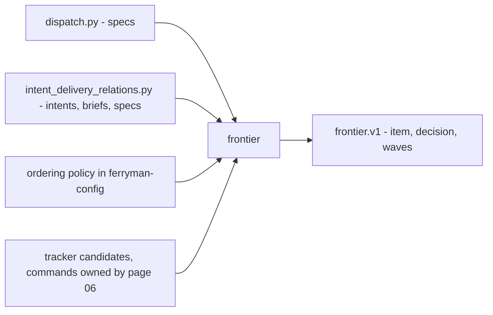
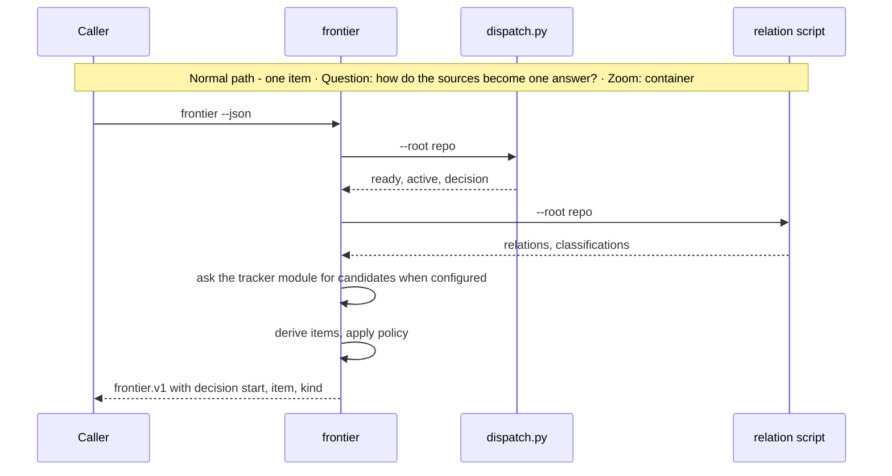
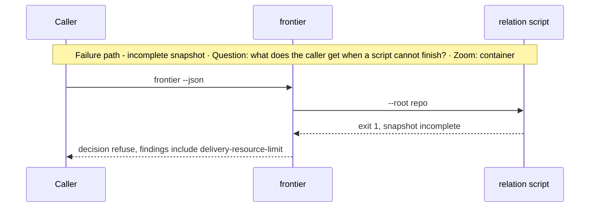

# Subsystem Design — Frontier and waves

**Decision sought:** Approve one read-only `frontier` query that turns two existing scripts and an optional tracker into five kinds of next work, with an explicit ordering policy in place of `ask` and a `waves` view over specs.

The frontier is the one place unattended work gets chosen, so it must be deterministic and must never pick silently. The design rests on three facts:

- It composes existing scripts by subprocess and edits none.
- It keeps the baseline `ask` answer unless the owner configures an order.
- It returns repository items alone when the tracker fails.

**Author(s):** Repository owner (draft)
**Status:** Draft
**Last updated:** 2026-11-07
**Reviewers:** Repository maintainers, work-loop owners

Part of the [set index](README.md). The output shape is `frontier.v1` on [page 01](01-contracts-and-data.md). Decisions are on [page 10c](10c-review-decisions.md), and risks are on [page 13](13-rollout-spikes-and-risks.md).

## 1. Scope and Context

The frontier reads and orders; it never starts work.

| In scope | Out of scope | Why |
| --- | --- | --- |
| One answer: the next item and its kind | Starting or running the work | Ferryman and supervisors act |
| Subprocess composition of two scripts and the tracker module | Editing `dispatch.py` | It sits in the `work-loop` skill, whose scripts are treated as pinned ([ADR-0144](../../adr/0144-work-loop-supervisor-owns-procedure.md)) |
| An ordering policy for several candidates | Priority semantics | The `Priority:` field "never decides readiness, dispatch, or order of work"[^1] |
| List a ticket carrying the `light` label as a `light_candidates` entry | Routing light work, serving it, or judging risk | A human starts it with `ferryman session` ([page 05](05-supervisors-and-gates.md)), and the frontier stays deterministic |
| A `waves` view of spec dependency layers | Parallel execution | [Page 08](08-worktree-and-concurrency.md) gates it |

**Goals**
- Two runs of `frontier --json` on one tree and one tracker snapshot give identical bytes, in 100% of a 50-tree fixture corpus.
- Every item has exactly one of the kinds `shape-intent`, `author-brief`, `author-spec`, `review`, `run-spec`. Otherwise the query returns `decision: none` with findings.
- With the default policy, several ready specs give `decision: ask`, and the unattended ferryman stops.

**Non-goals**
- Not a replacement for `ask`. A policy resolves it only when the owner configures one.
- Not an assignment mechanism across clones. The control plane assigns, or a claim ref does ([page 11](11-remote-agent-pool-seams.md)).
- Not a new source of truth. Facts come from artifact headers through the two scripts, plus tracker candidates when a tracker is configured.
- Not a tracker client. `ferryman`'s tracker module owns the verbs ([page 06](06-tracker-integration-and-authority.md)). This page owns how a candidate becomes an item.

*Question: which sources feed the frontier and what does it return? Zoom: container.*



`dispatch.py` sees specs only. The relation script sees headers across intents, briefs, and specs. Together they cover the pipeline, and neither is edited.

## 2. Structural Model

Four components derive, order, and layer the items.

| Element | Type | Responsibility | Zoom |
| --- | --- | --- | --- |
| `frontier.collect` | component | Run both scripts by subprocess, ask the tracker module for candidates when a tracker is configured, parse the JSON | component |
| `frontier.derive` | component | Map facts to the five item kinds | component |
| `frontier.order` | component | Apply the ordering policy, return the decision | component |
| `frontier.waves` | component | Layer `run-spec` items by `Depends on:`, flag path overlap | component |

| From | To | Nature | Protocol |
| --- | --- | --- | --- |
| `collect` | `dispatch.py` | calls | subprocess, `--root <repo>` |
| `collect` | `intent_delivery_relations.py` | calls | subprocess, `--root <repo>` |
| `collect` | tracker module | calls | subprocess through `ferryman`'s tracker module ([06](06-tracker-integration-and-authority.md)) |
| `derive` | `order` | passes items | in-process |

One row per item kind. The headers named already exist in the scripts and templates.

| Kind | Derived when | Served by |
| --- | --- | --- |
| `shape-intent` | a feature intent whose relation classification is `unresolved` with no route declared | discovery when installed (D3), else `intent frame` by hand |
| `shape-intent` (tracker source) | a tracker candidate with the shaping label, from a verified actor, whose ref matches no `source-authority` locator in the repository | `discovery-supervisor`, request `intake-ticket`, once E2 ships. Before E2 a ticket reaches an intent by manual `work-intake` |
| `author-brief` | an intent with route `brief` and no matching brief | spec |
| `author-spec` | an intent with route `spec` and no spec, or a Ready brief with a confirmed slice and no spec | spec |
| `review` | a brief `Draft` awaiting its Ready review, or a spec `Draft` or plan `Drafting` that has not passed pre-EXECUTE review | spec |
| `run-spec` | `dispatch.py` lists the spec as `ready` or `active` | work |

A tracker ticket with the verified label `[frontier] light_label` (default `light`) appears in the additive `light_candidates` field of `frontier.v1` and in no item. It is never served, and `run --next` and `ask` never see it, so a human reads the list and starts the work with `ferryman session --ticket <ref>`. An unmarked ticket takes the existing full path, and the frontier never judges risk.

The `shape-intent` tracker row stays a read-only candidate listing, and the bring-over itself is `work-intake` or `intake-ticket`, never the frontier.

The frontier also skips a ticket that already carries a `ferryman/*` branch or a `refs/ferryman/branches/<name>` marker (D58). Unverified: the exact `shape-intent` predicate. The relation script emits `direct-delivery`, `unresolved`, and `no-durable-child` classifications, and the full set of intent statuses and routes is read at implementation time.[^2]

When a brief exists, `ferryman` calls the brief-level runner's `next` only from a clean base checkout: the main worktree at the fetched tip, never a run branch or a pool clone on a run branch (D31). The answer is `{schema_version, base, action, standing_orders}`, where `action.kind` is one of `resume-slice`, `start-slice`, `await-gates`, `await-merge`, `complete`, or `blocked`.[^4] A `blocked` row carries a closed reason: `gate-not-clean`, `terminal-not-ready`, `in-flight-cap`, `pilot-in-flight`, `earlier-row-not-stopped`, `not-dispatchable`, `unreadable`, `refused`, `awaiting-decision`, or `supervisor-changed`.

Every verb refuses `not-main-worktree` or `base-not-default` unless it runs in the main worktree at the fetched tip, and refuses `base-not-committed` when anything under `docs/`, the work registry file, or the skill directory differs from the base, untracked files and an untracked `.gitignore` included.

It lists gates by running the supervisor's `gates` per slice worktree, and an unreadable listing is `unavailable`, never pending. Every `next` answer carries `schema_version: 1`, including a refusal `{"schema_version": 1, "refusal": {"code", "detail"}}`, and other verbs carry none. A refusal is one of `not-main-worktree`, `base-not-default`, `base-not-committed`, `invalid-policy`, or `invalid-standing-orders`, among others.[^4]

Every action object carries `base`, which is also top-level. `resume-slice` and `start-slice` carry `spec_path` (`docs/specs/<slug>`), `await-merge` carries `spec_paths` aligned with `slices`, and each `blocked` row carries its own `spec_path`. `await-gates` entries keep the supervisor's `spec_dir`, and `ferryman` requires `schema_version` (D56).

`start-slice` carries a `mode`: `run` for an Approved spec, `shape` for a Draft spec, and `author-spec` for a row with no spec yet. A `shape` or `author-spec` slice dispatches no implementer. When a brief exists, the brief runner decides which slice starts and when, and the spec phase of that slice runs under `spec-supervisor` when it is installed and otherwise under `work-loop`.[^7]

v1 single-checkout runs take an explicit subject and do not use brief ordering. Brief chaining arrives with `ferryman`-created slice worktrees (P6) or control-plane subjects. `ferryman` keeps its own files out of `docs/`, the work registry file, and the skill directory, except committed ledgers.

The frontier keeps its own derivation for the `shape-intent`, `author-brief`, `author-spec`, and `review` kinds.

A parked gate is not a frontier item. It shows in `gates`, so the frontier never offers work a human must unblock.

The ordering policy lives in `ferryman-config`. It has three modes:
- `ask` (default) returns `decision: ask` with the candidates.
- `list` follows an explicit ordered list of refs, then slug order.
- `kind-first` follows a kind order, with slug order inside a kind. The default order finishes before it starts: `run-spec` active, `run-spec` ready, `review`, `author-spec`, `author-brief`, `shape-intent`.

Reading `Priority:` as an input would make the field decide order, which its contract forbids. That use needs its own decision (D10 on [page 10c](10c-review-decisions.md)).

Waves layer `run-spec` items by `Depends on:` edges, which specs declare as typed references. Path overlap is a separate flag. Specs declare no touched paths.

**Waves and the brief.** A brief's Spec map is read by `lint-brief-coverage.py` for the spec slug in the first cell and the recorded status in the last cell, and the brief-level runner reads only the first cell in table order. `author-delivery-brief` calls the Spec map mechanically present and not a semantic gate field, and no existing brief defines waves as a field.[^6]

The `waves` view derives its layers from `Depends on:` edges and never authors them. An authored wave label in a brief's planning table must agree with the derived layers. A machine-read Wave field would need an owner amendment of the brief skill, and a Wave column in the Spec map must sit between Spec and Status, never last.

The optional `**Touches:**` line exists only on plan tasks, and the plan says it "predicts no parallelism".[^3] The view marks overlap `unknown` when any task omits `Touches:`. It marks it `declared`, with the union of globs, when every task has one.

## 3. Runtime Model

One call answers with an item, and any source failure shrinks the answer instead of guessing.

| Scenario | Trigger | Path |
| --- | --- | --- |
| Answer with one item | `ferryman frontier` | normal |
| Several candidates, default policy | two ready specs | `ask`, `ferryman` stops |
| A script fails or the tree is unsafe | non-zero exit or `dispatch` refusal | failure / recovery |
| Tracker refused, rate-limited, or unreachable | tracker module error | failure / recovery: repository items plus the finding `tracker-unavailable`, and no tracker item |





The relation script exits 1 for an incomplete snapshot and still prints JSON. The frontier turns that into a refusal with findings and offers no item, because a partial view could start the wrong work.

## 4. Contracts and Invariants

The query is read-only, keeps `ask`, and refuses on a partial view.

| Semantic name | Parties | Inputs/outputs | Identity | Compatibility | Failure semantics | Invariant | Enforcement | Verification |
| --- | --- | --- | --- | --- | --- | --- | --- | --- |
| frontier query | caller to `frontier` | `--root`, optional `--policy`, `--waves` in; `frontier.v1` out | item `ref` such as `spec:<slug>` | additive fields only | script failure gives `decision: refuse` with findings; exit 0 whatever the decision, as `dispatch.py` does | read-only; deterministic for one tree and one tracker snapshot | no write calls, sorted output | determinism and write-absence tests |
| dispatch composition | `frontier`, `dispatch.py` | JSON `ready`, `active`, `decision` | spec path | tracks `SCHEMA_VERSION = 1` | unknown version refuses | keeps `ask` | passthrough of `decision` under the default policy | policy tests |
| relation composition | `frontier`, relation script | JSON `relations`, `classifications`, `complete` | intent id | tracks its `schema_version` | `complete: false` refuses | no item from an incomplete snapshot | check `complete` | partial-snapshot test |

Call sites. The rows follow from them.

```text
ferryman frontier --json                       -> {"decision":{"action":"ask","candidates":["docs/specs/a","docs/specs/b"]},"items":[...]}
ferryman frontier --json --policy kind-first   -> {"decision":{"action":"start","item":"spec:a","kind":"run-spec"}}
ferryman frontier --waves --json               -> {"waves":[["spec:a","spec:c"],["spec:b"]],"overlap":{"spec:a":"unknown"}}
```

`--policy kind-first` uses the default order unless `ferryman-config` sets `kind_order`.

## 5. Data and State

The frontier holds no state, and its one input file is read-only.

| Element | State it owns | Lifecycle | Consistency requirement |
| --- | --- | --- | --- |
| `collect`, `derive`, `order`, `waves` | stateless | n/a | n/a |
| Ordering policy | `ferryman-config` file, repository-owned | edited by the owner, reviewed like code, pinned per run ([05b](05b-approval-integrity-and-trusted-configuration.md)) | one policy file; a flag may only select a named mode |

## 6. Deployment and Operations

One short process runs once per loop turn.

| Deployment unit | Runs as | Scaling | Observability |
| --- | --- | --- | --- |
| `ferryman frontier` | short process in `ferryman` package | one call per loop turn, bounded by the scripts' own limits | decision and finding codes in `events.jsonl` |

## 7. Quality Scenarios and Verification

Three scenarios guard against flapping order, silent picks, and silent version drift.

| Source | Stimulus | Environment | Artifact | Response | Measurable target | Business consequence | Mechanism | Verification |
| --- | --- | --- | --- | --- | --- | --- | --- | --- |
| Ferryman | calls frontier twice | unchanged tree and tracker snapshot | `frontier.derive` | equal bytes | 50 of 50 fixture trees | flapping order starts the wrong work | sorted output | determinism test |
| Ferryman | two ready specs | default policy | `frontier.order` | `ask` | 100% | an unattended run picks silently | passthrough | policy test |
| Maintainer | `dispatch.py` raises its schema version | upgrade | `collect` | refusal naming the version | 100% | silent misparse | version check | version test |

## 8. Implementation Mapping

All frontier code lives in `ferryman` package.

| Semantic element | Source owner | Build unit | Deployable | Verification |
| --- | --- | --- | --- | --- |
| `collect`, `derive`, `order`, `waves` | `packages/ferryman/ferryman/frontier/` | `ferryman` | CLI | fixture-tree tests |

The frontier finds both scripts through the registry on [page 02](02-install-trust-and-detection.md). `dispatch.py` is pinned: the first admitted `start` records the sha256 of every file under the installed `work-loop/scripts/`, and each entry point compares before it imports.[^5] The frontier only calls it, and changing the installed copy during a run voids the run.

## 9. Decisions, Alternatives, and Risks

[Page 10](10-decisions-and-records.md) owns decisions and alternatives, and [page 13](13-rollout-spikes-and-risks.md) owns risks.

## 10. Rollout, Migration, and Reversal

[Page 13](13-rollout-spikes-and-risks.md) owns them.

## 11. Open Questions

- The frontier before `ferryman` (no decision number). Default: users name the subject, and no standalone frontier script ships.
- Which intent header values mark an intent as needing shaping, versus closed or delivered? The `navigate-intents` owners answer by listing the statuses and routes in the intent template.

## Evidence

[^1]: `packs/core/.apm/skills/work-loop/scripts/lint-priority-field.py` docstring — verified.

[^2]: `packs/core/.apm/skills/navigate-intents/scripts/intent_delivery_relations.py`, `classification` values counted by search — verified for the three names, unverified for completeness.

[^3]: `packs/core/.apm/skills/new-spec/assets/plan.md`, "Optional `Touches:` grammar" — verified; the spec template has no touched-paths field.

[^4]: Brief-level runner reference `references/brief-runner.md` (verbs, `next` keys, `mode` values, action and blocked reasons, refusal codes, main-worktree and base rules, slice worktrees found by branch name, gates per worktree) and `scripts/brief-runner.py` (`NEXT_SCHEMA_VERSION`, `spec_path`, `spec_paths`, `spec_dir`) — verified (read, merged, ADR-0159 Accepted, core 4.0.22).

[^5]: The pin set (every file under installed `work-loop/scripts/`, plus `supervisor-policy.json` and `review-rules.json`) — stated by the work-loop owner, not independently checked.

[^6]: The Spec map reading rules and the absence of a waves field — verified for the absence of a waves field (`lint-brief-coverage.py` searched for "wave", no match) and the Spec map text in `author-delivery-brief/SKILL.md`; the cell-reading rules of `lint-brief-coverage.py` are unverified, and the brief-level runner's first-cell reading is verified (read, `brief-runner.py`).

[^7]: That `spec-supervisor`, when installed, takes the spec phase of a brief-runner slice whose `mode` is `shape` or `author-spec` is a design item for E1 — unverified.
