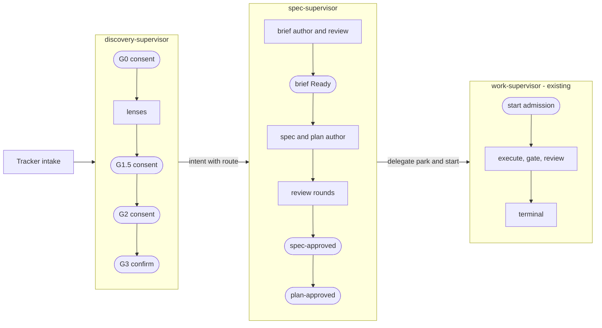
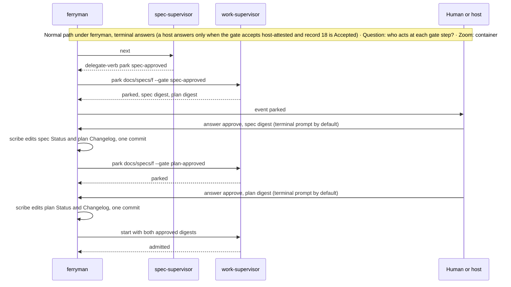

# Architecture Change — Sibling supervisors and gates

**Decision sought:** Approve a discovery supervisor and a spec supervisor as siblings of `work-supervisor.py` under one command contract, with ticket intake and a rejection route.

Each phase before execution gets its own supervisor, and the pinned work supervisor stays unedited. Three choices carry this:

- Siblings share one command contract, so `ferryman` treats all three alike.
- Every phase boundary is a gate or a committed status, so a crash re-derives from the repository.
- Page 05b ([approval integrity](05b-approval-integrity-and-trusted-configuration.md)) owns the approval path, so these supervisors never write an approval.

**Author(s):** Repository owner (draft)
**Status:** Draft
**Last updated:** 2026-11-07
**Reviewers:** Repository owner

**Baseline — current architecture:** [Work-loop execution supervisor](../work-loop-execution-supervisor.md), [supervisor stages](../work-loop-supervisor-stages.md), [ADR-0144](../../adr/0144-work-loop-supervisor-owns-procedure.md), [ADR-0157](../../adr/0157-work-loop-approval-gates-park-instead-of-halting.md), and the discovery gates in `packs/product-engineering/.apm/skills/discovery-loop/SKILL.md`.

Part of the [set index](README.md). The `ferryman` loop is on [page 03](03-ferryman-runtime.md), the guard, trusted configuration, and scribe on [page 05b](05b-approval-integrity-and-trusted-configuration.md), and tracker evidence on [page 06](06-tracker-integration-and-authority.md).

## 1. Scope and Baseline

Five items change, and the work supervisor does not.

| Delta item | In scope | Why it changes |
| --- | --- | --- |
| Command contract (`supervisor-manifest.v1`) | yes | `ferryman` is written against commands, not one script |
| Discovery supervisor for `discovery-loop` | yes | G0 to G3 run on prose today, and RFC-0053 chose no engine |
| Spec supervisor | yes | The work supervisor holds no pre-approval state by design |
| Rejection route and ticket intake | yes | A gate needs an answer other than approve, and a ticket needs a way in |
| Edits to `work-supervisor.py` | no | Pinned; an edit voids runs |
| Light mode as a session route of `ferryman` (D75) | yes | Direct-light leaves no spec and no plan, so no supervisor can drive it and a human launches it |
| Review obligation tiers and code-review round cap | no | [ADR-0158](../../adr/0158-review-obligation-policy-round-cap-and-tiers.md) covers code review only |

| Unchanged context | Link |
| --- | --- |
| `park`, `gates`, `start` semantics and gate records under the Git directory | [supervisor reference](../../../packs/core/.apm/skills/work-loop/references/supervisor.md) |
| Discovery verdict enum and cascade | `discovery-loop/references/gate-state-machine.md` |
| Pre-EXECUTE reviewer procedure | `work-loop/references/pre-execute-review.md` |
| Rejected planning gates | `work-loop/references/delivery-contract-lifecycle.md`[^1] |
| Light mode procedure | `work-loop/references/light-mode.md`, changed only by the PL slice[^4] |

**Session route (D75).** Light mode ships in v1 as a supervisor-less route that leaves no spec and no plan, as `work-loop` direct-light does today.[^4] A local human starts it with `ferryman session [--ticket <ref>] <prompt-or-request-file>`, and that invocation is the authority, since an issue or pull request is only context.

`--ticket` fetches the ticket through the tracker module as untrusted context. No model triages the request, no `mode-decision` record exists, and the `light` label carries no authority and only lists a candidate.

The route is a driver kind `session` beside `supervisor`. It runs one worker session from one `light-session` order (role and profile, prompt file, cwd, limits, allow list), on a `ferryman/session-<hash>` branch or in a checkout that refuses a dirty tree, as `run` does (D58, D59).

It reuses the workers, profiles, limits, orphan handling, projector, events, inbox, control files, locks, and the path-based guard checks (`worker-commit`, `worker-moved-ref`, protected paths, and a working-tree check that also refuses an untracked path outside the declared files[^6]). It does not use the next and report loop, the run chain, the scribe, approval attribution, parked gates, supervisor descriptors, or the spec supervisor.

The worker returns `handoff`, `escalate-full`, `needs-human`, or `blocked` in a required result file or token. Exit status 0 carries no meaning on any of the four CLIs tested, and a prose-question stop with exit 0 maps to `needs-human` by default.[^6]

`escalate-full` and `needs-human` park the run `light-escalated`, and a human starts the full path or answers. `blocked` stops the run with `needs-attention` and a reason such as "mandatory reviewer unavailable". `ferryman` never restarts a light run as full and never respawns a light session (`max_respawns` is 0).

The controller checks "reached direct-light" deterministically: a clean `git status` limited to the declared files, no `docs/specs/` or work-registry change, and a recorded reviewer outcome, because the transcript is never evidence.[^6]

The worker never commits. The result is the uncommitted tree plus the checkpoint ref `refs/ferryman/sessions/<run-id>/product`, and a human or the control plane commits, pushes, and opens the pull request.

A session has no resume: a kill parks `session-interrupted` and keeps the tree and checkpoint ([page 03](03-ferryman-runtime.md) lists the boundaries and exit codes). Pool mode refuses a session run (`session-pool-refused`, [page 11](11-remote-agent-pool-seams.md)).


## 2. Structural Change

| Element or relationship | Change type | Baseline reference |
| --- | --- | --- |
| `supervisor-manifest.v1` and six commands `start`, `next`, `report`, `status`, `park`, `gates` | added | the command table in the supervisor reference |
| `discovery-supervisor.py` in `discovery-loop` | added | RFC-0053 coordinator (agent edits sidecar files) |
| `spec-supervisor.py` in `new-spec` | added | none |
| `delegate-verb` request kind | added | none |
| Aggregate `gates` view across supervisors | added | `gates` lists one store |

*Question: which supervisor owns which phase, and where are the human gates? Zoom: container.*



Rounded boxes are human gates.

**Discovery doors (D3).** Two doors lead to an intent, and discovery is optional: standalone `intent frame` writes a plain intent, and `discovery-loop` is the door for raw ideas and tickets that need shaping.

The short route (`intent frame`, `de-risk`, `decompose`) stays in the intent skill with no supervisor. `start --adopt <intent-ref>` opts a committed intent into discovery by creating its sidecar, and `start --from-ticket <ref>` starts from a tracker ticket (below).

**Discovery shape.** The subject is a discovery directory in tier A (tracked, such as `docs/discovery/`) or tier B (local `.context/discovery/`; D9, [page 03c](03c-run-chain-locks-and-process-boundary.md)). State derives from sidecar slot statuses, verdict rows, and the connectedness lint, and in tier B from the local hash-chained ledger.

Lens writers write distinct slots, so the supervisor can issue disjoint lens requests with `next --width N`, which depends on D36 ([page 11](11-remote-agent-pool-seams.md)). `ferryman` uses width 1 in v1, and a pool can fan lens requests across nodes.

| Discovery request kind | Worker mode | Result the supervisor checks |
| --- | --- | --- |
| `intake-ticket` (owner decision D16) | headless or attach | a tracker-origin intent file exists with a `source-authority` locator that matches the ticket ref |
| `frame`, `diverge`, `lens`, `decompose` | headless or attach | slot file present, `status: proposed`, lints green |
| `reconcile-review` | headless, a profile different from the lens writers | typed findings recorded |
| `lint` | supervisor-run | connectedness lint exit code |
| `consent` (G0, G1.5, G2, G3) | human only | a typed verdict from the discovery verdict enum |

**Intake from a ticket.** A headless worker has no human session, so the repository supplies what `work-intake` asks a human to confirm: a destination and an authority mode.[^2]

| Input | Source | Rule |
| --- | --- | --- |
| Destination directory | `[intake] destination` in `ferryman.toml` | must resolve through `resolve_surface` as a closed candidate, else `destination-required` and no write |
| Authority mode | `[intake] authority_mode` | validated against the allowed set |
| Processor | `[intake] processor` | a tracker profile id and version that the registry knows |
| Permission | `[intake] allow`, `max_per_day` | `allow` defaults to `false`; the supervisor refuses past `max_per_day` |
| Ordinal | `intent_ordinal.py --dir <destination> --token <TOKEN>` | run by the discovery-supervisor during `report`, never by the worker |
| Creation | the worker returns a `normalized-intake` envelope, and the discovery-supervisor runs `intake_transaction.py` during `report` | the transaction commits, rolls back, or reports reconciliation required |

When `[intake]` is absent or `allow` is false, the request becomes a `consent` gate `intake-confirm` that a human answers with the destination and authority mode, for that ticket only. The answer passes the same validation as `[intake]`, a closed candidate destination and the allowed authority set, and ticket-derived values are never offered as defaults. `[intake]` is part of the trusted configuration set ([05b](05b-approval-integrity-and-trusted-configuration.md)), so a worker cannot widen it.

`intake-confirm` needs no `ferryman`: a session human runs `answer intake-confirm` at the `in-session` level, validated like `[intake]`. `allow = true` is `ferryman`-only.

Before the intent exists the run has no directory, so `ferryman` keys it on `ticket-<hash of ref>` and locks that key ([03c](03c-run-chain-locks-and-process-boundary.md)). The supervisor's `start --from-ticket` records one local ledger line under its store.

After `intake-ticket` commits the intent, the discovery-supervisor creates `docs/discovery/<intent-slug>/` in a second commit and commits its first ledger line (D64). [Page 03c](03c-run-chain-locks-and-process-boundary.md) owns the re-keying and the lock handover.

`start --adopt` skips the ticket phase and keys on the directory from the start.

**Spec shape.** The spec supervisor is a sibling and not a stage of `work-supervisor.py`. The work supervisor owns procedure from an Approved spec and nothing about what counts as accepted.

The sibling keeps a committed append-only ledger, one commit per step. When a brief exists, the brief runner decides which slice starts and when, and a slice whose `mode` is `shape` or `author-spec` runs its spec phase under this supervisor when installed, otherwise under `work-loop` ([04](04-frontier-and-waves.md)).[^10]

| Spec request kind | Worker mode | Result the supervisor checks |
| --- | --- | --- |
| `author-brief` (delegates to `author-delivery-brief`)[^11], `author-spec` | headless or attach | artifact present, `Status: Draft`, template lints green |
| `review-round` (one per reviewer role) | headless, a profile different from the author | raw report classified by `review-artifact.py raw-classify` |
| `adjudicate` | headless, a profile different from the reviewer | typed adjudication |
| `revise` | the author profile | sustained findings addressed, `Status` unchanged |
| `delegate-verb` | ferryman-run | `park` answers `parked` or `current`; `start` answers `admitted` |
| `consent` (`brief-ready`, `spec-approved`, `plan-approved`) | human only | a verified answer, applied by the scribe under `ferryman` or by the human approver in a session |

The round cap is new policy: ADR-0158 excludes pre-approval reviews, and `pre-execute-review.md` iterates to clean with no limit.[^3] The supervisor reads `max_review_rounds` from `spec-policy.json` and at the cap parks a `consent` gate naming the open findings.

## 3. Runtime Change

An approval is a verified answer, a scribe commit, and a delegated command, and rejection reverses it.

| Journey or scenario | Change type | Baseline reference |
| --- | --- | --- |
| Gate park, answer, scribe write, admit | modified | [ADR-0157](../../adr/0157-work-loop-approval-gates-park-instead-of-halting.md) |
| Spec rounds with a different reviewer | new | [pre-execute review](../../../packs/core/.apm/skills/work-loop/references/pre-execute-review.md) |
| `reject` or `request-changes` answer | new | rejected planning gates |
| Scribe commit lands, then `park plan-approved` or `start` refuses | new | the approval stays committed, the run parks `needs-attention`, and a human answers `request-changes` to return both artifacts to Draft (D21) |
| Session: the human runs `answer`, and the agent never does | new | ADR-0157 D4 |
| Session: discovery verdict rows, slot status, and brief `Status: Ready` written after a human answer | new | the sibling's `report` |
| Discovery lens fan-out | new | RFC-0053 convergence loop |

**Driving a sibling in a session.** Without `ferryman` the session agent is the controller. It calls `start`, `next`, and `report`, carries out each request itself (authoring in the session, reviewers as subagents, `delegate-verb` as a command), and stops at every `consent`.

`work-loop` is the one front door. With the spec supervisor installed, its spec-plan mode drives pre-approval through it and calls `work-supervisor start` at plan approval (`delegate-verb`), and without it `references/pre-execute-review.md` is the procedure.[^11]

Request-kind modes gain `session` beside `headless` and `attach`. A gate parks through the existing `park` command with no `--known-commits`, and the same commands later run under `ferryman` unchanged.[^5]

**Approval in a session.** The human approver writes `Status: Approved`, the dated plan Changelog line, and on rejection the revert to `Draft` (spec) and `Drafting` (plan), as ADR-0157 D4 has it today.[^8] The session agent never writes an approval, and no scribe, `approval-fields.v1` guard, or attribution record runs.

**Guard in a session.** The sibling's `report` refuses a consent with no human answer record (`no-human-answer`) and a wrong request id, and applies the moved-`HEAD` check, while the full guard and the scribe begin with `ferryman`.

The supervisor ships a human-run verb, `answer <gate> --decision <approve|reject|request-changes> --by <name>`. It checks that the gate is pending and the digest is the parked one, and records `{gate, decision, digest, by, time}`.

`answer` needs a controlling terminal and refuses `no-tty` otherwise. Its record states that the identity is unverified: `--by` is a name and not a check. G0 to G3 consent stays usable in a session at the `in-session` level.

**Attribution in a session.** The level is `in-session`: a human answer with no identity check, unlike `session-attested` (D20). The discovery supervisor writes its tier's ledger in a session as under `ferryman`, so resume and adopt behave the same in both, and the approval-fields contract and the tier B refusals belong to `ferryman`.

**Rejection in a session.** The human answers `reject` or `request-changes` and reverts the pair to Draft by hand, and `next` then issues `revise` or parks a `human-decision`, as under `ferryman`.

`status` exposes the gate's answer and `decision`, and `next` returns a `parked` refusal while a gate waits. A stub showed these shapes, which real siblings must add.[^7] In a session, review independence means distinct agent definitions.

**Instruction text.** Five rules apply: read the decision from `status`, never run `answer` or write an answer record or the store, run one command per verb, name the file-write tool generically ('Write, apply_patch or equivalent'), and carry a compact table of request kinds with their result-fact shapes.

`weak` is the control for review independence, and no agent self-approved in three tempting runs.[^7]

**Resume.** A fresh session calls `status` first and re-takes the same request id. `status` shows a pending request before `next` opens its attempt, so the attempt record `attempts/N.json` (and `N.reported`) is the open signal.[^9]



**Rejection.** An `answer` carries one of three decisions. `approve` applies the steps above.

`request-changes` returns the pair to authoring for a revision. `reject` returns the pair and also stops automatic revision.

Under `ferryman`, for both non-approve decisions the scribe sets the spec to `Draft` and the plan to `Drafting` in one commit under the write-ahead rule ([page 05b](05b-approval-integrity-and-trusted-configuration.md)). After `request-changes` the spec supervisor issues `revise` with the human's note as untrusted context.

After `reject` it parks a `human-decision` that offers revise or abandon. The decisions apply only before `start`. The guard allows the Draft revert, and the scribe writes the attribution record with the decision.

## 4. Contract and Invariant Change

Four contracts change, each a new command or request shape.

| Semantic name | Change type | Baseline reference | Compatibility during transition | Enforcement | Verification |
| --- | --- | --- | --- | --- | --- |
| Supervisor command contract | new | supervisor command table | `work-supervisor.py` conforms through a `ferryman` process-held descriptor; siblings ship `supervisor.toml` | registry refuses unknown manifest or version | conformance test per supervisor |
| Discovery and spec requests | new | `execution-request.v1` | reuse the envelope `{schema_version, request_id, run_id, kind, stage}`; each sibling defines its own `stage` enum and per-kind schemas | schema | schema tests |
| `delegate-verb` request | new | none | `ferryman` runs only commands the manifest lists in `delegates_to`, such as `park` and `start` for `work-supervisor` | allowlist in `registry` | unlisted-command refusal test |
| `--known-commits <sha,...>` on `next` and `report` | new, provisional (D60) | `next`, `report` | absent means no scribe commit is known | the sibling's moved-`HEAD` check accepts only listed scribe commits | sibling test |
| `next --width N` | new, optional | `next` | absent means 1; `work-supervisor.py` never sees it | manifest `max_width` | width test |

```text
spec-supervisor.py next docs/specs/f --known-commits 3f9a1c0  -> {"request":{...}}
spec-supervisor.py next docs/specs/f   -> {"request":{"kind":"review-round","role":"adversarial","exclude_profile":"author-1"}}
spec-supervisor.py report docs/specs/f result.json -> {"refusal":{"code":"worker-set-approval","owner":"controller"}}
```

Siblings write gate records under their own store root, never into `work-supervisor.py`'s `gates/` directory, whose tolerance of foreign records is unverified.

## 5. Data/State Migration

Ledgers are new, and the baseline files stay as they are.

| Data element | Old shape | New shape | Migration mechanism | Rollback |
| --- | --- | --- | --- | --- |
| Discovery state | agent edits to sidecar, decision log in `.context/discovery/` or `docs/discovery/` | the same files plus a committed `ledger.jsonl` in the discovery directory | adopt on first `start --adopt` or `--from-ticket`; no rewrite | revert the ledger commits; the sidecar stays valid |
| Spec state | none; review files under `.context/reviews/<run-id>/` | committed ledger in the spec directory, one line per step | the first `next` writes the first line | revert the step commits |

A partial migration leaves a ledger that ends early, and the supervisor re-derives from headers and statuses.

## 6. Deployment/Operational Change

| Deployment unit | Change type | Baseline reference |
| --- | --- | --- |
| `discovery-supervisor.py` | new, ships with `discovery-loop` (user or repo scope) | none |
| `spec-supervisor.py` | new, ships in `new-spec` (repo scope), driven by `work-loop` | none |

A supervisor ships in the skill that owns its artifact (`discovery-loop`, `new-spec`, `work-loop`), and `work-loop` is the front door that calls them.[^11]

## 7. Quality Regression and Verification

Review independence, integrity, and convergence are at risk.

| Attribute at risk | Baseline target | Stimulus that could regress it | Verification |
| --- | --- | --- | --- |
| Review independence | reviewers are distinct agents | one profile authors and reviews | 100% of rounds record a distinct profile or are flagged `weak` |
| Supervisor integrity | a refusal writes no commit | a sibling writes on refusal | refusal test per sibling |
| Convergence | iterate to clean | an endless review loop | at `max_review_rounds` the supervisor parks `consent` and issues no further round |

## 8. Build Mapping

Two supervisors and one contract make up the build.

| Semantic element | Change type | Source owner | Build unit | Deployable | Verification |
| --- | --- | --- | --- | --- | --- |
| Discovery supervisor | new | `packs/product-engineering/.apm/skills/discovery-loop/scripts/` | skill | pack install | pack tests, manifest test |
| Spec supervisor | new | `packs/core/.apm/skills/new-spec/scripts/` | skill | pack install | pack tests, manifest test |
| Command contract | new | the core pack owns the schema, `ferryman` consumes it, and a copy sits at `contracts/ferryman/supervisor-manifest.v1.schema.json` | contract | none | schema tests |

Each sibling hashes its own installed files against digests pinned at its first admitted `start`, and a test asserts the copied pin code behaves like the baseline's, since the work-loop scripts are not importable by name. Unverified: how much of the work supervisor's attempt-manifest and commit machinery a sibling can copy without editing the original.

## Evidence

[^1]: `packs/core/.apm/skills/work-loop/references/delivery-contract-lifecycle.md` § Rejected planning gates — verified.

[^2]: `packs/core/.apm/skills/work-intake/SKILL.md` ("Confirm before changing location, authority mode, or processor mapping"; `resolve_surface`), `scripts/intent_ordinal.py`, `scripts/intake_transaction.py` statuses — verified by reading, call signature not read.

[^3]: `docs/adr/0158-review-obligation-policy-round-cap-and-tiers.md` "Applies to"; `work-loop/references/pre-execute-review.md` — verified by keyword search.

[^4]: `packs/core/.apm/skills/work-loop/references/light-mode.md` (the explicit trusted invocation is the authority, an issue or PR is context, no spec, no plan, no work-registry mutation, a missing review is `BLOCKED`) — verified by reading. The PL slice adds that a local, human-launched `ferryman session` is such an invocation; the file does not say so now ([page 13](13-rollout-spikes-and-risks.md) PL).

[^5]: `work-loop/references/supervisor.md` and ADR-0157 describe a session agent driving `work-supervisor` and a human approving a parked gate. A real sibling does not exist until E1: unverified.

[^6]: Spike S2, 2026-11-07, four CLIs: exit status 0 followed a result, a prose question, and a Codex stop, three CLIs printed no direct-light decision record, a Pi run stopped BLOCKED with the reviewer tool missing, and a Pi run wrote an untracked `docs/product/captured/` file — verified (tested, single run, 2026-11-07). Surface-and-stop was untested on the other prompts: unverified.

[^7]: Spike S3, 2026-11-07, stub supervisor with Claude Code: the response shapes above, no distinct reviewer without a prompt, and no self-approval in three runs with a tempting prompt — verified (tested, single run, 2026-11-07). The stub is not the real `work-supervisor.py`: unverified.

[^8]: ADR-0157 D4 and `work-loop/references/supervisor.md` § Parked gates ("the spec approver then writes `Status: Approved` and the plan Changelog entry"; reject returns the pair to drafting) — verified by reading. The `in-session` level, session-mode `report` refusal, and a recording verb are not in ADR-0157: unverified design items for E1.

[^9]: Real-supervisor resume test, 2026-11-07: a session agent drove the unedited pinned `work-supervisor.py` and was killed with a request open, and a fresh session re-took the same request id in 4 of 4 resume-capable tries (Claude Code twice, Codex, Copilot), with no agent writing an approval, answer record, or the store — verified (tested, single run each, 2026-11-07). `spec-supervisor` does not exist, so the test is a proxy ([page 13](13-rollout-spikes-and-risks.md) lists what is untested).

[^10]: That `spec-supervisor` takes the spec phase of a brief-runner slice by default — unverified design item for E1.

[^11]: Front door, pre-execute-review fallback, `author-brief` delegation to `author-delivery-brief`, and the shipping rule — design rules for E1, unverified.
