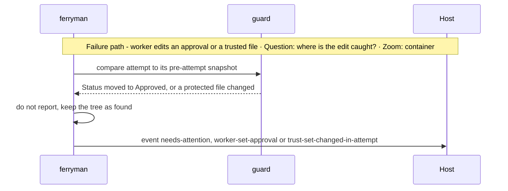
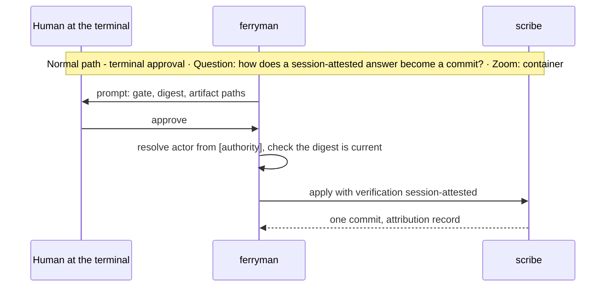
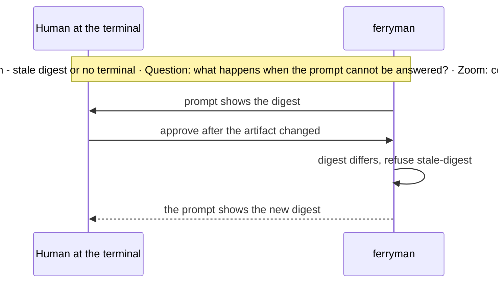

# Architecture Change — Approval integrity and trusted configuration

**Decision sought:** Approve an approval invariant enforced by a guard, a trusted configuration set that each run pins, and a gate scribe that writes approvals under a write-ahead record.

Unattended runs stay safe if approval comes only from a human and nothing a worker touches can change who counts as one. Three reasons support this:

- The guard compares full Git state and protected files, so a worker's shell cannot hide an edit.
- The pin fixes the approver set for the whole run.
- The scribe writes each approval under a write-ahead record, so a crash leaves no half-approval.

**Author(s):** Repository owner (draft)
**Status:** Draft
**Last updated:** 2026-11-07
**Reviewers:** Repository maintainers, security reviewer, work-loop owners

**Baseline — current architecture:** [Work-loop execution supervisor](../work-loop-execution-supervisor.md) (attempt manifest, `approvals.jsonl`), [ADR-0157](../../adr/0157-work-loop-approval-gates-park-instead-of-halting.md), and the approval entry form in `work-loop/references/supervisor.md`.

Part of the [set index](README.md). Page 05 ([supervisors and gates](05-supervisors-and-gates.md)) owns the supervisors and requests. [Page 03](03-ferryman-runtime.md) owns the kill-point table, and [page 03c](03c-run-chain-locks-and-process-boundary.md) owns the process boundary.

## 1. Scope and Baseline

Four items change, and the baseline approval files stay byte-exact.

| Delta item | In scope | Why it changes |
| --- | --- | --- |
| Approval attribution record | yes | Unattended approval needs who, how, and evidence on record |
| Approval guard | yes | A worker must never set an approval |
| Trusted configuration set | yes | A ticket must not steer a worker into changing who may approve |
| Gate scribe with write-ahead intent | yes | An approval edit must survive a crash |
| `approvals.jsonl` and the Changelog approval line | no | The supervisor writes the first, and a reworded second changes the gate digest |

| Unchanged context | Link |
| --- | --- |
| Attempt manifest and moved-`HEAD` rule | `_supervisor_attempt.py`[^1] |
| Approval entry form | `work-loop/references/supervisor.md`, *Approval entry*[^2] |

## 2. Structural Change

Four elements are new, and the guard runs in `ferryman` and in each sibling.

| Element or relationship | Change type | Baseline reference |
| --- | --- | --- |
| `approval-attribution.v1` record in `approval-attributions.jsonl` | added | `approvals.jsonl` |
| Approval guard reading `approval-fields.v1` | added | `report` refusals for trusted-file and `delivery/` edits |
| Trusted configuration set, pinned per run | added | the supervisor pins its own scripts |
| Gate scribe (D14, decided: ferryman-owned scribe) | added | the approver edits `Status:` by hand |

Under `ferryman` the guard runs before it reports, and again inside each sibling supervisor's `report` ([05](05-supervisors-and-gates.md)). Both read the same `approval-fields.v1` contract, so the field list has one home (D18). In a session without `ferryman` the sibling's `report` runs only the moved-`HEAD` check and the `no-human-answer` refusal, and neither the guard nor the scribe runs.

An attribution record carries `gate`, `artifact`, `digest`, `decision`, `actor`, `verification`, `channel`, `at`, and an optional `tracker` object that [page 06](06-tracker-integration-and-authority.md) fills. The `verification` value is one of four:
- `session-attested`: an interactive prompt on `ferryman`'s own foreground terminal (D20).
- `host-attested`: a control command where the host vouches for the actor.
- `tracker-verified`: a tracker event that `ferryman` itself checked with the six conditions on page 06.
- `control-plane-signed`: a command signed by the control plane's key, for pool nodes ([11](11-remote-agent-pool-seams.md)). A relayed tracker signal is recorded at this level, with its evidence bundle attached ([12](12-pool-state-integrity-and-signals.md), D28).

`[gates.<gate>] accept` in `ferryman.toml` lists the levels each gate takes. The default is `session-attested` only (D15). A pool sets `accept = ["control-plane-signed"]`, and `host-attested` and `tracker-verified` stay off ([11](11-remote-agent-pool-seams.md)).

The Changelog approval line keeps its fixed form byte for byte.

## 3. Runtime Change

An approval or rejection is one scribe commit, and a forged edit parks the run.

| Journey or scenario | Change type | Baseline reference |
| --- | --- | --- |
| Worker edits an approval field or a protected file | new refusal | `report` refusals |
| Worker commits, amends, or moves a ref | new refusal | moved-`HEAD` rule |
| Crash during a scribe write | new recovery | none |
| Verified answer to a gate | modified | [ADR-0157](../../adr/0157-work-loop-approval-gates-park-instead-of-halting.md) |



Under D35, route (a), a recorded answer from a verified named human through an enumerated channel counts as that human's approve once the new ADR is Accepted. The baseline wording stays that the approver writes the status. The scribe acts as the approver's recorded delegate, and the attribution record is the evidence.

The delegate reading for `session-attested` rests on record 11, and record 11's subject names it.

v1 ships `session-attested` only.

For every level the controller resolves the actor through `[identities]` to the gate's approvers with `kind` `user`, and refuses `actor-not-approver`. For `session-attested` the actor is the `[authority]` ref in the table below. In v1 a gate has a single approver, and `run` refuses `actor-not-approver` when the local identity is not the owner (D65, a sub-choice of D15).

The actor is the Git `user.email` compared with `[identities.<owner_ref>] git_emails`, and `git_emails` moves from P5 to P0. v1 requires `plan_reviewer_ref` to equal `owner_ref`, and `init` writes both (D65, provisional).

| Gate | `[authority]` ref that applies |
| --- | --- |
| `brief-ready` | `owner_ref` |
| `spec-approved` | `owner_ref` |
| `plan-approved` | `plan_reviewer_ref` |
| `G0`, `G1.5`, `G2`, `G3` | `owner_ref` |
| `intake-confirm` | `owner_ref` |
| round-cap consent (D37) | `owner_ref` |

`init` writes `approvers = [owner_ref]` for every gate it enables.

**Why v1 needs no ADR-0157 D4 change.** In v1 the approver gives the answer at the terminal prompt, which is the approver's own act. The scribe only writes the edit the approver's recorded answer names, and ADR-0157 D4 still bars every default, timeout, stale record, and flag.

So v1 writes rest on records 11 and 12, and the P0 gate lists them (D15, D74). Gating P0 on record 18 is the alternative.

**Default route: the terminal prompt.** The prompt appears when a gate parks and a TTY is attached.

| Moment | What happens |
| --- | --- |
| Before exit 10 | the prompt shows and waits up to `prompt_timeout_seconds` (default 900), and the run continues on an answer or parks exit 10 |
| Under `--watch` | the prompt shows at the park, and the inbox is polled between keystrokes |
| At the next `run` | the start-of-run sequence on [page 03](03-ferryman-runtime.md) applies: pending control files, then the prompt, then `next` |
| No TTY | the run parks with `no-tty` and exits 10, and the human runs `run` in a terminal |

It shows the gate, the digest, and the artifact paths. `ferryman answer` is refused under the default `accept` list.





The guard never reverts a worker's edit, because deleting a worker's files is a data-loss path. It refuses to report, parks the run, and leaves the tree for a human. A human edit outside any attempt window is a human act and is allowed.

An attached human session may not set an approval inside its attempt. The human answers through the control channel, so the scribe writes every approval.

## 4. Contract and Invariant Change

Four rules are new, and the guard corpus tests them.

| Semantic name | Change type | Baseline reference | Compatibility during transition | Enforcement | Verification |
| --- | --- | --- | --- | --- | --- |
| Approval attribution record | new | `approvals.jsonl`, Changelog line, both unchanged | the baseline files stay byte-exact; the record lives beside the artifact | scribe writes it, schema | record tests |
| Approval invariant | new | none | none | guard in `ferryman` and in each sibling's `report` | guard corpus |
| Trusted configuration set | new | supervisors pin their own scripts | a repository with no `ferryman.toml` runs on defaults, and the set still pins | digest pin | eight configuration shapes in the corpus |
| Scribe write-ahead | new | none | none | intent record, startup check | kill points B-S1 to B-S6 |

**Trusted configuration set.** The set is every file that decides who may approve or what the supervisors enforce. `approval-fields.v1` lists it under `protected_paths`:
- `ferryman.toml`
- `.work-intake.toml`
- `spec-policy.json`
- `supervisor-policy.json` and `review-rules.json`
- the user config `~/.ferryman/config.toml` and the profiles it names (pinned by digest in memory only, because it has no `HEAD` content, D29)
- the installed supervisor scripts of `work-loop`, the `spec-loop` skill, and `discovery-loop`
- the pinned launcher, by the path and sha256 that `start --launcher` and `--launcher-sha256` bind, when the policy is concurrent
- `work-loop/SKILL.md` and `references/light-mode.md`, when the session route is used, so a worker cannot edit the light procedure ([05](05-supervisors-and-gates.md))
- the `approval-fields.v1` copy the guard reads: the `spec-loop` copy, which is authoritative because `spec-loop` ships first, and `ferryman` adopts it. The pin covers the copy read

`approval-fields.v1` also lists `executed_paths`: every file the controller reads to decide or executes, namely the profiles, the user config, `dispatch.py`, `intent_delivery_relations.py`, `check-base-freshness.py`, and the lint scripts. Unverified: whether the supervisor's `report` or a lint script runs repository code.

`ferryman` pins the set when a run starts. In pool mode a run starts at the first dispatch of its run_id, and later dispatches check the control plane's recorded digests. It refuses to start with `trust-set-dirty` if a repository file differs from its `HEAD` content.

It compares each installed supervisor script with `files[relpath].sha` in the install state.

It keeps one digest per file in process memory and never reads the pin back from disk to decide.

A restart recomputes the pin from `HEAD`, and from the user config as it then stands.

`ferryman` re-checks the pin when each attempt closes, before each scribe write, and at every poll while a gate is parked. A change inside an attempt window refuses with `trust-set-changed-in-attempt`. A change outside a window, such as a human edit mid-run, refuses with `trust-set-changed`.

Either way the run parks. A change to the set is a human-only commit outside an attempt, and it takes effect at the next run start.

Limits. The pin lives in process memory while `ferryman` runs. A crash during an attempt that also committed a configuration change leaves no memory of the old pin.

The residue check still parks that attempt, and a human reviews it before restart. `ferryman` cannot defend against a worker that holds the user's full permissions and edits `ferryman`'s own code. The alternative is in D23 on [page 10](10-decisions-and-records.md).

**Approval guard.** The guard compares each attempt with a snapshot taken when the attempt opened: `HEAD`, the full ref map, and the tree of that `HEAD`. At close it checks four things:
1. `HEAD` and every ref against the snapshot. A new commit not made by the supervisor or the scribe refuses with `worker-commit`. A moved, added, or deleted ref refuses with `worker-moved-ref`.
2. The working tree against the pre-attempt tree, not the current `HEAD`, so a commit cannot hide an edit.
3. Every field in `approval-fields.v1` `fields` against the pre-attempt tree.
4. Every path in `protected_paths` against the pin.

The work supervisor's own attempt check works the same way. It compares the tree with a manifest and with `HEAD`, and it accepts a moved `HEAD` only when each new commit is in its list of commits it made, since "a trailer alone never counts".[^1] `ferryman`'s guard adds that check for pre-admission artifacts and for the siblings.

The guard trusts the ref list and tree hashes and not the reflog, which a worker can rewrite.

The reflog is advisory evidence only.

The ref snapshot is `git for-each-ref` over every namespace, taken before and after each attempt. A worker that moves another branch or tag already refuses as `worker-moved-ref`, so this needs no change.[^3] A daemonised worker (`setsid`) can write after the final snapshot, which [page 13](13-rollout-spikes-and-risks.md) accepts.

**Credential and token consequences (D76).** A worker spawns with no forge credential ([03b](03b-headless-worker-launch.md)), so a push from it fails, and the ref check stays as the second line.

A fifth check scans a returned patch and a product checkpoint for known token shapes and for the value of every stripped credential variable in the controller's environment. A hit holds the attempt as `secret-in-diff`. This is detection after the fact and does not prevent exposure, and the scan is a returned-patch check, so no guard shape is added.[^4]

The patch-hardening refusals of [page 11](11-remote-agent-pool-seams.md) are returned-patch checks too, with one fixture each for a `.git/` path, a symlink, a gitlink, and a path collision, and they add no guard shape.

Guard corpus, 26 shapes. Each must refuse:

| Group | Shapes |
| --- | --- |
| Approval-bearing edits (8) | A1 spec `Status: Approved`, A2 plan `Status: Approved`, A3 brief `Status: Ready`, A4 intent `Status: Accepted`, A5 plan Changelog approval line, A6 sidecar slot `ratified`, A7 a line in `delivery/approvals.jsonl`, A8 a line in `approval-attributions.jsonl` |
| Trusted configuration edits (8) | T1 `ferryman.toml`, T2 `.work-intake.toml`, T3 `spec-policy.json`, T4 `supervisor-policy.json`, T5 `review-rules.json`, T6 the user config, T7 a worker edits an installed supervisor script before `start`, T8 a worker swaps the pinned launcher |
| Git-state edits (3) | G1 a worker commits `Approved`, G2 a worker amends a commit, G3 a worker moves a ref, including another branch or tag |
| Returned-patch edits (2) | P1 a returned patch touches a path that `git check-ignore` matches, P2 a returned patch changes a `.gitattributes` file. Both fixtures also carry a token-shaped line, which must hold as `secret-in-diff` |
| Channel (3) | C1 a worker writes an `answer` control file during its attempt, C2 a worker runs `intake_transaction.py`, C3 a worker writes a file a lint script imports |
| Session route (2) | L1 a worker edits `work-loop/SKILL.md` or `references/light-mode.md` during a session, L2 a worker tries to change the `light` tracker label, which fails because a worker holds no tracker credentials and the shim is the only tracker path (the guard cannot see label changes, and the label only lists a candidate, [06](06-tracker-integration-and-authority.md)) |

One exposure sits outside the corpus: a worker that escapes its session and writes an `answer` after the window closes ([03c](03c-run-chain-locks-and-process-boundary.md)).

**Scribe write-ahead.** The scribe makes one approval edit in five steps, and a crash at any step resolves the same way.
1. Write and fsync an intent record `scribe/intent-<id>.json`. It holds the gate, digests, decision, actor, verification, evidence ref, base `HEAD`, commit message, and for each planned file its path, `before` hash, `after` hash, and `before` bytes.
2. Edit each planned file.
3. Stage exactly the planned paths.
4. Commit.
5. Close the intent.

Before any `next`, `ferryman` looks for an open intent and decides by the files' current hashes:
- All files at `before`: abandon the intent. Event `scribe-abandoned`.
- `HEAD` already holds the planned tree on the base `HEAD` as parent: close the intent. No second commit.
- Some or all files at `after`, nothing committed: complete the commit only if the approval re-verifies from durable evidence. For `tracker-verified` `ferryman` re-fetches the tracker event. For a `host-attested` or `control-plane-signed` answer it needs the control file for the same `id` still present and compliant with the window rule.
- A `session-attested` answer always restores and prompts again. Restoring writes the stored `before` bytes, only into files whose hash equals `after`.
- Any file at a hash that is neither `before` nor `after`: park `scribe-unrecoverable`, name the paths, and touch nothing.
- Uncommitted edits in approval-bearing files and no intent record: refuse `scribe-intent-missing` and park.

`ferryman` regenerates the `after` bytes from the intent's semantic fields and compares them with the recorded hash, so a forged intent file cannot make it commit different content. Rejection uses the same scribe: it sets the spec to `Draft` and the plan to `Drafting` in one commit, and the record carries decision `request-changes` or `reject` ([05](05-supervisors-and-gates.md)).

The scribe's planned files depend on the gate. For `spec-approved` they are the spec's `Status` line, the plan Changelog line, and `approval-attributions.jsonl`. For `plan-approved` they are the plan's `Status` line, its Changelog line, and the record.

For `brief-ready` they are the brief's `Status` line and the record. The scribe covers only brief-ready, spec-approved, and plan-approved. For the discovery gates G0 to G3 the discovery-supervisor, which owns them, writes the typed verdict row, the slot status, and the attribution record in one commit under its own ledger, with kill points B-D1 and B-D2 on [page 03](03-ferryman-runtime.md).

The discovery-supervisor's own `report` guard checks that commit against `approval-fields.v1`. In tier B (D9) there is no such commit, and the limits are on [page 03c](03c-run-chain-locks-and-process-boundary.md).

Call sites. The rows follow from them.

```text
scribe.apply(gate="spec-approved", decision="approve", digest="<hex>", actor="user:local", verification="session-attested")
  -> committed <sha>, or Refused("trust-set-changed")
guard.check(attempt)               -> clean, or Refused("worker-commit")
trust.verify(pin)                  -> ok, or Refused("trust-set-changed-in-attempt")
```

The scribe passes `start` the owner and plan-reviewer authority refs from `[authority]` in `ferryman.toml`. When the policy is concurrent it also passes `--launcher` and `--launcher-sha256` from the pinned configuration. Unverified: the meaning of the optional `:<hex>` suffix, which the supervisor reference defines.

It reads both digests from the `gates` output and passes `--approved-spec-digest` and `--approved-plan-digest`.

An `answer` carries the digest of the one gate it answers.

## 5. Data/State Migration

One committed file kind and one local record kind are new.

| Data element | Old shape | New shape | Migration mechanism | Rollback |
| --- | --- | --- | --- | --- |
| Approval attribution | spec and plan approval lines | the same lines unchanged, plus `approval-attributions.jsonl` | none for old entries | revert the scribe commit |
| Scribe intent | none | `scribe/intent-<id>.json` in the run root, recovery state while open | created at step 1 | keep while open, delete after the startup check |

A partial scribe write leaves an open intent. The startup check resolves it as above, so a partial write never becomes an approval.

## 6. Deployment/Operational Change

The guard, pin, and scribe ship in `ferryman` package.

| Deployment unit | Change type | Baseline reference |
| --- | --- | --- |
| Scribe, guard, trust pin | new, in `ferryman` | none |

Without `ferryman` there is no scribe or full guard, and approval follows ADR-0157, with the sibling's `no-human-answer` refusal and moved-`HEAD` check ([05](05-supervisors-and-gates.md)). The guard and scribe protections begin when `ferryman` runs the supervisor.

Operators watch for `worker-set-approval`, `worker-commit`, `worker-moved-ref`, `trust-set-changed`, `trust-set-changed-in-attempt`, `scribe-abandoned`, and `scribe-unrecoverable` events.

## 7. Quality Regression and Verification

Approval authority is the attribute at risk, and three scenarios cover it.

| Attribute at risk | Baseline target | Stimulus that could regress it | Verification |
| --- | --- | --- | --- |
| Approval authority | `start` admits only digests a human approved | any corpus shape A1 to L2 | 26 of 26 refused (design target) |
| Trusted configuration | supervisors refuse on a changed pinned script | a worker edits T1 to T8 | 8 of 8 refused, plus a start refusal on a dirty tree |
| Scribe atomicity | a refusal writes nothing | a crash between edit and commit | kill points B-S1 to B-S6, 6 of 6 resolve with no half-approval |

## 8. Build Mapping

Three ferryman modules and two contracts carry the build.

| Semantic element | Change type | Source owner | Build unit | Deployable | Verification |
| --- | --- | --- | --- | --- | --- |
| Scribe, guard, trust pin | new | `packages/ferryman/ferryman/{scribe,guard,trust}.py` | `ferryman` | CLI | corpus and kill-point tests |
| Field and path lists | new | the `spec-loop` copy is the source owner, and `contracts/ferryman/approval-fields.v1.schema.json` is compared with it | contract | none | schema tests, and the drift test against the `spec-loop` copy |
| Attribution record | new | `contracts/ferryman/approval-attribution.v1.schema.json` | contract | none | schema tests |

## Evidence

[^1]: `packs/core/.apm/skills/work-loop/scripts/_supervisor_attempt.py` module docstring: manifest of trusted files and Git control state, open-attempt check against the tree and `HEAD`, moved `HEAD` accepted only for supervisor-made commits — verified.

[^2]: `work-loop/references/supervisor.md` *Approval entry* (a reworded entry is ordinary text and changes the gate digest) and `work-loop-execution-supervisor.md` (`approvals.jsonl` is written only by the supervisor) — verified.

[^3]: wicked-core's worktree guard compares tree hashes and `HEAD` and does not snapshot other refs, so ours is wider — verified (read, wicked-core clone 2026-11-07). That our snapshot covers all refs is this page's own rule, tested by shape G3.

[^4]: wicked-core detects a subscription token after the fact — verified (read, wicked-core clone 2026-11-07). How the scan behaves on real CLI output, and its false-positive rate, are unverified.
