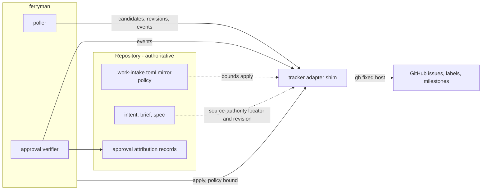
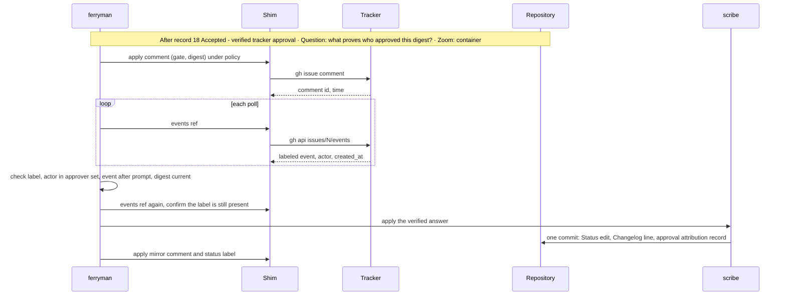
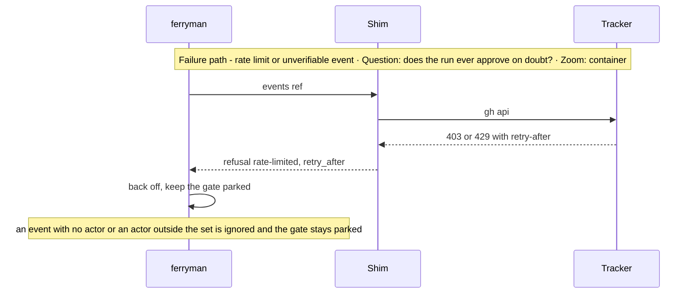

# Architecture Change — Tracker integration and authority

**Decision sought:** Approve a generic tracker-adapter seam with GitHub Issues, labels, and milestones as the first adapter, identity-verified approval signals recorded as attributed repository records, drift detection on ticket content, and a bounded standing write-back policy.

A tracker can feed and signal `ferryman` without ever deciding for it. It rests on three points:

- The repository stays authoritative, so a tracker only supplies intake, a mirror, and a signal.
- Every loosening signal passes six checks and lands as a repository record.
- Every write `ferryman` makes stays inside a policy table that the processor enforces.

**Author(s):** Repository owner (draft)
**Status:** Draft
**Last updated:** 2026-11-07
**Reviewers:** Repository maintainers, security reviewer, tracker-pack owners

**Baseline — current architecture:** `work-intake` § 7 refresh and write-back (`packs/core/.apm/skills/work-intake/SKILL.md`), [ADR-0077](../../adr/0077-feature-projection-and-tracker-authority.md), the `tracker-refresh-writeback` spec, and the tracker packs `packs/github`, `packs/linear`, `packs/atlassian`.

Part of the [set index](README.md). The approval record's meaning is on [page 05b](05b-approval-integrity-and-trusted-configuration.md). Alternatives are on [page 10](10-decisions-and-records.md).

## 1. Scope and Baseline

Seven items change, and GitHub Projects and field-level refresh decisions do not.

| Delta item | In scope | Why it changes |
| --- | --- | --- |
| Generic `tracker-adapter.v1` seam | yes | Linear and Jira follow GitHub, so the seam cannot assume GitHub |
| GitHub adapter: Issues, labels, milestones | yes | Narrow fine-grained tokens work for these |
| Tracker candidates feed the frontier | yes | Tickets are intents |
| Standing bounded write-back policy | yes | Unattended mirroring cannot ask per mutation |
| Approval and rejection from a tracker signal | yes | A human at a ticket should be able to answer a gate |
| Ticket drift detection | yes | A ticket can change while a run depends on it |
| Reply channel through comments | yes | Open questions need a queue apart from requirement fields |
| GitHub Projects | no | Deferred: user-owned Projects reject fine-grained tokens |
| Field-level refresh decisions | no | They stay human, from the current session |
| Inbound webhook or any listening port | no | [ADR-0062](../../adr/0062-workspace-mcp-per-session-only-constraint.md); polling stays foreground |
| Pool control-plane polling and relayed mirror writes | no | Control-plane jobs ([page 11](11-remote-agent-pool-seams.md)). Relayed signals are on [page 12](12-pool-state-integrity-and-signals.md) |

| Unchanged context | Link |
| --- | --- |
| Tracker-origin `source-authority` record, locator rules, lifecycle matrix | `work-intake/SKILL.md` § Refresh |
| Per-mutation durable receipts, fixed-host boundary (no redirects, no URL credentials, DNS checks) | same file, `remote_actions` and adapter validation |

The repository is authoritative. A tracker is intake, mirror, and approval signal only.

Projects are deferred (D49).[^1] Issues, labels, and milestones work with narrow fine-grained tokens.[^2]

## 2. Structural Change

The seam has eight commands, and a shim in each tracker pack implements them.

| Element or relationship | Change type | Baseline reference |
| --- | --- | --- |
| `tracker-adapter.v1` commands `capabilities`, `check`, `candidates`, `get`, `events`, `revisions`, `comments`, `apply` | added | none |
| GitHub shim `tracker_adapter.py` in `github-refresh` | added | `processor.py` (a class with no CLI), `intake_adapter.py` (`build-argv`, `validate-record`)[^3] |
| `candidates` feeding the frontier (derivation in [page 04](04-frontier-and-waves.md)) | added | none |
| `[authorization.mirror]` in `.work-intake.toml` | added | `[authorization.refresh]` |
| Approval verifier, filling the `tracker` object of `approval-attribution.v1` | added | none |
| Drift check, command `revisions` | added | `source-authority` revision pin |
| Question and prompt comments | added | `comment` capability |
| Processor `display-status` replace semantics | modified | today it only adds a label (`--add-label`) |

*Question: which side owns each tracker concept and which command carries it? Zoom: component.*



The seam uses neutral words. A ticket is a `ref`, an opaque string in the existing `scheme://host/path` or `scheme:ID` locator form. A label is a `tag`, a milestone is a `group`, and an actor is `{id, login, kind}` with `kind` `user`, `bot`, or `app`.

Each tracker's shim maps its own terms onto these.

**Label lifecycle (GitHub, names set in `ferryman-config`).** Who may apply a label decides how far `ferryman` trusts it.

| Label (tag) | Applied by | Ferryman action | Repository effect |
| --- | --- | --- | --- |
| `intent` | anyone | listed as a visible candidate, no start | none |
| `light` (`[frontier] light_label`) | a verified identity, because it loosens | listed only, as a `light_candidates` entry ([04](04-frontier-and-waves.md)). Never served, and a human starts it with `ferryman session --ticket` ([05](05-supervisors-and-gates.md)) | none |
| `ready-for-shaping` | a shaper | a `shape-intent` item with source tracker | an `intake-ticket` request ([05](05-supervisors-and-gates.md)) records a tracker-origin intent with its `source-authority` locator |
| `approve:brief-ready`, `approve:spec`, `approve:plan` | an approver for that gate, only after the gate lists `tracker-verified` in `ferryman-config` | verify, then scribe write | a status edit plus an `approval-attribution` record |
| `changes-requested:<gate>`, `rejected:<gate>` | the same approvers, same condition | verify, then scribe Draft revert ([05b](05b-approval-integrity-and-trusted-configuration.md)) | decision `request-changes` or `reject` in the record |
| `approve:g0`, `g15`, `g2`, `g3` | disabled by default | none unless the policy enables a gate | same as approval |
| `hold` | anyone, or an actor with triage permission (D38) | pause the run, honoured from any actor because it only tightens | none |
| `status/shaping`, `status/brief-draft`, `status/spec-review`, `status/awaiting-approval`, `status/in-delivery`, `status/shipped`, `status/changes-requested` | `ferryman` only | applied by `display-status` | none, mirror only |

Two rules follow. A signal that loosens needs a verified identity, and one that tightens needs none, because a false pause costs time and a false approval costs trust. An unverified `changes-requested` only pauses the run (`untrusted-request-changes`), because the revert writes the repository.

A human `status/*` label changes nothing: `ferryman` reports `mirror-drift` and corrects it.

The ticket lifecycle follows the label table: Candidate, Shaping, BriefDraft, SpecReview, AwaitingApproval, InDelivery, Shipped. `changes-requested` returns AwaitingApproval to SpecReview, and `hold` or abandon returns Shaping to Candidate.

Milestones map to briefs. The `github-brief-intake` skill reads a milestone and its issues, so a milestone is a brief's source and its issues are candidate slices.[^4] `ferryman` edits no milestone in v1.

### Backlog bring-over and direction

A team brings a ticket over by import, and mirrors status back by a separate, optional write. Each flow runs one way.

Three rules hold:
1. There is no continuous two-way sync, because two writers have no merge semantics.
2. Import and mirror are separate configuration: import needs the read side of the shim (`get`, `list`), and mirror needs `[authorization.mirror]`. Either works without the other, and they share only the ticket ref in the intent's `source-authority` record.
3. The repository item is authoritative from the import commit onward.

`ferryman` creates no ticket and imports nothing by itself. A human selects the ticket, and `work-intake` acquisition or `intake-ticket` does the import.[^10]

| Scenario | What happens | Existing mechanism | What `ferryman` does |
| --- | --- | --- | --- |
| A. Ideas are triaged in the tracker | A human labels the selected tickets, and each is brought over | `ready-for-shaping` label, `work-intake` acquisition | lists the labelled ticket as a `shape-intent` candidate and imports nothing |
| B. Import-only team (mirror off) | The intent is tracker-origin, and the ticket never receives a write | no `[authorization.mirror]` table, so per-mutation confirmation stays | reads only |
| C. Import plus mirror | Each switch runs on its own, and a failed mirror write leaves the import intact | `source-authority` locator, `[authorization.mirror]` | mirrors under policy, with no read from the mirror state |
| D. Ticket edited after import | `source-revision-drift` parks the run, and a human decides the refresh | `work-intake` refresh | detects and parks, and the mirror never writes the ticket body |
| E. Ticket closed or deleted after import | The repository item continues and closure is never mirrored | `closure` is outside `actions` | skips the closed ticket as a candidate and reports the drift[^11] |
| F. Repository-first team wants ideas visible in the tracker | Out of scope here, and it belongs to the external-tracker-projection capability | none in this set | creates no ticket |
| G. Batch bring-over of many ideas | One verified human label per ticket, and the daily cap bounds the count | `[intake] max_per_day`, `intake-cap-reached` | no bulk import |
| H. Another tracker | A per-pack shim gives the same two capabilities, with `get` and `list` kept apart from `apply` | `tracker-adapter.v1` | runs the shim as a subprocess |
| I. A ticket that is not ready | It stays in the tracker, because only a labelled ticket from a verified actor is a candidate | verified-label rule ([04](04-frontier-and-waves.md)) | lists nothing, and `Priority:` never orders |

## 3. Runtime Change

Verification is the new path, and every doubt leaves the gate parked.

| Journey or scenario | Change type | Baseline reference |
| --- | --- | --- |
| Poll for candidates, revisions, and approval signals | new | none |
| Verify an approval and record it | new | none |
| Policy-authorised mirror write | modified | per-mutation confirmation |
| Question and reply | new | none |
| Ticket content changes mid-run | new | refresh decision stays human |
| Label removed after the approval was recorded | new | the recorded approval stands, because the repository record is authoritative. A revert before `start` withdraws it, and after admission the work supervisor treats the revert as foreign history (D22) |





The verifier accepts only when all six checks pass:
1. The label names the current parked gate: `approve:<gate>`, `changes-requested:<gate>`, or `rejected:<gate>`.
2. The latest event for it is `labeled`, with no later `unlabeled`.
3. The event time is later than the prompt comment.
4. The event actor resolves through `[identities]` to the gate's approver set, with `kind` equal to `user`.
5. The gate digest equals the digest in the prompt.
6. A fresh `events` read, immediately before the scribe write, still shows the label.

A missing actor, a bot or app actor, an actor outside the set, a stale event, a changed digest, or a vanished label each leave the gate parked. Run-state records which check failed.

`approvers` and `shapers` name role refs. `[identities.<role-ref>]` in `ferryman-config` maps each to `tracker_ids` (stable numeric ids, preferred) and `logins` (a weaker fallback). The verifier resolves an actor through that table and nothing else.

The issue events endpoint, `GET /repos/{owner}/{repo}/issues/{issue_number}/events`, returns `labeled` and `unlabeled` events with a required `actor` (a user object with `login`), a required `label` with `name`, and `created_at`, and pages at up to 100.[^5] Unverified: that the actor carries a numeric `id`, that events persist as long as the issue, and that an app-applied label shows an app or bot actor. Without an id the verifier falls back to `login` and flags the weaker binding.[^6]

**Drift.** A run depends on tickets: the intent's ticket, and for a brief the milestone's issues. Each tick the poller reads their revisions and compares them with the `source-authority` revision pin.

The GitHub revision field is `updatedAt`.[^7]

`ferryman`'s own comments and labels change `updatedAt`, so on a change the shim fetches the mapped fields and compares their digest with the last accepted source requirements. Only a field difference counts. `ferryman` then emits `source-revision-drift` and parks the run.

Like `hold`, this is a tightening signal and needs no verified identity. The refresh decision stays human, through `work-intake` refresh.

**Polling budget.** GitHub documents 5,000 requests an hour per authenticated user, a secondary REST limit of 900 points a minute (a GET costs 1, a write 5), at most about 80 content-creating requests a minute and 500 an hour for an authenticated user, and `403` or `429` with `retry-after` on excess.[^8] Unverified: which limit `gh issue list` spends, so the cap counts every `gh` call.

ETag behaviour is unverified, so it is not relied on.

One tick costs R = 1 candidate list + W events reads (one per gate awaiting approval) + M milestone revision reads + S single-ticket revision reads. The poller sets its interval to the larger of `poll_interval_s` and ceil(3600 × R / `max_requests_per_hour`).

| Case | W | M | S | R | Requests at 60 s | Interval under the 1,000 cap |
| --- | --- | --- | --- | --- | --- | --- |
| Single machine, one gate | 1 | 1 | 1 | 4 | 240 an hour | 60 s |
| Aggregate, nominal | 10 | 3 | 5 | 19 | 1,140 an hour | 69 s |
| Aggregate, every gate has over 100 events (W counts 20 reads) | 20 | 3 | 5 | 29 | 1,740 an hour | 105 s |
| Aggregate, no drift reads | 10 | 0 | 0 | 11 | 660 an hour | 60 s |

A verified approval adds one confirming read, and a drift adds one field fetch. Both count against the cap. In a pool one control-plane poller serves every node, so this arithmetic applies once per token ([page 12](12-pool-state-integrity-and-signals.md)).

## 4. Contract and Invariant Change

Six rows change: the seam, the mirror policy, the narrowed approval rule, and the drift check.

| Semantic name | Change type | Baseline reference | Compatibility during transition | Enforcement | Verification |
| --- | --- | --- | --- | --- | --- |
| `tracker-adapter.v1` | new | refresh profile capabilities | existing `acquire`, `comment`, `display-status`, `trace-link`, `pull-request-link`, `closure` map to `get` and `apply` | fixed argv allowlist per shim | shim contract tests |
| `[authorization.mirror]` | new | `[authorization.refresh]` | a repository without the table keeps per-mutation confirmation | policy loader in the processor | policy tests |
| Standing write-back | narrowed rule | per-mutation fresh confirmation | applies only to actions in the table; all others keep fresh confirmation | processor checks policy before any call | out-of-policy refusal test |
| Approval from a tracker | narrowed rule | "tracker content is never authorization evidence" | refresh field decisions keep the old rule; only gate answers accept a verified event | verifier plus record | forged-signal corpus |
| `approval-attribution.v1` `tracker` object | new | approval lines | additive | scribe | commit-shape test |
| `revisions` drift check | new | `source-authority` revision | none | poller | drift test |

**Standing policy.** `[authorization.mirror]` lists these keys:
- `actions`: a subset of `display-status`, `comment`, `trace-link`, `pull-request-link`, never `closure`; `status_label_prefix`, the only label namespace it may touch; and `comment_kinds` (`prompt`, `mirror`, `question`).
- `max_writes_per_hour` (default 30, counted per repository per token) and `max_retries` (default 1). In `relayed` mode the control plane performs the writes, so every run on one repository and token shares the one budget.
- `decision_record`: an accepted ADR id. A policy without one is invalid.

The processor binds the policy fingerprint into every receipt, as `guarded_write_pair` already binds `.work-intake.toml`. A failed mutation may retry as a new mutation with a new receipt. A mutation of unknown effect, including `receipt_update_failed`, never retries and parks for the operator.

`.work-intake.toml` is part of the trusted configuration set ([05b](05b-approval-integrity-and-trusted-configuration.md)).

Under D35, a verified tracker label counts as an approve only after the new ADR is Accepted. Until then v1 records the label as a run-state field and a `tracker-signal-ignored` event, never as an attestation record, shows it, and the gate still waits for the terminal prompt.

**The narrowed rule.** `work-intake` says tracker content is never authorization evidence, and that identity, role, and time come from the current human session. A label event is tracker content.

An approval signal counts only as a verified API event from an actor in a repository-configured set, bound to a digest and a prompt, and recorded as an attributed repository record.

It never reaches field-level refresh.

**Reply channel.** `ferryman` posts a `question` comment per open question, with a gate or request ref and a digest. It recognises its own comments by author identity, since anyone can type a marker.

A reply is untrusted data, listed in run-state as `untrusted-reply` and never written into a requirement field.

It enters the repository only through a human answer, with the reply cited as provenance.

Call sites. The rows follow from them.

```text
tracker_adapter.py events github://github.com/example/repo/issues/7 --since 2026-11-01T00:00:00Z
  -> {"signals":[{"kind":"tag-applied","tag":"approve:spec","actor":{"id":"123","login":"alice-example","kind":"user"},"at":"...","event_id":"..."}]}
tracker_adapter.py revisions --group milestone:4
  -> {"revisions":[{"ref":"...issues/7","revision":"2026-11-02T10:00:00Z"}]}
```

## 5. Data/State Migration

Everything added is optional, so a repository that adds nothing keeps today's behaviour.

| Data element | Old shape | New shape | Migration mechanism | Rollback |
| --- | --- | --- | --- | --- |
| `.work-intake.toml` | `[authorization.refresh]` only | adds optional `[authorization.mirror]` | none; the table is optional | delete the table |
| `source-authority.remote_actions` | per-mutation receipts | adds `policy_fingerprint` | additive field | old receipts stay valid |
| Approval attribution | none | `approval-attributions.jsonl` with a `tracker` object ([05b](05b-approval-integrity-and-trusted-configuration.md)) | the first approval creates the file | revert the commit |

A failure between the repository commit and the mirror write leaves the ticket stale and never the repository. The mirror write retries under policy, and a persistent failure shows as `mirror-drift`.

## 6. Deployment/Operational Change

`ferryman` holds no credential and makes no HTTP call.

| Deployment unit | Change type | Baseline reference |
| --- | --- | --- |
| GitHub shim in `packs/github` | new | none |
| Linear and Jira shims | later, behind the same commands | `packs/linear`, `packs/atlassian` |
| `gh` on PATH, authenticated by the user | required | the approved fixed-host `gh` surface |

The GitHub adapters authenticate through `gh` and import no `credbroker`. The Linear script uses `credbroker` and `httpx`.[^9] `AGENTS.md` names `credbroker` as the credential path and declares no blessed outbound HTTP helper, so each pack keeps its own credential route and `ferryman` runs shims as subprocesses.

Unverified: how `gh` handles token scopes.

`doctor` prints its auth status output and parses nothing.

## 7. Quality Regression and Verification

Approval authority is at risk because this page turns a tracker click into a gate decision.

| Attribute at risk | Baseline target | Stimulus that could regress it | Verification |
| --- | --- | --- | --- |
| Approval authority | tracker content is never authorization evidence | a forged, stale, bot, out-of-set, changed-digest, or vanished-label signal | 6 of 6 verifier checks fail closed |
| Least privilege | write-back uses least-privilege credentials | standing policy widens actions | out-of-policy refusal test, `closure` always refused |
| Rate budget | none | polling grows with waiting gates and watched tickets | request-count test: 1,140 an hour stretches to a 69 s interval, 1,740 to 105 s |
| Drift | refresh decisions are human | ticket fields change mid-run | a label-only change does not drift, a body change does |
| Mirror correctness | receipts are durable before the call | a retry repeats an effect of unknown outcome | receipt-state test |

## 8. Build Mapping

The shim, three pack edits, and a poller and verifier in `ferryman` make up the build.

| Semantic element | Change type | Source owner | Build unit | Deployable | Verification |
| --- | --- | --- | --- | --- | --- |
| Shim | new | `packs/github/.apm/skills/github-refresh/scripts/tracker_adapter.py` | skill | pack install | contract tests |
| Read allowlist additions (`events`, `candidates`, `revisions`) | modified | `github-brief-intake/scripts/intake_adapter.py` | skill | pack install | argv tests |
| Processor replace-status and policy check | modified | `github-refresh/scripts/processor.py` | skill | pack install | processor tests |
| Policy table and schema | modified | `work-intake`, `contracts/jsonschema/refresh-authorization-policy.schema.json` | skill, contract | pack install | schema tests |
| Poller and verifier | new | `packages/ferryman/ferryman/{tracker,approval}.py` | `ferryman` | CLI | forgery corpus |

The shim loads the processor and intake adapter by path, with the regular-file check the repository's loaders use, so it copies none of their fixed-host validation. Subprocess reuse alone cannot cover write-back, because `processor.py` is a class with no command-line entry.

Linear and Jira shims come later. The Linear script offers `get-issue` and `get-project` only, and the Jira script has `search` and `whoami` but no event listing. Each needs `events`, `candidates`, and `revisions`.

Unverified: whether Jira's changelog gives the same actor and time facts.

## Evidence

[^1]: GitHub REST docs, project items (user-owned item endpoints do not accept fine-grained or App tokens) — https://docs.github.com/en/rest/projects/items — verified by fetch. The August 2026 report that the gap is still open — https://github.com/orgs/community/discussions/36441 — not re-fetched: unverified.

[^2]: Narrow fine-grained tokens for Issues, labels, milestones — exact permission names not checked: unverified.

[^3]: `github-refresh/scripts/processor.py` (class `GithubRefreshProcessor`, no `__main__`) and `github-brief-intake/scripts/intake_adapter.py` (`build-argv`, `validate-record`) — verified.

[^4]: `intake_adapter.py` `build_gh_argv` actions `milestone` and `issues` (`--milestone`, `--state all`, JSON including `updatedAt`) — verified.

[^5]: GitHub REST docs, issue events — https://docs.github.com/en/rest/issues/events — verified by fetch.

[^6]: Numeric actor id, event retention, app-actor shape — unverified.

[^7]: `github-refresh/references/refresh-profile.json` (`revision_field: updatedAt`) and `work-intake/SKILL.md` (record carries locator, revision, profile) — verified.

[^8]: GitHub REST docs, rate limits — https://docs.github.com/en/rest/using-the-rest-api/rate-limits-for-the-rest-api — verified by fetch.

[^9]: `packs/linear/.apm/skills/linear/scripts/linear.py` (`credbroker`, `httpx`, commands `check`, `get-issue`, `get-project`) and `packs/atlassian/.apm/skills/jira/scripts/jira.py` — verified by reading.

[^10]: `work-intake/SKILL.md` source acquisition and refresh, and [page 05](05-supervisors-and-gates.md) `intake-ticket` — verified. That `intake-ticket` ships only with E2 is stated on [page 04](04-frontier-and-waves.md).

[^11]: New and unverified: the frontier skips a closed or deleted ticket and reports drift. The closed-state read and the drift reason are not in the shim today.
