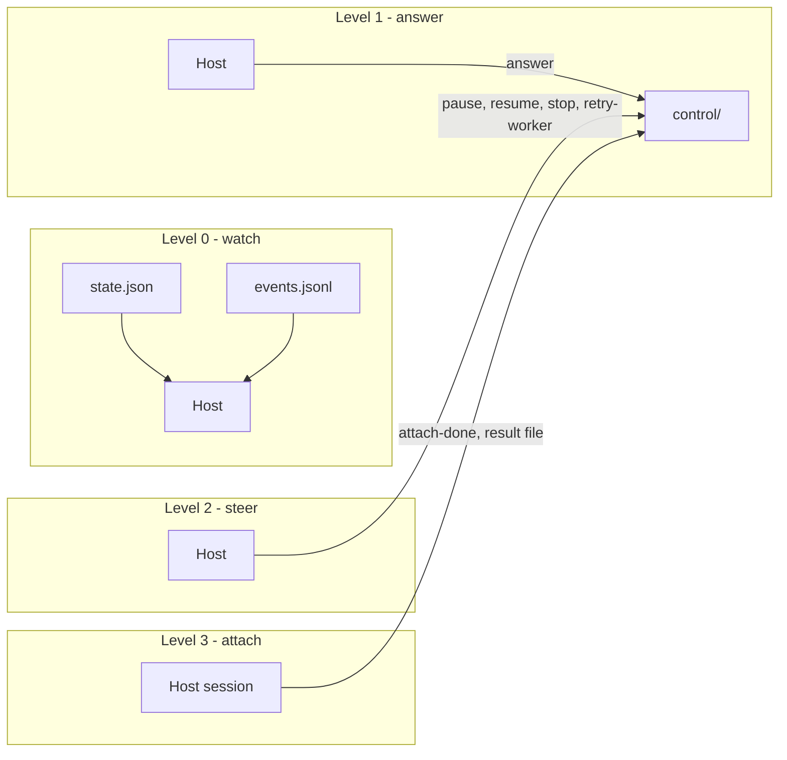
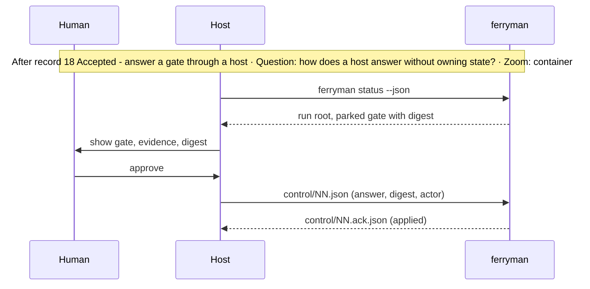
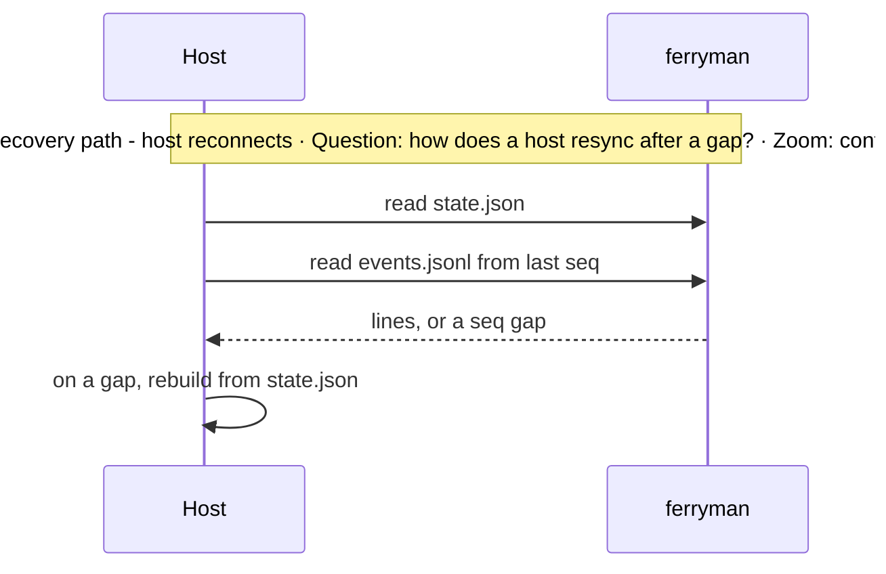

# Subsystem Design — Host and UI seam

**Decision sought:** Approve a read-only-first seam in which any host reads `run-state.v1` and `run-event.v1` and sends `run-control.v1` commands, with four capability levels and a rule for hosts that own worktrees.

A host is a viewer, so losing it never costs a delivery. Three properties hold it up:

- Every file has one writer.
- A host rebuilds from `state.json` after any gap.
- Each capability level adds one write privilege and nothing else.

**Author(s):** Repository owner (draft)
**Status:** Draft
**Last updated:** 2026-11-07
**Reviewers:** Repository owner

Part of the [set index](README.md). [Page 01](01-contracts-and-data.md) owns contract shapes. The Studio charter amendment is handled in the Studio repository and is out of scope.

## 1. Scope and Context

This page owns how a host uses the contracts, and each host owns its own product.

| In scope | Out of scope | Why |
| --- | --- | --- |
| Capability levels a host may adopt | A host's rendering, layout, or workflow | Each host owns its product |
| The contract file a host reads or writes at each level | Contract schemas | [Page 01](01-contracts-and-data.md) |
| Worktree-owning hosts | The worktree transaction | [Page 08](08-worktree-and-concurrency.md) |
| What the repository ships for hosts: nothing that runs | A daemon, registry, or HTTP API | [ADR-0062](../../adr/0062-workspace-mcp-per-session-only-constraint.md), Charter Principle 3 |

**Goals**
- A host built only from `run-state.v1` and `run-event.v1` reaches level 0 (watch). A conformance fixture proves it with no ferryman source in the test.
- A host that sends a stale `answer` gets `refused` in its ack in 100% of fixture cases.
- No contract file names a host product ([page 01](01-contracts-and-data.md) enforces it).

**Non-goals**
- Not a plugin system. A host adds nothing to `ferryman`.
- Not a hosted status service. A host that wants a service runs it in its own repository, where a persistent process belongs.
- Not a notifier. A host turns a `needs-attention` event into whatever alert it likes.

*Question: what does each capability level read and write? Zoom: container.*



The levels are cumulative. A level-1 answer is refused unless the gate's `accept` list names `host-attested`, and the ack says so. That level counts only after the D35 ADR is Accepted, and under the v1 defaults every level-1 answer is refused ([05b](05b-approval-integrity-and-trusted-configuration.md)).

A host can ship level 0 first.

## 2. Structural Model

Five elements make up the seam, and the repository ships none of the host side.

| Element | Type | Responsibility | Zoom |
| --- | --- | --- | --- |
| Host | external process | Render state, send control commands | container |
| `state.json`, `events.jsonl` | files | Read side ([page 01](01-contracts-and-data.md)) | container |
| `control/` | directory | Write side, one file per command | container |
| `ferryman status --json` | CLI | Print the absolute run root and current state | container |
| Host-owned execution root | optional input | A directory the host created, passed to `ferryman` as the execution root | container |

| From | To | Nature | Protocol |
| --- | --- | --- | --- |
| Host | `control/` | writes | temp file, then rename |
| Ferryman | Host | publishes | files only |
| Host | ferryman | spawns, optional | child process, host owns its lifetime |

A host finds runs itself. It lists worktrees with `git worktree list --porcelain` and runs `ferryman status --json` in each, because the repository ships no run registry. [ADR-0062](../../adr/0062-workspace-mcp-per-session-only-constraint.md) D4 names this short-lived discovery shape.

Each reference host implies one thing for the seam. Rows marked assumption come from local checkouts.

| Host or reference | What it implies | Source |
| --- | --- | --- |
| Studio | It accepts executor output only through an attributable human decision or a recorded policy, and it is not primarily a terminal or transcript interface. So it consumes state and events, and its answers carry an actor | [^1] |
| VelaTerm | It runs its own planner, executor, and reviewer workflows with rounds. So it can be a level-3 host, where one of its sessions is the attached worker, and it can read run-state instead of duplicating a workflow | [^2] |
| Orca | It creates and removes worktrees itself. So `ferryman` needs a host-owned execution root mode and never touches a worktree it did not create | [^3] |
| A TUI | `bmad-loop tui` reads only files its engine writes, and it launches runs and answers decisions. So a files-only contract suffices for a TUI, and answering is a control write | [^4] |
| Symphony | Its status surface is optional and "must not be required for correctness", and its orchestrator state is in memory. So status is a projection, and correctness lives elsewhere | [^5] |

bmad-loop signals escalation with an `ATTENTION` file and desktop notifications.[^4] The `needs-attention` event is the equivalent here, and the host chooses the alert.

A wicked-core workflow phase can run a direct subprocess command (`PhaseExecutor::Tool { cmd }`).[^6] A host on that engine can launch `ferryman run` as a tool phase with no ferryman change.

## 3. Runtime Model

A host answers through a file and rebuilds from the projection after a gap.

| Scenario | Trigger | Path |
| --- | --- | --- |
| Watch a run | host starts | normal |
| Answer a gate | human decides in the host | normal |
| Host restarts or loses its place | crash, reconnect | failure / recovery |





An ack file tells a host whether a command applied. A retry after a crash is safe because ids are idempotent. When no ferryman is running, the ack appears only after the next start ([page 01](01-contracts-and-data.md)).

A host that supplies the execution root passes `run --exec-root <dir>`. `ferryman` records `ownership: host` in run-state and does no worktree creation, removal, or reuse check on it. That keeps one owner per worktree.

The run-state `route` field (`supervisor` or `session`) is visible to hosts, so a host shows a session run with no gate and no supervisor ([01](01-contracts-and-data.md)).

The worker's `enforcement` level (`enforced`, `unenforced`, or `unverifiable`) is visible the same way, so a host can warn on a run whose tool limit was not enforced ([03b](03b-headless-worker-launch.md)).

## 4. Contracts and Invariants

The seam is two read files, one write folder, an actor claim, and an optional root.

| Semantic name | Parties | Inputs/outputs | Identity | Compatibility | Failure semantics | Invariant | Enforcement | Verification |
| --- | --- | --- | --- | --- | --- | --- | --- | --- |
| Read seam | ferryman to host | `state.json`, `events.jsonl` | `run_id`, `seq` | per [page 01](01-contracts-and-data.md) | host refuses an unknown major | derived projection only | ferryman is the sole writer | conformance fixture |
| Control seam | host to ferryman | `control/<id>.json`, ack | `id` | closed command enum | unknown command acked `refused` | `answer` binds to the current gate digest | digest check | stale-answer corpus |
| Actor claim | host to ferryman | `actor` string such as `host:<id>/<user>` | host id plus user | free-form, recorded verbatim | none; `ferryman` does not authenticate it | recorded as `host-attested`, never as verified; accepted only for gates whose `accept` list names `host-attested` (D15) | approval record `verification` field ([05b](05b-approval-integrity-and-trusted-configuration.md)) | record test |
| Host-owned root | host to ferryman | `--exec-root` | path | additive flag | refusal if the path is not a registered worktree of this repository | `ferryman` never changes worktree structure there | no worktree call on that path | absence test |

Call sites. The rows follow from them.

```text
ferryman status --json
ferryman run --supervisor work docs/specs/example-feature --exec-root ~/work/.hosted/example-feature --watch
write control/07.json {"id":"07","command":"pause","actor":"host:ui-1/user"}
```

## 5. Data and State

The seam adds no shared writable state.

| Element | State it owns | Lifecycle | Consistency requirement |
| --- | --- | --- | --- |
| Host | its own UI state | its own | none shared with `ferryman` |
| Ferryman | stateless apart from the run root | [page 01](01-contracts-and-data.md) | n/a |
| `control/` | commands and acks | host writes, ferryman acks | one writer per file |

Each file has one writer, so two hosts watching one run cannot corrupt each other. Two hosts answering one gate race on the digest, and the second answer is refused `stale-digest`.

## 6. Deployment and Operations

The repository ships no host-side code, so nothing deploys from here.

| Deployment unit | Runs as | Scaling | Observability |
| --- | --- | --- | --- |
| Host | the host's own process | one or many readers per run | count of unacked `control/` files |

## 7. Quality Scenarios and Verification

The host can fail or multiply without touching the run.

| Source | Stimulus | Environment | Artifact | Response | Measurable target | Business consequence | Mechanism | Verification |
| --- | --- | --- | --- | --- | --- | --- | --- | --- |
| Host | answers a changed gate | normal | control seam | refused | 100% of 20 stale-answer fixtures | wrong artifact approved | digest check | corpus |
| Host | dies mid-run | unattended | ferryman | run continues or parks, no loss | 0 lost commands in kill tests | a UI crash blocks delivery | file seam, no connection | kill test |
| Maintainer | adds a second host | review | contracts | no contract change needed | 0 contract edits for a second host fixture | the seam is not swappable | neutral names | fixture |

## 8. Implementation Mapping

The host side needs only two CLI features and a fixture set.

| Semantic element | Source owner | Build unit | Deployable | Verification |
| --- | --- | --- | --- | --- |
| `status --json`, `--exec-root` | `packages/ferryman/ferryman/cli.py` | `ferryman` | CLI | CLI tests |
| Conformance fixtures | `packages/ferryman/tests/fixtures/hosts/` | `ferryman` tests | none | fixture tests |

## 9. Decisions, Alternatives, and Risks

[Page 10](10-decisions-and-records.md) owns decisions and alternatives, and [page 13](13-rollout-spikes-and-risks.md) owns risks.

## 10. Rollout, Migration, and Reversal

[Page 13](13-rollout-spikes-and-risks.md) owns them.

## 11. Open Questions

- Does Studio want `run-state` to carry artifact links beyond refs? The Studio owners answer after reading page 01.
- Should hosts get a read-only `ferryman export` for a static snapshot? A host owner who needs it can raise it.

## Evidence

[^1]: `docs/CHARTER.md` in the agent-ready-studio checkout, permanent non-scope clauses 1 and 2 — assumption (local checkout, not reproducible here).

[^2]: `docs/manuals/planning-and-execution_20260925_1012.md` in the VelaTerm checkout — assumption (local checkout).

[^3]: `src/main/git/worktrees/` in the Orca checkout — assumption (local checkout).

[^4]: bmad-loop README (TUI reads engine files, `ATTENTION` file, desktop notifications) — https://github.com/bmad-code-org/bmad-loop — verified by fetch.

[^5]: OpenAI Symphony SPEC.md, sections 13.4 and 4.1.8 — https://github.com/openai/symphony — verified by fetch.

[^6]: `src/workflow.rs` `PhaseExecutor::Tool { cmd }` in the wicked-core checkout — assumption (local checkout; read in code).
