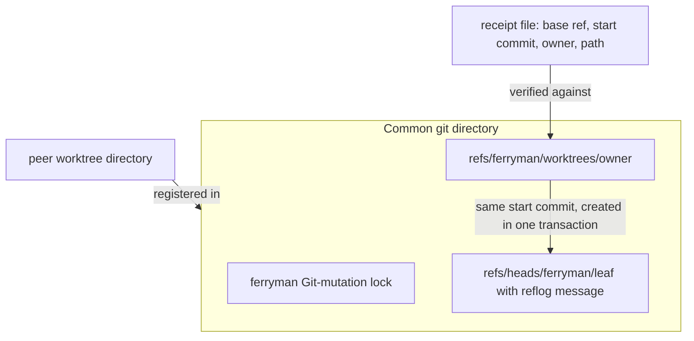
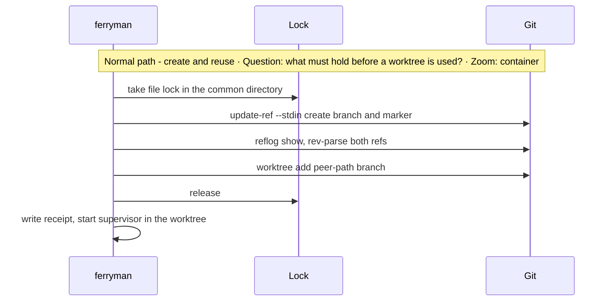
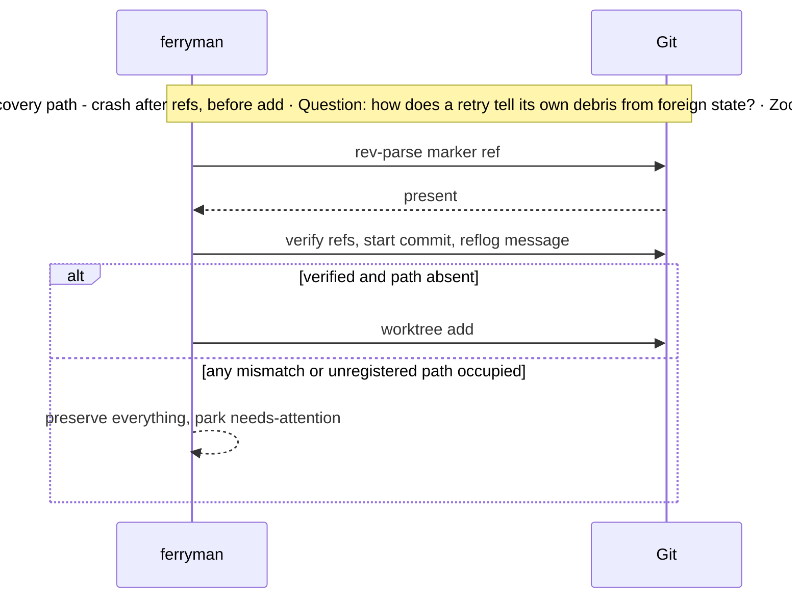

# Architecture Change — Worktree ownership and concurrency

**Decision sought:** Approve sequential execution in v1, and a precondition list that any later parallel-worktree admission must meet, built on a Git-native ownership transaction and a peer layout.

Parallel worktrees stay off until ownership is provable and removal cannot lose work. The design rests on three facts:

- One `update-ref` transaction creates a branch and an ownership marker together, so a crash leaves only safe half-states.
- Every doubt preserves the resources, so `ferryman` never guesses.
- Worktrees sit beside the repository and are never nested, so the measured nested-removal data loss cannot occur.

**Author(s):** Repository owner (draft)
**Status:** Draft
**Last updated:** 2026-11-07
**Reviewers:** Repository owner

**Baseline — current architecture:** [Loop parallelism](../loop-parallelism.md), [work-loop supervisor](../work-loop-execution-supervisor.md) (run store under the Git directory), [RFC-0015 errata](../../rfc/0015-wave-scheduled-supervisor-mode.md), [ADR-0005](../../adr/0005-supervisor-topological-default-and-write-gate.md) D7, and [ADR-0157](../../adr/0157-work-loop-approval-gates-park-instead-of-halting.md).

Part of the [set index](README.md). Parallel scheduling of specs stays a read-only view on [page 04](04-frontier-and-waves.md). The loop that would use worktrees is on [page 03](03-ferryman-runtime.md), and the locks are on [page 03c](03c-run-chain-locks-and-process-boundary.md).

## 1. Scope and Baseline

v1 creates no worktree, and the page defines what parallel admission needs.

| Delta item | In scope | Why it changes |
| --- | --- | --- |
| v1 stays sequential in one checkout | yes | No ownership rule exists yet |
| Ownership transaction and preconditions | yes | Parallel work needs them first |
| Peer worktree layout rule | yes | RFC-0015's erratum measured a nested-worktree data-loss path |
| Parallel admission itself | no | Gated on the preconditions; supervisor parallel admission is `STATUS: PLANNED` |
| Parallel result integration | no | [Product result integration](../work-loop-result-integration.md) owns it |
| Merge, and pushes outside `refs/ferryman/` | no | Never performed; branch deletion follows the index invariant (D17) |

| Unchanged context | Link |
| --- | --- |
| Parallel-write gate | [ADR-0005](../../adr/0005-supervisor-topological-default-and-write-gate.md) |
| Plan width and wave scheduling | [Loop parallelism § 3](../loop-parallelism.md) |
| Worktree topology: all peers on one common `.git` | [Loop parallelism](../loop-parallelism.md) |

The supervisor derives its Git directory with `rev-parse --absolute-git-dir` and the common directory with `--git-common-dir`. In a linked worktree the first is the worktree's own admin directory. The run store, pins, run lock, and parked gate records are therefore per worktree.[^1]

A supervisor started in a linked worktree works in isolation, and a gate parked there is invisible from the main checkout.

[ADR-0157](../../adr/0157-work-loop-approval-gates-park-instead-of-halting.md) lists "gates from several worktrees in one listing" as its revisit trigger. The aggregate `gates` view on [page 05](05-supervisors-and-gates.md) answers it. In a pool each run has its own clone, so these preconditions matter only for parallel runs on one machine ([page 11](11-remote-agent-pool-seams.md)).

## 2. Structural Change

Six elements are new, and all are inert in v1.

| Element or relationship | Change type | Baseline reference |
| --- | --- | --- |
| `worktrees` module (create, verify, reuse, remove) | added, inert in v1 | none |
| Ownership marker ref `refs/ferryman/worktrees/<owner>` and branch reflog message | added | none |
| Common-directory Git-mutation lock | added | none |
| Peer layout `<repo-parent>/.ferryman-worktrees/<repo>/<leaf>` | added | ADR-0005 D7 |
| Worktree receipt file | added | none |
| Aggregate gate enumeration over `git worktree list` | added | `gates` per store |

*Question: which Git objects prove that `ferryman` owns a worktree? Zoom: component.*



The ownership transaction follows VelaTerm's design.[^2] One `update-ref --create-reflog -m "<owner message>" --stdin` call runs `start`, two `create` lines (branch and marker), `prepare`, and `commit`. Before reusing anything, `ferryman` checks that both refs point at the recorded start commit and that the branch reflog holds exactly the owner message.

It refuses to reuse a path that exists but is not registered.

Rollback verifies ownership. It refuses a changed checkout and any uncommitted or untracked file. It runs a non-forced `worktree remove`.

It then deletes both refs in one transaction, so a concurrent commit makes the delete fail. That rule keeps the branch whenever its tip moved past the start commit.

Every doubt preserves the resources and never falls back to another directory. Reads set `GIT_OPTIONAL_LOCKS=0`, so a status call takes no index lock. The base ref lives in the receipt and not in repository config, because a config write takes `config.lock`, the race RFC-0015's decision 4 names.

| Precondition for parallel admission | Evidence | Status |
| --- | --- | --- |
| Atomic create of branch and marker by one `update-ref --stdin` | VelaTerm `owned_refs` | designed |
| Verify refs, start commit, and reflog message before reuse | VelaTerm `verify_owned_refs` | designed |
| Compare-and-delete rollback of both refs, only while the branch tip equals the start commit | VelaTerm `rollback_owned_worktree` | designed; narrows the index invariant on branch deletion (D17, per-branch confirmation on [page 10c](10c-review-decisions.md)) |
| Preserve on any doubt; never use another directory | VelaTerm error paths | designed |
| Remove a worktree only when it is clean | wicked-core `reap_worktree_if_clean` | designed |
| Owner-only reuse, with the owner recorded where the worktree dies with it | wicked-core `worktree_owner` (marker file in the Git admin directory) | designed; the ref marker replaces the file and also survives prune doubt |
| Never force-remove a worktree, and never remove one `ferryman` does not own | design rule from the ownership transaction | rule |
| Serialize ferryman Git mutations with a file lock in the common directory | Orca tracks maintenance per repository and defers it while the repository is busy | designed; whether Orca uses a lock is unverified |
| Pass `-c gc.auto=0 -c maintenance.auto=false` on ferryman Git calls | Orca defers `pack-refs` while busy and never kills it | designed; another tool's maintenance cannot be paused, so `ferryman` holds the lock and detects `packed-refs.lock` |
| Reclaim a stale ferryman lock only if attributed, old enough, and its pid is dead | Orca `PackRefsLockOwnership` | designed for `ferryman`'s own lock |
| No nested worktrees | RFC-0015 errata, 2026-09-25 | rule |

`ferryman`'s lock reclaim follows Orca. Reaping follows wicked-core: remove a worktree only when it is clean.[^3]

Peer layout. Worktrees sit beside the repository and never inside another worktree. The erratum records that removing a containing worktree with `--force` succeeds silently and deletes the nested worktree's whole directory, uncommitted work included.

A plain remove refuses.[^4] The erratum binds no layout rule. ADR-0160 supersedes ADR-0005 D7 in part, for concurrent-attempt directories only.[^5]

The ADR candidate on [page 10](10-decisions-and-records.md) is narrower: it covers run and slice worktrees, which keep the worktree rule, and the peer layout.

Two couplings follow from ADR-0160 and the Slice 7 containment rules. An attesting launcher must deny an attempt the work tree and every other worktree of the repository, so every ferryman-owned worktree stays enumerable by `git worktree list`. A worktree never sits under the system temp attempt prefix, because attempt directories are `mkdtemp` directories there, outside the Git directory, the run store, and every worktree.

Sequential stays the v1 default. Per-slice worktree creation for a brief belongs to `ferryman` under these rules (D32).

The peer root lies outside the repository root. [Page 02](02-install-trust-and-detection.md) owns the confinement rule for it: `ferryman` creates it with mode 0700, refuses a symlinked or foreign-owned component, and derives every path under it from the owner id alone.

## 3. Runtime Change

v1 changes nothing at runtime, and the new paths are inert until the preconditions pass review.

| Journey or scenario | Change type | Baseline reference |
| --- | --- | --- |
| Sequential run in the main checkout | unchanged | [supervisor](../work-loop-execution-supervisor.md) |
| Create an owned worktree | new, inert in v1 | none |
| Interrupted create, retry | new | none |
| Reap after terminal | new, inert in v1 | none |





A user who starts `ferryman` inside a linked worktree gets that worktree's own store, which works as described in section 1.

The transaction is atomic, so the branch and the marker appear together. The only half-states are "no refs" and "refs without a directory". Both are safe to finish or to roll back.

## 4. Contract and Invariant Change

Five contracts are new, and all preserve rather than repair on doubt.

| Semantic name | Change type | Baseline reference | Compatibility during transition | Enforcement | Verification |
| --- | --- | --- | --- | --- | --- |
| Ownership marker | new | none | no existing worktree carries it, so none is adopted | `verify_owned_refs` equivalent | ref-fixture tests |
| Worktree receipt | new | none | local, deletable; loss means preserve and ask | schema | loss test |
| Common-directory Git-mutation lock | new | none | cooperating tools only; a foreign tool ignores it | lock file with pid and time, same `lock` module as `ferryman` lock ([03c](03c-run-chain-locks-and-process-boundary.md)) | contention test |
| Peer layout | new, narrows a baseline option | ADR-0005 D7 | existing nested layouts keep working and are never created | path check at create | layout test |
| No-force removal | new | RFC-0015 errata | none | no `--force` in the argv allowlist | allowlist test |

Call sites. The rows follow from them.

```text
worktrees.prepare(repo, name)       -> receipt(owner, branch, base_ref, start_commit, path)
worktrees.materialize(receipt)      -> path, or Refused("path-occupied: preserved")
worktrees.reap(receipt)             -> removed | Kept("uncommitted files: preserved")
```

The marker namespace `refs/ferryman/` is new, so no existing tool can mistake its refs for its own.

## 5. Data/State Migration

No existing worktree or ref is touched.

| Data element | Old shape | New shape | Migration mechanism | Rollback |
| --- | --- | --- | --- | --- |
| Worktrees | user- or tool-created | unchanged, never adopted | none | none |
| Marker refs and branches | none | created per owned worktree | the transaction | compare-and-delete both refs |
| Receipts | none | `<git-common-dir>/ferryman/receipts/<owner>.json` | written after materialize | delete; ownership still verifies from refs |

A lost receipt costs the base ref, which lives only there. `ferryman` then preserves the worktree and asks a human.

## 6. Deployment/Operational Change

Two units are new, and `ferryman` never prunes.

| Deployment unit | Change type | Baseline reference |
| --- | --- | --- |
| `worktrees` module | new, built in P6 | none |
| Git-mutation lock file under the common directory | new | none |

Operators watch `git worktree list` for entries under the peer root, lock files whose pid is dead, and `needs-attention` events that name a preserved worktree. `git worktree prune` is the destructive call RFC-0015's decision names, so it stays a human command.

## 7. Quality Regression and Verification

Silent data loss is the attribute at risk, because the erratum measured it.

| Attribute at risk | Baseline target | Stimulus that could regress it | Verification |
| --- | --- | --- | --- |
| No silent data loss | a refusal writes nothing | a reap or remove deletes uncommitted work | dirty-worktree fixture, 0 deletions in 20 reap attempts (design target) |
| Ownership integrity | none today | two `ferryman` processes create the same name, or a crash between steps | contention and kill tests, 0 duplicate owners |
| Config-lock safety | RFC-0015 decision 4 | a `ferryman` process write to repository config during a parallel add | argv allowlist test, 0 config writes |
| Gate visibility | one listing per checkout | gates parked in several worktrees | enumeration test over 3 worktrees |

## 8. Build Mapping

The module is built in P6 together with the preconditions it enforces, and nothing calls it before then.

| Semantic element | Change type | Source owner | Build unit | Deployable | Verification |
| --- | --- | --- | --- | --- | --- |
| `worktrees` | new | `packages/ferryman/ferryman/worktrees.py` | `ferryman` | CLI | real-Git fixture tests |
| Lock | new | `.../lock.py` | `ferryman` | CLI | contention tests |
| Gate enumeration | new | `.../gates.py` | `ferryman` | CLI | three-worktree test |

Building it in P6 lets the preconditions run against real Git before anything depends on them.

Unverified: whether a worker whose current directory is a linked worktree can run the git commands it needs under a write-restricted sandbox, because a linked worktree keeps its index under the main repository's `.git/worktrees/`.[^9] `ferryman` creates every worktree itself, so a worker never needs to run `git worktree add`.

## Evidence

[^1]: `packs/core/.apm/skills/work-loop/scripts/_supervisor_git.py` (`_discover`), `_supervisor_attempt.py` and `work-supervisor.py` (store paths built from `pins.git_dir`) — verified.

[^2]: VelaTerm `src-tauri/src/git.rs` (`prepare_owned_worktree`, `owned_refs`, `verify_owned_refs`, `materialize_owned_worktree`, `rollback_owned_worktree`) — assumption (local checkout, read in code).

[^3]: wicked-core `src/repo.rs` (`reap_worktree_if_clean`, `worktree_owner`, `reap_orphan_worktrees`) and Orca `src/main/git/refs/maintenance/` — assumption (local checkouts).

[^4]: `docs/rfc/0015-wave-scheduled-supervisor-mode.md` Errata, 2026-09-25 entry — verified.

[^5]: ADR-0160 (on main) supersedes ADR-0005 D7 in part and ADR-0156 D2 in part — verified (read). Spec `verified-infrastructure-parallelism` AC-0017 lists denial of "the work tree and every other worktree of the repository" and of sibling attempt directories — verified (read, merged). Attempt directories are `agentbundle-attempt-` `mkdtemp` directories under the system temporary directory unless a parent is passed (`create_attempt_directory`) — verified (read, merged).

[^9]: Codex 0.164.0 under a `workspace-write` sandbox could not create a worktree even under `/tmp` (`could not create directory of '.git/worktrees/...': Operation not permitted`), 2026-11-07 — verified (tested, single run). Whether it can run git inside an existing linked worktree was not run: unverified.
