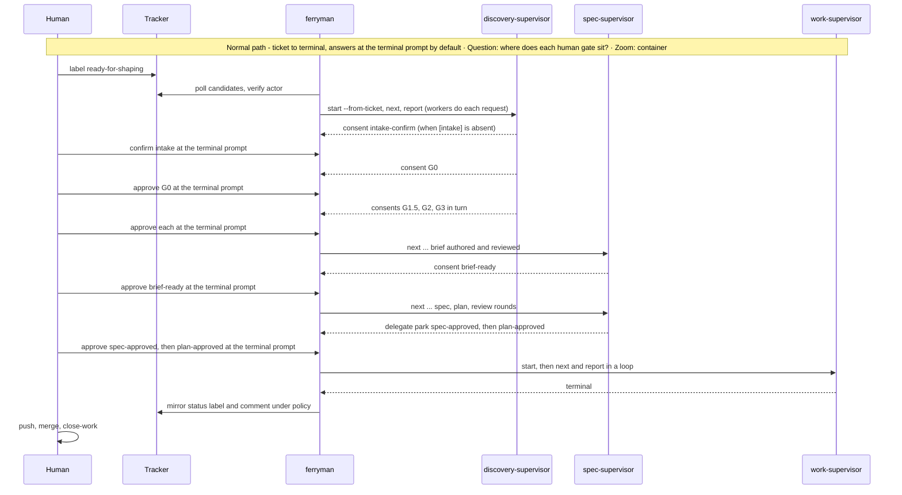
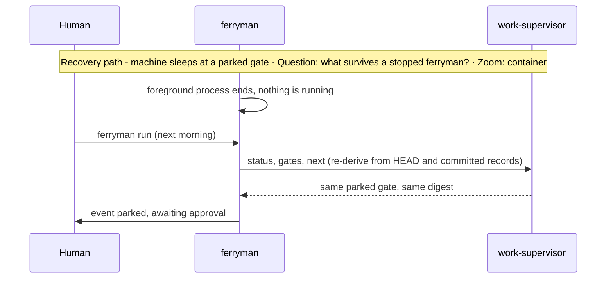

# Architecture Change — Flow: ticket to a spec ready to merge

**Decision sought:** Confirm that pages 01 to 08 compose into one unattended path from a labelled ticket to a finished, reviewed spec run, with humans at named gates and a human doing the merge.

The path runs from ticket to terminal and has no background process. In the default configuration, with `[intake] allow = false`, it has eleven human touches plus `close-work`: the `ready-for-shaping` label, `intake-confirm`, the four discovery consent gates G0, G1.5, G2, and G3, brief Ready, `spec-approved`, `plan-approved`, the push, and the merge.

The first real run adds the D54 confirmation once. With `allow = true` the `intake-confirm` touch disappears. Every gate is a committed fact or a parked record, so a stopped ferryman loses nothing.

`ferryman` stops at `terminal` because it never merges and pushes only checkpoint refs.

**Author(s):** Repository owner (draft)
**Status:** Draft
**Last updated:** 2026-11-07
**Reviewers:** Repository maintainers

**Baseline — current architecture:** [Work-loop execution supervisor](../work-loop-execution-supervisor.md) § 3, and the [set index](README.md).

This page holds sequences and no model, so it has no structure, contract, data, or deployment section. Each of those has one owner on the pages the sequence links. It is the runtime section of the architecture-change template applied across owners.

## 3. Runtime Change

One ticket passes nine steps, and each step has one owning page.

| Step | Actor | Owner |
| --- | --- | --- |
| 1. A shaper labels the issue `ready-for-shaping` | human, tracker | [06](06-tracker-integration-and-authority.md) |
| 2. `ferryman` polls, verifies the actor, and the frontier returns `shape-intent` | ferryman | [06](06-tracker-integration-and-authority.md), [04](04-frontier-and-waves.md) |
| 3. An `intake-ticket` request creates a tracker-origin intent (D16), and the discovery-supervisor runs G0 to G3 | worker, discovery-supervisor | [05](05-supervisors-and-gates.md) |
| 4. Consent gates park. A named human answers at the terminal in v1. Host and label answers count after the D35 ADR is Accepted | human | [05](05-supervisors-and-gates.md), [07](07-host-and-ui-seam.md) |
| 5. The spec supervisor authors a brief, reviews it with a different agent, and parks `brief-ready` | worker, spec-supervisor | [05](05-supervisors-and-gates.md) |
| 6. It authors spec and plan, runs review rounds to clean or the cap, and parks `spec-approved` then `plan-approved` | worker, spec-supervisor, ferryman | [05](05-supervisors-and-gates.md) |
| 7. The scribe records each verified answer, and `ferryman` delegates `start` to the work supervisor | ferryman, work-supervisor | [05b](05b-approval-integrity-and-trusted-configuration.md) |
| 8. The work supervisor executes tasks, gates, and review until `terminal` | work-supervisor, workers | [supervisor](../work-loop-execution-supervisor.md) § 3 |
| 9. On one machine a human pushes and merges, and `close-work` closes the artifact | human | none; `ferryman` never merges and pushes only to `refs/ferryman/`. In a pool the control plane merges only on a recorded human merge decision, which it owns outside the repository (record 13, D71, [page 11](11-remote-agent-pool-seams.md)) |

A human can answer `request-changes` or `reject` at `spec-approved` or `plan-approved` (step 6). Intent and brief gates use their own verdict enums ([05](05-supervisors-and-gates.md)). The scribe returns the spec and plan to Draft and Drafting, and the flow resumes at the authoring step ([05](05-supervisors-and-gates.md)).

Without `ferryman`, steps 3 to 7 run in a session: the session agent is the controller, and the human approver writes each approval and any rejection revert ([05](05-supervisors-and-gates.md)).

*Question: in what order do the actors hand work to each other? Zoom: container.*

A closed laptop loses the polling process and nothing else, because each gate is a committed fact or a parked record that the supervisor re-derives.

A run mixes headless and attached workers freely. Every `consent` request is human only.

In v1 an approval at step 4 or step 6 comes only from the terminal prompt and is recorded as `session-attested`. A host, a verified tracker label, or a control plane can approve only after its level (`host-attested`, `tracker-verified`, `control-plane-signed`) is enabled ([05b](05b-approval-integrity-and-trusted-configuration.md)).

## Evidence

This page cites no source of its own. Each step's owning page carries the evidence for its claims.
