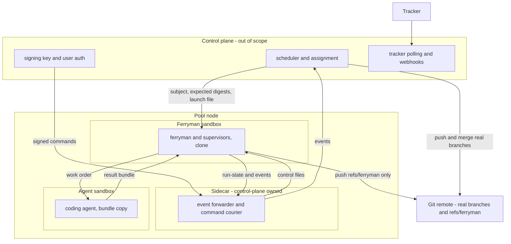
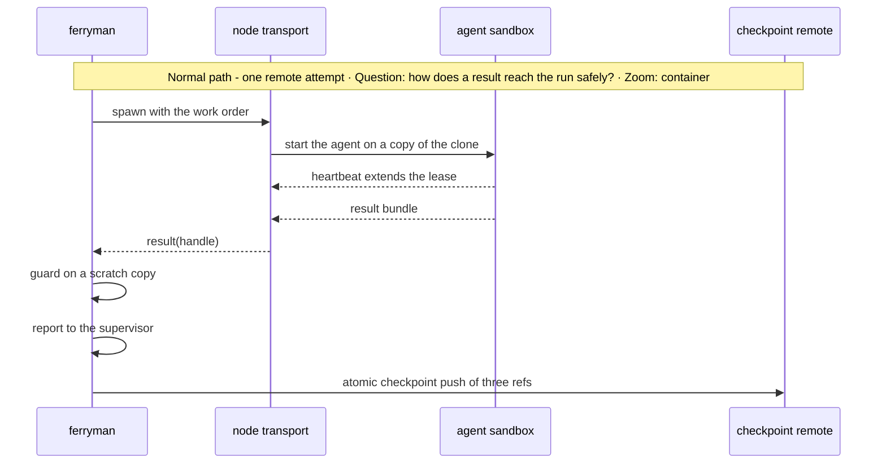
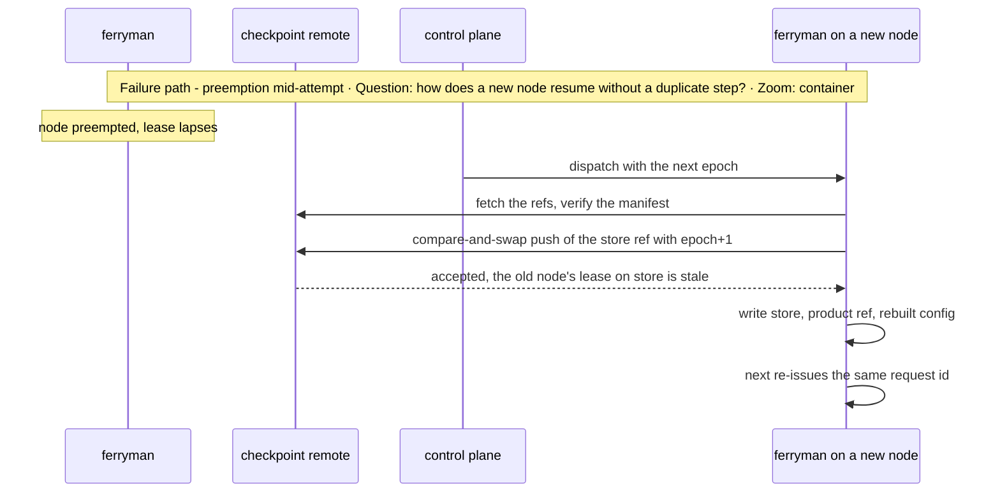

# Architecture Change — Remote agent pool seams

**Decision sought:** Approve a `remote` worker kind, signed control commands, and usage fields, so `ferryman` can serve a pool of remote coding-agent nodes under an outside control plane with no change to the single-machine design.

`ferryman`, supervisors, contracts, and guard are the same on one machine and in a pool. Four things change by configuration: the executor kind, the attestation level of control commands, the source of tracker signals, and a restore step before the first `next`. Three reasons support this:

- The control plane, scheduler, and user authentication stay outside this repository.
- Every seam is a contract that ships at P7 (D67), so the `remote` executor adds no new rule to the P0 contracts.
- Nothing in the pool path edits a pinned script.

**Author(s):** Repository owner (draft)
**Status:** Draft
**Last updated:** 2026-11-07
**Reviewers:** Repository maintainers, security reviewer, control-plane owners

**Baseline — current architecture:** Pages 01 to 08 of this [set](README.md) and the [supervisor](../work-loop-execution-supervisor.md).

[Page 12](12-pool-state-integrity-and-signals.md) owns the pool's portable state, supervisor digests, relayed signals, and claims.

## 1. Scope and Baseline

This page owns the node deployment, the worker interface for remote kinds, node trust, and usage.

| Delta item | In scope | Why it changes |
| --- | --- | --- |
| `remote` worker kind behind the generic `workers` interface | yes | A pool runs the agent in another sandbox or node |
| Signed control commands and level `control-plane-signed` | yes | Ferryman and agent must not share an OS user or container |
| Usage, deadline, and budget fields | yes | A pool bills and bounds work per attempt |
| Portable state, digests, signals, claims | no | [Page 12](12-pool-state-integrity-and-signals.md) owns them |
| Control plane, scheduler, user authentication | no | Out of scope: this repository supplies seams only |

The control plane owns:
- assignment of subjects to nodes, and node lifecycle;
- user authentication, and mapping a user to the `actor` it relays;
- the signing key, key rotation, and revocation of a node's credentials;
- tracker polling or webhooks, signal verification, and tracker writes in `relayed` mode;
- pushes to the repository's real branches, and merges;
- fencing a partitioned node, checkpoint retention, spend quotas, and the node marker that TB5 provisioning writes;
- re-delivering every signed command that has no `control-applied` event to the current epoch, re-signed;
- after a `terminal` event, pushing only a terminal checkpoint of the current epoch, and merging run commits and never rebasing them, and merging only on a recorded human merge decision (D27).

Stance: the design holds for one machine and for a pool. No page outside pages 11 and 12 depends on a pool. A pool cannot pass a gate until the D35 ADR is Accepted, because `control-plane-signed` answers count only after it.

Single-machine defaults stay: `headless` workers, `session-attested` answers, ferryman-side polling, and no checkpoint push.

## 2. Structural Change

A pool node runs `ferryman` and the agent in separate sandboxes, and a control-plane sidecar carries events out and signed commands in.

| Element or relationship | Change type | Baseline reference |
| --- | --- | --- |
| `remote` executor behind the `workers` interface | added | `workers` ([03](03-ferryman-runtime.md)), the `attach` work order |
| Signature check in `inbox`, level `control-plane-signed` | added | `host-attested` |
| Sidecar (event forwarder and command courier) | added, control-plane owned | none |
| Usage fields on attempts and events | added | `attempts/` record ([01](01-contracts-and-data.md)) |

*Question: where do the trust boundaries sit in a pool node? Zoom: container.*



Five trust boundaries (TB1 to TB5) cross the node:
- TB1: control plane to node. Commands carry a signature, and events carry no authority.
- TB2: ferryman sandbox to agent sandbox. The agent gets a copy of the clone and returns a bundle. It never sees the run store, the control inbox, or a long-lived credential, and the only credential it holds is a per-attempt model token (D46).
- TB3: sidecar to ferryman. The sidecar is an untrusted courier. It can drop, delay, or replay a command and cannot forge one, because it holds no signing key.
- TB4: node to remote. The node's push credential is limited to `refs/ferryman/`.
- TB5: provisioning to the ferryman sandbox. The launch file, the allowed-signers file (its one home), and the user config with its profiles arrive by image bake or by a read-only mount that the control plane authenticates, never through the sidecar or the work tree, and the ferryman sandbox cannot write them. The node bootstrap compares each file's digest to the value the control plane recorded at dispatch, outside `ferryman`.

## 3. Runtime Change

Three seams change runtime behaviour here, and each failure mode has a stated resolution.

| Journey or scenario | Change type | Baseline reference |
| --- | --- | --- |
| Remote attempt with lease and result bundle | new | `attach` work order |
| Signed answer delivered by the sidecar | new | control inbox |
| Budget exhaustion | new | `wall_seconds` timeout |

**Seam 1: remote worker kind.** The `workers` interface is `spawn(order) -> handle`, `status`, `cancel`, and `result`, and all four kinds implement it ([03](03-ferryman-runtime.md) owns it). A `remote` profile names four list-form commands, `spawn`, `status`, `cancel`, and `result`, supplied by the control plane's transport ([03](03-ferryman-runtime.md) owns the profile keys).

The work order is a bundle: request, briefing, result path, manifest scope, pre-attempt commit, deadline, and budget. The manifest scope lists the trusted files that must not change and, for a sibling supervisor, the slot paths the attempt may write. The `attach` order already carries request, briefing, and result path.

Liveness is a lease. The handle carries `lease_id` and `lease_until`, and the remote side refreshes it by heartbeat. When it lapses `ferryman` calls `cancel`, records the attempt `lost`, and uses no pid (local kinds keep pid checks).

Each spawn issues a new lease id, and `result` accepts only the current one. A node restored after a partition therefore ignores a result that carries the old agent's lease id.

The result bundle is the result file plus a patch: the diff of the agent's tree against the pre-attempt tree. A bundle that carries commits or refs is refused `worker-commit` or `worker-moved-ref`. `ferryman` fetches it through `result(handle)` into `attempts/<id>/result/` under the confinement rules of [page 02](02-install-trust-and-detection.md), with a size cap.

It applies the patch to a scratch copy and runs the guard there: manifest scope, `approval-fields.v1`, the pinned configuration, and the token scan, which holds a hit in the patch or the product checkpoint as `secret-in-diff` ([05b](05b-approval-integrity-and-trusted-configuration.md)). Only a clean patch applies to the working tree, as the worker's edits, and the supervisor's `report` commits as it does today. A worker never writes supervisor state.

Changed fields: `run-state` `worker` gains `executor`, `handle`, `state`, `lease_until`, `last_heartbeat`, and `node_id`. `run-event` gains `worker-submitted`, `lease-lost`, and `worker-cancelled`, and `worker-spawned` carries `executor`.

**Session route in a pool.** Pool mode refuses a session run with `session-pool-refused`, because a control-plane launch is external control-plane orchestration, a durability trigger in `light-mode.md`.

`ferryman session` reads no launch file, so it detects pool mode from a committed `[pool]` table or from a node marker that TB5 provisioning writes ([03](03-ferryman-runtime.md) owns session step 1). A repository that commits `[pool]` therefore refuses every session run, and the work-loop owners revisit the rule ([13](13-rollout-spikes-and-risks.md)).

**Pool mode and patch hardening.** A launch file with `mode = pool`, or any `kind = remote` profile, makes `run` refuse `pool-config-incomplete` (the list is the `launch.v1` row on [page 01](01-contracts-and-data.md)).

The list requires `kind = remote` for every role's profile, because a local `headless`, `tmux`, or `attach` worker would run agent code inside the key-holding ferryman sandbox before the guard. `ferryman` refuses a returned patch that:
- touches `.git/`, creates a symlink, or changes a mode bit;
- contains a `..` segment or an absolute path;
- adds a gitlink or submodule entry (mode 160000, `.gitmodules`), a binary hunk, a case-folding or Unicode-normalisation path collision, or a nested `.git` at any depth;
- touches a path that `git check-ignore` matches, or any `.gitattributes` file;
- exceeds the file-count cap for one patch.

Refusing mode bits also blocks a legitimate `chmod +x`.

It applies the patch with `git apply --check` under confined paths. The ferryman sandbox never runs worker-modified files before the guard passes. Unverified: whether the supervisor's `report` or a lint script runs repository code.

D55 names its execution boundary before any P7 slice starts, and until it does the ferryman sandbox refuses `execution-boundary-unset` for any step after the guard that runs repository or patch code, `report` and lints included.

**Signed commands, in detail.** A signed command binds the run epoch and carries an `expires_at` no later than 15 minutes ahead (a design default). The checkpoint manifest persists consumed `(key_id, nonce)` pairs and command ids, so replay fails across a change of node.

A nonce is consumed only in a checkpoint: a command that arrives during an attempt waits for the next boundary, except `stop`, which cancels and abandons the attempt first and then checkpoints ([12](12-pool-state-integrity-and-signals.md), a D27 sub-choice).

For every level `ferryman` checks the actor against the gate's approvers and refuses `actor-not-approver`. The signature scheme is decided as public-key verification (D43), and the human-decision assertion rides in the signed actor lines (D44, under D27).

Two sequences show the remote attempt and its recovery.





**Concurrent attempts.** The `remote` executor serves sequential requests. A concurrent attempt under Slice 7 differs: the supervisor spawns the pinned launcher itself, from owner-pinned bytes, and trusts only what it reads from that child's pipe.

A pool node is not itself such a launcher.

Only a local pinned launcher could proxy to a node and relay attestations, and only if the channel question below (D36) is settled.

A separate sandbox is necessary and not sufficient. The concurrent-attempt attestation must prove all of these:[^3]
- denial of the Git common directory, the shared refs, and the run store;
- denial of the work tree and every other worktree of the repository, every sibling attempt directory, and inter-process channels to sibling attempts;
- `network.allowed` false, and write roots exactly the attempt directory;
- a read allowlist equal to the declared `Reads:` (enforced allowlist), or a complete trace;
- the binding (run, attempt, grant, nonce, launcher sha256) echoed, and the release token echoed on the `access` line;
- `processes_ended` true.

Network denial leaves no model channel, and no record defines a model gateway. An off-the-shelf headless CLI, whose model client and tools share one process, cannot be a concurrent-attempt worker today.

Pool parallelism therefore comes from separate runs on separate clones ([12](12-pool-state-integrity-and-signals.md)), and no phase depends on `run-concurrent` (D36). A launcher-provided gateway would be a new channel the attestation must cover, and it needs an ADR from ADR-0156's owner.[^4]

**Pool agent-sandbox attestation.** A pool attempt needs a model channel, so it attests a different set from the concurrent-attempt list above, which keeps `network.allowed` false. The `spawn` answer of `remote-transport.v1` ([01](01-contracts-and-data.md)) carries an attestation that proves:[^6]
- egress to the model gateway only, with the per-attempt model token as the only credential (TB2, D46);
- no Git or forge credential;
- a copy-only work tree that mounts neither the clone, the run store, nor the control inbox;
- a digest-pinned image, which the control plane verifies as its D73 integrity duty;
- destroy on finish.

A missing or failing attestation is an item on the `pool-config-incomplete` list ([01](01-contracts-and-data.md)), and `ferryman` refuses the spawn.

**Seam 4: trust inside a node.** An environment allowlist does not protect a credential when `ferryman` and the agent share an OS user or container (assumption).[^1] A pool node therefore requires separate sandboxes or users, not a hardening option.

Control commands carry a signature. The control plane holds the private key, and the allowed-signers file that TB5 provisions holds the public keys. A signed command binds the fields in the canonical signed bytes defined in the `run-control.v1` row on [page 01](01-contracts-and-data.md).

`ferryman` verifies the signature, the expiry, and the digest. The new level is `control-plane-signed`, distinct from `host-attested`.

The approval attribution record stores `verification: control-plane-signed`, the relayed `actor`, `control_plane_id`, `key_id`, and the command id. A pool sets `[gates.<gate>] accept = ["control-plane-signed"]`, and `host-attested` and `tracker-verified` stay off by default. A relayed tracker signal is recorded at `control-plane-signed` ([12](12-pool-state-integrity-and-signals.md), D28).

D15 and D20 keep their single-machine text ([05b](05b-approval-integrity-and-trusted-configuration.md)).

In a pool an `answer` file without a valid signature is worth nothing, so a worker that reaches the inbox cannot approve.

**Seam 7: usage and budget.** The work order carries `deadline` and `budget {max_tokens, max_cost, max_wall_seconds}`, and the launch file carries a per-run budget. `ferryman` enforces wall-clock time (D70).

It records usage after the fact, from the attempt record and the `worker-exited` event, as `usage {tokens_in, tokens_out, cost, wall_seconds, node_id}`.

A host that reports no usage marks the cap `not enforced on this host`. An attempt that ends without a usage report emits `usage-unknown`. When cumulative usage passes the run budget `ferryman` parks `budget-exhausted`.

Claude Code's JSON output carries `total_cost_usd` as a client-side estimate, and streaming cost during an attempt is unverified.[^2] No other CLI is grounded.

Failure modes:

| Failure | What happens | Seam |
| --- | --- | --- |
| Node preempted mid-attempt | The lease lapses, the control plane reassigns, and the new node restores the last checkpoint and re-issues the same request id. At most one attempt is lost | 1, [12](12-pool-state-integrity-and-signals.md) |
| Control plane restart | Commands wait in `control/`, the sidecar buffers events, and signed commands carry an expiry | 4 |
| Duplicate dispatch | The second node's checkpoint push fails on the lease and `ferryman` halts `checkpoint-conflict`. Two nodes on one checkpoint are separated by the epoch in the `store` ref ([12](12-pool-state-integrity-and-signals.md)) | [12](12-pool-state-integrity-and-signals.md) |
| Partitioned worker still running | After a restore the old node's push fails on its stale `store` lease and it halts `checkpoint-conflict`. The control plane revokes the node's credential, and the old agent's result can never apply | 1, [12](12-pool-state-integrity-and-signals.md) |
| Lost node disk | The control plane restores a checkpoint. With none, `next` refuses `supervisor-changed` and a human restarts the run | [12](12-pool-state-integrity-and-signals.md) |
| Control plane compromise | It can sign any command. Key custody and approver identity are its job and are outside this design | 4 |

**Alternative: container executor kind.** It is recorded as the D23 and D27 alternative to revisit, and it is not scheduled.[^5]

| Alternative | Description | Cost | Why not now |
| --- | --- | --- | --- |
| Container executor kind | A worker profile `kind = container` implements `spawn`, `status`, `cancel`, and `result` with a read-only root, dropped capabilities, no-new-privileges, an internal network, and a model-credential gateway | A container runtime (and a VM on macOS), image builds, and network for a cold build | It conflicts with the install-nothing posture |

## 4. Contract and Invariant Change

Three contracts are new or widened, and each stays optional on one machine.

| Semantic name | Change type | Baseline reference | Compatibility during transition | Enforcement | Verification |
| --- | --- | --- | --- | --- | --- |
| Worker interface | new | `workers` component | local kinds implement the same four verbs | interface test over all kinds | fake-remote test |
| `run-control.v1` signature | widened | [01](01-contracts-and-data.md) | `require_signature = false` ignores the fields | signature check in `inbox` | forged-command corpus, 11 shapes: wrong key, expired, replayed, wrong digest, actor swapped, launch file substituted, wrong `run_id` or stale epoch, args hash changed, unknown or revoked `key_id`, signer not an approver, `actor_kind` not `user` |
| `run-state.v1`, `run-event.v1` worker and usage fields | widened | [01](01-contracts-and-data.md) | all new fields optional | schema | fixture tests |

Call sites. The rows follow from them.

```text
signed control file: {"id":"09","command":"answer","run_id":"r-3","epoch":2,"nonce":"n-91","actor":"host:ui-1/user","actor_issuer":"idp-1","actor_subject":"u-17","actor_kind":"user","auth_method":"sso","authenticated_at":"...","session_id":"s-4","args":{"gate":"spec-approved","digest":"<hex>","decision":"approve"},"key_id":"k1","sig":"<b64>","expires_at":"..."}
workers.remote.status(handle)  -> {"state":"running","lease_until":"...","usage":{"cost":0.4}}
workers.remote.result(handle)  -> bundle(result.json, patch.diff), or Refused("worker-commit")
```

The keys `[control] require_signature` and `[pool]` are in the `ferryman-config.v1` table on [page 01](01-contracts-and-data.md). A `remote` worker is a profile with `kind = remote`.

The pool also simplifies three things. One clone per run removes most of the worktree scope of [page 08](08-worktree-and-concurrency.md), which then matters only for parallel runs on one machine. Reviewer independence can hold by node or vendor.

Lens fan-out with `next --width N` needs concurrent attempts or separate runs, so D36 applies to it.

## 5. Data/State Migration

This page adds no durable state. The lease and usage fields live in the local attempt record, which is disposable. [Page 12](12-pool-state-integrity-and-signals.md) owns the checkpoint refs.

| Data element | Old shape | New shape | Migration mechanism | Rollback |
| --- | --- | --- | --- | --- |
| Attempt record | pid and times | adds executor, handle, lease, deadline, budget, usage | additive fields | delete the run root |

## 6. Deployment/Operational Change

A pool adds a sidecar, a transport, and two sandboxes per node.

| Deployment unit | Change type | Baseline reference |
| --- | --- | --- |
| Sidecar (event forwarder, command courier) | new, control-plane owned | none |
| Remote transport commands | new, control-plane supplied | none |
| Ferryman sandbox and agent sandbox | new, two sandboxes per node | none |

Operators watch `lease-lost`, `budget-exhausted`, and signature refusals per node. The control plane owns the operating targets for them (a D27 sub-choice).

## 7. Quality Regression and Verification

Four scenarios cover recovery, forgery, lease, and budget. All targets are design targets.

| Attribute at risk | Baseline target | Stimulus that could regress it | Verification |
| --- | --- | --- | --- |
| Recovery | resume with the same request id | node killed at each of the 26 run boundaries on [page 03](03-ferryman-runtime.md), including B-P1 to B-P6, then restored elsewhere (the session boundaries B-X1 to B-X5 never occur in a pool) | 26 of 26 resume with no duplicate step |
| Command forgery | only a human decision approves | the 11 shapes of the forged-command corpus ([§4](#4-contract-and-invariant-change)) | 11 of 11 refused |
| Lease | a lost worker is detected | heartbeat stops | detection within 2 lease intervals |
| Budget | the run parks at its budget | cumulative usage passes the run budget | `budget-exhausted` is parked at the first attempt close after the cumulative run budget passes, and per-attempt cost is not enforced (D70) |

## 8. Build Mapping

The seams live in `ferryman` and two contracts.

| Semantic element | Change type | Source owner | Build unit | Deployable | Verification |
| --- | --- | --- | --- | --- | --- |
| Worker interface and `remote` kind | new | `packages/ferryman/ferryman/workers/` | `ferryman` | CLI | fake-remote tests |
| Signature check | new | `.../inbox.py` | `ferryman` | CLI | forged-command corpus |
| Contract fields | widened | `contracts/ferryman/` | contract | none | schema tests |

The worker interface and the signed-command contract ship at P7 (D67) as contracts. The `remote` executor ships in P7 ([13](13-rollout-spikes-and-risks.md)).

## Evidence

[^1]: Credential exposure between a `ferryman` process and an agent that share an OS user or container — reasoning, not tested here — assumption.

[^2]: Claude Code programmatic docs, JSON output includes `total_cost_usd`, a client-side estimate — https://code.claude.com/docs/en/headless — verified by fetch.

[^3]: Spec `verified-infrastructure-parallelism` AC-0017 and AC-0020 (containment and access attestation checks), read in the unmerged Slice 7 worktree — verified (read). The `processes_ended` and token-echo items: stated by the Slice 7 owner.

[^4]: ADR-0156 D1 and AC-0017 require network denial, and neither ADR-0156, the spec, nor `launcher-message.v1` defines a model gateway — stated by the Slice 7 owner (2026-11-07), not independently checked.

[^5]: wicked-core's seat container floor uses a read-only root, all capabilities dropped, no-new-privileges, a per-seat internal network, and a credential gateway, and needs a container runtime, a VM on macOS, and image builds — verified (read, wicked-core clone 2026-11-07), not run. Fit with our worker interface: unverified.

[^6]: The attestation is the control plane's assertion, and no record defines how a node proves its fields to `ferryman` — unverified.
