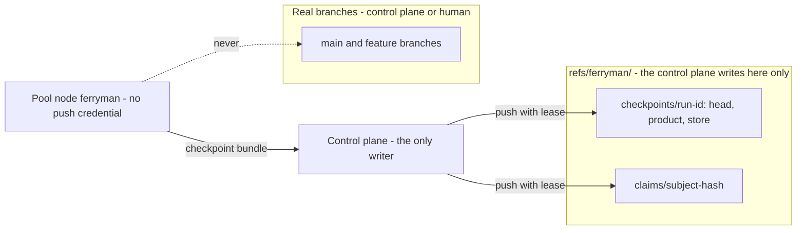

# Architecture Change — Pool state, integrity, and signals

**Decision sought:** Approve portable run state through a checkpoint namespace, out-of-band supervisor digests, relayed tracker signals, and optional claims, so a run survives a change of node.

A run can move between nodes only if its state travels, its supervisors are checked from outside the clone, and its approvals still verify. It rests on three points:

- A node returns a checkpoint bundle and pushes nothing, and the control plane writes only `refs/ferryman/` in a dedicated repository.
- The control plane supplies expected digests, so a fresh clone does not pin whatever it finds.
- A relayed signal carries an evidence bundle `ferryman` re-checks without credentials.

**Author(s):** Repository owner (draft)
**Status:** Draft
**Last updated:** 2026-11-07
**Reviewers:** Repository owner, security reviewer

**Baseline — current architecture:** [Work-loop product ref](../work-loop-product-ref.md), the pin check in the [supervisor](../work-loop-execution-supervisor.md), and [page 06](06-tracker-integration-and-authority.md) for tracker verification.

Part of the [set index](README.md). [Page 11](11-remote-agent-pool-seams.md) owns the pool deployment, the worker interface, node trust, and usage.

## 1. Scope and Baseline

Four seams change, and the supervisor's scripts do not.

| Delta item | In scope | Why it changes |
| --- | --- | --- |
| Checkpoint namespace and restore (seam 2) | yes | The run store and product ref are local to one clone |
| Out-of-band supervisor digests (seam 3) | yes | A fresh clone has no pins, and the first `start` pins what it finds |
| Relayed tracker signals (seam 5) | yes | One poller per node multiplies one token's rate budget |
| Claims for duplicate dispatch (seam 6) | yes | Clones at one `HEAD` pick the same spec |
| Edits to pinned scripts | no | [ADR-0144](../../adr/0144-work-loop-supervisor-owns-procedure.md) |

| Unchanged context | Link |
| --- | --- |
| Product ref transaction and classification | [work-loop product ref](../work-loop-product-ref.md) |
| Six tracker verification conditions | [page 06](06-tracker-integration-and-authority.md) |

## 2. Structural Change

Four ferryman modules and one ref namespace carry the seams.

| Element or relationship | Change type | Baseline reference |
| --- | --- | --- |
| Checkpoint bundle producer and restore step | added | run store and product ref[^1] |
| Out-of-band digest check | added | supervisor pin check[^2] |
| `signal` command handler | added | tracker poller on page 06 |
| Claim refs `refs/ferryman/claims/<hash>` | added | none |
| Namespace `refs/ferryman/` | added | `ferryman`'s only push target |

*Question: which refs does the control plane write for a node, and who owns each? Zoom: component.*



## 3. Runtime Change

| Journey or scenario | Change type | Baseline reference |
| --- | --- | --- |
| Checkpoint between attempts, restore on a new node | new | product ref, run store |
| Digest check before the first command and after each attempt | new | pin check |
| Signed signal delivered by the control plane | new | tracker poller |
| Claim create, renew, expire | new | none |

**Seam 2: durable state across machines.** The product ref `refs/agentbundle/delivery/<run-id>/<token>/product` is a local protected ref that only the supervisor moves with `HEAD`. The supervisor directory `.git/agentbundle-supervisor/` holds the run store, pins, run lock, and gate records, and a gate record sits at `gates/<id>.json`, outside any `<run-id>/` directory.[^1]

A fresh clone of a pushed branch carries neither.

A default clone does not fetch `refs/ferryman/*`, so a restore names an explicit refspec.[^3]

What the supervisor says in each case:

| Case | Supervisor result | Source |
| --- | --- | --- |
| Fresh clone, committed approvals, no store | `status` answers `committed-records-only`. Every other command except `start` refuses `supervisor-changed` | pin check[^2] |
| Store restored, product ref missing | `attempt-residue` with an open attempt, and untested with none | classification[^4] |
| Store and ref restored at the recorded value | normal classification, and `HEAD` ahead through made commits projects forward | same |
| Store restored, `HEAD` on a commit the store never recorded | a `history-adoption` decision for the owner | same |

Recommendation (D24): checkpoints in the `ferryman` namespace. Each checkpoint writes three refs and nothing else:
- `refs/ferryman/checkpoints/<run-id>/head`, the `HEAD` commit;
- `.../product`, the product-ref commit;
- `.../store`, a commit whose tree snapshots the whole supervisor directory (pins, made list, product record, every gate record, the attempts directory, no lock files) plus a manifest with a sequence number, the epoch, and a digest of the `attempts/` listing.

A planning gate parks before `start`, so it has no run id, and until `start` assigns one the checkpoint is keyed by subject hash (unverified design).[^11]

A pool node holds no checkpoint push credential (D45). At each boundary where no attempt is open (after each `report` and scribe commit, before the next `next`, and before exit 10), `ferryman` returns a bundle through the sidecar: the `head` and `product` commits, the `store` content, and the manifest. The control plane validates it against the manifest and writes the refs itself, and `ferryman` calls `next` only after the write is acknowledged.[^14]

The control plane writes the three refs with one `git push --atomic` and a `--force-with-lease=<ref>:<expected>` per ref, so the sequence number fences two nodes on one run.[^5] A node lost mid-attempt or with a bundle in flight loses only the work after the last written checkpoint.

**Pool prelude.** A pool run takes these steps before start step 1 on [page 03](03-ferryman-runtime.md): read the launch file, check its digest against the control plane's expected value, restore, and confirm the subject claim.

A restore runs in this order before the new node's first `next`:
1. The control plane fetches the three refs by explicit refspec and compares the manifest with its own record.
2. It compare-and-swaps `store` with a new commit that carries epoch+1, and dispatches the node with the checkpoint through the sidecar or a read-only fetch it provisions.
3. The node verifies the manifest against `expected_checkpoint` from `launch.v1`, and the `attempts/` listing against its digest. A difference refuses `checkpoint-conflict`.
4. The node writes `.git/config` from the template, then the store, then creates the product ref at the recorded value.

An old node's bundle after the restore carries a stale `store` lease, so the control plane's push fails and the node halts `checkpoint-conflict`.

Without `attempts/`, `next` returns the same request id, but numbering restarts and the earlier report is lost silently.[^11]

The control plane is the only writer of the dedicated checkpoint repository and holds its only push credential (D45), so one node cannot rewrite another run's checkpoint. Its record of the refs it wrote is the integrity basis, and a store that differs from that record fails restore step 1.[^13] The checkpoint remote is control-plane configuration, and a node configured with one refuses `pool-config-incomplete`.

The node never copies a recorded `.git/config`, because a hostile store could set `core.fsmonitor` or a hook and run code in the ferryman sandbox.[^10] It rebuilds the file from a fixed template with an allowlist of keys and no hooks, takes an allowed key's value only from TB5 or the launch file, and writes the template before any git command runs, because with a copied config a plain `git status` and `git commit` fired the hostile hooks and the supervisor's own git calls did not.[^8]

The template denies `include*`, `credential.*`, `core.sshCommand`, `core.fsmonitor`, `core.hooksPath`, `filter.*`, `diff.*`, and any key not on the allowlist. `launch.v1` pins the template digest (D73), and a node refuses a template that differs.

No attempt is open at a checkpoint, so no recorded fingerprint has to match, and whether the next attempt open fingerprints the rebuilt config is unverified.[^8]

Unverified: whether `start` on an admitted run re-pins and answers `current` on a fresh clone (alternative: D24, [10c](10c-review-decisions.md)), a restore with an open attempt, a provisioned read-only fetch, and signed manifests.

**Restore epoch.** The launch file carries an epoch, and a lost race on the control plane's compare-and-swap dispatches no node. Effects park in a pool (D69), and if D69's alternative is taken, a bundle follows each `effect-intent` commit and the compare-and-swap repeats before each effect dispatch.

On one machine a parked effect, with an `effect-intent` commit and an unknown outcome, resolves through an `effect-query` request that parks for a human.

Each race (two writers on one stale lease, two restorers, an old node against the new epoch) yields one winner in 20 of 20 trials, and an empty expected value is create-only.[^9][^8]

At one step a minute, 100 concurrent runs make 6,000 atomic pushes an hour. 200 sequential atomic pushes failed 0 times on a local bare repository, and 30 on a real host.[^9][^12]

`head` keeps the whole chain, and only the latest `store` checkpoint stays reachable. Git host push limits are unverified.

The launch file also carries the digest of the control plane's `doctor --probe` record (D73), and `ferryman` skips its own probe only when its recomputed digest equals it.

**Subject fence.** The restore epoch fences per run id. Before `start`, the control plane also writes `refs/ferryman/claims/<subject hash>` with an empty expected value, carrying `{run_id once known, epoch, node_id}`.

A pool claim does not expire (D26): only the control plane releases it, at terminal or abandon, and each re-key takes it again.

On a restore the control plane writes the claim with `--force-with-lease` on the old value and the new epoch, and releases any claim whose run is gone. A second dispatch is refused before `start`, in 20 of 20 trials. The claim is on the `pool-config-incomplete` list ([page 01](01-contracts-and-data.md)).

**Lost attempts.** The next launch file echoes each `worker-spawned` event as a charge, and a lost or `usage-unknown` attempt counts as a respawn charging `max_cost` and `max_tokens` until a real report arrives.

**Launch fields.** The control plane recomputes `expected_checkpoint`'s `manifest_digest` from the refs it wrote and never from a node-sent `checkpoint-pushed` event, because node events carry no authority (TB1).

The `terminal` manifest carries `terminal: true` and `head_sha`, so the control plane reconciles from refs after a lost event.

**Run grant.** `ferryman` reads grant values only from the runner's `next` or `status` at the base, and parks when they change.

A checkpoint write is never a push under a run grant (D57).[^15] The control plane writes one namespace (`refs/ferryman/checkpoints/<run-id>/`) of a dedicated checkpoint repository, so a grant that holds push does not hold pool checkpoints back.

One limit applies. A host cannot enforce a one-namespace remote on the tested tier (a credential is whole-repository, and rulesets are unavailable on a free private repository), so the control plane's own writer enforces the namespace. A ruleset on a paid or public repository is not tested and not planned, because a separate checkpoint repository is the design either way.

On one machine `ferryman` writes optional checkpoints to a local or separate remote, and `checkpoint-held` applies only when the grant or the runner refuses.

**Pool-mode behaviour.**
- A parked gate: `ferryman` exits 10, and the control plane re-dispatches with a restore when the answer arrives (D24).

**Seam 3: supervisor integrity on fresh clones.** The remaining gap is the first admission, which "pins the files itself": it pins whatever is installed when `start` runs.

On one machine [page 05b](05b-approval-integrity-and-trusted-configuration.md) closes it with install-state hashes, and in a pool the control plane's digests close it. The control plane records them once per run_id, where "run start" means the first dispatch, and reuses that set for every re-dispatch.

Repository files come from the run's base commit plus the released pack's hash records (or reviewed `main`), never from the clone. The user config and the profiles it names come from the files the control plane itself provisions through TB5 ([page 11](11-remote-agent-pool-seams.md)).

The control plane supplies expected SHA-256 digests at launch, in a launch file outside the repository. The set covers every file in `protected_paths` and `executed_paths` ([05b](05b-approval-integrity-and-trusted-configuration.md)). `ferryman` checks them before the first command, including `start`, and after every attempt close.

Where the install state file is present, `ferryman` also compares each file with `files[relpath].sha`.[^6] The state file lives in the repository, so this is a cross-check and not the anchor. A mismatch refuses `supervisor-digest-mismatch` and parks the run.

**Seam 5: tracker signals as input.** In `relayed` mode the control plane polls or takes webhooks, because the page 06 rate arithmetic is per checkout.

The control plane checks the six conditions of [page 06](06-tracker-integration-and-authority.md) and sends a signed `signal` command with an evidence bundle: tracker ref, event id, actor id, login and kind, tag, event time, prompt comment id and time, and the gate digest.

Without credentials `ferryman` re-checks the signature and expiry, that the tag matches the current parked gate, that the bundle digest equals the gate digest, that the event follows the reported prompt time, and that the actor id resolves through `[identities]` to the gate's approver set with `kind` `user`.

A relayed `signal` also carries the tightening signals `hold`, `source-revision-drift`, and an unverified `request-changes`, none needing actor verification. `ferryman` emits `mirror-requested` events, and the control plane performs the mirror writes under `[authorization.mirror]`, idempotent per request id.

`ferryman` cannot check that the event exists or re-read the label (check 6 on page 06). The control plane's signature replaces both, and it recomputes the gate digest from the repository at the parked commit and never from the relayed signal (D25). The record stores `verification: control-plane-signed`, `relayed_by`, and the whole bundle as evidence (D28).

**Seam 6: claims and duplicate dispatch.** An `active` spec stays invisible across clones until a branch merges. The control plane owns assignment, and `ferryman` takes an explicit subject.

Where no control plane exists, `ferryman` can take a claim: a commit holding `{owner, subject, lease_until, base}` at `refs/ferryman/claims/<subject hash>`. Creation is `git push --force-with-lease=<ref>:` with an empty expected value, so the ref must not exist.[^5]

Renewal pushes a child commit, and takeover after expiry names the old value. A live claim by another owner removes the item from the frontier with the finding `claimed-by-other`.

The claim carries its base commit, and `ferryman` runs `check-base-freshness.py --target <remote/branch>` first. A stale base refuses the claim.[^7]


## 4. Contract and Invariant Change

Five rows change, and one narrows the index invariant.

| Semantic name | Change type | Baseline reference | Compatibility during transition | Enforcement | Verification |
| --- | --- | --- | --- | --- | --- |
| Checkpoint namespace | new | none | off unless `[checkpoint] enabled` | argv allowlist limits `ferryman` pushes to `refs/ferryman/`, and a pool node has no checkpoint credential | push-scope test over all ferryman Git calls, and a corpus case: a node with no checkpoint credential cannot write the checkpoint repository |
| Ferryman push rule | narrowed | the [set index](README.md) invariant | none beyond the invariant | allowlist | absence test for any other ref |
| Expected digests | new | pin check | an absent file means no out-of-band check, flagged by `doctor` | `registry` | tamper-before-`start` test |
| `signal` command | new | tracker poller | `[tracker] mode = direct` ignores it | signature and evidence re-check | forged-signal corpus |
| Claim ref | new | none | off unless `[claims] enabled` | lease push | two-clone claim test |

```text
ferryman run --supervisor work docs/specs/f --launch /run/launch.toml    # subject, expected digests, signers digest, expected checkpoint
signed control file: {"id":"09","command":"signal","run_id":"r-3","epoch":2,"nonce":"n-77","actor":"cp:relay-1/user","actor_issuer":"idp-1","actor_subject":"u-17","actor_kind":"user","args":{"gate":"spec-approved","evidence":{...}},"key_id":"k1","sig":"<b64>","expires_at":"..."}
ferryman claim docs/specs/f     -> claimed (lease 900 s), or Refused("claimed-by-other")
```

The keys `[checkpoint]`, `[claims]`, `[integrity]`, `[pool]`, and `[tracker] mode` are in the `ferryman-config.v1` table on [page 01](01-contracts-and-data.md).

## 5. Data/State Migration

The checkpoint and claim refs are the only new durable data, and both are optional.

| Data element | Old shape | New shape | Migration mechanism | Rollback |
| --- | --- | --- | --- | --- |
| Run store and product ref | local to one clone | local, plus a checkpoint under `refs/ferryman/checkpoints/` | the control plane writes it from a returned bundle between attempts (one machine: `ferryman` pushes when enabled) | delete the namespace on the remote |
| Claim refs | none | `refs/ferryman/claims/<hash>` | created on claim | delete the ref |

## 6. Deployment/Operational Change

The control plane supplies the launch file, and nothing in the repository runs on the remote.

| Deployment unit | Change type | Baseline reference |
| --- | --- | --- |
| Checkpoint repository namespace `refs/ferryman/` | new, written only by the control plane | none |
| Launch file with expected digests, signers digest, expected checkpoint | new, control-plane supplied | none |

## 7. Quality Regression and Verification

All targets are design targets.

| Attribute at risk | Baseline target | Stimulus that could regress it | Verification |
| --- | --- | --- | --- |
| Fencing | one `ferryman` per subject | two nodes on one run | the control plane refuses the second node's first bundle, and an old node's bundle after a restore, on the lease in 20 of 20 trials |
| Integrity | the pin check refuses a changed supervisor | script edited before `start` | `supervisor-digest-mismatch` in 100% of runs |
| Effects | external effects never repeat | restore from an older checkpoint, or two nodes on one checkpoint, with an effect request pending | the request parks and 0 effects dispatch in 20 trials of each |
| Signals | only a verified actor loosens a gate | forged, replayed, wrong-digest, wrong-actor, actor-swapped, tag-off-gate, event-before-prompt, or bot-actor signal | 8 of 8 refused |
| Fresh clone | an unpinned run refuses | `next` on a clone with no store | `supervisor-changed` in 100% of runs |
| Duplicate dispatch across a park | a parked subject stays claimed | a second node asks for the subject while the first is parked or preempted | refused `claimed-by-other` in 20 of 20 trials |

## 8. Build Mapping

All four modules live in the `ferryman` package, and the control plane's writer sits outside this repository.

| Semantic element | Change type | Source owner | Build unit | Deployable | Verification |
| --- | --- | --- | --- | --- | --- |
| Checkpoint bundle and restore | new | `packages/ferryman/ferryman/checkpoint.py` | `ferryman` | CLI | restore test against the real supervisor |
| Digest check | new | `.../integrity.py` | `ferryman` | CLI | tamper test |
| `signal` handler | new | `.../inbox.py` | `ferryman` | CLI | forged-signal corpus |
| Claims | new | `.../claims.py` | `ferryman` | CLI | claim tests |

## Evidence

[^1]: `docs/architecture/work-loop-product-ref.md` §§ 1 and 2 (the product ref), and `_supervisor_git.py` (store under the Git directory) — verified.

[^2]: `packs/core/.apm/skills/work-loop/scripts/work-supervisor.py`, the pin function and its docstring: a working run with no store refuses every command but `start`, `status` alone passes (`committed-records-only`), and "the first admission has no run yet and pins the files itself" — verified by reading.

[^3]: A default clone of the pushed repository did not carry `refs/ferryman/*`, and an explicit refspec fetched them — verified (tested, single run, 2026-11-07).

[^4]: `packs/core/.apm/skills/work-loop/scripts/_supervisor_recovery.py` (`reconcile`, `_create`, `_divergence`) and `work-loop-product-ref.md` § 2 table — verified by reading. A missing product ref with an attempt open gave `attempt-residue` — verified (tested, single run, 2026-11-07). With no attempt open: unverified.

[^5]: git-push documentation, `--force-with-lease=<refname>:<expect>` (an empty expect means the ref must not exist) and `--atomic` — https://git-scm.com/docs/git-push — verified by fetch. A stale lease on one ref left a half-pushed checkpoint without `--atomic` and none with it — verified (tested, single run, 2026-11-07, local bare repository).

[^6]: `docs/architecture/catalogue/state.md` (`files` as `{relpath: {sha}}`, the Tier contract's comparison basis) — verified.

[^7]: `packs/core/.apm/skills/work-loop/scripts/check-base-freshness.py` docstring (`--target REMOTE/BRANCH`, exit 1 on surface) — verified.

[^8]: Restore test on the real unedited `work-loop` skill, local scratch: a checkpoint with no open attempt restored from the template with zero differing keys and the same request id from `next`, a stale `report` refused `not-current-attempt`, and a hostile recorded config was dropped. Old-node and race trials ran 20 each — verified (tested, single run, 2026-11-07).

[^9]: Spike S1, 2026-11-07, local bare repository: 200 sequential atomic pushes, and 20 trials each of the stale-lease and epoch races — verified (tested, single run).

[^10]: A repository-local `core.fsmonitor` program ran on `git status`, and a `core.hooksPath` hook ran on `git commit` — verified (tested, git 2.56.0, single run, 2026-11-07).

[^11]: Gate records sit at `.git/agentbundle-supervisor/gates/<id>.json` outside any `<run-id>/` directory: a run-scoped snapshot restored no gates, a whole-directory snapshot restored them, and a restore without `attempts/` gave the same request id and lost an earlier record — verified (tested, single run, 2026-11-07, local scratch). Keying a pre-`start` checkpoint by subject hash and the re-key at `start`: unverified design item for P7.

[^12]: Free private repository, git 2.56.0: 30 atomic leased pushes, 0 failures; a stale lease rejected all three refs in 20 of 20 trials; two racing writers had one winner in 20 of 20 — verified (tested, single run, 2026-11-08).

[^13]: Same host: a deploy key reached only its own repository and could write any ref in it; `/events` and `/activity` showed no custom-ref pushes; rulesets returned HTTP 403 — verified (tested, single run, 2026-11-08).

[^14]: The bundle, the acknowledgment before `next`, and the control plane as sole writer are the owner's decision, not built or tested. The trials used one writer and the same push command — assumption.

[^15]: Spec `run-grant` and `references/brief-runner.md` define "push" as publishing to the shared remote and exclude a separate one-namespace checkpoint remote — verified (read, merged). The owner decides that the exclusion covers the control plane's writer, and a follow-on wording change to RFC-0113 and spec `run-grant` words it by writer and repository — assumption.
