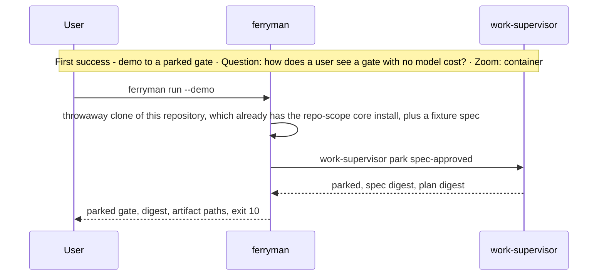
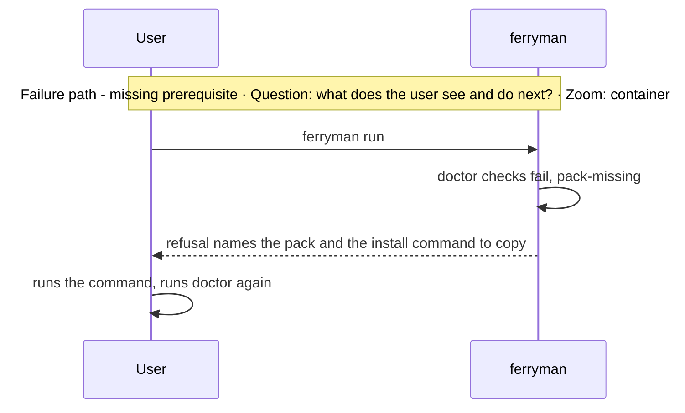

# Architecture Change — Installation and adoption experience

**Decision sought:** Approve a default install path of at most four manual steps to the first parked gate, a distribution channel, a compatibility policy, configuration provenance, and a documented clean-up of residue for `ferryman`.

`ferryman` is the first installed package whose job is to drive work and stay in use, since the installed packages so far manage packs. Three choices carry the experience:

- One doctor command names the fix for every missing prerequisite, and installs nothing.
- Configuration is generated, reviewed, and committed by a human, and not seeded by default.
- Every residue class has a listed clean-up that asks before any destructive Git step.

**Author(s):** Repository owner (draft)
**Status:** Draft
**Last updated:** 2026-11-07
**Reviewers:** Repository maintainers, docs owners

**Baseline — current architecture:** [Agentbundle](../agentbundle.md) § 2 (install scopes), [distribution routes](../distribution-routes.md), and [page 02](02-install-trust-and-detection.md), which owns detection and `doctor` mechanics.

The architect pack has no installation-and-adoption lens. Its quality lenses are reliability, performance, maintainability, cost, operability and supportability, security and trust, data integrity, and testability.[^1] The criteria below are a working definition: time to first success, human touches, prerequisites, upgrade safety, diagnosability, and residue.

Part of the [set index](README.md).

## 1. Scope and Baseline

The page owns what a person experiences, and page 02 owns how detection works.

| Delta item | In scope | Why it changes |
| --- | --- | --- |
| Personas, journeys, prerequisites, install order | yes | A second runtime package adds a release train and prerequisites |
| Distribution channel and package registration | yes | The package must reach users in connected and restricted networks |
| Compatibility with supervisor skill versions | yes | A core upgrade can strand the controller |
| Configuration provenance | yes | Seeds are written once and never upgraded[^2] |
| First run, consent display, diagnosability, clean-up | yes | The user needs a safe first success and a way out |
| Detection and `doctor` mechanics | no | [Page 02](02-install-trust-and-detection.md) |

| Unchanged context | Link |
| --- | --- |
| Install `agentbundle` with pip in a virtual environment, or from a clone, using the Python the agent runs | `guides/_shared/how-to/install-agentbundle.md`[^3] |
| Pack scopes: core repo only, `product-engineering` and `github` user or repo | each `pack.toml`[^4] |

## 2. Structural Change

Seven journeys cover the experience, and each has a human cost. Times are design targets, and no measurement exists.

| Journey | Steps | Who | Time target | Failure points |
| --- | --- | --- | --- | --- |
| A. Developer adds `ferryman` to a repo that has core | install the package, `ferryman doctor`, `ferryman init`, review and commit the config, `ferryman run --demo` | user, then agent | 15 min | missing `gh` auth, missing agent CLI, wrong Python |
| B. Teammate joins a repo that uses it (v1 limit: one approver, so a teammate who is not the owner cannot approve) | clone, install the package, `ferryman doctor`, set the user config and CLI login | user | 10 min | per-person state missing: `gh` auth, CLI login, identities |
| C. Pool node from an image | build the image with `ferryman`, the pinned CLIs and `ssh-keygen`, run `doctor` and `doctor --probe` during the build and record the result, and at launch supply the model and gateway credentials and the launch file | control plane, with one human touch to approve the image | 2 min per node at launch | probe record stale, digest mismatch, missing credential. Shallow-clone behaviour is unverified (no handling found in `check-base-freshness.py` or the supervisor classification code). A pool smoke step against a fake remote transport precedes the first dispatch, probe credentials exist at build time only, and a pod with no TTY satisfies the D54 display through the image-approval touch |
| D. Upgrade core or `ferryman` | upgrade, `ferryman doctor` | user or CI | 5 min | descriptor missing for the new skill version, and an `agentbundle` upgrade can raise the state schema, which `doctor` reports |
| F. Discovery outside a tracked directory | run `ferryman run` with discovery state in `.context/discovery/` (tier B); same machine only, no pool, `session-attested` only | user | 5 min | machine loss, clone deletion, and a broken ledger chain lose or stop the run |
| G. Drive a supervisor in a session, no `ferryman` (after E1 or E2) | install `agentbundle` and `core` (and `product-engineering` for discovery), keep saying "new spec" or invoke `work-loop`, and answer each parked gate as the approver | user | 5 min | `no-human-answer`, `parked`, and the `weak` flag when one agent definition authors and reviews |
| E. Uninstall or abandon | `ferryman clean --plan`, confirm each class, uninstall the package | user | 10 min | residue left behind |

The prerequisites and what each install step verifies:

| Order | Prerequisite | Scope | Verified by |
| --- | --- | --- | --- |
| 1 | Python 3.11 or later, Git 2.32 or later (the supervisor's floor) | machine | `python3 --version`, `git --version`, then `doctor` |
| 2 | `agentbundle` and the `core` pack. A session drive (journey G) needs nothing more | `agentbundle` any, `core` repo only | `agentbundle` status output, then `doctor` reads the install state ([02](02-install-trust-and-detection.md)) |
| 3 | `product-engineering` pack, only for discovery | user or repo | `doctor` |
| 4 | The `work-loop` skill, only for `ferryman session` | repo | `doctor` prints `session route: ready` or `session route: blocked (<reason>)`, and the route adds no install step |
| 5 | `ferryman` package, for every `ferryman` command including `session` | user | `ferryman --version` |
| 6 | Agent CLIs, each with a pinned version, and `ssh-keygen` with `-Y verify` for signed commands | machine | `doctor --probe` ([03b](03b-headless-worker-launch.md)) |
| 7 | `gh` and its login, only for tracker work | user | `doctor` prints the auth status output, and parses nothing |
| 8 | `ferryman.toml`, `[identities]`, tracker labels | repo | `doctor` and schema check |

The default `ferryman` path to the first parked gate has six manual steps today: install `agentbundle` and `core`, install `ferryman`, run `doctor`, run `init`, review and commit the config, and run the demo. The design target is four: (1) install `agentbundle` and `core`, (2) install `ferryman`, (3) ask the agent to run `setup-ferryman`, which runs `doctor` and `init` and shows each command behind one consent, and (4) review and commit the config, then run the demo. `setup-ferryman` is a proposed setup skill in `core`, matching the "ask your agent" pattern, and it is in the P0 row on [page 13](13-rollout-spikes-and-risks.md).

## 3. Runtime Change

The first success is a demo that reaches a parked gate at no model cost. `--demo` runs in a throwaway clone of the current repository, which already has the repo-scope core install, with a fixture spec added. It uses the installed supervisor read-only, is exempt from the default-branch rule and from the prompt wait, prints the parked gate, and exits 10.

| Journey or scenario | Change type | Baseline reference |
| --- | --- | --- |
| `ferryman run --demo` | new | none |
| First real run with the consent display | new | none |
| `ferryman clean` | new | none |

Before the first real run, `ferryman` shows the effective worker permissions for each role (its `allow` list, the model, the pinned CLI version) and asks for one confirmation. Hook wiring publishes only with consent, as the distribution routes require.[^5] `init` writes no install state and writes nothing to the tracker.

What the user sees on each failure. Each row names every code in its group, and [page 01](01-contracts-and-data.md) owns the registry:

| Failure | Codes the user sees | Next action |
| --- | --- | --- |
| Pack not installed | `pack-missing`, `skill-missing` | run the install command the refusal prints |
| The worker lacks a skill | `worker-skill-missing` | fix `setting_sources` or the profile, then run `doctor --probe` |
| Probe or park needing a human | `probe-failed`, `needs-attention` | read the event, then run `doctor --probe` or answer the park |
| State file schema unknown | `unsupported-state-schema` | upgrade `ferryman` |
| Brief-level runner or exec-root refusal | `not-main-worktree`, `base-not-default`, `base-not-committed`, `exec-root-not-worktree`, `path-occupied` | run from the main worktree at the fetched tip, commit `docs/`, or name a registered worktree |
| Intake cap or unverified request | `intake-cap-reached`, `untrusted-request-changes`, `grant-refused` | wait for the next day, answer through the terminal, or supply the grant in the launch file |
| Unknown schema or skill version | `unsupported-schema`, `unknown-descriptor`, `unknown-request-kind` | upgrade `ferryman` or pin core |
| CLI version differs from the probe record | probe failure with both versions | run `doctor --probe` |
| `gh` not logged in | `doctor` prints the auth status output | log in |
| Config schema older than `ferryman` | `doctor` reports the version drift | run `init --upgrade-plan`, review, commit |
| Checkout not fit for a run | `checkout-dirty`, `default-branch-refused`, `branch-changed` | commit or stash, or pass `--branch`, or switch back |
| The same subject has another unmerged branch | `subject-branch-unmerged` | merge or delete that branch, or run `ferryman done <branch>`. Other subjects' branches never block a run |
| Local discovery tier limits | `local-tier-pool-refused`, `local-tier-level-refused`, `local-ledger-corrupt` | move the discovery to a tracked directory (tier A), use the terminal prompt, or restore the ledger from a copy |
| Trusted file changed | `trust-set-dirty`, `trust-set-changed`, `trust-set-changed-in-attempt` | commit the change as a human, then restart the run |
| Worker overreach | `worker-set-approval`, `worker-commit`, `worker-moved-ref`, `refused-in-attempt`, `orphan-worker` | read the parked attempt, discard it, retry the worker |
| Scribe recovery | `scribe-intent-missing`, `scribe-unrecoverable` | run `status`, let the human review the intent file, and restart |
| Another process holds the subject | `ferryman-locked` | wait or stop the other process |
| Restart cannot find the subject | `chain-ambiguous` | name the subject with `--supervisor` |
| Light session stopped | `session-interrupted`, `light-escalated` | review the kept tree, then publish it, discard it, or start the full path |
| Session not allowed in a pool | `session-pool-refused` | run it on one machine |
| A host policy stopped the worker | `policy-blocked` | read the park record, then ask the policy owner to allow that step, or run it yourself |
| Worker credentials or floor | `credential-env-refused`, `profile-unprobed`, `enforcement-required`, `secret-in-diff` | remove the variable from `env_allow`, run `doctor --probe`, use an `enforced` profile, or remove the secret from the patch |
| Approval not accepted | `actor-not-approver`, `level-not-accepted`, `no-tty`, `stale-digest` | fix `[identities]`, use the terminal prompt, or answer the current digest |
| A gate waits, or a consent has no human answer | `parked`, `no-human-answer` | answer the gate as the named approver, then run `next` again |
| Restored store does not match | `attempt-residue` | repeat the restore, or start from a clean clone |
| Supervisor protocol fault | `supervisor-protocol`, `request-consumed`, `result-fact-refused` | stop and report the supervisor version |
| Supervisor file differs from the pin | `supervisor-changed`, `supervisor-digest-mismatch` | reinstall the pack. In a pool, reconcile the control-plane digests, or treat the run as tampered |
| Intake or tracker problem | `destination-required`, `source-revision-drift`, `mirror-drift`, `rate-limited`, `tracker-unavailable` | set `[intake] destination`, or wait, or re-read the ticket |
| Pool config or signature | `pool-config-incomplete`, `signature-invalid`, `transport-protocol`, `execution-boundary-unset` | complete or re-provision the launch file, or wait for the D55 boundary |
| Pool budget or lease | `budget-exhausted`, `lease-lost` | raise the budget through the control plane, or let it re-dispatch |
| Another node holds the checkpoint or claim | `checkpoint-conflict`, `claimed-by-other` | stop this node |
| A single-machine checkpoint stays local | `checkpoint-held` | the grant or the runner refuses, so change the grant or leave the checkpoint local |
| One image serves repositories at different core versions | `unknown-descriptor` on the older one | rebuild the image per core version, or pin each repository to one range |

## 4. Contract and Invariant Change

Four policies are new.

| Semantic name | Change type | Baseline reference | Compatibility during transition | Enforcement | Verification |
| --- | --- | --- | --- | --- | --- |
| Distribution | new | `agentbundle` published to PyPI and installable from a clone | the clone path serves offline and restricted networks | package registration rules | install fixtures |
| Compatibility range | new | descriptors per skill version | the version rule is on [page 02](02-install-trust-and-detection.md) | descriptor table | range test |
| Config provenance | new | seeds are never upgraded | a generated, committed file with a `schema_version` | `init`, `doctor` | drift test |
| Clean-up | new | none | `ferryman clean` never uses destructive Git without confirmation | per-class confirmation | residue fixture |

**Distribution.** `ferryman` reaches users in three ways: from PyPI into a virtual environment, as an isolated tool install, and from a clone.[^3] The isolated install is safe because `ferryman` imports no `agentbundle` and need not share the agent's Python, and the offline path is the clone install.

The Claude plugin route serves packs and not packages.

A PyPI lookup of 2026-11-07 found no `ferryman` package (assumption: not reproduced here). No npm or PATH collision check is recorded for `ferryman`, so the name must be re-checked, with trademark, before the first publish (D30, see the footnote on [page 10c](10c-review-decisions.md)). A new package follows `packages/AGENTS.md`: paired `version.py` and `pyproject.toml`, and package tests that read no repository path.[^6]

Unverified: how `agentbundle` is published and where a new package registers in the build and CI inventories.

**Compatibility.** A core patch release can strand `ferryman`: descriptors are per skill version, and an unknown version is a stop. Slice 7 shipped core 4.0.27 to 4.0.29.

The version rule is on [page 02](02-install-trust-and-detection.md): `doctor` reports the installed skill version against the range, and `run` refuses outside it.

An option is for the pack to ship a descriptor file beside the supervisor, so `ferryman`'s release leaves the critical path (D51). The supervisor's attempt manifest records the installed skill directory, so a new file there changes the manifest.[^7] Whether the supervisor pins that file is unverified, so the page does not propose it as settled.

**Configuration provenance.** Seeds are written once and never upgraded, so no configuration is seeded by default (D52).[^2] The RFC-0112 pack-defaults projection for non-sensitive defaults is a candidate to evaluate first.

Edits to the trusted set are human-only commits ([05b](05b-approval-integrity-and-trusted-configuration.md)).

| File | Created by | Notes |
| --- | --- | --- |
| `ferryman.toml` | `ferryman init`, then a human reviews and commits | carries `schema_version`, and `doctor` reports drift |
| `[identities]` (numeric tracker ids) | by hand | `init` prints a lookup command and writes nothing |
| `[gates]` | `init` writes `accept = ["session-attested"]` | the default is the safe one |
| `[authority]` `owner_ref`, `plan_reviewer_ref` | by hand | `init` prints a template |
| `spec-policy.json` | shipped with the `new-spec` skill | not edited by `ferryman`. A human changes `max_review_rounds` (D37) as a committed edit to the trusted set |
| Probe record | `doctor --probe` writes it into the user config | records the CLI version |
| Packaged default profiles | shipped in the package | overridden by the user config |
| `.work-intake.toml` | by hand, existing | `[authorization.mirror]` is optional |
| `~/.ferryman/config.toml` | by hand from a printed template | holds CLI paths and profiles |
| Tracker labels | `init --create-labels`, each set confirmed | label creation is a tracker write |

## 5. Data/State Migration

Residue is whatever remains after uninstall, and each class has a clean-up.

| Residue | Where | Clean-up |
| --- | --- | --- |
| Run roots | `<git-dir>/ferryman/` | delete when no intent or attempt is open |
| Checkpoint and claim refs | `refs/ferryman/` locally and on the remote | delete locally, then the remote only on confirmation |
| Ferryman-owned worktrees | the peer root | remove only when clean, never with `--force` |
| Tracker labels and mirror comments | the tracker | listed for the user, never removed unasked |
| `ferryman/*` branches (per-branch confirmation, D17), locks, receipts, the peer root, `~/.ferryman/`, the checkpoint remote, the `setup-ferryman` skill | local and remote | listed by `clean --plan` and removed only on confirmation |
| The committed `ferryman.toml` | the repository | kept on purpose: it is a reviewed repository file |
| `approval-attributions.jsonl` | the repository | kept on purpose: it is the approval evidence |
| The `--demo` throwaway clone | the system temporary directory | deleted when the demo exits, or by `clean` after a crash |
| Sibling supervisor stores | the supervisor store under the Git directory | delete when no run is open |
| `refs/ferryman/branches/<name>` markers | local | delete after the branch is gone |
| Committed discovery directories and ledgers | `docs/discovery/` | kept: they are repository records |
| Local discovery directory (tier B) | `.context/discovery/` | listed by `clean --plan`, kept until the intent is done, and lost with the machine or clone |
| `[authorization.mirror]` | `.work-intake.toml` | listed for the user, never removed unasked |
| The probe record | `~/.ferryman/config.toml` | removed with the user config |
| The package's virtual environment | the user's tool directory | removed by the uninstall command |

`ferryman clean --plan` prints every action. Each residue class needs its own confirmation. Uninstalling the package first leaves the residue in place, so the guide says to run `clean` first.

## 6. Deployment/Operational Change

Documentation ships with each phase, and its form follows the guides conventions.

| Phase | Deliverables |
| --- | --- |
| E1 to E3 | how-to: drive the spec supervisor in a session, and how-to: drive the discovery supervisor in a session, where a ticket becomes an intent through manual `work-intake`. A plain statement that `ferryman` is later and optional. Install prerequisites and the `pack-missing` message |
| P0 | how-to: install; how-to: first unattended run and the demo; how-to: approve from a terminal; README rows |
| PL | how-to: run a light change with `ferryman session` and publish it by hand |
| P1 | reference: `ferryman.toml` keys; explanation: what runs unattended and what stays human |
| P4 and P5 | how-to: connect GitHub; how-to: approve from a label |
| P7 | how-to: provision a pool node from an image |
| every upgrade | how-to: upgrade core or `ferryman`, and a `doctor` entry |

User guides follow Diataxis under `guides/`, validated by `guide.schema.json`. A page's `title` and leading H1 stay identical, and deleting or renaming a page deletes its `guide-nav-baseline.toml` entry in the same change.[^8] Unverified: where a package-level guide lives, since `guides/` is organised by pack.

For teams, the shared repo files are `ferryman.toml`, `.work-intake.toml`, and the install state. Per-person state is the user config, the `gh` login, and the CLI logins.

The security hand-off is two lists:

- Unattended it can: run workers inside their allow lists, park at gates, mirror status labels under policy, and checkpoint.
- By design only a human does: approve a gate (`session-attested` by default), merge, push to real branches, and widen the trusted configuration. In v1 a worker running as the same OS user can read the owner's `gh` and Git credentials, so these hold through the guard and not through credential isolation. On a pool, merge and push belong to the control plane on a recorded human merge decision that it owns outside the repository ([11](11-remote-agent-pool-seams.md), D71) ([13](13-rollout-spikes-and-risks.md) lists it as an accepted risk).

An air-gapped site uses the clone install and the CLIs' own proxies. CI can call `ferryman status --json` and `doctor` and read their exit codes. Unattended runs in CI belong to the control plane ([11](11-remote-agent-pool-seams.md)).

## 7. Quality Regression and Verification

Five attributes carry design targets, and none has a measurement yet.

| Attribute at risk | Baseline target | Stimulus that could regress it | Verification |
| --- | --- | --- | --- |
| Time to first parked gate | none | a new prerequisite or a slow install | demo reaches a parked gate in 15 minutes or less on a clean machine |
| Manual steps | 6 today | a new required step | 4 or fewer on the default path |
| Upgrade safety | none | a core patch release | `doctor` names the fix within one command after any core patch |
| Residue | none | uninstall after a run | 0 residue after `clean`, except the committed ledgers and attribution records, which stay on purpose |
| Diagnosability | none | any missing prerequisite | `doctor` or the refusal names the fix for 100% of the refusal codes this set defines |

## 8. Build Mapping

The experience lives in the package, one proposed skill, and the guides.

| Semantic element | Change type | Source owner | Build unit | Deployable | Verification |
| --- | --- | --- | --- | --- | --- |
| `init`, `clean`, `--demo` | new | `packages/ferryman/ferryman/{init,clean,demo}.py` | `ferryman` | CLI | fixture tests |
| `setup-ferryman` (proposed name) | new | `packs/core/.apm/skills/setup-ferryman/` | skill | pack install | skill tests |
| Guides | new | `guides/` | site | published | `guide.schema.json` check |

## Evidence

[^1]: `packs/architect/okf/architecture-lenses/concepts/quality-lenses/` holds eight lenses and none for installation or adoption — verified by listing the directory.

[^2]: `agentbundle install` writes seeds once and `agentbundle upgrade` never refreshes them — taken from a note outside this repository, and the install code was not re-read: unverified.

[^3]: `guides/_shared/how-to/install-agentbundle.md` (pip in a virtual environment, "use the same Python your agent runs, because some skills import `agentbundle` from their scripts", install from a clone) — verified (read).

[^4]: `packs/core/pack.toml` (`allowed-scopes = ["repo"]`), `packs/product-engineering/pack.toml` and `packs/github/pack.toml` (default user, allowed user and repo) — verified (read).

[^5]: `docs/architecture/distribution-routes.md` (the `claude-plugins` route is `user-publishable-with-consent`, and a pack that publishes hooks without consent is refused) — verified (read).

[^6]: `packages/AGENTS.md` (version rule, test conventions) — verified (read). The `ferryman` PyPI lookup of 2026-11-07 is recorded under D30.

[^7]: `work-loop/scripts/_supervisor_attempt.py` module docstring: the manifest records every trusted file, including the installed skill directory — verified (read).

[^8]: `guides/AGENTS.md` (job pages, frontmatter owned by `contracts/guide.schema.json`, nav baseline deletion) — verified (read). `guide-nav-baseline.toml` was read only in its header.
