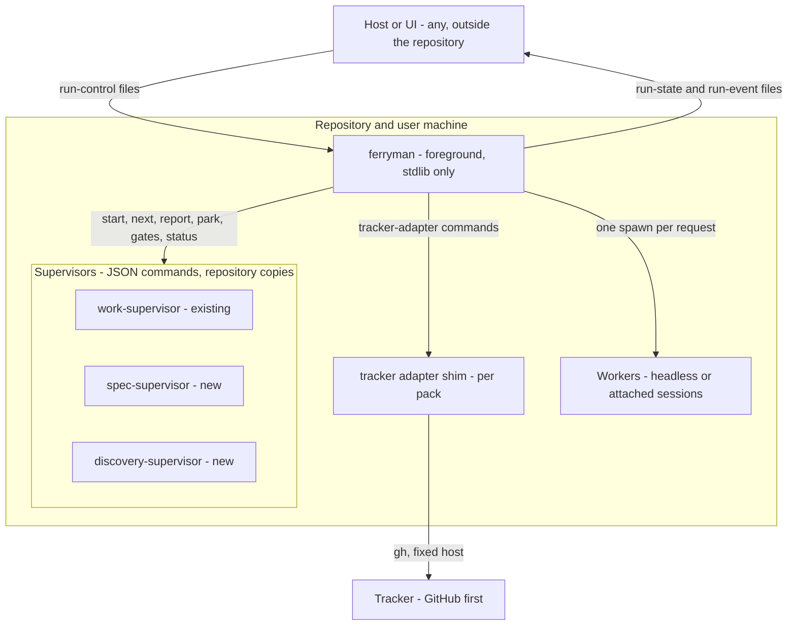

# Architecture Change — Unattended delivery ferryman (set index)

**Decision sought:** Approve a foreground ferryman, two sibling supervisors, a tracker-mirror seam, and host-neutral run contracts, so intent-to-spec work runs mechanically with humans only at gates.

The program runs from a ticket to a terminal state, with a human merge, as a short-lived command the user starts, on one machine or on a node of a remote agent pool. It calls existing supervisor commands, starts one worker per request, and stops at every parked gate. Three properties hold it up:

- Supervisors keep all procedure, so no pinned script changes.
- Contracts name no host, so any UI can read run state.
- The repository stays the only authority, so a tracker can feed and signal but never decide.

`ferryman` is an optional add-on and ships after the two supervisors, so everyday users benefit first: spikes S0 to S3, then E0 (records), E1 and E2 (supervisors), E3 (docs and routing), then P0 onward. Interactive `work-loop`, `discovery-loop` and the supervisors work without it, and removing it changes no committed record.

**Author(s):** Repository owner (draft)
**Status:** Draft
**Last updated:** 2026-11-07
**Reviewers:** Repository owner

**Baseline — current architecture:** [Work-loop execution supervisor](../work-loop-execution-supervisor.md), [supervisor stages](../work-loop-supervisor-stages.md), [loop infrastructure](../loop-infrastructure.md), [loop parallelism](../loop-parallelism.md), [workspace-mcp](../workspace-mcp/design.md), and the [reference architecture](../reference.md). This set describes the future state. Each page reconciles into `current-architecture` after it ships.

## Naming table

One table fixes every name, so a later change is mechanical. In prose, "the controller" is the role and `ferryman` is the program. "Runner" means only ADR-0159's brief-level runner, a read-only query.

| Item | Name |
| --- | --- |
| Product, package, CLI, Python module | `ferryman` (`packages/ferryman/`, module `ferryman/`) |
| Repository config, user config | `ferryman.toml`, `~/.ferryman/config.toml` |
| Run root, lock files | `<git-dir>/ferryman/`, `ferryman.lock` |
| Git namespace, branch prefix | `refs/ferryman/`, `ferryman/<subject>` |
| Peer worktree root | `.ferryman-worktrees` |
| Contracts directory, config contract | `contracts/ferryman/`, `ferryman-config.v1` |

## 1. Scope and Baseline

The set adds ten capabilities and leaves every pinned script, the daemon ban, and the Studio charter work alone.

| Delta item | In scope | Why it changes |
| --- | --- | --- |
| Run-state, event, run-control contracts | yes | Only the work supervisor's private `run.json` and `.loop-run/events.jsonl` exist today |
| Ferryman package `packages/ferryman/` | yes | Nothing drives `next` then `report` without an agent session |
| Frontier query and waves view | yes | `dispatch.py` sees specs only, and its `ask` answer stops an unattended run |
| Discovery and spec supervisors | yes | Phases before spec approval have no procedure engine |
| Light session route, `ferryman session` (D75) | yes | Direct-light leaves no spec and no plan, so no supervisor can drive it |
| Worktree ownership, v1 sequential | yes | Parallel work needs an ownership rule |
| Tracker mirror, approval signal, write-back policy | yes | Tickets are the intake; unattended mirroring needs a bounded policy |
| Host seam | yes | Hosts read state and send commands through contracts only |
| Install detection, trust, confined file handling | yes | `ferryman` finds supervisors without importing `agentbundle` |
| Remote agent pool seams (executor, checkpoints, signed commands, signal relay, claims, usage) | yes | A pool node runs `ferryman` and the agent in separate sandboxes under an outside control plane |
| Studio charter amendment | no | Handled in the Studio repository |
| Pool control plane, scheduler, user authentication | no | Out of scope: this repository supplies seams only |
| Daemon, run registry, multi-run harness | no | [ADR-0062](../../adr/0062-workspace-mcp-per-session-only-constraint.md) and Charter Principle 3 |
| Edits to pinned `work-loop` scripts | no | [ADR-0144](../../adr/0144-work-loop-supervisor-owns-procedure.md): an edit voids runs |
| `workspace_mcp_server.py` importing `agentbundle` | no | Separate decision |

| Unchanged context | Link |
| --- | --- |
| Request kinds, stages, event-line fields | [stages](../work-loop-supervisor-stages.md) |
| Parked gates and `start` admission (not light mode) | [ADR-0157](../../adr/0157-work-loop-approval-gates-park-instead-of-halting.md) |
| Refresh lifecycle, field decisions, receipts | `packs/core/.apm/skills/work-intake/SKILL.md` § 7 |
| Discovery gates G0 to G3 and the typed sidecar | `packs/product-engineering/.apm/skills/discovery-loop/SKILL.md` |
| Concurrent attempts in host-contained directories | ADR-0160 (on main), ADR-0156, and the `verified-infrastructure-parallelism` spec (Shipped, on main) |
| Brief-level runner | ADR-0159 (Accepted, on main) |
| Run grant at brief Ready | RFC-0113 (Accepted) and spec `run-grant` (Shipped, core 4.0.28), both on main |

`ferryman` only calls existing JSON commands, so anything not listed keeps its behaviour.

## 2. Structural Change

Twenty pages each own one lens, and `ferryman` sits between hosts, supervisors, workers, and a tracker.

| Element | Change | Owning page | Baseline reference |
| --- | --- | --- | --- |
| Twelve contracts under `contracts/ferryman/` | added | [01](01-contracts-and-data.md) | beside `contracts/delivery/` |
| Detection, scope, copy trust, confined file handling, `doctor` | added | [02](02-install-trust-and-detection.md) | new |
| Ferryman loop, workers, kill points, blocking-verb handling | added | [03](03-ferryman-runtime.md) | new |
| Headless launch contract and probe | added | [03b](03b-headless-worker-launch.md) | new |
| Run chain, locks, v1 checkout policy, process boundary | added | [03c](03c-run-chain-locks-and-process-boundary.md) | new |
| Installation and adoption experience | added | [14](14-installation-and-adoption-experience.md) | [agentbundle install](../agentbundle.md) |
| Frontier and waves | added | [04](04-frontier-and-waves.md) | `dispatch.py`, `intent_delivery_relations.py` |
| Sibling supervisors, ticket intake, rejection route, session route | added | [05](05-supervisors-and-gates.md) | `work-supervisor.py`, `light-mode.md` |
| Approval guard, trusted configuration, gate scribe | added | [05b](05b-approval-integrity-and-trusted-configuration.md) | supervisor attempt check |
| Tracker seam, labels, verified approval, write-back, drift | added | [06](06-tracker-integration-and-authority.md) | `work-intake` § 7, `packs/github` |
| Host and UI seam | added | [07](07-host-and-ui-seam.md) | new |
| Worktree ownership and concurrency | added | [08](08-worktree-and-concurrency.md) | [loop parallelism](../loop-parallelism.md) |
| End-to-end flow | added | [09](09-flow-ticket-to-merged-spec.md) | none |
| Alternatives, owner decisions, records | added | [10](10-decisions-and-records.md) | none |
| Rollout, four spikes, risks | added | [13](13-rollout-spikes-and-risks.md) | none |
| Owner decision triage and review decisions | added | [10b](10b-decision-triage.md), [10c](10c-review-decisions.md), [10d](10d-folded-decisions-and-defaults.md) | none |
| Remote worker kind, signed commands, usage | added | [11](11-remote-agent-pool-seams.md) | `workers`, control inbox |
| Checkpoints, out-of-band digests, relayed signals, claims | added | [12](12-pool-state-integrity-and-signals.md) | [work-loop product ref](../work-loop-product-ref.md) |

*Question: which layer talks to which, and where do trust boundaries sit? Zoom: container.*

Three trust boundaries cross this picture, and a pool node adds five more ([11](11-remote-agent-pool-seams.md)). The host reaches `ferryman` through a folder the user owns. `ferryman` treats every worker as untrusted.

On one machine the shim holds the only network credential path, and in a pool the control plane does.

## 3. Runtime Change

Eight new paths exist, and the first one is the whole delivery flow.

| Scenario | Change | Owning page |
| --- | --- | --- |
| Ticket to a finished spec run, with gates | new | [09](09-flow-ticket-to-merged-spec.md) |
| Ferryman loop and crash recovery | new | [03](03-ferryman-runtime.md) |
| Tracker approval verification | new | [06](06-tracker-integration-and-authority.md) |
| Parallel worktree admission | new, gated | [08](08-worktree-and-concurrency.md) |
| Remote attempt, signed command | new | [11](11-remote-agent-pool-seams.md) |
| Checkpoint restore, relayed signal, claim | new | [12](12-pool-state-integrity-and-signals.md) |
| Light session, no supervisor, no spec | new | [05](05-supervisors-and-gates.md) |
| Drive a sibling supervisor in a session, no `ferryman` | new | [05](05-supervisors-and-gates.md) |

The existing work-supervisor path is unchanged. `ferryman` does the controller's mechanical half and a worker does its judgment half.

## 4. Contract and Invariant Change

Seven invariants hold across pages, and no single page owns them.

| Invariant | Enforced by | Verified by |
| --- | --- | --- |
| No contract names a host product | schema lint over `contracts/ferryman/` | name-grep test |
| `ferryman` imports no `agentbundle` module | import-graph test | package test |
| Only a human decision sets an approval status | approval guard ([05b](05b-approval-integrity-and-trusted-configuration.md)) | 26-shape guard corpus |
| Trusted configuration changes only by a human commit outside an attempt and applies at the next run start | digest pin ([05b](05b-approval-integrity-and-trusted-configuration.md)) | eight configuration shapes in the corpus |
| The repository is authoritative; a tracker is intake, mirror, and approval signal | [06](06-tracker-integration-and-authority.md) | refresh and approval tests |
| Workers never commit; only supervisors and the gate scribe commit | guard and the made-commit list | full-run fixture |
| `ferryman` never merges, pushes only checkpoint refs under `refs/ferryman/` on a single machine (a pool node pushes nothing), and deletes only a branch it created that still sits at its start commit, or one a human confirms for deletion per branch with the unmerged commit count shown (D17) | argv allowlist, ownership transaction | push-scope, absence, and compare-and-delete tests |

State re-derives from committed records and `HEAD` or, in the local discovery tier B, from local durable records (D9, [03c](03c-run-chain-locks-and-process-boundary.md)). Run-state files are projections, and `ferryman` never reads its own projection to decide.

## 5. Data/State Migration

No existing data moves, and each new state kind has one owner.

| State | Owner page | Shape | Rollback |
| --- | --- | --- | --- |
| Run root `<git-dir>/ferryman/runs/<run-id>/` (`state.json`, `events.jsonl`, `control/`, `attempts/`, `scribe/`) | [01](01-contracts-and-data.md) | local, deletable when no intent or attempt is open | delete the directory |
| Lock files under the common Git directory | [03c](03c-run-chain-locks-and-process-boundary.md) | local, deletable | delete a stale file |
| Sibling supervisor ledgers | [05](05-supervisors-and-gates.md) | committed, one step per commit | revert the step commits |
| Approval attribution records | [05b](05b-approval-integrity-and-trusted-configuration.md) | committed with the status edit | revert that commit |
| Worktree receipts | [08](08-worktree-and-concurrency.md) | local, deletable | delete the receipt |
| Session product checkpoint ref `refs/ferryman/sessions/<run-id>/product` | [05](05-supervisors-and-gates.md) | local ref, deletable once a human publishes | delete the ref |
| Checkpoint and claim refs under `refs/ferryman/` | [12](12-pool-state-integrity-and-signals.md) | optional, on the Git remote | delete the namespace |

## 6. Deployment/Operational Change

Three units ship, and none runs in the background.

| Deployment unit | Change | Owning page |
| --- | --- | --- |
| `ferryman` package, user started | new | [02](02-install-trust-and-detection.md) |
| Sibling supervisors inside skills | new | [05](05-supervisors-and-gates.md) |
| Tracker shim scripts in tracker packs | new | [06](06-tracker-integration-and-authority.md) |

Operators watch `ferryman status --json` and the event file.

## 7. Quality Regression and Verification

Three attributes are at risk, and each has a verification on its owning page.

| Attribute at risk | Baseline target | Stimulus | Verification |
| --- | --- | --- | --- |
| Work-supervisor integrity | a refusal writes no commit, ref, or journal line | a call order the controller never produced | ferryman tests replay refusals against the real script |
| Approval authority | only a named human approves | a worker or tracker actor forges approval | guard corpus and identity tests |
| Charter fit | no daemon, no port | a watch loop grows toward a service | absence tests and review |

## 8. Build Mapping

Contracts, one package, and three pack areas carry the build.

| Element | Source owner | Build unit | Deployable | Verification |
| --- | --- | --- | --- | --- |
| Contracts | `contracts/ferryman/` | contract files | none | registry entry, schema tests |
| Ferryman | `packages/ferryman/` | Python distribution | user-installed CLI | package tests, sdist test |
| Siblings and shims | `packs/core`, `packs/product-engineering`, `packs/github` | skills | pack install | pack tests |

## Page order and single-owner map

Read in order. Pages link forward where an owner sits later, and each concern has one owner in the map below.

| Order | Page | Lens | Template | Quality lenses applied |
| --- | --- | --- | --- | --- |
| 1 | [01 contracts and data](01-contracts-and-data.md) | contracts | subsystem | data integrity, maintainability, CLI and library shape |
| 2 | [02 install, trust, detection](02-install-trust-and-detection.md) | trust | architecture change | security and trust boundaries, tool authorization |
| 3 | [03 ferryman runtime](03-ferryman-runtime.md) | runtime | subsystem | reliability, durable run state, operability |
| 3b | [03b headless worker launch](03b-headless-worker-launch.md) | launch | subsystem | tool authorization, testability |
| 3c | [03c run chain and locks](03c-run-chain-locks-and-process-boundary.md) | chain | subsystem | reliability, durable run state |
| 4 | [04 frontier and waves](04-frontier-and-waves.md) | scheduling | subsystem | testability, maintainability |
| 5 | [05 supervisors and gates](05-supervisors-and-gates.md) | procedure | architecture change | durable run state |
| 5b | [05b approval integrity](05b-approval-integrity-and-trusted-configuration.md) | authority | architecture change | security, durable run state |
| 6 | [06 tracker integration](06-tracker-integration-and-authority.md) | external authority | architecture change | tool authorization, security, cost |
| 7 | [07 host and UI seam](07-host-and-ui-seam.md) | observation | subsystem | operability, maintainability |
| 8 | [08 worktree and concurrency](08-worktree-and-concurrency.md) | concurrency | architecture change | reliability, data integrity |
| 9 | [09 ticket-to-spec flow](09-flow-ticket-to-merged-spec.md) | end to end | architecture change, runtime only | reliability |
| 10 | [10 decisions and records](10-decisions-and-records.md) | decisions | architecture change | all |
| 10c | [10c owner decisions](10c-review-decisions.md) | decisions | architecture change | all |
| 10d | [10d folded decisions and defaults](10d-folded-decisions-and-defaults.md) | decisions | architecture change | all |
| 10b | [10b decision triage](10b-decision-triage.md) | triage | architecture change | all |
| 13 | [13 rollout, spikes, risks](13-rollout-spikes-and-risks.md) | plan | architecture change | all |
| 14 | [14 installation and adoption](14-installation-and-adoption-experience.md) | experience | architecture change | operability (working definition, no matching lens exists) |
| 11 | [11 remote agent pool seams](11-remote-agent-pool-seams.md) | pool node | architecture change | reliability, security and trust boundaries, tool authorization |
| 12 | [12 pool state, integrity, signals](12-pool-state-integrity-and-signals.md) | pool state | architecture change | durable run state, data integrity, security |

Each concern has one owner. Other pages link to it.

| Concern | Owner |
| --- | --- |
| Contract shapes, versions, `ferryman-config` keys, run-root files | 01 |
| Detection, scope, which supervisor copy runs, confined file handling | 02 |
| Loop, worker profiles, kill points, inbox rules, blocking-verb (`run-concurrent`) handling, the CLI surface table | 03 |
| Refusal-code registry, the one authoritative `approval-fields.v1` copy rule | 01 |
| Headless launch contract, tested CLI facts, `doctor --probe` pass rule | 03b |
| Run chain, subject derivation, subject and tracker locks, v1 checkout policy, process boundary | 03c |
| Personas and journeys, prerequisites, distribution, compatibility policy, configuration provenance, clean-up, documentation deliverables | 14 |
| Frontier derivation and ordering | 04 |
| Supervisor siblings, request kinds, ticket intake, rejection route, session route and its result enum | 05 |
| Approval records, approval guard, trusted configuration set, scribe write-ahead, guard corpus | 05b |
| Tracker verbs, labels, identity checks, write-back policy, drift, rate budget | 06 |
| Host capability levels | 07 |
| Worktree transaction, peer layout | 08 |
| Alternatives, records, reconciliation with ADR-0159 and RFC-0113 | 10 |
| The 26 owner decisions (26 decided, 0 open) | 10c |
| Folded sub-options and the defaults table | 10d |
| Decision classes, decide-first list, decision sessions | 10b |
| Phases (S0 to S3, E0 to E3, P0, PL, P1, P4 to P7, spare P8), the four spikes, reversal, risks | 13 |
| Remote executor, node trust, signed commands, usage and budget | 11 |
| Checkpoint and restore, push scope, out-of-band digests, relayed signals, claims | 12 |

Split check, using the decomposition rubric: each page needs a live decision (D1) plus one of D2 to D6.

| Page | Live decision (D1) | Second criterion |
| --- | --- | --- |
| 01 | Neutral contracts closed to host names | D5: hosts and packs review them |
| 02 | Which supervisor copy runs, how packs are detected | D2: control-plane trust domain |
| 03 | Foreground ferryman owns the controller's mechanical half | D3: independent release unit |
| 03b | A launch contract that fixes what each CLI would decide | D6: own quality scenarios (the probe) |
| 03c | One run across subjects with fenced locks | D3: independent failure unit |
| 04 | Explicit ordering policy over `ask` | D6: own quality scenarios |
| 05 | Sibling supervisors and the command contract | D3: independent release unit per skill |
| 05b | The approval invariant and the pinned configuration | D2: human-authority boundary |
| 06 | Verified tracker approval and standing write-back | D2: network and identity boundary |
| 07 | Read-only-first host seam | D5: host owners differ |
| 08 | Ownership transaction and peer layout | D6: own failure scenarios |
| 09 | none | exception, see D19 on page 10 |
| 10 | Alternatives, owner decisions, records | D5: owners decide, not authors |
| 13 | Phasing and the risk register | D5: window owners differ per phase |
| 14 | Install path, distribution, compatibility, clean-up | D5: docs and maintainer owners differ |
| 10b | Triage that orders the owner's decisions | D5: owners decide, not authors |
| 10c | The owner decisions with recommendations | D5: owners decide, not authors |
| 10d | Folded sub-options and defaults | D5: owners decide, not authors |
| 11 | Remote worker kind and node trust | D2: node, control-plane, and sandbox boundaries |
| 12 | Portable state and relayed signals | D2: remote, control-plane, and tracker boundaries |

Page 09 fails D1. It holds sequences only and links to owners. Decision D19 on [page 10d](10d-folded-decisions-and-defaults.md) asks whether to fold it into § 3 above.

Every page ends with an `## Evidence` section of numbered footnotes, each with a source and a confidence tag.[^1]

## Evidence

[^1]: Footnote convention for the set. Tags: verified (read in code or fetched), assumption (stated without a check here), unverified (named so a reader can test it). Claims about VelaTerm, Orca, wicked-core, Studio, bmad-loop, and Symphony come from local checkouts or fetched pages, so they carry the tag assumption.
