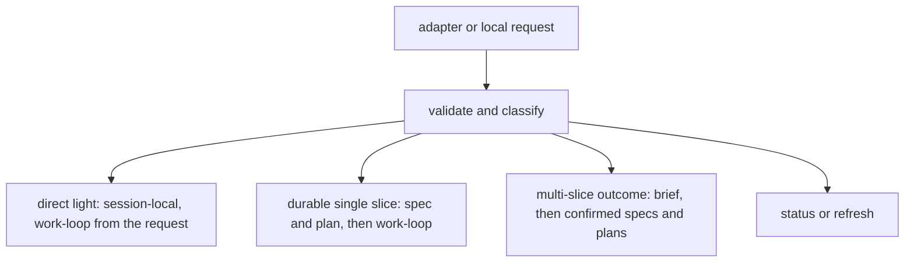

# Work intake and artifact routing

Work enters through one front door, `work-intake`, which classifies a request
into a canonical artifact and hands it to the workflow that owns the next step.
Each artifact's own header carries its lifecycle state, and `dispatch.py` reads
those headers to say what is ready. Tracker adapters acquire and normalize
input but never classify or write repository state.

Only `work-loop` runs implementation, and only `close-work` closes delivery.
No workflow registers work in the legacy `workspace.toml`. Dispatch reads it
only to refuse, and its deletion is **STATUS: PLANNED**
(see [§ 3](#3-state-and-write-authority)).

## 1. Structure: who owns which step

Each step has one owning skill. Skills pass work by writing an artifact, not by
calling each other.

| Step | Owner | Writes |
| --- | --- | --- |
| Classify and route a request | `work-intake` | The routed artifact, after validation |
| Admit a minimum repository intent | `intake-intent` | `docs/product/intents/` file |
| Create or confirm a multi-spec delivery brief | `author-delivery-brief` (`create`, `continue`) | `docs/product/briefs/` file |
| Author a spec and plan | `new-spec` | `docs/specs/<feature>/` |
| Say what is ready, active, or blocked | `work-loop` `dispatch.py` | Nothing (read-only) |
| Show placed intents and outstanding work | `navigate-intents` | Nothing (read-only) |
| Repair entries `workspace.toml` still holds | `workspace-status` (`repair-plan`, `repair-apply`) | The artifact's own file; drops the entry |
| Refresh a tracker-origin artifact | Profile refresh processors, selected by exact profile ID and version | Guarded local change after authorization |
| Implement and return completion evidence | `work-loop` | Code, `delivery/` records |
| Pause, close, disposition | `close-work` | Pause overlay, completion receipt, `docs/lifecycle/` record |

`init-project` is the entry for a new repository. A trigger gate sends a
script, spike, or single feature past the flow (a single feature goes to
`new-spec`). A value gate follows, then the foundation (an ADR plus a resolved
`current-architecture` destination), then a walking-skeleton spec handed to
`work-loop`.[^1]

An intent carries a `Level` from an open recognized set, `product-vision`,
`product-strategy`, `capability`, `feature`, and a separate `Scale` axis from
app to business unit. `Scale` suggests a starting altitude and does not stamp
one.[^2] One independently shippable feature emits a delivery contract for
`new-spec`. Multi-spec or cross-repository work emits a delivery brief.

[^1]: `packs/core/.apm/skills/init-project/SKILL.md`; entrypoint list in `packs/core/.apm/skills/work-intake/SKILL.md`.
[^2]: [ADR-0033](../adr/0033-intent-level-open-recognized-set-decoupled-from-scale.md); the `intent` skill's `references/intent-model.md` and `references/scale-intake.md` in `packs/product-engineering/.apm/skills/intent/`.

Historical nested spec folders do not gain a dispatch identity because they are
absent from the old registry. The Shipped
[self-hosted-fonts record](https://github.com/eugenelim/agent-ready-repo/blob/0cb7935cbf3383342a340054d9dadbabac3e35c9/docs/specs/platform-site/self-hosted-fonts/spec.md) is one
such record: canonical spec identity has one slug under `docs/specs/`. Reusing a
nested record as live work requires a supported identity first; retaining its
history does not make it executable. The former registry-pruning workflow
is not a migration path for this shape.

## 2. Contracts at each boundary

Four contracts carry work between owners. Each is a closed shape that the
receiver validates before any effect.

**Normalized intake.** Jira, Jira Align, GitHub, and Linear adapters emit
`normalized-intake.v1` and delegate the route. A local request is normalized
the same way.[^3] Tracker content never reaches a processor as free prose.
The normalized envelope is transient input, separate from the artifact that
keeps delivery state. Combining those shapes would expose source payload fields
as coordination state. JSON Schema checks shape; lifecycle relationships and
legacy compatibility need their own fixtures and runtime checks. A legacy repair
input does not widen the canonical input schema, and lexical path validation
does not replace runtime confinement.

Tracker-authored text supplies content, not trusted locator or revision metadata.
The acquisition profile owns that provenance. GitHub's approved `gh` route is a
separate boundary: the adapter binds trusted host selection, while `gh` owns
redirect and DNS behavior.

**Optional shaping handoff.** A shaping workflow may add one closed object
inside `normalized-intake.v1` with boundaries, non-goals, dependencies, design
context, and delivery questions. `route_handoff` admits only a validated,
resolved delivery contract or brief and returns an existing processor or a
zero-effect stop.

It does not materialize, register, or dispatch. Absent or
older Core receives the same content as portable rendered data.[^4]

**Source authority.** A tracker-origin artifact carries one closed
`source-authority.v1` block. Its `tracker_profile` table (`id`, `version`) is
the only home of the profile.

Each field is `source`-owned or `local`-owned,
and the block records the compared and accepted revisions.[^5] A remote
coordination action is a separate effect with its own fresh confirmation. Neither
tracker content nor intake authorization can approve it.

**Semantic-surface resolution.** `surface_resolver.py` resolves one role
(`architecture-design`, `current-architecture`, `decision-record`) from at most
32 caller-supplied candidates with one to four evidence records each. It is
read-only and returns role, locator, evidence, writability, confinement, and
independent source, write, and deletion authority facts.

Only repository-path
candidates enter realpath confinement. External locators stay opaque and
offline.[^6] Callers acquire the candidates; the selector ranks the evidence
provided and does not discover or dereference external content. Availability,
writability, and authority answer separate questions: a writable destination
does not grant permission to change it. Architect and governance workflows
consume the result by role and keep ownership of the artifact method.

Precedence is an explicit destination (unless mandatory policy rejects it),
declared policy or configuration, established repository convention, then an
established external destination. Equally ranked non-equivalent candidates need
confirmation.

Contradiction or unsafe confinement is a refusal. Absence offers
selection or creation and performs neither.

[^3]: `packs/core/.apm/skills/work-intake/scripts/intake_router.py`; `contracts/jsonschema/normalized-intake.schema.json`.

[^4]: `route_handoff` in `intake_router.py`.

[^5]: `packs/core/.apm/skills/work-intake/scripts/refresh.py`; `contracts/jsonschema/source-authority.schema.json`; [ADR-0077](../adr/0077-feature-projection-and-tracker-authority.md).

[^6]: `packs/core/.apm/skills/work-intake/scripts/surface_resolver.py` (candidate and evidence limits); `contracts/jsonschema/semantic-surface-resolution.schema.json`.

## 3. State and write authority

Lifecycle state lives in each artifact's own `Status:` and `Depends on:`
headers. No intake route adds a `workspace.toml` entry.

| State | Location | Write authority | Readers |
| --- | --- | --- | --- |
| Intents, briefs, specs, plans | `docs/product/`, `docs/specs/` | Owning artifact workflow | `dispatch.py`, `navigate-intents`, reviewers |
| Captured item (defect, design, research) | `docs/product/captured/<slug>.md` | `work-intake` | `dispatch.py --captured`, `work-loop` |
| Tracker-origin authority | `source-authority` block of the artifact | Accepted intake or refresh workflow | Refresh and reconciliation |
| Refresh role policy | `[authorization.refresh]` in `.work-intake.toml` at the repository root | Maintainer; `refresh-policy-move` repair relocates an existing table | Refresh processors |
| Direct-light decision | Active session only | `work-loop` | Requester |
| Pause overlay and dependency-scoped receipt | Existing writable shaping or build surface | `close-work` after exact write authority | Resume path, dependents |
| Cooling lifecycle record | `docs/lifecycle/<delivery_id>.json` | `close-work` (sole writer) | Day-30 review, `dispatch.py` |
| Legacy registry | `workspace.toml` | `workspace-status repair-apply` only | `dispatch.py` (refuse only), `workspace-status`, workspace MCP |

`dispatch.py` refuses with `unmigrated_workspace` while `workspace.toml` holds
any entry, and with `invalid_workspace` when the file is unusable. Each refusal
points to the `workspace-status` repair.[^7]

The retirement (readers, per-fact homes, deletion) is delivered by the
[workspace registry retirement brief](../product/briefs/workspace-registry-retirement-delivery.md)
under [FEAT-0034](../product/intents/FEAT-0034-workspace-registry-retirement.md)
and [RFC-0105](../rfc/0105-artifact-derived-navigation-and-workspace-retirement.md).
Deleting the file is the last slice of that brief. **STATUS: PLANNED.**
The file stays in place after the repair drops its entries.

A remaining entry has `path`, `kind`, `source`, `summary`, and `needs`. Comments, summaries, order, labels, and hints cannot select a route, satisfy a
dependency, or authorize dispatch. Terminal status and artifact retention are
independent: cooling or deletion policy never substitutes for `Shipped`,
`Withdrawn`, or `Cancelled`.

### Delivery-brief lifecycle

A brief's lifecycle is its `Status:` alone. Child specs constrain that state but
never change it automatically.[^8]

| State | Child-scope invariant | Transition owner |
| --- | --- | --- |
| `Draft` | No child is `Implementing` or `Shipped` | `author-delivery-brief create`, or `continue` after a material Ready-review invalidation |
| `Ready` | Ready gate passed; no child is `Implementing` or `Shipped` | `author-delivery-brief continue`, after revision-bound review and human confirmation |
| `Executing` | At least one child is `Implementing` or `Shipped` | The reviewed coordination update accompanying child execution |
| `Shipped` | Spec map non-empty and every materialized child `Shipped` | `close-work`, after human confirmation that the outcome is complete |
| `Withdrawn` | No child reached `Implementing` or `Shipped` | `close-work`, after termination confirmation |
| `Cancelled` | At least one child reached `Implementing` or `Shipped` | `close-work`, after termination confirmation |

All materialized children being `Shipped` does not prove the brief complete,
because a later slice may not exist yet. Such a brief stays `Executing`.
Reconciliation fails closed when a brief-backed child is `Implementing` or
`Shipped` and the brief is not `Executing`.

[^7]: `packs/core/.apm/skills/work-loop/scripts/dispatch.py` (module docstring, `unmigrated_workspace`); `workspace.toml` at the repository root.
[^8]: `packs/core/.apm/skills/author-delivery-brief/scripts/brief_shape.py` (state set); `packs/core/.apm/skills/close-work/SKILL.md`.

## 4. Runtime flows

The question this diagram answers is which durability class an explicit start
takes. Classification routes it to exactly one:

The eight flows below follow a piece of work from dispatch to disposition.

1. **Dispatch.** `dispatch.py` reads each spec's `Status:` header, sibling
   `plan.md`, `Depends on:` targets, and a cooled spec's lifecycle record. It
   returns `ready`, `active`, `blocked`, `findings`, and a `decision` of
   `start`, `resume`, `ask`, `none`, or `refuse`. It never picks between several
   candidates. The packaged copy also backs the workspace MCP
   `workspace_status` tool.[^9]
2. **Execution input.** Every workspace-dispatchable, queued, or resumable build item resolves to an existing durable `spec.md` and sibling `plan.md`. Execution receives
   those files, not tracker payloads. An explicit direct-light request is session-local, creates no entry, and is ineligible for argless dispatch or fresh-session resumption.[^10]
3. **Refresh.** The exact configured processor acquires and compares one
   source revision and presents field decisions. It applies guarded local
   changes only after authorization. An unavailable or version-mismatched
   processor mutates nothing.
4. **Before implementation.** A durable spec maps each lasting fact to a
   resolver-selected owner and names stale current surfaces as plan work.
5. **Completion.** `work-loop` returns bounded evidence: accepted outcome,
   implemented scope, gates, durable-output status, stable references,
   obligations, dependencies, and completion event. It does not close or
   disposition work.
6. **Closeout.** `close-work` reacquires evidence, inventories the plan's
   Design/LLD and implementation findings, and requires human whole-surface
   freshness review. An unowned non-inferable fact, a stale surface, or a live
   obligation blocks.
7. **Pause.** A pause keeps Ready or Implementing state in a reference-only
   restorable overlay. Closeout does not start.
8. **Disposition.** A completed, abandoned, or superseded item moves through
   Closeout-pending under `close-work` only. For `cool-30-days` it enrols a
   record in `docs/lifecycle/` and computes the review date from an injected
   instant. A named time zone that is unavailable returns `unknown-timezone`
   with no UTC fallback. Disposition is intent, never deletion permission.
   Every persisted effect needs a separately resolved authority fact and a fresh
   human confirmation bound to the exact resource and evidence.[^11]

Durable product intent, rationale, user promises, current architecture,
interfaces, operations, and release history stay in their semantic owners.
A delivery record may leave only after `close-work` verifies that every lasting
fact reached its owner and each affected human surface stays coherent as a
whole.

[^9]: `packs/core/.apm/skills/work-loop/scripts/dispatch.py`; `_load_packaged_dispatch` in `packages/agentbundle/agentbundle/workspace_mcp.py`.
[^10]: [ADR-0092](../adr/0092-direct-light-execution-session-local-boundary.md).
[^11]: `packs/core/.apm/skills/close-work/scripts/close_work.py`, `cooling.py`; `docs/lifecycle/README.md`; [RFC-0096](../rfc/0096-portable-delivery-artifact-lifecycle.md).

## 5. Failure and recovery

Missing, malformed, duplicate, unsafe, or inconsistent state becomes a stable
non-dispatchable finding with one safe next action. Unresolved authority or
lifecycle conflicts stop before an artifact write. An unsafe local candidate,
symlink escape, loop, or mandatory-policy conflict returns a stable refusal
without raw exception text.

**Queue repair.** `workspace-status` has two verbs, `repair-plan` and
`repair-apply`.

`dispatch.py` answers every question the retired status verbs asked. The
retired prune, candidate-listing, and rollback tooling has no replacement.[^12]

`repair-plan` is read-only. `repair-apply` needs explicit confirmation and
re-derives each operation from the current tree.

A changed source, registry
fingerprint, or spec status leaves that operation unapplied with its reason
while the rest proceeds. Repair never promotes or retires work that is still
running.

The plan admits ten operation types. Each moves a fact into the artifact's own
file or drops an entry that no longer needs one.[^16] Findings that cannot be
applied mechanically are emitted as `manual_findings` for a person.

The skill's
`references/mutate.md` owns exact shapes. Repair serializes on
`.workspace-repair.lock`.

**Legacy entries.** A legacy entry shape surfaces as `unsupported_legacy` and
is rewritten in canonical form by hand.

The retained decoder only refuses an
alias (canonical reconciliation), reads repair inputs, and feeds status-analysis
listings. It never dispatches a legacy shape.

**Handoff admission** stops on incomplete bounded content, a confidentiality or
mandatory-policy conflict, source or revision mismatch, forged resolver data, or
unacquired external content. No handoff result changes lifecycle state.

**Closeout** fails closed when a destination is ambiguous or stale, a lasting
fact exists only in the delivery container, a compatible pause or receipt
surface is absent, or source, write, and deletion authority do not independently
support the action. Every immediate deletion re-resolves, confines, enumerates,
fingerprints, and checks source-state evidence before effect.

Drift expires
the confirmation. Committed removal is an ordinary reviewed change, never a
history rewrite.

[^12]: The repair's verbs: `_SUBCOMMANDS` and `_RETIRED_REPLACEMENT` in `packs/core/.apm/skills/workspace-status/scripts/workspace_status.py`; `packs/core/.apm/skills/workspace-status/SKILL.md`.
[^16]: `_VALID_OPERATION_TYPES` in `workspace_status.py`: `queue-to-shipped`, `queue-remove`, `needs-to-header`, `needs-drop-cooled`, `captured-to-file`, `intent-brief-drop`, `spec-entry-drop`, `tracker-entry-drop`, `captured-entry-drop`, `refresh-policy-move`. `queue-to-shipped` and `queue-remove` are re-derived from spec status at apply time.

### Selection evidence and historical queue repairs

Removing first-in-list suggestions did not remove blocked-item diagnostics. The
old candidate filter was unreachable when applied to a candidate's own findings
and wrong when applied by path: a waiting item's dependency finding could hide
the active spec it awaited. The delivery's pack test is the evidence. Its eval
harness copied fixtures by basename and could not create the nested spec state,
so a nominal eval would have proved nothing. That limitation is recorded in the
[removal contract](../specs/next-item-suggestions-removal/spec.md), not claimed
as a completed live-agent check.

### Comparison and refresh limits

Registry comparison takes identities from the navigator and collection names
from the owning engine tables. It passes an empty cooled set when reading a
captured item's own status: cooling controls dispatch, not that file's status.
A missing registration is not automatically an omission, and a dependency edge
cannot stand in for a freshness timestamp. Those distinctions explain why a
historical queue reconciliation did not manufacture missing work or a fake
reanchor dependency.

Local refresh and remote write-back are not one transaction. Local authority is
durable before the separately confirmed adapter command runs once. If writing
the terminal receipt fails after the remote call, the effect is unknown and
needs operator repair; a retry needs a fresh confirmation. The GitHub adapter
checks trusted host binding and argv/stdin isolation, while `gh` retains its
own connection, redirect and DNS behavior. This is not a claim of end-to-end
HTTP confinement by repository code.

The retired migration tool kept exact source slices because parsed TOML cannot
round-trip comments and punctuation. A reviewed selection bound the slice,
workspace and artifact receipt; rollback restored only that recorded slice and
never deleted the separately approved canonical artifact. Its frozen
[source inventory](../specs/work-intake-migration-docs/notes/legacy-source-inventory.md)
and retained spec own accepted legacy inputs and credential-detector limits.
Current repair has the different scope stated in § 5; this historical rationale
does not restore the removed rollback command.

## 6. Mechanical invariants

- JSON Schemas under `contracts/jsonschema/` own normalized intake, workspace
  entries, source authority, refresh authorization and results, and
  semantic-surface resolution shapes.
- `intent_corpus_lint.py` routes every file in `docs/product/intents/` to a
  live or tombstone contract by the `Tombstone:` field in its preamble.
  Exit 0 is clean, 1 is a violation, and 2 means the corpus could not be fully
  read.[^13]
- `lint-spec-status.py` checks `docs/specs/*/spec.md` against the `new-spec`
  status contract. `lint-brief-coverage.py` rolls each brief's Spec map from
  `Brief:` back-links. `lint-traceability.py` flags structural orphans across
  the product chain. For intents it reads `Kind:`, `Level:`, `Slug:`, and
  `Tombstone:` only from visible field lines above the first H2, with HTML
  comments hidden. Other producer types use their bold-body markers
  (`**Type:**`, `**Action:**`, `**Service:**`), not YAML frontmatter.[^14]
  An empty `Tombstone:` field retires an intent for the navigator and
  traceability lint, but `lint-graph-pointers.py` requires a non-empty value.
  The real-corpus parity test compares traceability with the navigator and fails
  on disagreement; it does not prove graph-pointer parity for that empty-field
  case.[^17]
- Feature delivery relations have one source,
  `packs/core/.apm/adapter-root-bins/intent_delivery_relations.py`. Each
  consuming skill (`close-work`, `work-loop`, `navigate-intents`) ships a
  byte-identical copy and `_file_safety.py` in its own `scripts/`. A parity
  test pins the copies. The resolver reads confined artifact preambles and
  returns one typed snapshot (`relations`, `classifications`, `provenance`,
  `diagnostics`, `artifacts`). An unsafe or over-budget corpus yields an
  incomplete snapshot. `close-work` and `work-loop` then report
  `delivery-resolver-unavailable`, and `navigate-intents` refuses with
  `resolver_unavailable`. None scans on its own.[^15]
- The close-work, semantic-surface, shaping-handoff, and routing matrices run
  the real resolver and compare results deterministically. The routing matrix
  requires byte-identical canonical results across the four tracker adapters.

The behavior tests run `close_work.py` and the workspace scripts against fixture repositories. These scripts run in the finish-time checklist and as CI gates where a PR event
and Python exist. They do not fail closed inside an arbitrary adopter repository.

[^13]: `packs/core/.apm/skills/work-intake/scripts/intent_corpus_lint.py`.
[^14]: `packs/core/.apm/skills/work-loop/scripts/lint-spec-status.py`, `lint-traceability.py`; `packs/core/.apm/skills/author-delivery-brief/scripts/lint-brief-coverage.py`.
[^15]: `packs/core/tests/pack/test_intent_delivery_relations.py`; `packs/core/tests/integration/test_intent_delivery_traceability.py`; `closure_index.py` (`close-work`), `lint-traceability.py` (`work-loop`), `intent_view.py` (`navigate-intents`).
[^17]: `lint-traceability.py`: `_is_tombstone` and `recognize_intents`;
    `lint-graph-pointers.py`: `_Index.add`;
    `tests/roster/test_lint_traceability_intent_parity.py`.

## 7. Relevant decisions

- [RFC-0083](../rfc/0083-work-intake-and-artifact-routing.md) — work intake and artifact routing
- [RFC-0096](../rfc/0096-portable-delivery-artifact-lifecycle.md) — portable delivery-artifact lifecycle; its [context-lifecycle survey](../rfc/0096-notes/open-source-context-lifecycle-survey.md) retains the research basis outside any delivery family
- [RFC-0105](../rfc/0105-artifact-derived-navigation-and-workspace-retirement.md) — artifact-derived navigation and workspace retirement
- [ADR-0009](../adr/0009-product-brief-layer-and-plan-owned-lld.md), [ADR-0019](../adr/0019-product-intent-ontology-and-brief-projection.md), [ADR-0033](../adr/0033-intent-level-open-recognized-set-decoupled-from-scale.md)
- [ADR-0077](../adr/0077-feature-projection-and-tracker-authority.md), [ADR-0078](../adr/0078-standalone-intake-and-deterministic-workspace-index.md), [ADR-0092](../adr/0092-direct-light-execution-session-local-boundary.md)

Maintainer procedures: [Maintaining work intake and refresh](../guides/reference/work-intake-maintenance.md).

## Lifecycle parser and satisfaction decisions

Brief preamble bounds and HTML comments are handled in the same pass. An
unterminated comment must hide all following fields; stripping only closed
comments first would expose them. A heading inside a comment is not the first
uncommented heading. The six-state transition contract is all 36 ordered pairs;
passing fixtures for only Executing and Shipped cannot establish the other four
states. `Cut-closed` requires an ISO date plus non-empty evidence. Its readers
keep the grammar in hand-lockstep, documented at the functions, because skills
do not import one another's implementations.

### Historical registry satisfaction limits

These decisions describe the retained legacy registry reader. Current dispatch
reads artifact headers and lifecycle records as described in §§ 3–4; the old
entry-shape rules do not add requirements to that path.

A closed captured item's fixed resolution could satisfy a dependency without
registry membership only after structural and unmigrated-shape checks; the
cooled-artifact branch took priority. Membership did not prove dispatchability.
Deletion-on-close was instruction-level, with leftover entries reported as an
impossible transition. Removing its plan does not claim a close action occurred.

That reader distinguished missing `source.parent`, explicit none, and a brief
pointer. Brief membership had to resolve before child-scope satisfaction;
unrelated nonbrief work did not acquire that check. Already deleted Cooling
artifacts could leave its candidate set before a parent was consulted. Explicit
none was an operator assertion, not independent proof. The retained follow-on
records the proposed writer and verifier; current enrolment has the separate
lifecycle-record contract described above.

Legacy completion receipts were optional local evidence under ADR-0103, not a
new source discriminator. Shape admission preserved an entry; satisfaction used
the stricter grammar. A live artifact took precedence, leaving its receipt
unchecked until pruning made it relevant. Defects could not use the early-return
path that bypassed their rules. Duplicated grammars avoided coupling separately
versioned contracts and needed parity checks. A reviewed self-assertion was not
independent evidence.

## Intent navigation and authoring boundaries

The navigator's placement edges are not delivery relations. The bundled delivery
resolver owns the latter; the brief-parent composition and terminality copies
have parity checks. Parent cycles refuse the edge leaving the lowest-sorting
slug, making the result deterministic. The query envelope is owned by the
retained spec, not a second serialized contract file.

Dependency display deliberately re-reads the intent collection: the original
derivation drops preambles and tombstones needed for dependency resolution.
Admission, tombstone and identity rules are copied with fixture parity, and a
live-ID mismatch between reads refuses `unsafe_input` as a race. Browser and
query traversals have parity checks rather than a shared implementation. These
edges display relationships; they do not enforce dispatch. The historical
739-file latency observation does not benchmark today's corpus, and FEAT-0002's
usefulness comparison remains separate from correctness and speed.

The shared graph-pointer authoring check validates the whole selected artifact,
so a body-only edit can expose an old malformed pointer. Repair that selected
artifact rather than expanding the check into a corpus rewrite. Typed identities
do not use suffix guesses; duplicates stay unresolved. Discovery and other
writers reuse the same checker rather than adding copies. Repository-qualified
pointers need a separately admitted syntax before this checker can accept them.

### Offline intent export

The exporter measures UTF-8 bytes before creating a file, confines the destination
outside enclosing repositories and the root repository's listed worktrees, and
publishes without replacing an existing name. It pins the opened directory's
identity, creates an exclusive mode-0600 temporary regular file, writes and
fsyncs it, checks identity and single-link status, then links it to the final
name through the directory descriptor and removes the temporary name. Missing
no-follow or directory-descriptor primitives fail closed; there is no non-atomic
Windows fallback.

Git worktree enumeration is required for confinement and cannot degrade to an
empty list. Source-link probes may degrade to latest or inert links; they use
hardened Git calls and confined blob hashing rather than `git status`, avoiding
clean-filter and fsmonitor execution. An accepted limit remains: when exporting
from a linked worktree, a main checkout Git records nowhere through
`--separate-git-dir` or `core.worktree` may remain unprotected. This is not a
claim that every separate-git-dir checkout is rejected.

The session-start view hashes the joined shared and layout styles and refuses
symlinked assets. Desktop row selection keeps row focus and announces the detail;
mobile selection focuses the detail heading, and Back restores the row and scroll.
Nothing auto-selects a row. Full-render performance evidence covers the largest
input for which the delivery resolver still supplies outstanding work; larger
unavailable results do not establish rendering speed. Chunking below the fold
is the fallback if startup exceeds budget. Current token, readiness and graph
successors keep their own contracts.

## Historical reclassification decision

RFC-0096 Wave 7c chose to pair `retain-exception` with `Reclassified` in the record,
rather than treat Reclassified as projection-only. The transition-set oracle is
an independently literal expected set, not a value derived from the validator
under test. Its separate prune investigation refuted silent stranding: an orphaned
legacy entry produced missing-artifact/unsatisfied-dependency findings. That did
not prove atomic removal, and a self-asserted record field could not supply it.
These are legacy registry observations, not current dispatch rules.

The still-open captured follow-on points to
[the retained detail](../specs/reclassified-lifecycle-result/notes/follow-ons.md),
which distinguishes the surviving prune obligation from the refuted harm and
separates cooling's digest agreement from an inaccurate immutability title.
Retiring the construction pair changes none of those dispositions.

## Intent delivery and field ownership decisions

The delivery resolver's skill-local copies are deliberate portability work.
Repository-scoped adapter-root binaries are not an adopter installation route;
a pipx or zipapp interpreter also does not make package imports available to a
skill script's interpreter. The private file-safety copy and parity checks
preserve that boundary. Historical diagnostic counts are dated corpus results,
not a permanent list of open defects.

The 2026-09-24 field-vocabulary decision required no extra ADR: ADR-0111 owns
the review mandate, while the field module and adopter reference have an
executable parity check. Supersession transitions and value shape already had
their own decision owners. A third pointer-only record would duplicate them.
That decision does not settle governance of the tier taxonomy itself. A future
taxonomy change must settle that question; per-field value validation still does
not prove required presence by state or paired supersession across a corpus.

The old rename delivery's shared-lock dead-owner gap is superseded by
`intake_transaction.py`'s bounded PID read, liveness probe, identity recheck and
single acquisition retry. Windows deliberately treats PIDs as live because its
signal API is unsafe for this probe. This does not establish unmeasured
cross-mount rename or Windows reparse behavior. Rename's sealed transaction
recovery and the short shared writer lock remain different protocols.

Renumbering requires positive evidence of a live source. A damaged tombstone
marker must not fall through as live; this is a scoped marker check, not a ban
on all unfamiliar preamble text. The caller samples the transaction date once
so a midnight crossing cannot write two dates. ADR-0129 owns the tombstone
choice and the residual that manually deleting one frees its ordinal.

ADR-0111's review split delegates self-check findings to finding adjudication;
optional adversarial review augments that route rather than introducing a
second integration entry. Historical fixture counts are not a current behavior
guarantee. Discovery's outside-authored `shaping-review` blackboard slot was
excluded, not implemented: reintroducing it requires its own data-handling
shaping. The delivery plan's alleged five-question spec follow-on is not an
extant contract; the retained ledger records the actual routing residues,
including the unresolved Core-absent invocation described there.

## Intent view boundaries and an accepted historical deferral

Owner matching lowers only ASCII A–Z and collapses only spaces and tabs so
Python and JavaScript agree for non-ASCII names. The `k:` route prefix keeps a
real owner named `none` separate from the no-owner sentinel. Filters narrow
visible rows; they do not recompute the graph or its descendant counts.

A handover path's character and segment bounds do not establish its semantic
meaning. Legal hostile-looking names remain quoted data in a closed template;
a denied clipboard operation offers selection as the fallback.

The tree view's repeated ancestor context was an accepted 2026-10-17 deferral,
not an omitted completed repair. Session-start AC-0011 explicitly requires the
context cell's nearest-ancestor text. Trimming it requires changing that
continuing criterion, rather than silently treating indentation as permission.
The retained tree verification ledger owns the dated review and screenshot
hashes; those observations are not a new visual-QA claim.
