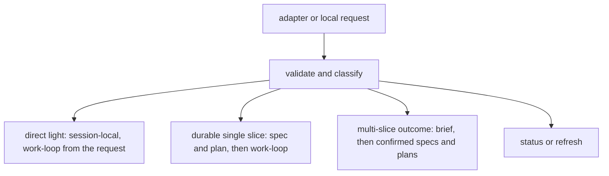

# Work intake and artifact routing

Work enters through one front door, `work-intake`, which classifies a request
into a canonical artifact and hands it to the workflow that owns the next step.
Each artifact's own header carries its lifecycle state, and `dispatch.py` reads
those headers to say what is ready. Tracker adapters acquire and normalize
input but never classify or write repository state.

Only `work-loop` runs implementation, and only `close-work` closes delivery.
No workflow registers work in the legacy `workspace.toml`. Dispatch reads it
only to refuse, and its deletion is **STATUS: PLANNED**
(see [§ 3](#3-state-and-write-authority)).

## 1. Structure: who owns which step

Each step has one owning skill. Skills pass work by writing an artifact, not by
calling each other.

| Step | Owner | Writes |
| --- | --- | --- |
| Classify and route a request | `work-intake` | The routed artifact, after validation |
| Admit a minimum repository intent | `intake-intent` | `docs/product/intents/` file |
| Create or confirm a multi-spec delivery brief | `author-delivery-brief` (`create`, `continue`) | `docs/product/briefs/` file |
| Author a spec and plan | `new-spec` | `docs/specs/<feature>/` |
| Say what is ready, active, or blocked | `work-loop` `dispatch.py` | Nothing (read-only) |
| Show placed intents and outstanding work | `navigate-intents` | Nothing (read-only) |
| Repair entries `workspace.toml` still holds | `workspace-status` (`repair-plan`, `repair-apply`) | The artifact's own file; drops the entry |
| Refresh a tracker-origin artifact | Profile refresh processors, selected by exact profile ID and version | Guarded local change after authorization |
| Implement and return completion evidence | `work-loop` | Code, `delivery/` records |
| Pause, close, disposition | `close-work` | Pause overlay, completion receipt, `docs/lifecycle/` record |

`init-project` is the entry for a new repository. A trigger gate sends a
script, spike, or single feature past the flow (a single feature goes to
`new-spec`). A value gate follows, then the foundation (an ADR plus a resolved
`current-architecture` destination), then a walking-skeleton spec handed to
`work-loop`.[^1]

An intent carries a `Level` from an open recognized set, `product-vision`,
`product-strategy`, `capability`, `feature`, and a separate `Scale` axis from
app to business unit. `Scale` suggests a starting altitude and does not stamp
one.[^2] One independently shippable feature emits a delivery contract for
`new-spec`. Multi-spec or cross-repository work emits a delivery brief.

[^1]: `packs/core/.apm/skills/init-project/SKILL.md`; entrypoint list in `packs/core/.apm/skills/work-intake/SKILL.md`.
[^2]: [ADR-0033](../adr/0033-intent-level-open-recognized-set-decoupled-from-scale.md); the `intent` skill's `references/intent-model.md` and `references/scale-intake.md` in `packs/product-engineering/.apm/skills/intent/`.

## 2. Contracts at each boundary

Four contracts carry work between owners. Each is a closed shape that the
receiver validates before any effect.

**Normalized intake.** Jira, Jira Align, GitHub, and Linear adapters emit
`normalized-intake.v1` and delegate the route. A local request is normalized
the same way.[^3] Tracker content never reaches a processor as free prose.

**Optional shaping handoff.** A shaping workflow may add one closed object
inside `normalized-intake.v1` with boundaries, non-goals, dependencies, design
context, and delivery questions. `route_handoff` admits only a validated,
resolved delivery contract or brief and returns an existing processor or a
zero-effect stop.

It does not materialize, register, or dispatch. Absent or
older Core receives the same content as portable rendered data.[^4]

**Source authority.** A tracker-origin artifact carries one closed
`source-authority.v1` block. Its `tracker_profile` table (`id`, `version`) is
the only home of the profile.

Each field is `source`-owned or `local`-owned,
and the block records the compared and accepted revisions.[^5] A remote
coordination action is a separate effect with its own fresh confirmation. Neither
tracker content nor intake authorization can approve it.

**Semantic-surface resolution.** `surface_resolver.py` resolves one role
(`architecture-design`, `current-architecture`, `decision-record`) from at most
32 caller-supplied candidates with one to four evidence records each. It is
read-only and returns role, locator, evidence, writability, confinement, and
independent source, write, and deletion authority facts.

Only repository-path
candidates enter realpath confinement. External locators stay opaque and
offline.[^6] Architect and governance workflows consume the result by role
and keep ownership of the artifact method.

Precedence is an explicit destination (unless mandatory policy rejects it),
declared policy or configuration, established repository convention, then an
established external destination. Equally ranked non-equivalent candidates need
confirmation.

Contradiction or unsafe confinement is a refusal. Absence offers
selection or creation and performs neither.

[^3]: `packs/core/.apm/skills/work-intake/scripts/intake_router.py`; `contracts/jsonschema/normalized-intake.schema.json`.

[^4]: `route_handoff` in `intake_router.py`.

[^5]: `packs/core/.apm/skills/work-intake/scripts/refresh.py`; `contracts/jsonschema/source-authority.schema.json`; [ADR-0077](../adr/0077-feature-projection-and-tracker-authority.md).

[^6]: `packs/core/.apm/skills/work-intake/scripts/surface_resolver.py` (candidate and evidence limits); `contracts/jsonschema/semantic-surface-resolution.schema.json`.

## 3. State and write authority

Lifecycle state lives in each artifact's own `Status:` and `Depends on:`
headers. No intake route adds a `workspace.toml` entry.

| State | Location | Write authority | Readers |
| --- | --- | --- | --- |
| Intents, briefs, specs, plans | `docs/product/`, `docs/specs/` | Owning artifact workflow | `dispatch.py`, `navigate-intents`, reviewers |
| Captured item (defect, design, research) | `docs/product/captured/<slug>.md` | `work-intake` | `dispatch.py --captured`, `work-loop` |
| Tracker-origin authority | `source-authority` block of the artifact | Accepted intake or refresh workflow | Refresh and reconciliation |
| Refresh role policy | `[authorization.refresh]` in `.work-intake.toml` at the repository root | Maintainer; `refresh-policy-move` repair relocates an existing table | Refresh processors |
| Direct-light decision | Active session only | `work-loop` | Requester |
| Pause overlay and dependency-scoped receipt | Existing writable shaping or build surface | `close-work` after exact write authority | Resume path, dependents |
| Cooling lifecycle record | `docs/lifecycle/<delivery_id>.json` | `close-work` (sole writer) | Day-30 review, `dispatch.py` |
| Legacy registry | `workspace.toml` | `workspace-status repair-apply` only | `dispatch.py` (refuse only), `workspace-status`, workspace MCP |

`dispatch.py` refuses with `unmigrated_workspace` while `workspace.toml` holds
any entry, and with `invalid_workspace` when the file is unusable. Each refusal
points to the `workspace-status` repair.[^7]

The retirement (readers, per-fact homes, deletion) is delivered by the
[workspace registry retirement brief](../product/briefs/workspace-registry-retirement-delivery.md)
under [FEAT-0034](../product/intents/FEAT-0034-workspace-registry-retirement.md)
and [RFC-0105](../rfc/0105-artifact-derived-navigation-and-workspace-retirement.md).
Deleting the file is the last slice of that brief. **STATUS: PLANNED.**

A remaining entry has `path`, `kind`, `source`, `summary`, and `needs`. The file stays in place after the repair drops its entries.
Comments, summaries, order, labels, and hints cannot select a route, satisfy a
dependency, or authorize dispatch. Terminal status and artifact retention are
independent: cooling or deletion policy never substitutes for `Shipped`,
`Withdrawn`, or `Cancelled`.

### Delivery-brief lifecycle

A brief's lifecycle is its `Status:` alone. Child specs constrain that state but
never change it automatically.[^8]

| State | Child-scope invariant | Transition owner |
| --- | --- | --- |
| `Draft` | No child is `Implementing` or `Shipped` | `author-delivery-brief create`, or `continue` after a material Ready-review invalidation |
| `Ready` | Ready gate passed; no child is `Implementing` or `Shipped` | `author-delivery-brief continue`, after revision-bound review and human confirmation |
| `Executing` | At least one child is `Implementing` or `Shipped` | The reviewed coordination update accompanying child execution |
| `Shipped` | Spec map non-empty and every materialized child `Shipped` | `close-work`, after human confirmation that the outcome is complete |
| `Withdrawn` | No child reached `Implementing` or `Shipped` | `close-work`, after termination confirmation |
| `Cancelled` | At least one child reached `Implementing` or `Shipped` | `close-work`, after termination confirmation |

All materialized children being `Shipped` does not prove the brief complete,
because a later slice may not exist yet. Such a brief stays `Executing`.
Reconciliation fails closed when a brief-backed child is `Implementing` or
`Shipped` and the brief is not `Executing`.

[^7]: `packs/core/.apm/skills/work-loop/scripts/dispatch.py` (module docstring, `unmigrated_workspace`); `workspace.toml` at the repository root.
[^8]: `packs/core/.apm/skills/author-delivery-brief/scripts/brief_shape.py` (state set); `packs/core/.apm/skills/close-work/SKILL.md`.

## 4. Runtime flows

The question this diagram answers is which durability class an explicit start
takes. Classification routes it to exactly one:

The eight flows below follow a piece of work from dispatch to disposition.

1. **Dispatch.** `dispatch.py` reads each spec's `Status:` header, sibling
   `plan.md`, `Depends on:` targets, and a cooled spec's lifecycle record. It
   returns `ready`, `active`, `blocked`, `findings`, and a `decision` of
   `start`, `resume`, `ask`, `none`, or `refuse`. It never picks between several
   candidates. The packaged copy also backs the workspace MCP
   `workspace_status` tool.[^9]
2. **Execution input.** Every workspace-dispatchable, queued, or resumable build item resolves to an existing durable `spec.md` and sibling `plan.md`. Execution receives
   those files, not tracker payloads. An explicit direct-light request is session-local, creates no entry, and is ineligible for argless dispatch or fresh-session resumption.[^10]
3. **Refresh.** The exact configured processor acquires and compares one
   source revision and presents field decisions. It applies guarded local
   changes only after authorization. An unavailable or version-mismatched
   processor mutates nothing.
4. **Before implementation.** A durable spec maps each lasting fact to a
   resolver-selected owner and names stale current surfaces as plan work.
5. **Completion.** `work-loop` returns bounded evidence: accepted outcome,
   implemented scope, gates, durable-output status, stable references,
   obligations, dependencies, and completion event. It does not close or
   disposition work.
6. **Closeout.** `close-work` reacquires evidence, inventories the plan's
   Design/LLD and implementation findings, and requires human whole-surface
   freshness review. An unowned non-inferable fact, a stale surface, or a live
   obligation blocks.
7. **Pause.** A pause keeps Ready or Implementing state in a reference-only
   restorable overlay. Closeout does not start.
8. **Disposition.** A completed, abandoned, or superseded item moves through
   Closeout-pending under `close-work` only. For `cool-30-days` it enrols a
   record in `docs/lifecycle/` and computes the review date from an injected
   instant. A named time zone that is unavailable returns `unknown-timezone`
   with no UTC fallback. Disposition is intent, never deletion permission.
   Every persisted effect needs a separately resolved authority fact and a fresh
   human confirmation bound to the exact resource and evidence.[^11]

Durable product intent, rationale, user promises, current architecture,
interfaces, operations, and release history stay in their semantic owners.
A delivery record may leave only after `close-work` verifies that every lasting
fact reached its owner and each affected human surface stays coherent as a
whole.

[^9]: `packs/core/.apm/skills/work-loop/scripts/dispatch.py`; `_load_packaged_dispatch` in `packages/agentbundle/agentbundle/workspace_mcp.py`.
[^10]: [ADR-0092](../adr/0092-direct-light-execution-session-local-boundary.md).
[^11]: `packs/core/.apm/skills/close-work/scripts/close_work.py`, `cooling.py`; `docs/lifecycle/README.md`; [RFC-0096](../rfc/0096-portable-delivery-artifact-lifecycle.md).

## 5. Failure and recovery

Missing, malformed, duplicate, unsafe, or inconsistent state becomes a stable
non-dispatchable finding with one safe next action. Unresolved authority or
lifecycle conflicts stop before an artifact write. An unsafe local candidate,
symlink escape, loop, or mandatory-policy conflict returns a stable refusal
without raw exception text.

**Queue repair.** `workspace-status` has two verbs, `repair-plan` and
`repair-apply`.

`dispatch.py` answers every question the retired status verbs asked. The
retired prune, candidate-listing, and rollback tooling has no replacement.[^12]

`repair-plan` is read-only. `repair-apply` needs explicit confirmation and
re-derives each operation from the current tree.

A changed source, registry
fingerprint, or spec status leaves that operation unapplied with its reason
while the rest proceeds. Repair never promotes or retires work that is still
running.

The plan admits ten operation types. Each moves a fact into the artifact's own
file or drops an entry that no longer needs one.[^16] Findings that cannot be
applied mechanically are emitted as `manual_findings` for a person.

The skill's
`references/mutate.md` owns exact shapes. Repair serializes on
`.workspace-repair.lock`.

**Legacy entries.** A legacy entry shape surfaces as `unsupported_legacy` and
is rewritten in canonical form by hand.

The retained decoder only refuses an
alias (canonical reconciliation), reads repair inputs, and feeds status-analysis
listings. It never dispatches a legacy shape.

**Handoff admission** stops on incomplete bounded content, a confidentiality or
mandatory-policy conflict, source or revision mismatch, forged resolver data, or
unacquired external content. No handoff result changes lifecycle state.

**Closeout** fails closed when a destination is ambiguous or stale, a lasting
fact exists only in the delivery container, a compatible pause or receipt
surface is absent, or source, write, and deletion authority do not independently
support the action. Every immediate deletion re-resolves, confines, enumerates,
fingerprints, and checks source-state evidence before effect.

Drift expires
the confirmation. Committed removal is an ordinary reviewed change, never a
history rewrite.

[^12]: The repair's verbs: `_SUBCOMMANDS` and `_RETIRED_REPLACEMENT` in `packs/core/.apm/skills/workspace-status/scripts/workspace_status.py`; `packs/core/.apm/skills/workspace-status/SKILL.md`.
[^16]: `_VALID_OPERATION_TYPES` in `workspace_status.py`: `queue-to-shipped`, `queue-remove`, `needs-to-header`, `needs-drop-cooled`, `captured-to-file`, `intent-brief-drop`, `spec-entry-drop`, `tracker-entry-drop`, `captured-entry-drop`, `refresh-policy-move`. `queue-to-shipped` and `queue-remove` are re-derived from spec status at apply time.

## 6. Mechanical invariants

- JSON Schemas under `contracts/jsonschema/` own normalized intake, workspace
  entries, source authority, refresh authorization and results, and
  semantic-surface resolution shapes.
- `intent_corpus_lint.py` routes every file in `docs/product/intents/` to a
  live or tombstone contract by the `Tombstone:` field in its preamble.
  Exit 0 is clean, 1 is a violation, and 2 means the corpus could not be fully
  read.[^13]
- `lint-spec-status.py` checks `docs/specs/*/spec.md` against the `new-spec`
  status contract. `lint-brief-coverage.py` rolls each brief's Spec map from
  `Brief:` back-links. `lint-traceability.py` flags structural orphans across
  the product chain and recognizes a producer node by a bold-body marker
  (`**Type:**`, `**Action:**`, `**Service:**`, `**Kind:**`, `**Level:**`), not
  YAML frontmatter.[^14]
- Feature delivery relations have one source,
  `packs/core/.apm/adapter-root-bins/intent_delivery_relations.py`. Each
  consuming skill (`close-work`, `work-loop`, `navigate-intents`) ships a
  byte-identical copy and `_file_safety.py` in its own `scripts/`. A parity
  test pins the copies. The resolver reads confined artifact preambles and
  returns one typed snapshot (`relations`, `classifications`, `provenance`,
  `diagnostics`, `artifacts`). An unsafe or over-budget corpus yields an
  incomplete snapshot. `close-work` and `work-loop` then report
  `delivery-resolver-unavailable`, and `navigate-intents` refuses with
  `resolver_unavailable`. None scans on its own.[^15]
- The close-work, semantic-surface, shaping-handoff, and routing matrices run
  the real resolver and compare results deterministically. The routing matrix
  requires byte-identical canonical results across the four tracker adapters.

The behavior tests run `close_work.py` and the workspace scripts against fixture repositories. These scripts run in the finish-time checklist and as CI gates where a PR event
and Python exist. They do not fail closed inside an arbitrary adopter repository.

[^13]: `packs/core/.apm/skills/work-intake/scripts/intent_corpus_lint.py`.
[^14]: `packs/core/.apm/skills/work-loop/scripts/lint-spec-status.py`, `lint-traceability.py`; `packs/core/.apm/skills/author-delivery-brief/scripts/lint-brief-coverage.py`.
[^15]: `packs/core/tests/pack/test_intent_delivery_relations.py`; `packs/core/tests/integration/test_intent_delivery_traceability.py`; `closure_index.py` (`close-work`), `lint-traceability.py` (`work-loop`), `intent_view.py` (`navigate-intents`).

## 7. Relevant decisions

- [RFC-0083](../rfc/0083-work-intake-and-artifact-routing.md) — work intake and artifact routing
- [RFC-0096](../rfc/0096-portable-delivery-artifact-lifecycle.md) — portable delivery-artifact lifecycle
- [RFC-0105](../rfc/0105-artifact-derived-navigation-and-workspace-retirement.md) — artifact-derived navigation and workspace retirement
- [ADR-0009](../adr/0009-product-brief-layer-and-plan-owned-lld.md), [ADR-0019](../adr/0019-product-intent-ontology-and-brief-projection.md), [ADR-0033](../adr/0033-intent-level-open-recognized-set-decoupled-from-scale.md)
- [ADR-0077](../adr/0077-feature-projection-and-tracker-authority.md), [ADR-0078](../adr/0078-standalone-intake-and-deterministic-workspace-index.md), [ADR-0092](../adr/0092-direct-light-execution-session-local-boundary.md)

Maintainer procedures: [Maintaining work intake and refresh](../guides/reference/work-intake-maintenance.md).
