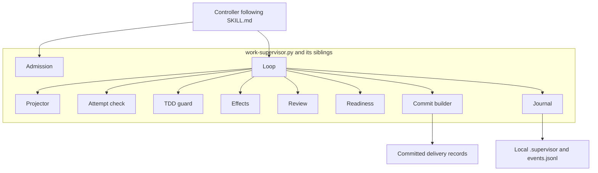
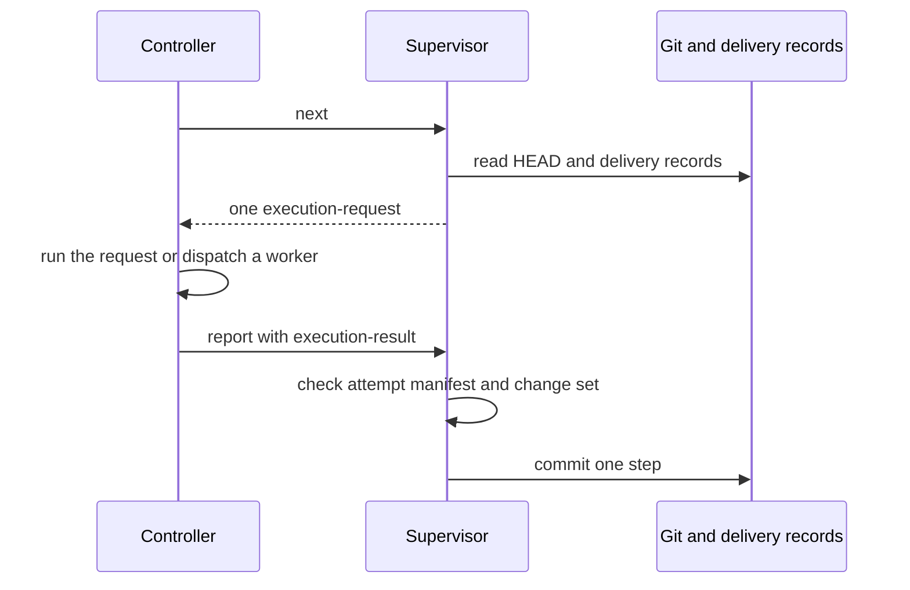
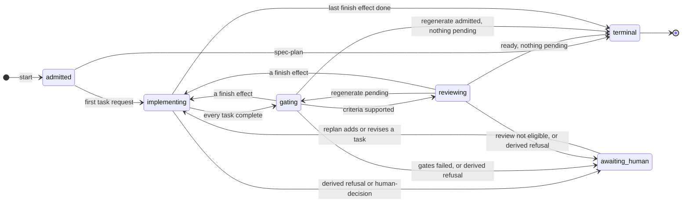

# Subsystem Design — Workspace execution supervisor

**Decision:** `work-loop` stays the public skill, and the supervisor shipped
inside it — `work-supervisor.py` and its `_supervisor_*.py` siblings — is the
only owner of full-mode procedure. It derives every step from committed facts
and needs only the Python standard library
([ADR-0144](../adr/0144-work-loop-supervisor-owns-procedure.md)).
[Authority migration](work-loop-authority-migration.md) maps where each former
authority went.
**Author:** Platform Core
**Status:** Current
**Last updated:** 2026-10-29
**Reviewers:** Core pack maintainers

This page is the home for the supervisor's procedure: requests, steps,
stages, replanning, the TDD guard, effects, readiness, and state.
[runtime security primitives § 11](runtime-security-primitives.md#11-execution-supervisor-controls) owns the attempt-security controls.
[Loop infrastructure](loop-infrastructure.md) covers how its scripts are
invoked, the linters, the run lock, and the light-mode review flow.

## 1. Scope and Context

A *slice* is one independently shippable step of the
[acceptance-centered work-loop brief](../product/briefs/acceptance-centered-work-loop.md#proposed-delivery-slices),
which owns each slice's status.

| In scope | Out of scope | Why |
| --- | --- | --- |
| Admission, task projection, replanning, the TDD guard, sequential dispatch, recovery, the retry count, external effects, review selection, readiness | Acceptance meaning | Criteria, evidence, and review facts own completion, not procedure |
| Full-mode `code` and `spec-plan` runs | Light mode | Light mode runs no supervisor ([ADR-0014](../adr/0014-rigor-scales-with-risk-work-loop-modes.md)) |
| Worker-attempt checks and Windows process control | Parallel writes | Parallel-write gating ([ADR-0005](../adr/0005-supervisor-topological-default-and-write-gate.md)) is unchanged; parallel admission is a later slice |
| The execution-root worktree as the product result | A protected product ref | [Product result integration](work-loop-result-integration.md) is a later slice's design |

The supervisor dispatches one request at a time. It does not run agents
itself: it issues a typed request, the controller carries it out, and the
controller reports the result. The controller is the agent following
`SKILL.md`.

## 2. Structural Model

All modules live in `packs/core/.apm/skills/work-loop/scripts/`.

| Element | Module | Responsibility | State |
| --- | --- | --- | --- |
| Command surface | `work-supervisor.py` | Verbs `start`, `next`, `report`, `status`, and `resolve-effect`; pins the installed supervisor files | None of its own |
| Admission | `_supervisor_admission.py` | The run's workspace, the approval pair, and `start` | Commits `delivery/approvals.jsonl` |
| Projector | `_supervisor_projector.py` | Plan grammar, task projection, and the six envelope references | Stateless |
| Loop | `_supervisor_loop.py` | Derive the current request, commit steps, recover | Stateless; reads `HEAD` |
| Attempt check | `_supervisor_attempt.py` | Record each attempt's manifest, check for residue | Run store under the Git directory |
| TDD guard | `_supervisor_tdd.py` | Red before green for a task's stub fence | Derived from `stub` and `red` commits |
| Not-red recovery | `_supervisor_recovery.py` | Close a not-red `write-stub` attempt and require a named human to confirm the next trusted-file change | `recovery.json` in the run store |
| Effects | `_supervisor_effects.py` | External effects that never repeat | `delivery/effect-resolutions.jsonl` |
| Review | `_supervisor_review.py` | Reviewer selection, the policy resolver, dispositions | `delivery/review-selections.jsonl`, `delivery/review-decisions.jsonl` |
| Readiness | `_supervisor_readiness.py` | Readiness derived from durable facts | Stateless |
| Commit builder | `_supervisor_commit.py` | The Git port and the one-step-per-commit builder | Supervisor commits |
| Git helper | `_supervisor_git.py` | The one hardened helper every supervisor `git` call uses | None |
| Journal | `_supervisor_journal.py` | Local, deletable state: `run.json`, the advisory journal, the security log, the run lock, and `.loop-run/events.jsonl` lines | `<spec>/.supervisor/` |

Two data files shape behaviour without code changes, and this page does not
restate their values. `work-loop/supervisor-policy.json` holds the
implementation retry cap, the effect dispatch cap, lock timings, and the
authority role each decision accepts. `work-loop/review-rules.json` says which
reviewer roles run.

The supervisor also loads siblings that earlier slices shipped and it does not
own:

- `_acceptance.py` for the envelope and verdict;
- `_evidence_store.py` for evidence, and `_policy_import.py` for the approval
  pair it imports;
- `_review_selection.py`, `_review_persistence.py`, `_review_disposition.py`,
  and `_review_bridge.py` for structured review records;
- `_subject_projection.py` for the review subject;
- `_loop_guards.py` for the plan grammar and contract canonicalisation;
- `_statelock.py` for the run lock;
- `_file_safety.py` and `_confined_mutation.py` for confined reads and writes;
- `_security_capability.py`, `_security_events.py`, and `_containment.py` for
  capability grants, the security log, and host containment.

## 3. Runtime Model

| Scenario | Trigger | Path |
| --- | --- | --- |
| Admit a run | `start` on an Approved spec and plan | Commit one `approval` step |
| Execute | `next` issues a request, the controller reports it | Normal sequence |
| Replan inside the envelope | A controller edit leaves every protected reference and the terminal intent unchanged | Commit one `replan` step, no approval |
| Cross a protected boundary | An edit changes a protected reference or the terminal intent | Refuse and name the owner |
| Recover | A crash, a lost journal, or a rebase | Re-derive from `HEAD` and `delivery/` |

### Admission

`start` refuses unless the spec is `Approved` or `Implementing`, the plan is
`Approved` or `Executing`, and `--intent` matches the spec's
`## Terminal Intent`. It commits one line to `delivery/approvals.jsonl` holding
an `approval-record.v1` and an `initial-plan-review.v1`. Both are bound to the
reviewed-execution-envelope fingerprint (a digest of the spec's protected
sections, listed in § 3, *Replanning*), the terminal intent, the code-trust
classification, the run id, and the `owner` and `plan-reviewer` authority
references. A `spec-plan` run then commits `terminal` and ends, with no task
projected and no request issued (ADR-0144 D4).

### Normal sequence

1. `next` derives the current request from `HEAD`. It first commits any
   pending controller edit to the spec, plan, or cited records as one `replan`
   step, unless a not-red confirmation is owed (§ 3, *TDD guard*). It then
   commits any step it takes itself — a supervisor-run `red`
   proof, an `effect-intent`, or `terminal` — projects the matching event
   lines, records the attempt's issuance in the run store, writes `run.json`,
   and appends an advisory journal line. A refusal derived here writes only
   `run.json`.
2. The request's id is deterministic, so a repeated `next` re-issues it
   unchanged until it is reported or superseded.
3. An attempt request records its manifest before the controller dispatches it
   (§ 4, *Attempts*).
4. The controller runs the request and calls `report`. `report` refuses a
   result that is not for the current request, that changes a trusted file, or
   that touches committed `delivery/` records. Otherwise it commits exactly one
   step.

### Request order

`next` takes the first of these that applies. When the run's code trust is
`untrusted` and the host supplies no verified containment, every request that
would run repository code — `write-stub`, `implement-task`, a supervisor-run red
proof, `run-gates`, and `regenerate` — becomes an `untrusted-code`
`human-decision` instead.

1. `terminal`, when a terminal step exists for the current product tree, or the
   intent is `spec-plan`.
2. The not-red recovery gate: an owed replan confirmation, a standing decline,
   or a leftover file the discard could not remove.
3. A `human-decision` when the implementation retry count has reached the cap.
4. The first incomplete task whose dependencies are complete: `write-stub`,
   `implement-task`, or a supervisor-run red proof.
5. A `dependency-cycle` refusal when tasks remain but none is ready.
6. A `human-decision` when the working tree holds changes no task admitted.
7. Open effects declared by tasks.
8. Readiness work: `run-gates`, reviewer selection and `review-role`,
   `assess-finding`, or a `human-decision` when gates failed, criteria stay
   unsupported, or review is not acceptance-eligible.
9. A pending `regenerate` of the installed skill.
10. Finish effects.
11. `terminal`.

### Request kinds and stages

`run.json`'s `stage` comes from the current request kind. A refusal that `next`
writes — such as `dependency-cycle` or a protected boundary — maps to
`awaiting-human` from any stage, whoever owns it. Every other refusal reaches
the controller only through the verb's output and leaves `run.json` unchanged.
Examples are `attempt-residue` from the open-attempt guard,
`supervisor-changed` from the pin check, every `report` refusal, `run-locked`,
and refusals from `start` and `resolve-effect`.

`status` re-derives the run without committing, so `status --check` exits 1
only for a refusal that derivation and request selection produce. Two refusals
that `next` writes to `run.json` do not reach it: a `foreign-delivery-edit` from
the delivery-record sync, and a `stub-not-red` from the supervisor's own red
run of committed stubs. For either, `run.json` shows the refusal while
`status --check` exits 0.

| Request kind | `run.json` stage | Opens an attempt |
| --- | --- | --- |
| `implement-task` | `implementing` | Yes, worker |
| `write-stub` | `implementing` | Yes, worker |
| `external-effect` | `implementing` | No |
| `effect-query` | `implementing` | No |
| `run-gates` | `gating` | Yes |
| `regenerate` | `gating` | Yes, without the installed skill |
| `review-role` | `reviewing` | Yes, worker |
| `assess-finding` | `reviewing` | Yes, worker |
| `human-decision` | `awaiting-human` | No |

`awaiting_human` in the diagram is the `awaiting-human` stage. After a decision
or a cleared refusal, the run returns to whichever stage its next request
has; the diagram draws only the repair path.

### Step kinds and event stages

Each supervisor commit carries one operation, and each emits one
`.loop-run/events.jsonl` line whose `event` is the operation.
[Telemetry](telemetry.md#51-what-a-line-holds) owns the line's fields. The
stage a line records comes from the commit's operation, not from the request,
so it can differ from `run.json`'s stage:

| Operation | Event-line stage |
| --- | --- |
| `approval` | `admitted` |
| `replan` | unchanged |
| `stub`, `red`, `implement`, `gate-fail` | `implementing` |
| `effect-intent`, `effect-dispatch`, `effect-receipt`, `claim` | `implementing` |
| `evidence` | `gating` |
| `review` | `reviewing` |
| `resolution` | `awaiting-human` |
| `terminal` | `terminal` |

Issuing a `human-decision` commits nothing, so no line is written while a human
is pending. A replan confirmation commits as `replan`, and an owner review
decision as `review`. A `gate-fail` step comes from a failing `implement-task`
result and counts toward the retry cap. A `run-gates` result commits an
`evidence` step, pass or fail.

### Replanning

There is no whole-plan lock. The envelope covers six protected references:

- `spec_policy`: acceptance criteria, testing strategy, and agent rules;
- `scope_and_non_goals`;
- `authority_and_security`: the `Constrained by:` value and each cited
  record's decision section;
- `public_contracts`: the `Contract:` value;
- `durable_outputs`;
- `accepted_risk`.

Any edit that leaves all six and the terminal intent unchanged commits as one
`replan` step with no approval. That covers reordering, splitting, merging, or
replacing tasks, editing tests, stubs, effects, or the plan's
`## Design (LLD)`, and bookkeeping. Unintegrated attempts of superseded tasks
cancel, and completed work stays complete. A changed task revision makes that
task due again.

A change to a protected reference or the terminal intent refuses. The refusal
names the spec-amendment, decision, contract, risk, or plan-review owner.

A controller plan edit is in-envelope only while no attempt is open. During an
attempt, any plan change refuses it with `attempt-residue`. So the controller
edits after reporting the open request and before the next `next`. The
grounding of an `implementation-discovered` seam or design means, and each
correction, is such an edit to the plan's `## Design (LLD)`
([ADR-0151](../adr/0151-post-lock-routes-for-the-stub-fence-and-implementation-discovered-means.md)
D2). The verification ledger keeps execution observations only.

### TDD guard

The red test is written at EXECUTE
([ADR-0150](../adr/0150-tdd-red-test-is-written-at-execute-and-mechanism-lives-in-the-plan-design.md)).
For a task with a stub fence (ADR-0151 D1, ADR-0144 D5):

1. The controller writes the fence into the task's `Tests:` as a task-start
   revision, after the previous result is reported and before the `next` that
   issues the task's first request.
2. `next` commits that edit as a `replan` step.
3. `next` issues `write-stub`. The worker writes the stub files, and its result
   may change exactly the fenced stub paths; anything else refuses
   `not-exactly-stub`.
4. The supervisor runs the stubs and checks they match the fence byte for byte
   and exit with a code the fence declares as red.
5. It commits the `stub` step with its red proof. When the stub bytes are
   already in `HEAD`, because the task was revised after its stub commit, the
   supervisor runs them on a scratch copy and commits only a `red` step.
6. Only then is `implement-task` issued. A worker attempt that writes or
   changes a fence is refused.

When the supervisor's own red run of committed stubs finds them not red, `next`
refuses `stub-not-red`. That run uses a scratch copy, so nothing is discarded
and no confirmation is owed; the controller's fence edit commits as an ordinary
`replan`.

When a `write-stub` result's stub already passes, `report` refuses
`stub-not-red`. Once the attempt
checks find no difference, that refusal closes the attempt and discards the
files it and its launch changed; nothing from the result commits. The run store
records that a confirmation is owed (ADR-0151 D3). The next trusted-file change
then opens a `human-decision` carrying its diff and a digest of its exact bytes.

- **Confirm.** A `confirm-replan` answer with an `owner` authority reference
  commits the change as a `replan` step only when the change set is exactly the
  bound files and the bytes still match the digest. The commit carries the
  authority reference in a `Supervisor-Authority-Ref` trailer.
- **Decline.** A `decline-replan` answer commits nothing. `next` refuses
  `replan-declined` until the trusted files match `HEAD` again. Restoring them
  brings back the fence that was not red, so `write-stub` runs again, and the
  next trusted-file change still needs a confirmation.

Both answers are recorded with their authority reference and digest in
`recovery.json` in the run store. A file the discard could not remove blocks
every step until the controller removes it or restores it to `HEAD`.

### Effects

A task declares an external effect on its `**Effects:**` line; a plan-level
`**Effects:**` line declares finish effects. The supervisor records the intent
before the first dispatch and the receipt after it. An effect the source shows
never happened may be dispatched again, up to the policy's effect dispatch cap.
An outcome the source cannot establish waits for a named human's
`effect-resolution.v1` through `resolve-effect`: `effect-confirmed`,
`do-not-retry`, or one `retry-authorized` claim taken under lock (ADR-0144 D6).

### Review and readiness

`review-rules.json` lists the reviewer roles. The controller answers a
selection request with the conditional roles it selects and the ones it omits,
and the supervisor commits that answer to `delivery/review-selections.jsonl`.
Owner decisions such as `reselect-review` and `accept-risk` commit as `review`
steps in `delivery/review-decisions.jsonl`.

Review closes only from structured readiness (ADR-0144 D8). Every selected
obligation needs a current `review-report.v1`. Every finding needs a current
`finding-assessment.v1`, and every supported finding needs a
`finding-disposition.v1`. Readiness also needs the current approval pair and
every criterion supported by fresh admissible evidence. The supervisor reads no
stored verdict as input.

### Failure and recovery

1. Completion is an `implement` commit for a task's current revision. Red proof
   is a `stub` or `red` commit for its stub digest. The retry count is the
   number of `gate-fail` steps. All three re-derive from `HEAD`.
2. A crash, a deleted journal, or a rebase with messages preserved converges to
   the uninterrupted result. The journal is advisory and never read for a
   decision.
3. A run whose durable state predates the supervisor is re-derived from the
   spec, plan, Git history, evidence, and review facts. It is not resumed in
   place (ADR-0144 D7).
4. A refusal writes no commit, ref, journal line, or `.loop-run/events.jsonl`
   line. An attempt refusal does record a refusal mark in the run store and a
   denial line in `security-events.jsonl`, and a `stub-not-red` refusal of a
   `write-stub` result discards the attempt's files (§ 3, *TDD guard*). The
   refusal's code and owner reach the controller through the verb's output.
   Only a refusal `next` writes also sets `run.json`'s `refusal` field (§ 3,
   *Request kinds and stages*).

### Exit codes

Every verb prints one JSON object; a refusal prints
`{"refusal": {"code", "owner", "detail"}}`. Every verb exits 0 on success, 1 on
a refusal, and 2 on a usage error. `status --check` also exits 3 on a
non-terminal run whose implementation retry count has reached the policy cap,
and 3 takes precedence over 1. A terminal run exits 0.

## 4. Contracts and Invariants

Every schema below is in `contracts/delivery/`.

| Contract | Producer → consumer | Invariant |
| --- | --- | --- |
| `approval-record.v1` and `initial-plan-review.v1` | `start` → admission | One `approvals.jsonl` line per `start`; a partial line is never readable |
| `reviewed-execution-envelope.v1` | `_acceptance.py` → admission and loop | Same protected references, same fingerprint |
| `task-contract.v1` | Projector → loop | Identity is the title without its number; the revision digests the pinned fields |
| `execution-request.v1` | `next` → controller | Deterministic id; re-issued until reported or superseded |
| `execution-result.v1` | Controller → `report` | Refused unless it answers the current request |
| `mechanical-journal.v1` | Journal → nobody | Advisory; deleting it changes no decision |
| `effect-resolution.v1` | Effects and `resolve-effect` → effects | Append only; one durable retry claim |
| `semantic-evidence-transaction.v1`, `evidence-receipt.v1` | Supervisor → `delivery/evidence.jsonl` | Read by `replay_admitted_frames` |
| `review-report.v1`, `finding-assessment.v1`, `finding-disposition.v1` | Reviewers and controller → review | Semantic records in `delivery/evidence.jsonl`; closure derives only from these |
| `security-capability.v1`, `containment-attestation.v1`, `security-event.v1` | Attempt security → supervisor | Authority never exceeds the grant |

The event file keeps the existing
`contracts/jsonschema/loop-run-event.schema.json` envelope.
[Telemetry](telemetry.md) owns its field set.

### Attempts

An attempt opens when `next` issues `implement-task`, `write-stub`,
`review-role`, `assess-finding`, `run-gates`, or `regenerate`, and when the
supervisor itself launches repository code for a red proof. Its manifest
records the size and digest of every trusted file — the spec, its plan, the
records it cites, and the installed skill — and of the Git control state. A
`regenerate` manifest leaves out the installed skill, because regenerating it
is the request.

While an attempt is open, `next`, `report`, and `start` first compare the
working tree with the manifest and with `HEAD`. A difference refuses the
attempt, and `next` answers `attempt-residue` until the named paths are
restored. An attempt closes when it is reported, superseded, or refused; a
`stub-not-red` refusal also closes it (§ 3, *TDD guard*).

### Trust

Worker attempts — implementer and reviewer subagents — are untrusted. A change
during an attempt to a trusted file, to Git control state, or to committed
`delivery/` records refuses its result. `HEAD` may advance only by commits the
supervisor made. The controller is trusted. A named-human decision is recorded
with its authority reference (ADR-0144 D11).

`start --code-trust trusted|untrusted` records whether the run's repository
code is trusted, and an `untrusted` run runs no repository code without verified
host containment (§ 3, *Request order*). Git hardening, launch grants, the
run-store layout, supervisor pinning and regeneration admission, and result
acceptance per request kind are in [runtime security primitives § 11](runtime-security-primitives.md#11-execution-supervisor-controls).

## 5. Data and State

| Location | Holds | Durability | Rule |
| --- | --- | --- | --- |
| Supervisor commits | One step each | Committed | The source of completion, red proof, and the retry count |
| `docs/specs/<feature>/delivery/approvals.jsonl` | The approval pair, one line per `start` | Committed | Only the supervisor writes it |
| `docs/specs/<feature>/delivery/evidence.jsonl` | Evidence frames and receipts, review reports, assessments, and dispositions | Committed | Only the supervisor writes it |
| `docs/specs/<feature>/delivery/review-selections.jsonl`, `review-decisions.jsonl` | Reviewer selections and owner review decisions | Committed | Only the supervisor writes them |
| `docs/specs/<feature>/delivery/effect-resolutions.jsonl` | Named-human effect decisions | Committed | Append only |
| `<spec>/.supervisor/` | `run.json`, `journal.jsonl`, `security-events.jsonl`, the run lock | Local, self-ignoring | Deletable; nothing re-derives from it |
| Run store under the Git directory | Attempt manifests and issuance marks, pinned supervisor digests, `recovery.json` | Local | The attempt-security trust root |
| `.loop-run/events.jsonl` | One line per supervisor step | Local | Projected from commits; a lost line is repaired |

`run.json` holds `run_id`, `active`, `stage`, `gate_pending`, `gate_question`,
and `refusal`. `active` is true from the first admitted `start` until terminal.
`gate_pending` is true exactly while a `human-decision` is open, with its
question in `gate_question`. `refusal` names the refusal `next` last derived,
with its owner, or is empty. The workspace bridge reads `run.json` through a confined
regular-file read with a 64 KiB bound and only displays it. A human answer
reaches the supervisor only through its own `human-decision` request.

Deleting the journal, `run.json`, or `security-events.jsonl` neither reopens a
closed attempt nor clears an owed confirmation, because both live in the run
store.

## 6. Deployment and Operations

| Unit | Runs as | Observability |
| --- | --- | --- |
| Supervisor | Scripts in the installed `work-loop` skill directory, standard library only, POSIX and Windows | `run.json`, `.loop-run/events.jsonl`, `status` |
| Pre-PR hooks | `packs/core/.apm/hooks/pre-pr.py` and `tools/hooks/pre-pr.py` | `status --check` exit code for each spec holding `delivery/approvals.jsonl` |
| Workspace bridge | `agentbundle` MCP server | Run id, `run_active`, stage, and pending gate from `run.json` |

The supervisor never imports or executes anything from `tools/`, `packages/`,
or another installed package at runtime. Same-process code is not a sandbox;
attempt security checks what an attempt changed rather than claiming to
contain it.

## 7. Quality Scenarios and Verification

| Stimulus | Response | Verification |
| --- | --- | --- |
| Killed at any kill point, journal deleted, or branch rebased | Converges to the uninterrupted run's tasks, tree, and records | Crash corpus |
| Effect source is unknowable after a crash | Dispatches nothing until a named human decides | Effect corpus and two-process claim race |
| In-envelope task change | New projection, no approval request | Replan corpus |
| Protected change | Refuses with no commit, ref, journal line, or event | Replan corpus |
| TDD task reaches implementation | Red observed first, byte-identical to the fence | TDD corpus |
| Worker changes a trusted file | Result refused; `attempt-residue` until restored | Attempt-security suites |
| Installed skill runs with only the standard library | Synthetic run reaches readiness | Clean-environment import fence, POSIX and Windows |
| A new reviewer role | Joins through one `review-rules.json` entry and a typed report | Synthetic-reviewer fixture |

The suites live under `packs/core/tests/skills/work-loop/`.

## 8. Implementation Mapping

| Element | Source | Verification |
| --- | --- | --- |
| Supervisor modules | `packs/core/.apm/skills/work-loop/scripts/work-supervisor.py` and `_supervisor_*.py` | Work-loop supervisor suites |
| Policy data | `work-loop/supervisor-policy.json`, `work-loop/review-rules.json` | Policy and review-selection tests |
| Light-mode and pre-approval review verbs | `work-loop/scripts/review-artifact.py` (`validate`, `classify`, `raw-classify`, `inspect`, `record`) | Review-artifact tests |
| Portable records | `contracts/delivery/` | Schema validation and registry rows |
| Skill procedure | `work-loop/SKILL.md` and its references | Skill evals |
| Generated copy | `.claude/skills/work-loop/` | `make build-self` drift check |

There is no build step: the skill ships the modules as path-loaded siblings.

## 9. Decisions, Alternatives, and Risks

- **Decision:** One skill-shipped supervisor owns full-mode procedure
  (ADR-0144 D1, D2).
- **Decision:** The stub fence is a task-start revision and an
  `implementation-discovered` means is a working-plan edit (ADR-0151).
- **Rejected:** a single-file supervisor built from a manifest by a repository
  tool, and a journal or effect store in `packages/agentbundle/`. Neither
  reaches adopters (ADR-0144, alternatives).
- **Not built yet:** leases and parallel scheduling. ADR-0144 D1 assigns
  leases to the supervisor; they arrive with parallel scheduling in a later
  slice (see the [brief's delivery slices](../product/briefs/acceptance-centered-work-loop.md#proposed-delivery-slices)).
- **Not in this subsystem:** provider selection and external runtime adapters.
  The
  [runtime adapter crosswalk](runtime-adapter-crosswalk.md) is a draft mapping
  for later slices.
- **Risk:** a controller needs a plan edit while an attempt is open.
  **Mitigation:** `attempt-residue` names the paths to restore, and the edit
  waits for the next `next`.
- **Risk:** a writer that can edit the run store under the Git directory could
  clear an owed confirmation. **Mitigation:** none in this subsystem; that
  store is the attempt-security trust root.

## 10. Rollout, Migration, and Reversal

The `work-loop` invocation is unchanged, and Core 4.0.0 ships the supervisor as
the only full-mode procedure owner with no compatibility adapter, reverse
reader, or dual-write path. A run started before 4.0.0 is re-derived from
durable facts. Reversal is reinstalling the prior Core major, which discards
supervisor records that release cannot read (ADR-0144 D7).

| Responsibility | Owner |
| --- | --- |
| Supervisor, policy data, and skill procedure | Core pack maintainers |
| Delivery contracts | `agentbundle` contract maintainers |
| Rollback | Core pack release maintainers |
