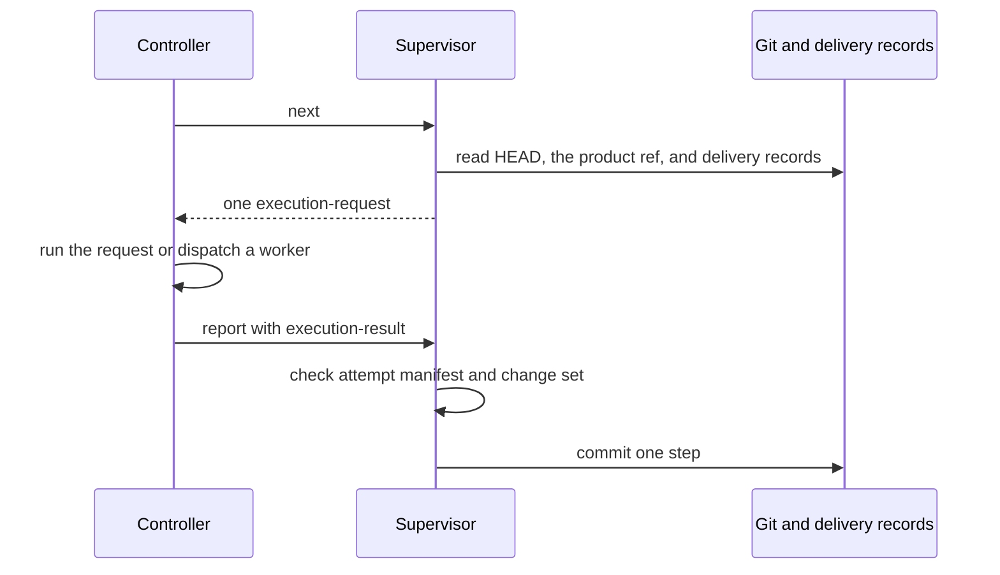

# Work-loop execution supervisor

`work-loop` runs full mode through one supervisor: `work-supervisor.py` and its
`_supervisor_*.py` siblings, which need only the Python standard library.[^1]
The supervisor issues one typed request at a time. The controller carries it
out, and `report` commits exactly one step.

Completion, red proof, the retry count, and readiness all re-derive from `HEAD`,
the product ref, and the committed `delivery/` records. A refusal writes no
commit, ref, or journal line.

Worker attempts are untrusted, and each is checked against a manifest.

**Status:** Current. Governing record:
[ADR-0144](../adr/0144-work-loop-supervisor-owns-procedure.md).

Neighbouring pages own the rest:

- [Authority migration](work-loop-authority-migration.md) maps where each former
  authority went.
- [Product ref](work-loop-product-ref.md) owns the ref transaction and history
  adoption.
- [Plan changes](work-loop-plan-changes.md) owns replanning and the TDD guard.
- [Stages](work-loop-supervisor-stages.md) owns the request-kind, stage, and
  event-line tables.
- [Runtime security primitives § 7](runtime-security-primitives.md#7-the-execution-supervisor-assumes-a-worker-may-write-files-directly)
  owns the attempt-security controls.
- [Loop infrastructure](loop-infrastructure.md) covers script invocation, the
  linters, the run lock, and the light-mode review flow.

## 1. Scope and Context

The supervisor owns procedure for full-mode runs and nothing about what counts as accepted.

The [acceptance-centered work-loop brief](../product/briefs/acceptance-centered-work-loop.md#proposed-delivery-slices)
owns each delivery slice's status.

| In scope | Out of scope | Why |
| --- | --- | --- |
| Admission, task projection, replanning, the TDD guard, sequential dispatch, recovery, the retry count, external effects, review selection, readiness | Acceptance meaning | Criteria, evidence, and review facts own completion, not procedure |
| Full-mode `code` and `spec-plan` runs | Light mode | Light mode runs no supervisor ([ADR-0014](../adr/0014-rigor-scales-with-risk-work-loop-modes.md)) |
| Worker-attempt checks and Windows process control | Parallel writes | Parallel-write gating ([ADR-0005](../adr/0005-supervisor-topological-default-and-write-gate.md)) is unchanged; parallel admission is `STATUS: PLANNED` |
| The product ref the supervisor moves with `HEAD`, and the refusals and decision it raises (§ 3, *Product ref*) | Parallel result integration | [Product result integration](work-loop-result-integration.md) § 1a: the sequential ref ships, and three-tree apply and parallel results are `STATUS: PLANNED` |

The supervisor dispatches one request at a time. It does not run agents
itself: it issues a typed request, the controller carries it out, and the
controller reports the result. The controller is the agent following
`SKILL.md`.

## 2. Structural Model

Thirteen modules own the procedure, and sibling modules supply acceptance, evidence, and review records. All live in `packs/core/.apm/skills/work-loop/scripts/`.

| Element | Module | Responsibility | State |
| --- | --- | --- | --- |
| Command surface | `work-supervisor.py` | Verbs `start`, `next`, `report`, `status`, and `resolve-effect`; pins the installed supervisor files | None of its own |
| Admission | `_supervisor_admission.py` | The run's workspace, the approval pair, and `start` | Commits `delivery/approvals.jsonl` |
| Projector | `_supervisor_projector.py` | Plan grammar, task projection, and the six envelope references | Stateless |
| Loop | `_supervisor_loop.py` | Derive the current request, commit steps, recover | Stateless; reads `HEAD` and the product ref |
| Attempt check | `_supervisor_attempt.py` | Record each attempt's manifest, check for residue | Run store under the Git directory |
| TDD guard | `_supervisor_tdd.py` | Red before green for a task's stub fence | Derived from `stub` and `red` commits |
| Not-red recovery | `_supervisor_recovery.py` | Close a not-red `write-stub` attempt and require a named human to confirm the next trusted-file change | `recovery.json` in the run store |
| Effects | `_supervisor_effects.py` | External effects that never repeat | `delivery/effect-resolutions.jsonl` |
| Review | `_supervisor_review.py` | Reviewer selection, the policy resolver, dispositions | `delivery/review-selections.jsonl`, `delivery/review-decisions.jsonl` |
| Readiness | `_supervisor_readiness.py` | Readiness derived from durable facts | Stateless |
| Commit builder | `_supervisor_commit.py` | The Git port, the one-step-per-commit builder, and the product ref transaction | Supervisor commits, the run's product ref |
| Git helper | `_supervisor_git.py` | The one hardened helper every supervisor `git` call uses | None |
| Journal | `_supervisor_journal.py` | Local, deletable state: `run.json`, the advisory journal, the security log, the run lock, and `.loop-run/events.jsonl` lines | `<spec>/.supervisor/` |

Two data files shape behaviour without code changes, and this page does not
restate their values.[^2] `supervisor-policy.json` holds the implementation
retry cap, the effect dispatch cap, the stub timeout, the red-proof budget, lock
timings, the authority role each decision accepts, and `result_authority`.
`result_authority` says whether acceptance reads the product ref or `HEAD`, and
is pinned with the file at `start`. `review-rules.json` says which reviewer
roles run.

The supervisor also loads these siblings and does not own them:

- `_acceptance.py` for the envelope and verdict;
- `_evidence_store.py` for evidence, and `_policy_import.py` for the approval
  pair it imports;
- `_review_selection.py`, `_review_persistence.py`, `_review_disposition.py`,
  `_review_bridge.py`, and `_review_assessment.py` for structured review records
  and the proof-by-run check;
- `_subject_projection.py` for the review subject;
- `_loop_guards.py` for the plan grammar and contract canonicalisation;
- `_statelock.py` for the run lock;
- `_file_safety.py` and `_confined_mutation.py` for confined reads and writes;
- `_security_capability.py`, `_security_events.py`, and `_containment.py` for
  capability grants, the security log, and host containment.

## 3. Runtime Model

Each `next` derives one request from committed facts, and each `report` commits one step.

| Scenario | Trigger | Path |
| --- | --- | --- |
| Admit a run | `start` on an Approved spec and plan | Commit one `approval` step |
| Execute | `next` issues a request, the controller reports it | Normal sequence |
| Replan inside the envelope | A controller edit leaves every protected reference and the terminal intent unchanged | Commit one `replan` step, no approval |
| Cross a protected boundary | An edit changes a protected reference or the terminal intent | Refuse and name the owner |
| Recover | A crash, a lost journal, a reset back to an earlier supervisor commit, or a rebase | Re-derive from `HEAD`, the product ref, and `delivery/`; a step cut off after its refs moved but before it was recorded, a rebase, or other foreign history waits for the owner (§ 3, *Product ref*) |

### Admission

`start` refuses unless the spec is `Approved` or `Implementing`, the plan is
`Approved` or `Executing`, and `--intent` matches the spec's
`## Terminal Intent`. It commits one line to `delivery/approvals.jsonl` holding
an `approval-record.v1` and an `initial-plan-review.v1`.

Both are bound to the reviewed-execution-envelope fingerprint (a digest of the
spec's protected sections, listed in [plan changes](work-loop-plan-changes.md#1-replanning)),
the terminal intent, the code-trust classification, the run id, and the `owner`
and `plan-reviewer` authority references. A `spec-plan` run then commits
`terminal` and ends, with no task projected and no request issued ([ADR-0144](../adr/0144-work-loop-supervisor-owns-procedure.md) D4).

### Normal sequence

1. `next` derives the current request from `HEAD`. It first commits any
   pending controller edit to the spec, plan, or cited records as one `replan`
   step, unless a not-red confirmation is owed (§ 3, *TDD guard*).
   It then commits any step it takes itself: a supervisor-run `red` proof, an
   `effect-intent`, or `terminal`. It projects the matching event lines,
   records the attempt's issuance in the run store, writes `run.json`, and
   appends an advisory journal line. A refusal derived here writes only
   `run.json`.
2. The request's id is deterministic, so a repeated `next` re-issues it
   unchanged until it is reported or superseded.
3. An attempt request records its manifest before the controller dispatches it
   (§ 4, *Attempts*).
4. The controller runs the request and calls `report`. `report` refuses a
   result that is not for the current request, that changes a trusted file, or
   that touches committed `delivery/` records. Otherwise it commits exactly one
   step.

### Request order

Every verb first classifies how `HEAD` and the product ref relate; `status`
does so read-only ([product ref](work-loop-product-ref.md#2-classification-decides-what-a-verb-may-do)).
`next` issues the `history-adoption` `human-decision` there when foreign history
needs the owner, and the order below runs only when it does not.

Then `next` commits any pending `replan`, and then any admitted `regenerate`
step, before it takes the first of these that applies. When the run's code trust
is `untrusted` and the host supplies no verified containment, every request that
would run repository code becomes an `untrusted-code` `human-decision`. Those
requests are `write-stub`, `implement-task`, a supervisor-run red proof,
`run-gates`, and `regenerate`.

1. `terminal`, when a terminal step exists for the current product tree, or the
   intent is `spec-plan`.
2. The not-red recovery gate: an owed replan confirmation, a standing decline,
   or a leftover file the discard could not remove.
3. A `human-decision` when the implementation retry count has reached the cap.
4. The first incomplete task whose dependencies are complete: `write-stub`,
   `implement-task`, or a supervisor-run red proof.
5. A `dependency-cycle` refusal when tasks remain but none is ready.
6. A `human-decision` when the working tree holds changes no task admitted.
7. Open effects declared by tasks.
8. Readiness work: `run-gates`, reviewer selection and `review-role`,
   `assess-finding`, or a `human-decision` when gates failed, criteria stay
   unsupported, or review is not acceptance-eligible.
9. A `regenerate` request for the installed skill, when one is pending.
10. Finish effects.
11. `terminal`.

### Request kinds and stages

`run.json`'s `stage` comes from the current request kind: `implementing` for
`implement-task`, `write-stub`, `external-effect`, and `effect-query`; `gating`
for `run-gates` and `regenerate`; `reviewing` for `review-role` and
`assess-finding`; and `awaiting-human` for `human-decision`.

A refusal that `next` writes maps to `awaiting-human` from any stage. Every
other refusal reaches the controller only through the verb's output and leaves
`run.json` unchanged. The [stages page](work-loop-supervisor-stages.md) owns the full
table, the state diagram, and the event-line stage for each commit operation.

### Product ref

The run's result is a protected Git ref that only the supervisor moves. Each
step moves `HEAD` and the ref in one transaction.[^3] Before the request order,
every verb classifies the ref against `HEAD` and the run store.

History the supervisor did not make, such as a rebase or a step cut off after
its refs moved, waits for the owner's `adopt-history` answer or a restore of both
refs. The [product ref page](work-loop-product-ref.md) owns the transaction, the
classification table, history adoption, and the `regenerate` step.

### Replanning

A plan edit that leaves the six protected references and the terminal intent
unchanged commits as one `replan` step with no approval. A change to a protected
reference or the terminal intent refuses and names its owner.

A completed task becomes due again only when a pinned field of its current
revision changes. The [plan changes page](work-loop-plan-changes.md#1-replanning) owns the
envelope and the edit rules.

### TDD guard

A task with a stub fence runs `write-stub`, then a supervisor-run red proof,
and only then `implement-task`. A stub that is not red refuses `stub-not-red`.

A `write-stub` result whose stub already passes also owes an owner confirmation
before the next trusted-file change commits. The
[plan changes page](work-loop-plan-changes.md#2-tdd-guard) owns the steps and
both answers.

### Effects

A task declares an external effect on its `**Effects:**` line; a plan-level
`**Effects:**` line declares finish effects. The supervisor records the intent
before the first dispatch and the receipt after it. An effect the source shows
never happened may be dispatched again, up to the policy's effect dispatch cap.

An outcome the source cannot establish waits for a named human's
`effect-resolution.v1` through `resolve-effect`: `effect-confirmed`,
`do-not-retry`, or one `retry-authorized` claim taken under lock (ADR-0144 D6).

### Review and readiness

`review-rules.json` lists the reviewer roles. The controller answers a
selection request with the conditional roles it selects and the ones it omits,
and the supervisor commits that answer to `delivery/review-selections.jsonl`.
Owner decisions such as `reselect-review` and `accept-risk` commit as `review`
steps in `delivery/review-decisions.jsonl`.

Review closes only from structured readiness ([ADR-0144](../adr/0144-work-loop-supervisor-owns-procedure.md) D8). Every selected
obligation needs a current `review-report.v1`. Every finding needs a current
`finding-assessment.v1`, and every supported finding needs a
`finding-disposition.v1`.

Readiness also needs the current approval pair and every criterion supported by
fresh admissible evidence. The supervisor reads no stored verdict as input.

An `assess-finding` result is refused `review-record-refused` when its
proof-by-run assessment does not name exactly one proof run of the subject
commit, or pairs the wrong outcome with it.[^4]

### Failure and recovery

1. Completion is an `implement` commit for a task's current revision. Red proof
   is a `stub` or `red` commit for its stub digest. The retry count is the
   number of `gate-fail` steps. All three re-derive from `HEAD`.
2. A crash before a step's refs move or after it was recorded, a deleted journal, or a reset back to an earlier supervisor commit converges to
   the uninterrupted result. A crash after the refs moved but before the step was
   recorded, a rebase, and any other history the supervisor did not make wait for
   the owner: `adopt-history`, or restoring both refs so the step is rebuilt (§ 3,
   *Product ref*). The journal is advisory and never read for a decision.
3. A run whose durable state predates the supervisor is re-derived from the
   spec, plan, Git history, evidence, and review facts. It is not resumed in
   place (ADR-0144 D7).
4. A refusal writes no commit, ref, journal line, or `.loop-run/events.jsonl`
   line. An attempt refusal does record a refusal mark in the run store and a
   denial line in `security-events.jsonl`, and a `stub-not-red` refusal of a
   `write-stub` result discards the attempt's files (§ 3, *TDD guard*). The
   refusal's code and owner reach the controller through the verb's output.
   Only a refusal `next` writes also sets `run.json`'s `refusal` field (§ 3,
   *Request kinds and stages*).

### Exit codes

Every verb prints one JSON object; a refusal prints
`{"refusal": {"code", "owner", "detail"}}`. Every verb exits 0 on success, 1 on
a refusal, and 2 on a usage error.

`status --check` also exits 3 on a non-terminal run whose implementation retry
count has reached the policy cap, and 3 takes precedence over 1. A terminal run
exits 0.

## 4. Contracts and Invariants

Every schema below is in `contracts/delivery/`.

| Contract | Producer → consumer | Invariant |
| --- | --- | --- |
| `approval-record.v1` and `initial-plan-review.v1` | `start` → admission | One `approvals.jsonl` line per `start`; a partial line is never readable |
| `reviewed-execution-envelope.v1` | `_acceptance.py` → admission and loop | Same protected references, same fingerprint |
| `task-contract.v1` | Projector → loop | Identity is the title without its number; the revision digests the pinned fields |
| `execution-request.v1` | `next` → controller | Deterministic id; re-issued until reported or superseded |
| `execution-result.v1` | Controller → `report` | Refused unless it answers the current request |
| `mechanical-journal.v1` | Journal → nobody | Advisory; deleting it changes no decision |
| `effect-resolution.v1` | Effects and `resolve-effect` → effects | Append only; one durable retry claim |
| `semantic-evidence-transaction.v1`, `evidence-receipt.v1` | Supervisor → `delivery/evidence.jsonl` | Read by `replay_admitted_frames` |
| `review-report.v1`, `finding-assessment.v1`, `finding-disposition.v1` | Reviewers and controller → review | Semantic records in `delivery/evidence.jsonl`; closure derives only from these |
| `security-capability.v1`, `containment-attestation.v1`, `security-event.v1` | Attempt security → supervisor | Authority never exceeds the grant |

The event file keeps the existing
`contracts/jsonschema/loop-run-event.schema.json` envelope.
[Telemetry](telemetry.md) owns its field set.

### Attempts

An attempt opens when `next` issues `implement-task`, `write-stub`,
`review-role`, `assess-finding`, `run-gates`, or `regenerate`, and when the
supervisor itself launches repository code for a red proof.

Its manifest records the size and digest of every trusted file (the spec, its plan, the
records it cites, and the installed skill) and of the Git control state. A
`config` or `config.worktree` entry records the config fingerprint instead: the
file's size and digest with its canonical tracking blocks removed, prefixed
`config-view:`. A `regenerate` manifest leaves out the installed skill, because
regenerating it is the request.

While an attempt is open, `next`, `report`, and `start` first compare the
working tree with the manifest and with `HEAD`. A difference refuses the
attempt, and `next` answers `attempt-residue` until the named paths are
restored. An attempt closes when it is reported, superseded, or refused; a
`stub-not-red` refusal also closes it (§ 3, *TDD guard*).

### Trust

Worker attempts (implementer and reviewer subagents) are untrusted. A change
during an attempt to a trusted file, to Git control state, or to committed
`delivery/` records refuses its result.

`HEAD` may advance only by commits the supervisor made. The supervisor's own
move of this run's product ref is accepted only at the run store's recorded
value, and any other change to that ref during an attempt refuses the result.

The controller is trusted. A named-human decision is recorded with its authority
reference (ADR-0144 D11).

`start --code-trust trusted|untrusted` records whether the run's repository
code is trusted, and an `untrusted` run runs no repository code without verified
host containment (§ 3, *Request order*). Git hardening, launch grants, the
run-store layout, supervisor pinning and regeneration admission, and result
acceptance per request kind are in [runtime security primitives § 7](runtime-security-primitives.md#7-the-execution-supervisor-assumes-a-worker-may-write-files-directly).

## 5. Data and State

| Location | Holds | Durability | Rule |
| --- | --- | --- | --- |
| Supervisor commits | One step each | Committed | The source of completion, red proof, and the retry count |
| `docs/specs/<feature>/delivery/approvals.jsonl` | The approval pair, one line per `start` | Committed | Only the supervisor writes it |
| `docs/specs/<feature>/delivery/evidence.jsonl` | Evidence frames and receipts, review reports, assessments, and dispositions | Committed | Only the supervisor writes it |
| `docs/specs/<feature>/delivery/review-selections.jsonl`, `review-decisions.jsonl` | Reviewer selections and owner review decisions | Committed | Only the supervisor writes them |
| `docs/specs/<feature>/delivery/effect-resolutions.jsonl` | Named-human effect decisions | Committed | Append only |
| `<spec>/.supervisor/` | `run.json`, `journal.jsonl`, `security-events.jsonl`, the run lock | Local, self-ignoring | Deletable; nothing re-derives from it |
| Run store under the Git directory | Attempt manifests and issuance marks, pinned supervisor digests, `recovery.json`, the product ref's name and recorded commit (`product-ref`), and the list of made commits | Local | The attempt-security trust root. A checkout without it verifies committed records only, and `status` reports which (`verification`) |
| `.loop-run/events.jsonl` | One line per supervisor step | Local | Projected from commits; a lost line is repaired |

`run.json` holds `run_id`, `active`, `stage`, `gate_pending`, `gate_question`,
and `refusal`. `active` is true from the first admitted `start` until terminal.
`gate_pending` is true exactly while a `human-decision` is open, with its
question in `gate_question`.

`refusal` names the refusal `next` last derived,
with its owner, or is empty.

The workspace bridge reads `run.json` through a confined regular-file read with
a 64 KiB bound and only displays it. A human answer reaches the supervisor only
through its own `human-decision` request.

Deleting the journal, `run.json`, or `security-events.jsonl` neither reopens a
closed attempt nor clears an owed confirmation, because both live in the run
store.

## 6. Deployment and Operations

| Unit | Runs as | Observability |
| --- | --- | --- |
| Supervisor | Scripts in the installed `work-loop` skill directory, standard library only, POSIX and Windows | `run.json`, `.loop-run/events.jsonl`, `status` |
| Pre-PR hooks | `packs/core/.apm/hooks/pre-pr.py` and `tools/hooks/pre-pr.py` | `status --check` exit code for each spec holding `delivery/approvals.jsonl` |
| Workspace bridge | `agentbundle` MCP server | Run id, `run_active`, stage, and pending gate from `run.json` |

The supervisor never imports or executes anything from `tools/`, `packages/`,
or another installed package at runtime.[^5] Same-process code is not a sandbox.
Attempt security checks what an attempt changed rather than claiming to contain
it.

## 7. Quality Scenarios and Verification

| Stimulus | Response | Verification |
| --- | --- | --- |
| Killed at any kill point, journal deleted, or branch reset back to an earlier supervisor commit | Converges to the uninterrupted run's tasks, tree, and records once the owner has answered where a step was cut off or foreign history sits on `HEAD`. The full corpus runs under the shipped `result_authority`, and a named sample runs under the other | Crash corpus |
| Effect source is unknowable after a crash | Dispatches nothing until a named human decides | Effect corpus and two-process claim race |
| A plan edit | Inside the envelope it projects with no approval request; a protected change refuses with no commit, ref, journal line, or event | Replan corpus |
| TDD task reaches implementation | Red observed first, byte-identical to the fence | TDD corpus |
| Worker changes a trusted file | Result refused; `attempt-residue` until restored | Attempt-security suites |
| Installed skill runs with only the standard library | Synthetic run reaches readiness | Clean-environment import fence, POSIX and Windows |

The suites live under `packs/core/tests/skills/work-loop/`.

## 8. Implementation Mapping

| Element | Source | Verification |
| --- | --- | --- |
| Supervisor modules and policy data | `packs/core/.apm/skills/work-loop/scripts/work-supervisor.py`, `_supervisor_*.py`, `supervisor-policy.json`, `review-rules.json` | Work-loop supervisor suites |
| Light-mode and pre-approval review verbs | `work-loop/scripts/review-artifact.py` (`validate`, `classify`, `raw-classify`, `inspect`, `record`) | Review-artifact tests |
| Portable records | `contracts/delivery/` | Schema validation and registry rows |
| Skill procedure and generated copy | `work-loop/SKILL.md`, `.claude/skills/work-loop/` | Skill evals, `make build-self` drift check |

The skill ships the modules as path-loaded siblings, with no build step.

## 9. Decisions, Alternatives, and Risks

[ADR-0144](../adr/0144-work-loop-supervisor-owns-procedure.md) and
[ADR-0151](../adr/0151-post-lock-routes-for-the-stub-fence-and-implementation-discovered-means.md)
hold the decisions and the rejected alternatives.

- **`STATUS: PLANNED`:** leases and parallel scheduling. ADR-0144 D1 assigns
  leases to the supervisor, and the
  [brief's delivery slices](../product/briefs/acceptance-centered-work-loop.md#proposed-delivery-slices)
  schedule them.
- **Not in this subsystem:** provider selection and external runtime adapters
  ([crosswalk](runtime-adapter-crosswalk.md)).
- **Risk:** a controller needs a plan edit while an attempt is open.
  **Mitigation:** `attempt-residue` names the paths to restore.
- **Risk:** a writer that can edit the run store could clear an owed
  confirmation. **Mitigation:** none here. That store is the attempt-security
  trust root.

## 10. Ownership and Reversal

[Authority migration](work-loop-authority-migration.md) owns the migration and
reversal of the supervisor. The product ref and `result_authority` setting have
their own reversal in
[product result integration § 10](work-loop-result-integration.md#10-rollout-migration-and-reversal).

| Responsibility | Owner |
| --- | --- |
| Supervisor, policy data, and skill procedure | Core pack maintainers |
| Delivery contracts | `agentbundle` contract maintainers |
| Rollback | Core pack release maintainers |

[^1]: `packs/core/.apm/skills/work-loop/scripts/work-supervisor.py`: the
    `add_parser` calls give the verbs `start`, `next`, `report`, `status`, and
    `resolve-effect`. The `_supervisor_*.py` files beside it are the modules in
    § 2.

[^2]: `packs/core/.apm/skills/work-loop/supervisor-policy.json` and
    `review-rules.json`.

[^3]: `_supervisor_commit.py`: `PRODUCT_REF_RE` and the two-ref transaction.

[^4]: `_supervisor_readiness.py`: the `assess-finding` branch calls
    `_review_assessment.py` `check_proof_by_run` and raises
    `review-record-refused`.

[^5]: `packs/core/tests/skills/work-loop/test_supervisor_dark_launch.py`: runs
    `work-supervisor.py` under `-I -S` and fails if any other module loads.
