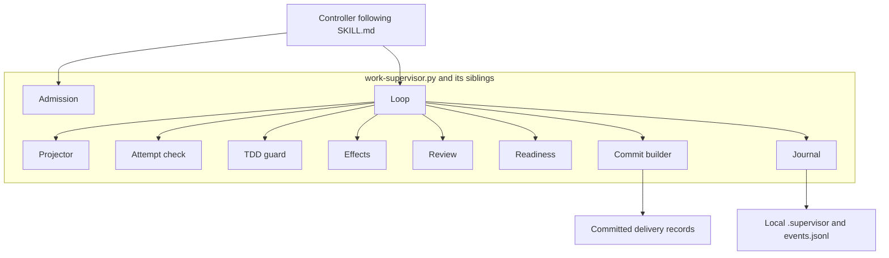
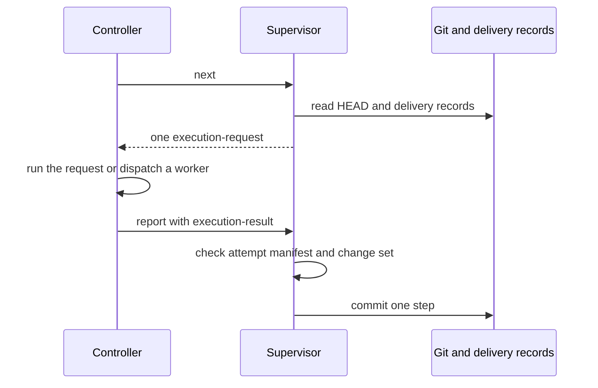

# Subsystem Design — Workspace execution supervisor

**Decision:** `work-loop` stays the public skill, and the supervisor shipped
inside it — `work-supervisor.py` and its `_supervisor_*.py` siblings — is the
only owner of full-mode procedure. It derives every step from committed facts,
needs only the Python standard library, and ships with no compatibility layer
to the phase engine it replaced ([ADR-0144](../adr/0144-work-loop-supervisor-owns-procedure.md)).
**Author:** Platform Core
**Status:** Current
**Last updated:** 2026-10-29
**Reviewers:** Core pack maintainers

## 1. Scope and Context

| In scope | Out of scope | Why |
| --- | --- | --- |
| Admission, task projection, replanning, the TDD guard, sequential dispatch, recovery, the retry count, external effects, review selection, readiness | Acceptance meaning | Criteria, evidence, and review facts own completion, not procedure |
| Full-mode `code` and `spec-plan` runs | Light mode | Light mode runs no supervisor ([ADR-0014](../adr/0014-rigor-scales-with-risk-work-loop-modes.md)) |
| Worker-attempt checks and Windows process control | Parallel writes | Parallel-write gating ([ADR-0005](../adr/0005-supervisor-topological-default-and-write-gate.md)) is unchanged; Slice 7 owns parallel admission |
| The execution-root worktree as the product result | A protected product ref | [Product result integration](work-loop-result-integration.md) is Slice 5's design, not built |

The supervisor dispatches one request at a time. It does not run agents
itself: it issues a typed request, the controller carries it out, and the
controller reports the result. The controller is the agent following
`SKILL.md`.

## 2. Structural Model

All modules live in `packs/core/.apm/skills/work-loop/scripts/`.

| Element | Module | Responsibility | State |
| --- | --- | --- | --- |
| Command surface | `work-supervisor.py` | Verbs `start`, `next`, `report`, `status`, and `resolve-effect`; pins the installed supervisor files | None of its own |
| Admission | `_supervisor_admission.py` | The run's workspace, the approval pair, and `start` | Commits `delivery/approvals.jsonl` |
| Projector | `_supervisor_projector.py` | Plan grammar, task projection, and the six envelope references | Stateless |
| Loop | `_supervisor_loop.py` | Derive the current request, commit steps, recover | Stateless; reads `HEAD` |
| Attempt check | `_supervisor_attempt.py` | Record each worker request's manifest, check for residue | Run store under the Git directory |
| TDD guard | `_supervisor_tdd.py` | Red before green for a task's stub fence | Derived from `stub` and `red` commits |
| Not-red recovery | `_supervisor_recovery.py` | Close a not-red `write-stub` attempt and require a named human to confirm the next trusted-file change | `recovery.json` in the run store |
| Effects | `_supervisor_effects.py` | External effects that never repeat | `delivery/effect-resolutions.jsonl` |
| Review | `_supervisor_review.py` | Reviewer selection, the policy resolver, dispositions | `delivery/review-selections.jsonl`, `delivery/review-decisions.jsonl` |
| Readiness | `_supervisor_readiness.py` | Readiness derived from durable facts | Stateless |
| Commit builder | `_supervisor_commit.py` | The Git port and the one-step-per-commit builder | Supervisor commits |
| Git helper | `_supervisor_git.py` | The one hardened helper every supervisor `git` call uses | None |
| Journal | `_supervisor_journal.py` | Local, deletable state: `run.json`, the advisory journal, the security log, the run lock, and `.loop-run/events.jsonl` lines | `<spec>/.supervisor/` |

Two data files shape behaviour without code changes.
`work-loop/supervisor-policy.json` holds the implementation retry cap (5), the
effect dispatch cap (3), and the authority role each verb accepts.
`work-loop/review-rules.json` says which reviewer roles run.

The supervisor also loads Slice 1 and Slice 2 siblings it does not own:
`_acceptance.py` for the envelope and verdict, `_evidence_store.py` for
evidence, `_review_*.py` for structured review records, and
`_security_capability.py` for capability grants.

## 3. Runtime Model

| Scenario | Trigger | Path |
| --- | --- | --- |
| Admit a run | `start` on an Approved spec and plan | Commit one `approval` step |
| Execute | `next` issues a request, the controller reports it | Normal sequence |
| Replan inside the envelope | A controller edit leaves every protected reference and the terminal intent unchanged | Commit one `replan` step, no approval |
| Cross a protected boundary | An edit changes a protected reference or the terminal intent | Refuse and name the owner |
| Recover | A crash, a lost journal, or a rebase | Re-derive from `HEAD` and `delivery/` |

**Admission.** `start` refuses unless the spec is `Approved` or
`Implementing`, the plan is `Approved` or `Executing`, and `--intent` matches
the spec's `## Terminal Intent`. It commits one line to
`delivery/approvals.jsonl` holding an `approval-record.v1` and an
`initial-plan-review.v1`. Both are bound to the reviewed-execution-envelope
fingerprint, the terminal intent, the run id, and the authority references
(`owner` and `plan-reviewer`). A `spec-plan` run then commits `terminal` and
ends, with no task projected and no request issued.

**Normal sequence**

1. `next` derives the current request from `HEAD`, with no writes beyond
   `run.json`. It first commits any pending controller edit to the spec, plan,
   or cited records as one `replan` step.
2. The request is one of `implement-task`, `write-stub`, `run-gates`,
   `review-role`, `assess-finding`, `external-effect`, `effect-query`,
   `regenerate`, or `human-decision`. Its id is deterministic, so a repeated
   `next` re-issues it unchanged.
3. For a worker request, the attempt check records a manifest of every trusted
   file and the Git control state before the controller dispatches it.
4. The controller runs the request and calls `report`. `report` refuses a
   result that is not for the current request, that changes a trusted file, or
   that touches committed `delivery/` records. Otherwise it commits exactly one
   step.
5. The order of requests is: retry cap, the first incomplete task, open effects
   of completed tasks, gates and review, finish effects, then terminal.

**Step kinds.** Each supervisor commit carries one operation: `approval`,
`replan`, `stub`, `red`, `implement`, `evidence`, `gate-fail`, `review`,
`effect-intent`, `effect-dispatch`, `effect-receipt`, `claim`, `resolution`, or
`terminal`.

**Replanning.** There is no whole-plan lock. The envelope covers six protected
references: `spec_policy` (criteria, testing strategy, agent rules),
`scope_and_non_goals`, `authority_and_security` (the `Constrained by:` value
and each cited record's decision section), `public_contracts` (the
`Contract:` value), `durable_outputs`, and `accepted_risk`. Reordering,
splitting, merging, or replacing tasks, editing tests, stubs, effects, or the
plan's `## Design (LLD)`, and bookkeeping edits all reproject tasks with no
approval. A change to a protected reference or the terminal intent refuses and
names the spec-amendment, decision, contract, risk, or plan-review owner. A
controller plan edit is in-envelope only while no attempt is open; during an
attempt any plan change refuses it with `attempt-residue`.

**TDD guard** ([ADR-0151](../adr/0151-post-lock-routes-for-the-stub-fence-and-implementation-discovered-means.md)).
The controller writes a task's `stub` fence as a task-start revision: after
the previous result is reported, and before the `next` that issues the task's
first request. The supervisor materializes the fence unchanged and commits a
`stub` or `red` step only after it has itself observed the fence fail with a
declared red exit code. No `implement` step is admitted before that. A
`stub-not-red` refusal of a `write-stub` result closes the attempt with nothing
from it committed. The next trusted-file change then opens a `human-decision`
bound to a digest of its exact bytes. It commits as a `replan` only after a
named human confirms it (`confirm-replan`). An implementer attempt never writes
a fence.

**Effects.** A task declares an external effect on its `**Effects:**` line.
The supervisor records the intent before the first dispatch and the receipt
after it. An effect the source shows never happened may be dispatched again,
up to three dispatches in all. An outcome the source cannot establish waits for
a named human's `effect-resolution.v1` through `resolve-effect`:
`effect-confirmed`, `do-not-retry`, or one `retry-authorized` claim taken under
lock.

**Review and readiness.** `review-rules.json` selects the reviewer roles. Review
closes only from structured readiness: every selected obligation has a current
`review-report.v1`, every finding has a current assessment, and every supported
finding is disposed. Readiness also needs the current approval pair and every
criterion supported by fresh admissible evidence. The supervisor reads no
stored verdict as input.

**Failure and recovery sequence**

1. Completion is an `implement` commit for a task's current revision. Red proof
   is a `stub` or `red` commit for its stub digest. The retry count is the
   number of `gate-fail` steps. All three re-derive from `HEAD`.
2. A crash, a deleted journal, or a rebase with messages preserved converges to
   the uninterrupted result. The journal is advisory and never read for a
   decision.
3. A run started under the old phase engine is re-derived from the spec, plan,
   Git history, evidence, and review facts. It is not resumed in place.
4. `status --check` exits 0 when healthy or terminal, 1 when refused, 3 when the
   implementation retry count has reached 5, and 2 on a usage error.

## 4. Contracts and Invariants

Every schema below is in `contracts/delivery/`.

| Contract | Producer → consumer | Invariant |
| --- | --- | --- |
| `approval-record.v1` and `initial-plan-review.v1` | `start` → admission | One line per `start`; a partial line is never readable |
| `reviewed-execution-envelope.v1` | `_acceptance.py` → admission and loop | Same protected references, same fingerprint |
| `task-contract.v1` | Projector → loop | Identity is the title without its number; the revision digests the pinned fields |
| `execution-request.v1` | `next` → controller | Deterministic id; re-issued until reported or superseded |
| `execution-result.v1` | Controller → `report` | Refused unless it answers the current request |
| `mechanical-journal.v1` | Journal → nobody | Advisory; deleting it changes no decision |
| `effect-resolution.v1` | Effects and `resolve-effect` → effects | Append only; one durable retry claim |
| `semantic-evidence-transaction.v1`, `evidence-receipt.v1` | Supervisor → `delivery/evidence.jsonl` | Read by `replay_admitted_frames` |
| `review-report.v1`, `finding-assessment.v1`, `finding-disposition.v1` | Reviewers and controller → review | Closure derives only from these |
| `security-capability.v1`, `containment-attestation.v1`, `security-event.v1` | Attempt security → supervisor | Authority never exceeds the grant |

The event file keeps the existing `contracts/jsonschema/loop-run-event.schema.json`
envelope, with supervisor step names in `from`, `event`, and `to`.

**Trust.** Worker attempts — implementer and reviewer subagents — are
untrusted. A change during an attempt to a trusted file (the spec, its plan,
the records it cites, or the installed skill), to Git control state, or to
committed `delivery/` records refuses its result. `HEAD` may advance only by
commits the supervisor made. The controller is trusted. A named-human decision
is recorded with its authority reference.

## 5. Data and State

| Location | Holds | Durability | Rule |
| --- | --- | --- | --- |
| Supervisor commits | One step each | Committed | The source of completion, red proof, and the retry count |
| `docs/specs/<feature>/delivery/` | `approvals.jsonl`, `evidence.jsonl`, `review-selections.jsonl`, `review-decisions.jsonl`, `effect-resolutions.jsonl` | Committed | Only the supervisor writes them |
| `<spec>/.supervisor/` | `run.json`, `journal.jsonl`, `security-events.jsonl`, the run lock | Local, self-ignoring | Deletable; nothing re-derives from it |
| Run store under the Git directory | Attempt manifests, refusals, pinned supervisor digests, `recovery.json` | Local | The attempt-security trust root |
| `.loop-run/events.jsonl` | One line per supervisor step | Local | Projected from commits; a lost line is repaired |

`run.json` holds `run_id`, `active`, `stage`, `gate_pending`, `gate_question`,
and `refusal`. `stage` is one of `admitted`, `implementing`, `gating`,
`reviewing`, `awaiting-human`, and `terminal`. The workspace bridge reads it
through a confined regular-file read with a 64 KiB bound and only displays it.
A human answer reaches the supervisor only through its own `human-decision`
request.

## 6. Deployment and Operations

| Unit | Runs as | Observability |
| --- | --- | --- |
| Supervisor | Scripts in the installed `work-loop` skill directory, standard library only, POSIX and Windows | `run.json`, `.loop-run/events.jsonl`, `status` |
| Pre-PR hooks | `packs/core/.apm/hooks/pre-pr.py` and `tools/hooks/pre-pr.py` | `status --check` exit code for each spec holding `delivery/approvals.jsonl` |
| Workspace bridge | `agentbundle` MCP server | Run id, `run_active`, stage, and pending gate from `run.json` |

The supervisor never imports or executes anything from `tools/`, `packages/`,
or another installed package at runtime. Same-process code is not a sandbox;
attempt security checks what an attempt changed rather than claiming to
contain it.

## 7. Quality Scenarios and Verification

| Stimulus | Response | Verification |
| --- | --- | --- |
| Killed at any kill point, journal deleted, or branch rebased | Converges to the uninterrupted run's tasks, tree, and records | Crash corpus |
| Effect source is unknowable after a crash | Dispatches nothing until a named human decides | Effect corpus and two-process claim race |
| In-envelope task change | New projection, no approval request | Replan corpus |
| Protected change | Refuses with no commit, ref, journal line, or event | Replan corpus |
| TDD task reaches implementation | Red observed first, byte-identical to the fence | TDD corpus |
| Worker changes a trusted file | Result refused; `attempt-residue` until restored | Attempt-security suites |
| Installed skill runs with only the standard library | Synthetic run reaches readiness | Clean-environment import fence, POSIX and Windows |
| A new reviewer role | Joins through one `review-rules.json` entry and a typed report | Synthetic-reviewer fixture |

The suites live under `packs/core/tests/skills/work-loop/`.

## 8. Implementation Mapping

| Element | Source | Verification |
| --- | --- | --- |
| Supervisor modules | `packs/core/.apm/skills/work-loop/scripts/work-supervisor.py` and `_supervisor_*.py` | Work-loop supervisor suites |
| Policy data | `work-loop/supervisor-policy.json`, `work-loop/review-rules.json` | Policy and review-selection tests |
| Light-mode and pre-approval review verbs | `work-loop/scripts/review-artifact.py` (`validate`, `classify`, `raw-classify`, `inspect`, `record`) | Review-artifact tests |
| Portable records | `contracts/delivery/` | Schema validation and registry rows |
| Skill procedure | `work-loop/SKILL.md` and its references | Skill evals |
| Generated copy | `.claude/skills/work-loop/` | `make build-self` drift check |

There is no build step: the skill ships the modules as path-loaded siblings.

## 9. Decisions, Alternatives, and Risks

- **Decision:** One skill-shipped supervisor owns full-mode procedure
  (ADR-0144 D1, D2).
- **Decision:** The stub fence is a task-start revision and an
  `implementation-discovered` means is a working-plan edit (ADR-0151).
- **Rejected:** a single-file supervisor built from a manifest by a repository
  tool, and a journal or effect store in `packages/agentbundle/`. Neither
  reaches adopters (ADR-0144, alternatives).
- **Not built:** provider selection, external runtime adapters, leases, and
  parallel scheduling. The [runtime adapter crosswalk](runtime-adapter-crosswalk.md)
  is a draft mapping for Slices 6 and 7.
- **Risk:** a controller needs a plan edit while an attempt is open.
  **Mitigation:** `attempt-residue` names the paths to restore, and the edit
  waits for the next `next`.
- **Risk:** a writer that can edit the run store under the Git directory could
  clear an owed confirmation. **Mitigation:** none in this subsystem; that
  store is the attempt-security trust root.

## 10. Rollout, Migration, and Reversal

The `work-loop` invocation is unchanged. Core 4.0.0 makes the supervisor the
only full-mode procedure owner and removes the phase engine, the cohort writer,
the legacy review path, and the wave-decision contract. No compatibility
adapter, reverse reader, or dual-write path ships. A run started before 4.0.0
is re-derived from durable facts. Reversal is reinstalling the prior Core
major, which discards supervisor records that release cannot read (ADR-0144
D7). [Authority migration](work-loop-authority-migration.md) records where each
old authority went.

| Responsibility | Owner |
| --- | --- |
| Supervisor, policy data, and skill procedure | Core pack maintainers |
| Delivery contracts | `agentbundle` contract maintainers |
| Rollback | Core pack release maintainers |
