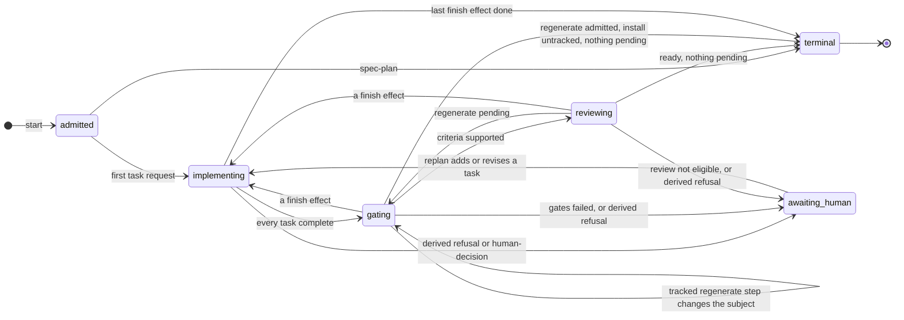

# Work-loop supervisor stages and event lines

Each request kind maps to one `run.json` stage, and each supervisor commit maps
to one event-line stage. The two can differ, because the event line takes its
stage from the commit's operation and not from the request.

This page owns both tables and the state diagram. [The supervisor page](work-loop-execution-supervisor.md)
owns the request order and the refusals. [Telemetry](telemetry.md#51-what-a-line-holds)
owns the event line's fields.

## 1. Request kinds map to stages

| Request kind | `run.json` stage | Opens an attempt |
| --- | --- | --- |
| `implement-task` | `implementing` | Yes, worker |
| `write-stub` | `implementing` | Yes, worker |
| `external-effect` | `implementing` | No |
| `effect-query` | `implementing` | No |
| `run-gates` | `gating` | Yes |
| `regenerate` | `gating` | Yes, without the installed skill |
| `review-role` | `reviewing` | Yes, worker |
| `assess-finding` | `reviewing` | Yes, worker |
| `human-decision` | `awaiting-human` | No |

A refusal that `next` writes, such as `dependency-cycle` or a protected
boundary, maps to `awaiting-human` from any stage. Every other refusal reaches
the controller only through the verb's output and leaves `run.json` unchanged.
Examples are `attempt-residue`, `supervisor-changed`, every `report` refusal,
`run-locked`, and refusals from `start` and `resolve-effect`.[^1]

`status` re-derives the run without committing, so `status --check` exits 1
only for a refusal that derivation and request selection produce. Two refusals
that `next` writes to `run.json` do not reach it: a `foreign-delivery-edit` from
the delivery-record sync, and a `stub-not-red` from the supervisor's own red
run of committed stubs. For either, `run.json` shows the refusal while
`status --check` exits 0.[^2]

`awaiting_human` in the diagram is the `awaiting-human` stage. After a decision
or a cleared refusal, the run returns to whichever stage its next request has.
The diagram draws only the repair path.

## 2. Commit operations map to event-line stages

Each supervisor commit carries one operation, and each emits one
`.loop-run/events.jsonl` line whose `event` is the operation.[^3]

| Operation | Event-line stage |
| --- | --- |
| `approval` | `admitted` |
| `replan`, `reanchor`, `regenerate` | unchanged |
| `stub`, `red`, `implement`, `gate-fail` | `implementing` |
| `effect-intent`, `effect-dispatch`, `effect-receipt`, `claim` | `implementing` |
| `evidence` | `gating` |
| `review` | `reviewing` |
| `resolution` | `awaiting-human` |
| `terminal` | `terminal` |

Issuing a `human-decision` commits nothing, so no line is written while a human
is pending. A replan confirmation commits as `replan`, and an owner review
decision as `review`.

A `gate-fail` step comes from a failing `implement-task` result and counts
toward the retry cap. A `run-gates` result commits an `evidence` step, pass or
fail.

[^1]: `packs/core/.apm/skills/work-loop/scripts/_supervisor_loop.py`: request
    derivation and the refusals it writes to `run.json`.

[^2]: `work-supervisor.py`: the `status` verb and its `--check` exit code.

[^3]: `_supervisor_journal.py`: `.loop-run/events.jsonl` projection.
