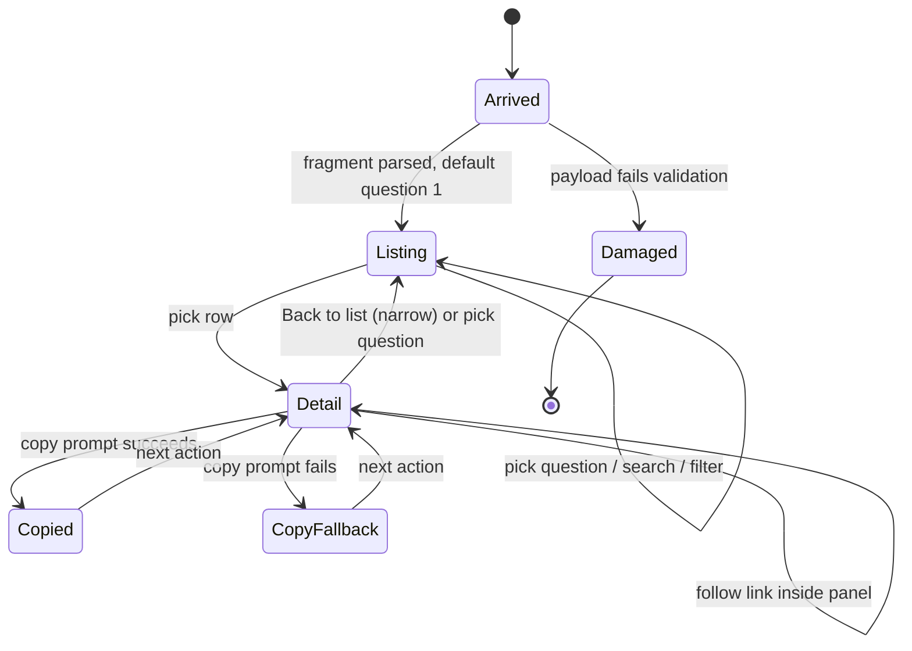

# Session-start orientation — information architecture

This note covers the exported `navigate-intents` view, redesigned so a maintainer starts a session from it. It is advisory design, not contract. The export spec owns the contract.

## Job, audience and success metric

- **Job.** At session start, decide what to work on and start it. Between sessions, look up where a piece of work sits.
- **Audience.** One maintainer, working alone, who knows the repository's vocabulary but not the current state of 169 intents, 24 briefs and 558 specs. A delivery agent reads the same facts through the bounded query, not this page.
- **Success metric.** The maintainer answers each of the four questions below from the first screen, without searching, and faster than by searching the repository. This is the de-risk kill condition.
- **Genre.** Workspace, for its session arc of arrive, orient and work, with the dense scanning of an analytical surface inside the worklist. The page is single-user and read-only, so the collaborate and persist stages reduce to "copy a prompt" and "the URL keeps my place".

## The four questions

The page is organised by the questions a maintainer brings, not by the data model. Each question is a destination with its own worklist.

| # | Question | Answers with | Size today |
| ---: | --- | --- | ---: |
| 1 | What can I work on next? | Work in a startable stage, in a fixed stage order | 20 specs and briefs |
| 2 | What is still open under this capability? | Each capability with its open work beneath | 22 capabilities |
| 3 | What has no parent? | Open items with no resolved parent, grouped by type and level | 107 items |
| 4 | What is broken? | Refused edges, dangling or mismatched pointers, delivery diagnostics | 0 refused edges today |

Question 1's 20 today are 1 Implementing spec, 4 Approved specs, 11 Executing briefs and 4 Ready briefs. Accepted intents still to decompose join the end of that list. With the readiness bridge live, the canonical sets replace this stage list.

## Ranking without inventing priority

The records hold stage, not priority, so order follows only recorded facts, and the page says what the order is.

1. **Readiness bridge live.** Question 1 lists `workspace-status`'s canonical sets in this order: active (resumable), then ready, then blocked with its finding. The first ready item is labelled "`work-loop` takes this first". That is true, because an argless `work-loop` takes the first canonical ready entry.
2. **Readiness bridge absent.** Question 1 is titled "In a startable stage" and its lead line reads "Readiness not checked in this snapshot". Nothing is called ready. Order is by stage: Implementing spec, Approved spec, Executing brief, Ready brief, then Accepted intent not yet decomposed. Ties sort by heading.
3. **Every list** names its sort key in its header, for example "By stage, then name". No list is ordered by a computed score.

## Content rank on the first screen

**Primary — the four questions.** Each appears as a labelled count with one plain line of meaning. Examples: "20 in a startable stage", "107 open with no parent", "Nothing broken". Question 1 is selected on arrival, so its worklist is already showing.

**Secondary — the worklist for the selected question.** Each row leads with the human heading. Next comes the state as a word with a shape mark, then one quiet context tag (level or type). The parent appears as a short trail, for example "under Repository work graph". The slug id is not in the row. Search still matches it, and the detail panel shows it.

**Tertiary — provenance and totals.** When the snapshot was made, what scope it covers, and the corpus totals (169 intents, 24 briefs, 558 specs). These sit in the page header's meta line and the footer, never as competing counts.

**On demand — the key.** State meanings, edge groups and trust classes open from a "Key" control beside the worklist header. They never pre-fill the detail panel.

## Detail panel: actionable first

The detail panel opens when a row is picked. It reads top-down in this order:

1. **Heading and state sentence.** One sentence built from recorded facts, for example: "Approved spec · 2 open items beneath · 1 broken pointer".
2. **Next step.** The paste-ready prompt with a copy control and a one-line reason. The rule maps recorded state to a skill:
   - a canonical ready spec, or any Approved spec when the bridge is absent → `work-loop <spec path>`, with the note "work-loop checks readiness before it starts";
   - a blocked item → the finding's own next action, with no prompt;
   - a Draft intent → `intent` in the mode its recorded progress fields imply: frame review, de-risk, or decompose;
   - a brief → `author-delivery-brief continue <brief path>`;
   - anything else → no prompt, and a plain reason why.
3. **What is open beneath.** Open descendants, grouped by type, each a link into the same panel.
4. **What is broken.** Refused or dangling pointers and delivery diagnostics, each with what it means in plain words.
5. **Where it sits.** The parent trail, as a breadcrumb to the root.
6. **Open the file.** The source link, labelled when it may be newer than the snapshot.
7. **Record details**, collapsed. Path, slug id, type, level, kind, and every edge group, using the existing labels.

When no row is picked, the panel shows a short "Pick an item to see its next step" prompt. On a wide screen it instead shows the first item in the current list, so the panel is never empty reference text.

## Navigation shape

The tree is breadth-first and flat:
- **Level 1.** The four questions, plus "Browse all" (the full intent tree) and search.
- **Level 2.** The selected list, with at most two filters relevant to that question. Question 2 filters by capability. Question 3 filters by type and level. "Browse all" keeps the level, kind and status filters.
- **Level 3.** The detail panel. Links inside it move the panel, never the list.

Search is global and always visible in the header. It matches heading and slug and returns a list in the worklist zone. The four existing views map onto this shape:
- Outstanding splits into questions 1 and 3.
- Refused edges becomes part of question 4.
- Parentless becomes question 3.
- Tree becomes "Browse all".

## Layout zones by width

Wide screens use the width; nothing is centred inside a fixed cap.

| Width | Zones |
| --- | --- |
| 2560 and 1680px | Three zones: a question rail (narrow, fixed), the worklist (fluid, row text held to a readable measure), and the detail panel (fluid, wider than the rail). Rows are single-line grids with the heading, state and context tag in aligned columns. |
| 1280px | Question rail collapses into a row of four question tabs above the worklist; worklist and detail panel share the width. |
| 320px | One column. The questions stack as four buttons, then the list. Picking a row shows the detail panel in place of the list, with a "Back to list" link that returns to the same scroll position. |

## Wayfinding

- **Where am I.** The selected question is marked in the rail or tabs. The worklist header repeats it with its count and sort key. The detail panel's breadcrumb shows where an item sits in the graph.
- **Where can I go.** The four questions are always visible, except at 320px, where they sit above the list. Search is always visible.
- **How do I get back.** All state lives in the URL fragment: question, filters, search, picked item. Browser back retraces steps, and a reload or shared link restores the same view. This is the page's last-location persistence.
- **Re-orientation on arrival.** The header line says when the snapshot was made and, with the bridge live, when readiness was checked. A stale snapshot shows its age in hours.

## States

| State | What the page shows |
| --- | --- |
| First run, empty corpus | "No intents, briefs or specs found under this root", plus how the export finds them. The four questions show 0 with that reason. |
| A question with nothing | A positive line, for example "Nothing broken" or "Every open item has a parent", never an empty box. |
| No search or filter results | What was searched, and a one-step "Clear search" control. |
| Readiness bridge absent | Question 1 titled "In a startable stage" with "Readiness not checked in this snapshot". |
| Readiness bridge failed | The same as absent, plus the failure in plain words and the command to check readiness by hand. |
| Outstanding unavailable | When the delivery resolver is incomplete, questions 1 to 3 say "Can't list open work: delivery mapping incomplete", give the reason, and leave "Browse all" working. |
| Damaged payload | One plain error naming the problem, with nothing else rendered. |
| Partial: refused pointers on an item | The item shows normally, with its broken pointers in "What is broken". |
| Loading | None: the file is static and renders at once. Lists build lazily without shifting the layout above them. |
| Copy succeeded or failed | A brief text confirmation beside the control ("Copied"), announced to assistive tech. On failure, the prompt stays selected for manual copy. |

## What this replaces in the current view

- The six-count summary strip → counts on the four questions, plus corpus totals in the meta line.
- Four data-model tabs → four question destinations and "Browse all".
- Id-first rows with repeated heading and chips → heading-first, single-line rows.
- A legend in the detail panel → a "Key" on demand.
- A field-dump detail panel → actionable order, with record details collapsed.
- A flat outstanding list → stage-ordered lists with the sort key named.
- A centred fixed-width page → width-adaptive zones checked at 320, 1280, 1680 and 2560px.

## Interaction and behaviour

Every response is instant and motionless. Every control is a native link, button, input, select or disclosure, so keyboard, focus and screen-reader behaviour come from the browser rather than from custom code. The state set comes from the shared quality floor; the table under § States places it on this surface.

### State model

Guards:
- *pick row* lands in Detail only when the item id resolves in the payload. An unknown id in the fragment shows "That item is not in this snapshot" in the panel and keeps the list.
- *copy prompt* exists only when the next-step rule produced a prompt.

### Where state lives

- The URL fragment holds the question, search text, filters and picked item.
- Picking a question or a row adds a history entry, so browser back retraces those steps.
- Typing in search or changing a filter replaces the current entry, so back does not replay keystrokes.
- A reload or a shared link restores the same view, which is the page's last-location memory.

### Questions

- The four questions and "Browse all" are links in one navigation landmark. The selected one is marked as current, both visibly and to assistive tech.
- Choosing one swaps the worklist and keeps keyboard focus on the chosen link. The worklist header updates with its count and sort key.
- At 320px they render as the same links stacked above the list.

### Worklist

- Each row is one link to that item, so Tab moves row by row and Enter picks.
- No custom arrow-key model is added. Native tab order is predictable. The longest list, 107 rows, is reached through filters and search rather than long tabbing.
- A "Skip to details" link sits at the top of the list, visible on focus.
- The picked row is marked as current. Rows render lazily below the fold, and nothing above them moves when they arrive.

### Detail panel

- **Wide and medium widths.** Picking a row updates the panel and leaves focus on the row, so the user can keep scanning. A polite announcement says "Showing <heading>".
- **Narrow width.** Picking a row replaces the list with the panel and moves focus to the panel heading. "Back to list" restores the list, its scroll position, and focus on the row that was picked.
- Links inside the panel (open beneath, parent trail, broken pointers) move the panel to the target item. They add a history entry and leave the list as it was.
- "Record details" is a native disclosure, closed by default. Its open or closed state lasts while the page is open and is not stored in the fragment.

### Next-step prompt

- The prompt is shown as visible, selectable code text, so it can always be copied by hand.
- The "Copy prompt" button writes it with the browser clipboard on that click. That is a local operation and needs no network or policy change.
- **On success:** the button reads "Copied" until the next action, and a polite announcement says "Prompt copied".
- **On failure:** the prompt text is selected, and the line beside it reads "Copy didn't work here. Press Ctrl+C or ⌘C to copy the selected prompt." This can happen when a browser refuses clipboard access to a local file.

### Search and filters

- Search is a native search field in the header. It filters as the user types, inside the existing 300 ms search budget, so no debounce is shown.
- The result count is announced politely once typing pauses, so a screen reader is not flooded.
- Escape, or the field's own clear control, empties it and restores the question's list.
- Filters are native selects with only the options that question needs. A change applies at once. An active filter shows beside the list header with a "Clear" control.

### Key

- "Key" is a native disclosure beside the worklist header, closed by default.
- It holds the state meanings, edge groups and trust classes, in the existing label set.
- It never opens on its own and never occupies the detail panel.

### Feedback and cognitive fit

- **Hick's law.** First-level choices drop from 4 tabs, 4 filters and 6 counts to 4 questions plus "Browse all". Each question shows at most two filters.
- **Fitts's law.** Every target is at least the WCAG 2.2 AA minimum size. The copy control sits next to the prompt it copies.
- **Jakob's law.** List-then-detail, back-button history and a native search field behave as on other sites.
- **Focus.** Focus is always visible. A sticky header or panel never covers it; scrolling keeps the focused row clear of sticky regions.
- **Doherty threshold.** Everything is local and synchronous, so every response is effectively immediate.

## De-risk result

- **Date:** 2026-10-12.
- **Approach:** prototype-led, because the view is a two-way door: a disposable file, cheap to change.
- **Kill condition, set before the build:** kill if, on a prototype first screen built from real export data, the owner cannot answer any one of the four questions without searching.
- **Prototype:** a throwaway page outside the repository. It was built from that day's real export payload and `workspace-status` canonical output (4 ready, 0 active, 29 blocked, 75 problems), following this note, `docs/design/direction/skill-html-views.md` and `docs/design/tokens/skill-html-views.md`. It was checked at 320, 1280, 1680 and 2560px in light and dark.
- **Verdict: survived.** The owner answered all four questions from the first screen without searching.
- **Gaps the build must close.**
  - The export payload gives specs and briefs no heading, so rows cannot lead with a name. The prototype read first-line titles from the files to stand in.
  - Some briefs' first line is a sentence rather than a title.
  - A 320px check needs a true 320px viewport. Headless Chrome on macOS enforces a wider minimum window, and the page is then cropped rather than reflowed.
- **Still open.** The intent's 4-of-6-session comparison against repository search runs on the shipped build, not on this prototype.
