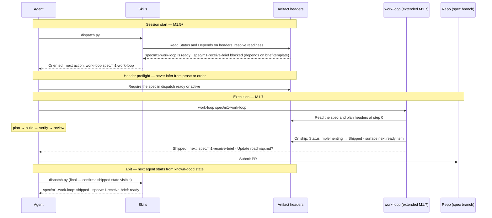

# Journey: Agent executes a spec autonomously

**Use it when:** an authorized headless session is assigned an already Approved, canonically ready or active spec and sibling plan.
**You provide:** a repository with valid artifact headers, the exact spec path, its approved plan, and the control-plane authority required for the run.
**You receive:** a shipped spec, a PR passing gates, and the spec's `Status:` set to `Shipped` so the next agent orients immediately.
**Your decisions:** None — this journey runs headless.

**Persona:** An AI agent — Claude Code, Codex CLI, Kiro CLI, or any headless harness — starting a fresh session with no persistent memory of prior sessions. The agent has no human in the execution phase, so every durable approval and dispatch input must already exist; it cannot infer authority from a ticket, comment, summary, or queue order.

**Outcome:** The spec's `Status:` is `Shipped`. A PR is submitted and passing. `dispatch.py` lists the next ready item. The next agent starting a session can orient immediately without reading any prior session's context.

**Surface:** cross-platform — runs identically across Claude Code (`claude`), Codex CLI (`codex`), Kiro CLI (`kiro`), GitHub Copilot CLI, Gemini CLI. The skill surface (`work-loop` and its `dispatch.py`) is harness-agnostic; harness-specific conventions (MCP vs static `.md`, context window limits) are adapter concerns (INI-003).

**Trigger:** A human or control plane invokes the session with one exact registered spec path after the required approval boundary is durable.

**End state:** Spec shipped. PR submitted. `Status:` moved from `Implementing` to `Shipped`. Next ready item surfaced. Session exits cleanly with committed state — the next agent picks up from a known-good position.

---

## Prerequisites

| Pack | Scope | Status | Provides |
|---|---|---|---|
| core | repo | current | `work-loop` (with `dispatch.py`), `new-spec` |
| coding CLI adapter pack | user | planned (INI-003) | Harness-specific invocation, write-back contract implementation; one adapter per harness (Claude Code, Codex CLI, Kiro, etc.) |

**One-time setup:**
1. Install core pack at repo scope.
2. Install the harness-specific coding CLI adapter pack at user scope (when INI-003 ships).
3. The supplied spec's `Status:` must be `Approved` (or `Implementing`), its `Depends on:` targets satisfied, and its sibling `plan.md` must exist and be approved.
4. Agent must have write access to the spec branch — the `Status:` edit commits with the spec PR.

**Scale:** all harness shapes (interactive Claude Code, headless CI, remote agents via INI-004) use the same write protocol: edit the spec's `Status:` header locally and commit it in the same spec PR. Adapter-specific concerns (CLI invocation, tool surface, context window) are INI-003's scope.

---

## Interaction model

---

## Stage 1: Orient

| Row | Content |
|-----|---------|
| **Actions** | Runs `dispatch.py` for the supplied path. Continues only when the spec is listed ready or active; blocked findings, and `unmigrated_workspace` while a `workspace.toml` entry remains, refuse dispatch. |
| **Failure modes** | Supplied path is ambiguous, missing its artifact/plan, unapproved, dependency-blocked, or already conflicts with active work; stale `Status:` if a prior agent did not write it back on ship. |
| **Remaining pains** | "I can see the spec is ready but I can't confirm no other agent has claimed it — atomic claiming is an INI-003 adapter concern." |

---

## Stage 2: Validate Spec Context

| Row | Content |
|-----|---------|
| **Actions** | Reads the accepted spec and sibling plan. `work-loop` binds its run to the canonical evaluation and loads any declared brief/dependency provenance. It never creates a missing contract from index prose. |
| **Failure modes** | Spec or plan is missing or no longer approved; provenance is ambiguous; prior session decisions were not committed. Each condition stops the headless attempt for human/control-plane repair. |
| **Remaining pains** | "If a prior agent made decisions mid-session that weren't committed, I have no way to see them." Partial-progress capture (gate-boundary handoff notes) is a post-M1 backlog item deferred to INI-005. |

---

## Stage 3: Plan

### Now and to-be (unchanged — work-loop already handles this)

| Row | Content |
|-----|---------|
| **Actions** | Validates the already approved plan and surfaces assumptions within its accepted scope. Missing or materially stale approval stops rather than being recreated headlessly. |
| **Emotions** | N/A. **Failure modes:** plan makes assumptions that conflict with prior decisions; spec AC is too vague to plan against. |
| **Pains** | "The spec AC doesn't tell me what 'done' looks like precisely enough — I have to make assumptions that may conflict with the reviewer's expectations." "If the plan has multiple parallel tasks, I have no way to know which can run in parallel and which must sequence." |
| **Opportunities** | Spec AC written precisely enough for an agent to plan without ambiguity; `work-loop` plan step surfaces assumptions explicitly before build starts. Already partially addressed by work-loop's plan gate. |

---

## Stage 4: Build & Verify

### Now and to-be (unchanged — work-loop already handles this)

| Row | Content |
|-----|---------|
| **Actions** | Executes plan tasks. Runs gates: lint, typecheck, tests, traceability lint. Iterates on failures. |
| **Emotions** | N/A. **Failure modes:** gate failure not diagnosed (agent retries blindly); budget exceeded (too many tokens spent on a failing gate); traceability lint fails because spec or brief is missing a marker. |
| **Pains** | "A gate fails and I retry the same approach three times before trying something different." "I don't know how much budget I've consumed or how close I am to the limit." "The traceability lint fails but the error message doesn't tell me which marker is missing where." |
| **Opportunities** | Gate failure diagnostics that name the specific cause and suggest a corrective action; budget tracking surfaced to the agent mid-execution; traceability lint error messages that name the missing marker and the file. |

---

## Stage 5: Ship & Exit

| Row | Content |
|-----|---------|
| **Actions** | Submits PR. `work-loop` moves the spec's `Status:` from `Implementing` to `Shipped` on ship; surfaces next ready item; prompts `roadmap.md` update. Exit state is committed — next agent orients in one `dispatch.py` call. |
| **Failure modes** | PR submitted but write-back skipped (agent interrupted before `work-loop` completes write-back); `roadmap.md` update skipped. Next agent should run `dispatch.py` to confirm state before starting. |
| **Remaining pains** | Partial-progress capture if the agent was interrupted mid-build (not committed). Full session continuity feeds INI-005. |

---

## Frontstage actions

- **Skill:** run-dispatch
- **Skill:** validate-spec-ready-or-active
- **Skill:** write-plan
- **Skill:** execute-plan-tasks
- **Skill:** run-gates
- **Skill:** submit-pr
- **Skill:** update-spec-status-on-ship
- **Skill:** run-dispatch-exit-state

---

## Failure mode arc (replaces emotional arc for agent persona)

Most critical failure: **Stage 1 (Orient)** — spec already claimed by another agent, or a spec `Status:` stale because a prior agent didn't write back. `dispatch.py` catches the second; atomic claiming (INI-003) closes the first.

Second most critical: **Stage 5 (Ship & Exit)** — PR submitted but `work-loop` write-back interrupted. Next agent re-picks the same spec. Mitigation: always run `dispatch.py` at session start to confirm state before claiming.

Remaining failure modes (partial-progress capture, budget tracking, gate diagnostics) are post-M1 backlog items — some feed INI-005 design.

---

## Handoff notes

**For `blueprint-service`:** backstage services include the spec headers on `main` (spec claiming — INI-003 adapter concern; write-back on ship: agent edits `Status:` locally and commits with the spec PR), spec branch (plan and build), gates (lint, typecheck, tests, traceability lint), PR submission. Atomic claiming across concurrent headless agents is an open INI-003 design question.

**For INI-003:** the headless dispatch variant of this journey (agent invoked via `claude -p` or equivalent) adds the adapter layer between Stage 1 (Orient) and Stage 2 (Validate Spec Context). The adapter consumes `dispatch.py` output rather than raw prose, formats the invocation, and handles write-back. Stages 3–5 are identical.
