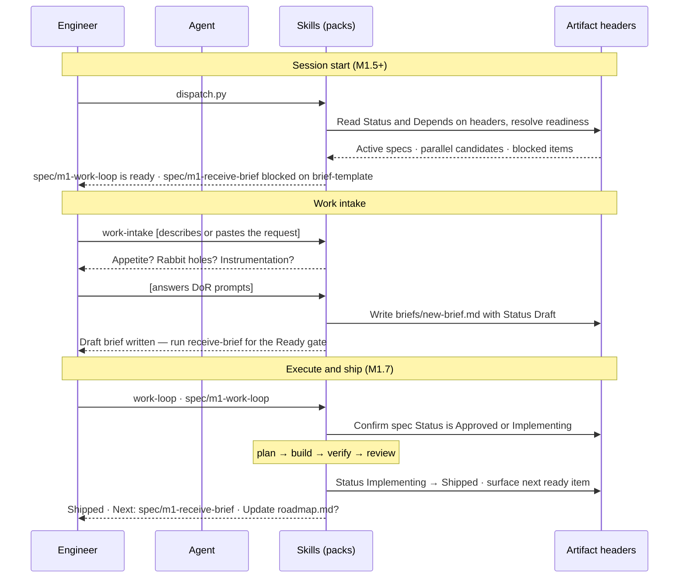

# Journey: Engineer adopts AI-native coordination

**Use it when:** your team hits the coordination gap — sessions expire, context is lost, or a second agent has no idea what the first one did.
**You provide:** your repo with core pack installed, an existing working rhythm with 1–2 agents, and willingness to keep `Status:` and `Depends on:` headers current in committed artifacts.
**You receive:** a `dispatch.py` listing any agent can cold-start from, parallel specs that execute without collision, and a team lead view that shows exceptions rather than every action.
**Your decisions:** shape and prioritise work (Stage 2); answer DoR prompts when briefing (Stage 3); approve plans and handle gate failures during execution (Stage 4).

**Persona:** A platform-oriented engineering team — internal tooling, multi-component systems, or a developer platform group — that already runs one or two AI agents but has no coordination layer. Sessions expire and context is lost. A second agent knows nothing about the first. The team has no visibility into what is in flight.

**Outcome:** Any agent can cold-start a session, run `dispatch.py`, know exactly what to work on, and the team lead only reviews what diverged. Multiple specs execute in parallel without collision. Shaping artifacts survive sessions. The team operates at Step 2 maturity reliably.

**Surface:** cross-platform — CLI/terminal, harness-agnostic.

**Trigger:** The team hits the coordination gap — session context lost, duplicate work, or a colleague joins and has no idea what is in flight.

**End state:** `dispatch.py` is the standard session-start command. Briefs flow in from any source as files with a `Status:` header. Specs are coordinated through their `Status:` and `Depends on:` headers. The team lead reviews exceptions, not every action.

---

## Prerequisites

| Pack | Scope | Status | Provides |
|---|---|---|---|
| core | repo | current | `work-intake`, `work-loop`, `new-spec`, `receive-brief`, `author-brief` |

**One-time setup:**
1. Install core pack at repo scope.
2. The specs and briefs are committed to `main` with their `Status:` and `Depends on:` headers — no branch setup needed. Run `dispatch.py` to verify.

**Scale:** the full journey (shaping + brief + build) requires all M1 ACs. If the team only needs build-room coordination (Stages 3–5), core pack + `work-loop` alone is sufficient; its `dispatch.py` adds queue visibility.

---

## Interaction model

---

## Stage 1: Install & Orient

| Row | Content |
|-----|---------|
| **Actions** | Discovers the platform. Installs agentbundle. Reads AGENTS.md. Runs `dispatch.py` — orients from the artifact headers and surfaces the next item without reading any other file. |
| **Emotions** | Curious then oriented (neutral → positive). First action is clear. |
| **Remaining pains** | "I don't understand the vocabulary — Intent vs Brief vs Spec." The vocabulary page (M6) is not yet available; the glossary in `docs/CONVENTIONS.md` is the current reference. |

---

## Stage 2: Shape Work

### Now

| Row | Content |
|-----|---------|
| **Actions** | Uses `intent frame` and `intent de-risk` to scope an initiative. Produces framing artifacts in-session. Tries to figure out when shaping is done enough to write a brief. |
| **Emotions** | Engaged but uncertain (neutral). Output lives in session context, not the repo. |
| **Pains** | "My shaping output doesn't survive the session." "I don't know when shaping is done enough to graduate to a brief." "I have no artifact I can hand to someone else." |
| **Opportunities** | Committed shaping artifacts in `docs/product/shaping/` with a visible graduation criterion (Outcome + Appetite + ≥1 Rabbit hole = ready to brief). |

> **With M2** — `frame-situation`, `place-bet`, `map-capabilities` ship: skills write committed artifacts to `docs/product/shaping/`; shaping artifacts move through the six-step sequence with write-back; graduation criterion: `author-brief` creates the brief from the bet + capability map and writes it as a Draft brief file.

---

## Stage 3: Brief & Queue

| Row | Content |
|-----|---------|
| **Actions** | Receives source material externally. Runs `work-intake`, which normalizes the bounded facts and routes a coherent multi-feature outcome to `author-brief`. The brief is written as a Draft file. `receive-brief` moves it to Ready after the human gate; specs appear only for confirmed slices. |
| **Emotions** | Efficient (positive). External input → ready specs in one flow; no manual reformatting. |
| **Remaining pains** | Tracker items still need normalized intake; automatic tracker refresh is not available yet. |

---

## Stage 4: Execute & Ship

| Row | Content |
|-----|---------|
| **Actions** | Picks up a spec from `dispatch.py`. Runs `work-loop`. Completes the spec. Submits PR. `work-loop` moves the spec's `Status:` from `Implementing` to `Shipped`; surfaces next ready item from `dispatch.py`; prompts `roadmap.md` update. |
| **Emotions** | Satisfied and oriented (positive). Spec shipped and `dispatch.py` reflects it. |
| **Remaining pains** | "`roadmap.md` update is prompted but still requires a manual PR — it is not auto-written (per CONVENTIONS)." |

---

## Stage 5: Session Continuity

| Row | Content |
|-----|---------|
| **Actions** | Session ends. New session — next day, a colleague, or a new agent. Runs `dispatch.py`. One command surfaces ready and active specs and blocked reasons. Reads the artifact headers from the local working directory (files live on `main`; consistent on any branch). |
| **Emotions** | Confident (positive). Context is committed; orientation is immediate. |
| **Remaining pains** | "An agent starting fresh still has no context about mid-session decisions that weren't committed." Partial-progress capture feeds INI-005. |

---

## Frontstage actions

- **Skill:** install-agentbundle
- **Skill:** read-agents-md
- **Skill:** intent frame
- **Skill:** intent de-risk
- **Skill:** receive-external-brief
- **Skill:** run-author-brief
- **Skill:** run-receive-brief
- **Skill:** pick-spec-from-dispatch
- **Skill:** run-work-loop
- **Skill:** submit-pr
- **Skill:** run-dispatch
- **Skill:** resume-from-session-start

---

## Emotional arc

The M1 flow — Stage 1 through Stage 5 — is now positive end-to-end. The remaining friction lives in Stage 2 (Shape Work) where M2 skills are still pending, and in Stage 3 where tracker intake (M5) is still manual.

**Remaining gap:** "My shaping output doesn't survive the session." Committed shaping artifacts (`frame-situation`, `place-bet`, `map-capabilities`) and shaping write-back are M2 scope.

---

## Handoff notes

**For `map-screen-flow`:** Stage 3 (Brief & Queue) and Stage 5 (Session Continuity) carry the highest-opportunity pains. The `author-brief` flow (external input → DoR elicitation → brief file write) and the `dispatch.py` output view are the highest-priority screen-level inputs for any future web surface.

**For `blueprint-service`:** backstage dependencies include the artifact headers on `main` (skills edit `Status:` locally and commit it in the same spec PR), `docs/product/briefs/` (brief file store), `docs/product/shaping/` (shaping artifact store), agentbundle skill loader.
