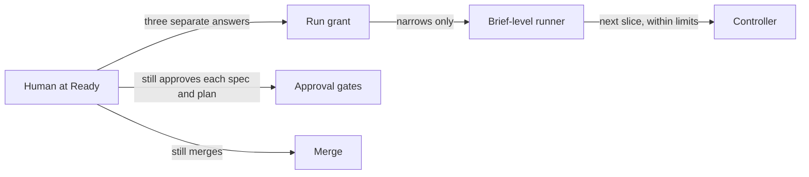

# RFC-0113: One run grant at brief Ready

- **Status:** Accepted
- **Author:** eugenelim
- **Date opened:** 2026-11-05
- **Date closed:** 2026-11-07
- **Decision weight:** heavy (it changes a published skill's confirmation flow and sets what an unattended run may do, which is an agent-authority trust model)
- **Related:** [RFC-0099](0099-cut-before-adding-and-artifact-shaping.md) (§7 keeps every spec-plan and human approval gate), [ADR-0157](../adr/0157-work-loop-approval-gates-park-instead-of-halting.md) (spec and plan approvals wait for a human and bind to exact revisions), [ADR-0150](../adr/0150-tdd-red-test-is-written-at-execute-and-mechanism-lives-in-the-plan-design.md) (names the protected classes), [ADR-0159](../adr/0159-brief-level-runner-chains-slices-from-committed-records.md) and the [brief-level-runner spec](../specs/brief-level-runner/spec.md) (a read-only runner that chains a brief's slices, shipped in core 4.0.22), [run-grant](../specs/run-grant/spec.md) (the follow-on spec D8 asks for)

## Summary

A delivery brief is a group of specs, called slices, behind one outcome; once a human confirms it Ready, a program called the brief-level runner can start its slices one after another with nobody watching. Nothing limits such a run per brief today. This RFC proposes that the human set those limits once, at Ready, and agrees the principles a follow-on spec must honour; it fixes no mechanism.

Decisions, each recommended as stated:

- **D1.** Add an optional **run grant**: a human-confirmed, committed record of per-brief limits for an unattended run.
- **D2.** The runner starts no work from any brief before its Ready confirmation, with or without a grant.
- **D3.** Ask the Ready confirmation, the confirmation of the brief's list of slices, and the grant at one stop, as separate yes/no answers. Today's path, which asks them at separate times, stays the default.
- **D4.** A grant only narrows what the run would do without one. It never widens anything.
- **D5.** A grant carries no authority. It never feeds an approval, and merge and the other human-only actions stay human. A grant may add to that list, never shorten it.
- **D6.** A grant binds to exactly what the human was shown. A brief that chose a grant does not run if its grant is missing, stale or malformed.
- **D7.** Accept and disclose three limits: a grant cannot bound an agent that can rewrite the repository's local copy of the default branch; the guard against hidden grant changes protects only where the host enforces it; and spend is enforced only as far as the host reports usage.
- **D8.** One follow-on spec, and no new ADR, settles the design, held to the properties and tests listed here; this RFC serves as the revisit ADR-0159 asks for when a run grant changes what may run without a human [4].

The decider is the repository's maintainer, eugenelim.

## Motivation

The main gap is per-brief limits. Once the runner chains slices [4], a brief's run can go on for hours with no person present. Its only bounds are repository-wide. Nothing records, per brief, when the run counts as done, how long it may run, how much it may spend, which slices it may touch, or which actions the human wants to keep. The old work-loop engine had one run-level switch, `auto_parallel`, and it had no fields, so it bounded nothing [1].

A smaller gap is the second confirmation. A brief stops for a human at Ready, then again later to confirm its list of slices, before any slice starts [6]. Both ask about the same brief. The grant depends on that list, so asking for it at the same stop costs the human little.

This affects maintainers who run a delivery brief through the runner, and adopters of core, who get the runner and this grant.

### Terms

- **Ready** is a brief's status once a human confirms it. The **slice cut** is the confirmed list of the brief's slices.
- The **shaping review** is an independent review of a brief's text before Ready. Its result, `Clean`, holds only for the exact text it read. A brief's **deciding content** is the text that review judges: its outcome, scope, slice list and other content that changes what gets built.
- **Standing orders** are one human-written file of numbered constraints per brief, passed as data to every agent the run starts [4].
- The **brief-level runner** is a read-only program that reads committed records and names the next slice to work on [4]. The **controller** is the agent that acts on its answers; **workers** are the agents the controller starts.
- The **base** is the repository's local copy of the freshly fetched default branch, which the runner reads.
- A **runnable brief** is any brief the runner would start or resume work from, whatever its status.
- **Approval gates** are the human approvals of each slice's spec and plan, which wait for a human and bind to exact file revisions [2][3].

### Goals

- A human can record per-brief limits once, at Ready.
- A grant can only make a run stop sooner or do less.
- Every spec, plan and amendment approval, and every merge, stays exactly as RFC-0099 §7 [2], ADR-0157 [3] and ADR-0159 [4] set it.
- The RFC says plainly what a grant cannot bound.

### Non-goals

- **Unattended merge.** Excluded by D5.
- **Bounding an agent that can rewrite the local base** (D7).
- **Metering spend inside the repository.** Hosts report usage differently or not at all.
- **Cross-repository briefs.** The trust model assumes one repository.
- **A design.** The follow-on spec owns every mechanism.

## Proposal

A grant flows from one human decision into limits the runner applies. It never touches the approval gates or the human-only actions.

### D1. An optional run grant

A grant records, for one brief: when it expires, when the run counts as done, which slices the run may work on, how many times a failed task may be retried, how many slices may run at once, a spend cap, and any actions the human keeps beyond the fixed human-only list. It is a committed record, because the runner reads only committed records [4]. It is optional: a brief that never chose one runs with the runner's limits alone, which this RFC calls a **no-grant run**, the baseline for D4 and for testing.

### D2. No work before Ready

The runner starts no work from any brief, with or without a grant, until a human has confirmed it Ready. Today's runner reads a brief's slice list whatever its status [5], so a `Draft` brief's slices can start without that confirmation. This applies to every brief, so it changes how briefs without a grant run too, and a no-grant run includes it. The grant path needs it, because a proposed slice list may sit in a brief before the human confirms it.

### D3. One stop, separate answers

The skill that readies a brief offers a grant path beside today's path. On the grant path, one stop asks three questions, each yes or no: is this brief Ready, is this the slice cut, and is this the grant. The shaping review's `Clean` must cover the slice cut the human confirms.

This is one stop, not one approval. ADR-0157 and ADR-0159 share a driver: no human approval is "removed, merged, or inferred" [3][4]. Ready and the slice cut are still two separate answers, and either can be "no". The only change is that the human no longer waits between them.

### D4. A grant only narrows

A grant can lower or remove what the runner would do without it, and nothing else. This is a safety argument, not a style choice. A grant is a file in the repository, so anything a grant could widen, an agent able to forge the file could widen too. Under narrow-only, a forged grant can make the run do less, never more.

### D5. A grant carries no authority

A grant never feeds an approval gate. It never approves a spec or a plan, never relaxes a review or a security control, and never turns a waiting approval into a given one [3]. These stay human whatever a grant says:

- every spec and plan approval;
- reapproval after a material change to an approved spec or plan;
- every merge;
- every irreversible operation;
- acceptance of residual risk in a protected class, which ADR-0150 defines as a security boundary, data loss or durability, a migration or persisted state, a public interface, or an irreversible operation.

A grant may add actions to this list, such as pushing or opening a pull request. It can never remove one. Merge stays human because the runner's ready-to-merge signal comes from records a worker can forge today [5], so releasing merge through a grant would let a worker trigger it. A later RFC may revisit this once the host can attest which worker wrote a record.

### D6. Bound to what the human saw, failing closed

A grant takes effect only for the exact brief and standing orders the human was shown, and only in the exact form the human confirmed. Any later change to the brief's deciding content or to the standing orders makes the grant stale. Renewing a grant, such as extending its expiry, needs a new human confirmation.

A brief that chose the grant path records that choice apart from the grant itself. Such a brief does not run if its grant is missing, stale or malformed. It does not fall back to running without limits, because the human chose to bound it. A grant takes effect only once a human has reviewed and merged the commit that brings it in.

### D7. Disclosed limits

Three limits are disclosed in this RFC and shown to the human when they confirm a grant:

- **The base-writer limit.** ADR-0159's runner spec accepts two residual risks [5]: a worker with Git access in a slice's checkout can create or rename the slices' branches, and a worker that can also write the main checkout can move the local base to its own commit. The second worker can edit or delete a grant and its grant-path record. If it removes both, the run returns to its no-grant limits; if it removes only one, D6 stops the run. Either way the cost is spend and slice order, which the runner spec already accepts, not an approval or merge. This closes only when the host can prove the base genuine, or can stop workers from writing shared Git refs.
- **A host-dependent guard.** The guard against grant changes hidden in other work (D8) protects only where the host enforces it, such as a required status check. Where it is not enforced, a reviewed pull request can still change a grant or add an unconfirmed slice to a runnable brief, and only the reviewing human catches it. The cost is again spend and slice order.
- **Partial spend enforcement.** Nothing in the repository meters spend. Spend can be enforced only as far as the host reports usage. A host may report nothing, may count within one session only, or may leave out the agents a run spawns, and the human is told which applies.

### D8. Follow-on spec

One spec designs and ships the grant. It must hold these properties, and its security review must check every one:

- **Narrow only (D4).** No input can widen a limit. A value the spec does not allow makes the grant malformed, never clamped.
- **No authority (D5).** A grant never feeds an approval gate. The human-only list, and how it is enforced, come from records a grant cannot change.
- **Data, not instructions.** Grant content reaches the controller and any agent only as checked, typed limit values, never as free text or instructions. The grant file is bounded in size and type and checked before any value in it is used.
- **Bound to what was shown (D6).** The grant written equals the grant the human confirmed, and a change to what the human was shown since they saw it stops the write.
- **Fail closed (D6).** A partial write never leaves a runnable brief. Any partial evidence that a brief chose the grant path, such as the grant-path record without a valid grant or a grant without the record, counts as a malformed grant, not as no grant.
- **No unconfirmed slices (D2).** The runner never starts work from any brief before its Ready confirmation, with or without a grant. No path through the skill or the runner leaves a runnable brief holding a slice no human confirmed; D7 discloses the route around the guard.
- **Guarded changes.** A grant change cannot ride unseen inside other work, and the guard cannot be weakened by the change it judges. A grant change is any of these: a change to a grant, a grant-path record, standing orders, or anything else the binding covers; a commit that makes a brief runnable, including a new brief committed in a runnable state; or a change to a runnable brief's slice list. Every condition under which the guard does not protect is shown to the human at confirmation.
- **Spent means stopped.** Once a limit is spent or a grant is refused, neither the runner's answers nor the controller start new, resumed or retried work for that brief, and no limit is extended without a new human confirmation. The runner's own answers enforce every limit it can work out from committed records, so those limits hold if the controller's session is lost; the controller enforces only what the runner cannot see. Silence, a timeout or a session ending never extends a limit. Work already running may finish its current task.
- **Visible to the human.** Pending approvals and merges stay visible even when a grant stops the run, and while a brief's grant state is unknown or refused, nothing is pushed or opened as a pull request without a human.

Each property needs a test that can fail, including a forged grant that tries to raise each limit, a deleted grant, a removed grant-path record, and a grant that tries to shorten the human-only list. A test pins the no-authority rule so that weakening it fails.

The spec must also settle:

- the grant's format, and exactly what the binding covers;
- which limits the runner enforces and which the controller enforces, and how the controller reads them without trusting a file a worker can edit;
- how the runner answers for a valid, spent, stale, missing or malformed grant, and which clock decides expiry;
- the guard against hidden grant changes, and where it applies;
- the changes to the skill that readies a brief, including its rule that only confirmed slices enter the slice list;
- what the human is shown at the stop;
- the trust model's entry in the security architecture;
- how the Ready-only change treats briefs already running without a Ready confirmation; any exemption is temporary, is shown to a human, and never lets a brief that was never confirmed start new work.

No new ADR is needed. ADR-0159 asks to be revisited "if a run grant changes which actions may proceed without a human" [4]. A grant changes that only by removing actions, so this RFC is the revisit and ADR-0159's decision stands. A grant that let a new action proceed without a human would need its own revisit.

## Costs and what could go wrong

- **Stakes.** The change is reversible. A grant is optional, and removing the feature returns briefs to today's two stops.
- **One stop gets less attention than two.** Each answer stays its own yes or no, and today's path stays the default. *Wrong if* grant-path briefs show more rejected or reworked slices than two-stop briefs.
- **Grant churn.** Binding to what the human saw means edits make grants stale and stop runs. *Wrong if* re-grants become routine on ordinary briefs; then the binding covers too much.
- **The base-writer limit and the host-dependent guard (D7).** Bound: the no-grant limits, so spend and slice order, never an approval or a merge. Closed by a host-attested base, a worker sandbox, and an enforced guard.
- **A faked confirmation.** The agent running the grant path records the name the person gave; it cannot verify who answered, as ADR-0157 accepted for approval records [3]. Here the result starts a whole run. Bound: a faked grant can only narrow, and a human reviews the merge that brings it in.
- **Partial spend enforcement and clock error.** Spend is enforced only as far as the host reports it, and a wrong clock can move expiry. Bound: the other limits, and never past the no-grant limits.
- **Draft briefs stop running.** The Ready-only change (D2) stops work a `Draft` brief's slices could start today. Bound: one Ready confirmation. *Wrong if* adopters rely on running slices from `Draft` briefs.
- **Failing closed stops healthy runs.** It costs time, not safety. *Wrong if* operators delete grants to keep runs moving.

## Alternatives

- **Do nothing.** No per-brief limits, and two stops. Rejected: a long unattended run keeps only repository-wide limits.
- **A grant per slice.** Rejected: it records limits but adds a stop to every slice.
- **One combined approval** for Ready, slice cut and limits. Rejected: it merges two human answers, which ADR-0157 and ADR-0159 forbid [3][4].
- **A per-run on/off switch like `auto_parallel`.** Rejected: it records no limit [1].
- **A grant that may widen limits.** Rejected by D4: a forger could widen them too.
- **Unattended merge under a grant.** Rejected by D5 until ready-to-merge signals can be trusted.

## How we will know it works

- **Hypothesis:** a grant-path run does only what a no-grant run would, and stops at its grant's limits.
- **Measure:** the follow-on spec's tests for each D8 property, then, on the first two grant-path briefs, a comparison of the runner's answers with what it would answer with no grant, noting where each run stopped.
- **Success:** every property test passes, no answer falls outside the no-grant answers, and each run stops at its first spent limit.
- **Failure:** a failing property test blocks the follow-on spec's release. On real briefs, any answer a no-grant run would not give, or a bad grant that lets work continue, triggers a fix or a rollback of the grant path.

## Open questions

1. **Which units may a spend cap use?** Default: tokens, the unit hosts most often report. Owner: eugenelim, when the follow-on spec is drafted.

## Evidence

1. `auto_parallel` was a per-run on/off grant that skipped only the human go-ahead for work that had already cleared its gates. It was "never a gate input", a failure still stopped the run, and it had no fields. Source: the `work-loop` text removed in commit `49a239a72` (core 4.0.0, PR #1651). Method: `git show 49a239a72`, reading the removed lines.
2. Every spec-plan and human approval gate stays, and approval binds to exact revisions. Source: [RFC-0099 §7](0099-cut-before-adding-and-artifact-shaping.md#7-preserve-every-spec-plan-and-human-approval-gate). Method: read.
3. A decision driver forbids removing, merging or inferring a human approval. No record turns a waiting approval into a given one. An approval record holds the name an approver gave, not a verified identity. Source: [ADR-0157](../adr/0157-work-loop-approval-gates-park-instead-of-halting.md). Method: read.
4. The runner reads only committed records, passes standing orders as data that cannot grant authority, and keeps approvals, merge and irreversible operations human. It shares ADR-0157's driver. Its "Revisit if" line reads "if a run grant changes which actions may proceed without a human". Source: [ADR-0159](../adr/0159-brief-level-runner-chains-slices-from-committed-records.md), Accepted. Method: read at commit `a242146b9`.
5. The runner's spec reads a brief's slice list without checking the brief's status. It accepts two residual risks: a worker with Git in a slice's checkout can create, delete or rename the slices' branches, which can forge a ready-to-merge signal, and a worker that can also write the main checkout can move the local base to its own commit. Both cost spend and ordering, not approval or merge. Source: the [brief-level-runner spec](../specs/brief-level-runner/spec.md), Shipped: its reading criteria AC-0003 and AC-0004 for the status fact, and its Assumptions for the two risks. Method: read at commit `a242146b9`.
6. The skill that readies a brief confirms Ready, then asks a "second, distinct human confirmation" of the slice cut, and lets only confirmed slices into the brief's slice list. Source: `packs/core/.apm/skills/author-delivery-brief/SKILL.md`. Method: read.
