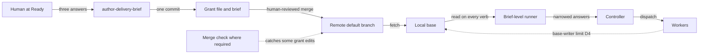

# RFC-0113: One run grant at brief Ready

- **Status:** Draft
- **Author:** eugenelim
- **Date opened:** 2026-11-05
- **Date closed:**
- **Decision weight:** heavy (it changes a published skill contract, asks two human confirmations at one stop, and sets what an unattended run may do, which is an agent-authority trust model)
- **Related:** [RFC-0099](0099-cut-before-adding-and-artifact-shaping.md) (§7 keeps every spec-plan and human approval gate), [ADR-0157](../adr/0157-work-loop-approval-gates-park-instead-of-halting.md) (spec and plan approvals wait as parked gates bound to exact digests), [ADR-0150](../adr/0150-tdd-red-test-is-written-at-execute-and-mechanism-lives-in-the-plan-design.md) (names the protected classes), [ADR-0159](../adr/0159-brief-level-runner-chains-slices-from-committed-records.md) and the [brief-level-runner spec](../specs/brief-level-runner/spec.md) (a read-only runner that chains a brief's slices; both are on an unmerged branch as of 2026-11-07, and this RFC merges after them)

## Summary

Let a human set limits, once, when a delivery brief (a group of specs, called slices) becomes Ready, for the unattended run in which ADR-0159's brief-level runner [4] starts those slices one after another. The limits live in a committed **run grant** file that the runner may only use to make the run stop sooner or do less, because nothing limits such a run per brief today. Every spec, plan and amendment approval, and every merge, stays with a human.

Decisions, each recommended as stated:

- **D1.** At one stop, ask the human three separate yes/no questions: is the brief Ready, is this list of slices right, and are these limits right. Today's path, which asks Ready and the slice list at separate times, stays the default.
- **D2.** Keep the grant in a committed file tied to the exact brief text and standing orders (the brief's written constraints) the human was shown.
- **D3.** A grant can only tighten the runner's limits, never loosen them.
- **D4.** State two limits openly, in the RFC and to the human. An agent that can rewrite the repository's local copy of the default branch can undo a grant, back to the runner's default limits. A grant change hidden in a pull request is caught only where the merge check (a CI check on grant edits) is a required check and that pull request also changes files outside `docs/`. This depends on D3.
- **D5.** The runner enforces the expiry time, which slices may run, when the run is done, retries per task, and how many slices run at once.
- **D6.** The controlling agent enforces the spend cap and any extra actions the human keeps (push, opening a pull request), by procedure, using only values the runner reports.
- **D7.** Merge and a fixed list of human-only actions stay human. A grant can add to the list but never shorten it.
- **D8.** One follow-on spec builds this. No new ADR: ADR-0159 asks to be revisited if a run grant changes what may run without a human, this RFC is that revisit, and its decision stands.

The decider is the repository's maintainer, eugenelim.

## Motivation

The main gap is per-brief limits. Once the runner chains slices [4], a brief's run can go on for hours with no person present. Its only bounds are the lease policy's retry budget and in-flight cap, which are repository-wide. Nothing records, per brief:

- when the run counts as done;
- how long it may run, or how much it may spend;
- which slices it may touch;
- what the human has kept for themselves beyond the fixed rules.

The old work-loop engine's `auto_parallel` switch, the only run-level grant, had no fields, so it could not bound anything [1]. It was removed in core 4.0.0 and nothing replaced it.

A smaller gap is the second confirmation. A brief stops for a human at Ready, then later at the slice cut, before any slice starts [6]. Both ask about the same brief revision. The grant fits best at the slice-cut stop, and asking for Ready at that same stop then adds little.

Who is affected: maintainers who run a delivery brief through the brief-level runner, and adopters of core who get the runner.

### Terms

**Briefs**

- **Core** is this project's base pack of agent skills. A **delivery brief** coordinates one outcome that takes several slices. Its **Spec map** is a table with one **row** per slice. A **slice** is one spec with its own plan.
- The `author-delivery-brief` skill moves a brief from `Draft` to `Ready` in four stages: 1 checks readiness, 2 runs the **shaping review** (an independent reviewer whose `Clean` result holds only for the exact text it read), 3 writes `Ready` after a human confirms it, and 4 asks a human to confirm the **slice cut**, the list of slices. A brief becomes `Executing` once a slice is being built. A **running brief** is one at `Ready` or `Executing`.
- A **material edit** changes the brief's outcome, scope, Spec map or other deciding content, and voids the shaping review's result.
- The **brief coverage lint** checks each Spec map row's recorded status against the spec's real status.

**The run**

- **work-loop** is core's build workflow. In its **full mode**, its path for risky change, each slice has two human approvals, `spec-approved` and `plan-approved`. ADR-0157 lets them wait as **parked gates**, each tied to a **digest** (a fingerprint of a file's contents), so an edited file cannot pass as approved. A **material amendment** is a change to an approved spec or plan that needs a fresh approval.
- The **supervisor** runs one slice's work-loop procedure and keeps its delivery records. A slice's stop is **merge-ready** when its run reports it ready to merge, and **merged** when its spec is `Shipped`.
- The **brief-level runner** (ADR-0159) is a read-only script above it. It reads committed records at the **base**, the local ref of the freshly fetched default branch that every worktree shares, and names the next slice to work on. Its **default limits** are the ones it applies with no grant. A runner call changes no file, apart from the supervisor's own security-event record keeping that brief-level-runner AC-0001 allows. Its four commands, or **verbs**, are `next` (one action, such as `start-slice`, `resume-slice`, `await-gates`, `await-merge`, `complete`, or `blocked` with a reason per row, such as `refused` when the supervisor refused the slice or `unreadable` when its records cannot be read), `status` (each row's state), `gates` (every parked gate and its state) and `classify` (what to do with a failed task: retry, split it, replace the worker, replan, or `surface-to-human`).
- The **controller** is the agent that acts on the runner's answers. A **worker** is any agent it starts to do slice work. Each slice runs in its own **slice worktree** on a branch named `brief/<brief-slug>/<spec-slug>`; the **main worktree** holds the base.
- **Standing orders** are one human-written file of numbered constraints per brief, passed to every worker (brief-level-runner AC-0015 to AC-0017).
- **Lease policy** is the supervisor's table of run limits: a retry budget per task, slices in flight at once, and each worker kind's **stuck-after runtime**, after which a worker with no visible progress is replaced (brief-level-runner AC-0018). An **AC** (acceptance criterion) is a numbered rule in a spec.
- The **protected classes** are a security boundary, data loss or durability, a migration or persisted state, a public interface, and an irreversible operation (ADR-0150).

### Goals

- A human can record per-brief limits once, at Ready.
- A grant can only make a run stop sooner or do less than the runner's default limits.
- Every spec, plan and amendment approval stays exactly as RFC-0099 §7 and ADR-0157 set it.
- A grant-path brief whose grant is missing, stale or malformed does not run.
- The RFC states which limits hold against which actor.

### Non-goals

- **Unattended merge.** The main thing an operator might want from a grant, excluded by D7.
- **Metering spend inside the repository.** Hosts report usage differently or not at all (D6).
- **Closing the base-writer limit**, where a worker rewrites the local base (D4). A file read from the base cannot do that.
- **Cross-repository briefs.** The trust model assumes one repository's base.

## Proposal

A grant flows from one human decision to the runner's answers. It reaches the remote default branch only through a human-reviewed merge, and the runner reads it from the local base on every call. D4 says what a worker able to rewrite that local copy can do, and when the merge check protects.

### D1. One stop, three distinct answers

`author-delivery-brief` continue mode offers two paths after the readiness check.

- **Two-step path (the default):** confirm Ready, then later confirm a slice cut, as today.
- **Grant path:** the skill derives the slice cut first and puts its rows in the Spec map while the brief is still `Draft`, so the shaping review covers the cut. After a `Clean`, one stop shows the human a **confirmation record** and asks three questions, each yes or no: confirm Ready for this exact revision; confirm these rows as the cut; confirm this grant (D2). The confirmation record is the text the human reads at that stop: the grant's fields, the two disclosures in D4, and D6's notes on which limits are procedure only or not enforced on this host.

The skill writes nothing until all three answers are in. It never writes a `Ready` or `Executing` brief that holds a Spec map row no human has confirmed.

| Ready | Slice cut | Grant | What the skill writes |
| --- | --- | --- | --- |
| yes | yes | yes | `Status: Ready`, a `Run grant: required` line in the brief, and the grant file, as one change |
| yes | yes | no | `Status: Ready` only; the cut is confirmed, and the runner runs with its default limits |
| yes | no | any | Nothing as `Ready`. The unconfirmed rows leave the Spec map, a material edit, so the brief needs a new shaping review and a fresh three-answer stop |
| no | any | any | Nothing. The brief stays `Draft` |

If the human declines the grant path and the `Draft` brief already holds rows, stage 3 of the two-step path asks the cut question in the same sitting, using the table above.

The runner gains one refusal: it refuses any brief whose status at the base is not `Ready` or `Executing`. A `Draft` brief's rows never run, whoever committed them. This refusal could ship on its own; the grant path needs it because the path puts rows into a `Draft` brief.

This is one stop, not one approval. ADR-0157 and ADR-0159 share a driver [3][4]: no human approval is "removed, merged, or inferred". Ready and the cut stay two distinct answers to two named questions, and either can be "no". Only the wait between the two questions is removed. No spec, plan or amendment approval is touched.

The follow-on spec amends four `author-delivery-brief` rules:

- stage 3's Ready write-back, which asks the cut question when the Spec map already holds rows;
- stage 4's "Only a confirmed slice invokes `new-spec`";
- stage 4's "a rejected or deferred cut changes neither Ready status nor the empty-capable Spec map" ("empty-capable" means a Ready brief may list no slices);
- the rule in the skill's Delivery map section, "Only confirmed specs enter the Spec map".

### D2. The grant file and its binding

The grant lives at `docs/product/run-grants/<brief-slug>.md`, beside the standing orders. The brief's `Run grant: required` line records that the brief took the grant path, so a grant must exist. The runner reads the grant file only from the base. The file holds exactly these fields:

| Field | v1 values |
| --- | --- |
| `Brief` | `brief:<slug>`, equal to the file's own slug |
| `Brief digest` | the digest of the exact brief text the shaping review found `Clean` |
| `Standing orders` | their sha256 at confirmation, or `none` |
| `Granted by`, `Granted on` | the handle the approver gave, and a date |
| `Expires` | an absolute UTC time, later than `Granted on` |
| `Exit` | `all-merge-ready`, `all-merged`, or `after:<spec-slug>` for a slug in the cut |
| `Slice cut` | Spec map row slugs, in Spec map order |
| `Retries` | 0 to the lease policy's retry budget |
| `Slices in flight` | 1 to the lease policy's in-flight cap |
| `Spend cap` | a number with a unit, or `none` |
| `Also human` | zero or more of `push`, `pr-open` |

The grammar is closed. A value outside it, including an out-of-range number or an unknown `Also human` action, makes the grant malformed rather than clamped or ignored. The runner reports only parsed values, never the file's text, and no grant text reaches an agent as an instruction.

The digest ignores the brief's `Status:` value, the `Run grant: required` line and the Spec map's Status values, which change as slices progress. Everything else in the brief, including each row's slug and order, stays covered. Any other brief edit, or any standing-orders edit, makes the grant **stale**. Changing only the grant, such as renewing `Expires`, needs one human confirmation of the new record and no fresh shaping review.

Three rules bind the grant to what the human read:

- **Refuse if changed.** The write-back refuses when the brief or standing orders differ from the digests in the confirmation record, and the grant file it writes must equal the grant the human confirmed, byte for byte.
- **One change.** `Status: Ready`, the `Run grant: required` line and the grant file are written together. The session that ran the skill commits them in one commit. A partial write-back must never leave a brief the runner will dispatch.
- **The merging human binds it.** The commit reaches the default branch only through a human-reviewed pull request. That human checks the grant file in the diff against the record they confirmed. This review, not the commit, is the final binding.

A **merge check** keeps a grant edit from riding inside slice work. It is keyed on the paths a pull request changes, never on branch names. The check's script and its CI configuration, including the setting that names it as a required check, always come from the pull request's target branch on the remote, never from the pull request, so a pull request cannot weaken its own check. It fails a pull request that carries a grant edit and also changes files outside `docs/`. Grant edits include:

- a change to a grant or standing-orders file;
- any change that moves a brief into `Ready` or `Executing` from any other status, or adds a new brief file already in one of them; a move between `Ready` and `Executing` does not count;
- a change to the rows of a running brief.

It protects only where it is a required status check. If it is not, the confirmation record warns that a grant edit could slip in through a slice pull request.

### D3. A grant only narrows

A grant is a set of limits on the runner's default behavior. It never adds anything.

| Grant state at the base | `next`, `status` | `gates` | `classify` |
| --- | --- | --- | --- |
| No `Run grant: required` line and no grant file | default | default | default |
| Valid and fresh, row inside the grant | narrowed by D5 | default | lower retry budget |
| Valid, but expired, past exit, or row outside the cut | narrowed by D5 | default | `surface-to-human`, never a retry |
| Line present, file missing, malformed or stale | refuse | default | `surface-to-human` |
| File present, line missing | refuse | default | `surface-to-human` |

`gates` never refuses on a grant problem, because the human needs the gate listing most when a run has stopped. `next` and `status` refuse, as they do for malformed standing orders (brief-level-runner AC-0016). `classify` never sends work out again once a grant limit has fired.

Removing the `Run grant: required` line does not make the grant stale, because the digest skips that line. The runner catches it through the table's "File present, line missing" row.

### D4. What a grant cannot bound

This disclosure holds only if D3 does.

If the controller and runner behave as designed, a grant's limits hold exactly as the human set them.

Against a worker that can rewrite the base, a grant bounds nothing beyond the runner's default limits. The brief-level-runner spec accepts two `Security:` residuals in its Assumptions [5]: a worker with Git in a slice worktree can create or rename `brief/*` branches, and one that can also write the main worktree's files can move the base to its own commit. Such a worker can edit or delete the grant, or remove the `Run grant: required` line. Because a grant only narrows (D3), the worst it can do is return the run to the runner's default limits. That is the spend-and-ordering risk the brief-level-runner spec already accepts, not an approval or merge risk. The gap closes only when the host can prove the base is genuine, or a sandbox stops workers from writing shared Git refs.

The confirmation record states both limits:

- "These limits hold for the controller. A worker that can rewrite this repository's default branch locally can lift them back to the runner's defaults."
- "A grant change merged inside a pull request is caught only where the grant merge check is a required status check, and only when that pull request also changes files outside `docs/`. Otherwise the reviewing human is the only check."

Later sections call this the base-writer limit. The first residual, forging a `brief/*` branch, is the branch residual.

### D5. Runner-enforced limits

The runner reads its process clock once per verb and enforces:

- **Expiry:** past `Expires`, it names no `start-slice` or `resume-slice`.
- **Slice cut:** it never names a row outside the cut.
- **Exit:** once the exit condition holds, it names no `start-slice` or `resume-slice`.
- **Retries:** `classify` uses the lower of `Retries` and the lease policy's per-task budget. `Retries` limits only that per-task budget. The supervisor also keeps a run-wide count of failed attempts, which no replan resets. A grant does not change it.
- **Slices in flight:** the cap is the lower of `Slices in flight` and the lease policy's cap.

These rules only remove `start-slice` and `resume-slice`. Pending gates and merges still reach the human through `await-gates` and `await-merge`. A row held back by a grant rule carries a grant reason when `next` answers `blocked`. If the row is also blocked for a reason that needs a human, such as `refused` or `unreadable`, the runner still shows that reason.

Running out of any limit parks the run. Work already dispatched finishes its current task, bounded by its stuck-after runtime, and is not retried. Only a new human-confirmed grant extends a limit. Silence, a timeout or a session end never does.

### D6. Controller-enforced limits

The runner never pushes, opens a pull request, or sees spend, so the controller enforces two limits by procedure. `next` and `status` report `Also human` and `Spend cap` as parsed values from the base. The controller uses only those, never a grant file in a worktree a worker can edit.

- **`Also human`:** before a push or a pull-request open, the controller stops for the human when the action is reserved. If the runner reports any grant refusal, for a brief that has the `Run grant: required` line or a grant file at the base, the controller cannot see `Also human`. It then treats every push and pull-request open as needing a human. The confirmation record says this limit is procedure only.
- **Spend:** when the host reports usage, the controller stops starting and resuming work once the run passes `Spend cap`, and tells the human. Spend counts within one session only, and host reports may leave out spawned subagents. When the host reports no usage, the confirmation record marks a numeric cap "not enforced on this host", and D5's limits are the bound.

### D7. What stays human

A grant cannot remove anything from this fixed floor. The floor lives in the skill and the runner, not in the grant file:

- every `spec-approved` and `plan-approved`, still parked and digest-bound under ADR-0157 [3];
- reapproval after a material amendment;
- every merge;
- every irreversible operation;
- acceptance of residual risk in a protected class.

`Also human` can add `push` or `pr-open`, never remove an item.

Merge stays human. ADR-0159 keeps every merge human. The runner's merge-ready stop comes from a slice worktree's own records, which a worker can forge through the branch residual (D4). Releasing merge through a grant would therefore let a worker trigger it. A later RFC may revisit this once the host can attest which worker wrote a record.

The grant is never an input to a gate. It never approves a spec or plan, never relaxes a review or security control, and never turns a parked gate into an approval. A test pins this rule beside the brief-level-runner spec's AC-0024 test, which fails if RFC-0099 §7 [2] or the repository's rule never to cut a required human approval is weakened.

### D8. Follow-on

One spec delivers the grant. It amends the brief-level-runner spec in these places:

- AC-0002 (the grant file joins what the runner reads from the base);
- AC-0003 (refuses a brief that is not `Ready` or `Executing`);
- AC-0009 (which rows `start-slice` and `resume-slice` may name, and the grant reasons);
- AC-0028 (the in-flight cap becomes the lower of the grant's and the lease policy's);
- AC-0009 and AC-0013 (`Also human`, `Spend cap` and the other grant values as named fields in `next` and `status`; this changes `next`'s answer shape, so its `schema_version` rises);
- AC-0016 and AC-0033 (a grant refusal for `next` and `status`, with its place in the refusal order AC-0033 sets beside `invalid-policy` and `invalid-standing-orders`);
- AC-0020 (`classify` answers `surface-to-human` once a grant limit fires);
- the Agent Rules: "extract only the fields named here" gains the grant fields, and the runner spec's rule that new reason codes need prior approval is met by this spec.

The same spec owns the detail this RFC leaves open:

- the file format: a closed grammar for each field, a regular UTF-8 file with a size limit and the same content rules as brief-level-runner AC-0015, which refuses anything the work-loop knowledge lint refuses in a multi-line body field, and the exact digest function with its rationale;
- the grant reasons' place in AC-0009's reason order;
- the merge check's full trigger and exemption lists, including the lifecycle edits that slice and close-out pull requests must make;
- the rollback and reconciliation rule for a failed write-back;
- the grant path and decline route in `author-delivery-brief`, with the four rules D1 lists;
- a seeded grant template under `docs/product/run-grants/`;
- tests for each D3 row, a forged grant that tries to raise each limit, a deleted grant, an `Also human` that tries to remove a floor item, and the merge check's cases. These must fail: a code pull request that moves a `Draft` brief to `Ready`, one that moves it straight to `Executing`, one that adds a brief already running, one that changes a running brief's rows, and pull requests that edit the check's script or only its invoking configuration while making a grant edit. A lifecycle-only slice pull request and a close-out pull request must pass;
- the grant and standing-orders trust model in `docs/architecture/security.md`;
- the core release.

No new ADR is needed. A grant changes which actions can proceed without a human, but only by removing some. That triggers ADR-0159's revisit clause without changing its decision, and this RFC is that revisit. A grant that let a new action proceed without a human would need its own revisit.

## Costs and what could go wrong

- **Stakes.** The change is reversible. A grant is optional, and removing the feature returns briefs to today's two stops; no stored state outside the grant files changes.
- **One stop gets less attention than two.** Each answer is its own yes or no, and the two-step path stays the default. *Wrong if* grant-path briefs show more rejected or reworked slices than two-step briefs.
- **Grant churn.** A brief or standing-orders edit stales the grant and parks the run. *Wrong if* re-grants are routine on ordinary briefs; then the digest covers too much.
- **The base-writer limit (D4).** Bound: the brief-level-runner spec's accepted spend-and-ordering risk. Closed by a base the host can prove genuine, or a sandbox that stops workers writing shared Git refs.
- **A faked confirmation.** The controller runs the grant path, and `Granted by` records only the handle the approver gave. ADR-0157 accepted the same limit for approval lines; here the result starts a whole run. Bound: a faked grant can only narrow, and it reaches the remote default branch only through a human-reviewed merge (D4 covers the local base).
- **Unconfirmed rows added outside the skill.** A docs-only pull request, or one merged where the check is not required, can add a row to a running brief without a cut answer. The runner then starts it with its default limits. Bound: spend and ordering, because the row's spec and plan approvals stay human.
- **Split product pull requests.** Readying a brief in the same pull request as changes outside `docs/` now fails the merge check, so those changes travel separately.
- **Weak spend enforcement.** It is controller-enforced, per session, and may miss subagents. The confirmation record says so on hosts that report nothing.
- **Clock skew.** A slow runner clock can extend a run past the human's expiry, never past the runner's default limits.
- **A stale grant stops a healthy run.** Failing closed costs time, not safety. *Wrong if* operators delete grants to keep runs moving.

## Alternatives

**D1 — how a brief's run is started.**

- **Do nothing:** no per-brief limits, and two stops. Rejected: it leaves a long unattended run with only repository-wide limits.
- **A grant per slice:** it records limits but adds a stop to each slice.
- **One combined approval:** a single yes for Ready, cut and limits. Rejected: it merges two human answers, which the shared ADR-0157 and ADR-0159 driver forbids.
- **A per-run on/off flag like `auto_parallel`:** records no limit.
- **One stop with distinct answers (recommended).**

**D2 — where the grant lives.** A section in the brief would make every limit change a material edit. The supervisor's local store in each worktree is uncommitted, and the runner reads only committed records. Chat leaves nothing to check. A committed file (recommended) matches the standing-orders pattern.

**D3 — narrow or widen.** Widening is rejected: under the base-writer limit (D4), a forger could widen too.

**D5 and D6 — who enforces.** A new supervisor verb is rejected: the brief-level-runner spec forbids new supervisor verbs, and ADR-0159 rejects a supervisor verb that manages a whole brief. The runner enforces every limit it can compute from committed records, because those limits still hold if the controller's session is lost.

**D7 — merge.** Merge stays human because today nothing can tell a forged merge-ready stop from a real one.

## How we will know it works

- **Hypothesis:** a grant-path run does only what a no-grant run would, and stops at its grant's limits.
- **Measure:** on the first two grant-path briefs, compare each runner answer with the no-grant answer at the same base, and note where each run stopped.
- **Success:** no runner answer outside the no-grant answers, each run stops at its first spent limit, and every stale, malformed or missing grant on a brief with the line is refused.
- **Failure:** any answer a no-grant run would not give, or a stale or missing grant that lets work continue. Either blocks the follow-on spec's release.

## Open questions

1. **Which units may `Spend cap` use?** Default: tokens, the unit hosts most often report. Owner: eugenelim, when the follow-on spec is drafted.

## Evidence

1. `auto_parallel` was a per-run on/off grant that skipped only the human go-ahead for a group of tasks that had already cleared its gates. It was "never a gate input", and a failed group still surfaced and stopped. It had no fields. Source: the `work-loop` text removed in commit `49a239a72` (core 4.0.0, PR #1651). Method: `git show 49a239a72`, reading the removed lines.
2. Every spec-plan and human approval gate stays, and approval binds to exact revisions. Source: [RFC-0099 §7](0099-cut-before-adding-and-artifact-shaping.md#7-preserve-every-spec-plan-and-human-approval-gate). Method: read.
3. Spec and plan approvals wait as parked gates. The first decision driver forbids removing, merging or inferring a human approval. No record turns a parked gate into an approval. The gate digest ignores the `Status:` value. Source: [ADR-0157](../adr/0157-work-loop-approval-gates-park-instead-of-halting.md). Method: read.
4. One decision driver is "No human approval is removed, merged, or inferred." The runner reads only committed records, standing orders cannot grant authority, and approvals, merge and irreversible operations stay human. Its "Revisit if" line reads "if a run grant changes which actions may proceed without a human". Source: [ADR-0159](../adr/0159-brief-level-runner-chains-slices-from-committed-records.md), Accepted on an unmerged branch as of 2026-11-07. Method: read at commits `d25333d4` and `7e8821ca9`, unchanged between them.
5. The runner reads the brief, specs and standing orders only from the base (AC-0002), answers `next` in a fixed action and reason order with a `schema_version` (AC-0009), reads a standing-orders file of numbered lines (AC-0015 to AC-0017), takes its lease keys from policy (AC-0018), and refuses an invalid policy in a fixed refusal order (AC-0033). Its Assumptions accept two `Security:` residuals: forgeable `brief/*` branches and a movable local base. Source: the [brief-level-runner spec](../specs/brief-level-runner/spec.md), Implementing on an unmerged branch as of 2026-11-07. Method: read at commit `7e8821ca9`.
6. `author-delivery-brief` continue mode confirms Ready at stage 3, asks a "second, distinct human confirmation" of the cut at stage 4, and treats a delivery-map change as a material edit. Its brief coverage lint fails a Spec map Status cell that differs from the spec's real status. Source: `packs/core/.apm/skills/author-delivery-brief/SKILL.md` and `packs/core/.apm/skills/author-delivery-brief/scripts/lint-brief-coverage.py`. Method: read.
