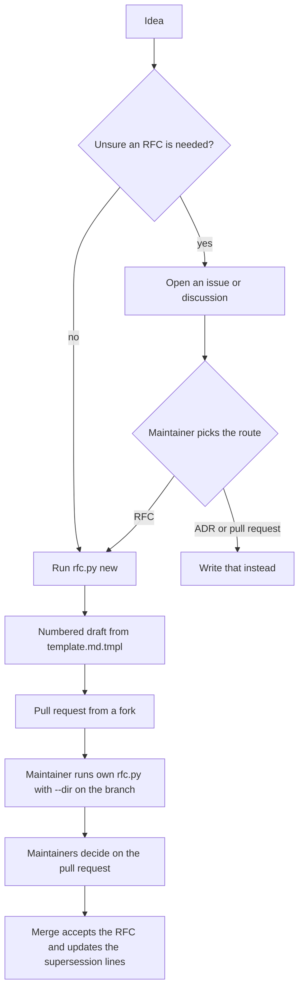

# RFC-0114: Lighter RFCs for proposers and maintainers

- **Status:** Accepted
- **Author:** eugenelim
- **Date opened:** 2026-11-06
- **Date closed:** 2026-11-06
- **Decision weight:** heavy — it reverses parts of frozen RFCs and shipped specs, and it changes a template, a skill and seeded files that adopters receive
- **Supersedes in part:** RFC-0014 D1,D2,D3; RFC-0054 D2,D3; RFC-0055 D1
- **Related:** RFC-0014 (froze the answer-first RFC template), RFC-0054 (added the Reviewer brief, the decisions table and the Decision weight field), RFC-0055 (the Errata convention), RFC-0091 (decides when an RFC is warranted and what each weight obliges), ADR-0089 (Decision weight changes how much review an RFC gets); notes: [measurements](0114-notes/measurements.md), [shipped criteria touched](0114-notes/superseded-criteria.md), [script security controls](0114-notes/security-controls.md), [skill updates](0114-notes/skill-updates.md)

## Summary

Replace the answer-first RFC template with a six-section one, and ship a script, a starter governance file and an optional discussion step, so a contributor with only a fork can propose a change and a maintainer can review it quickly. Today a typical RFC runs about 4,300 words and states its decision three times before the problem [1][2], and a visitor with no agent tooling has no way to create a numbered draft.

The decider is eugenelim, the repository's maintainer. Each decision is one claim and can be accepted or rejected on its own, with these links: D1 and D2 change the same template, D7 depends on D3 and D5, and D6 stands alone but is described in D5's starter. A **seeded file** is a file a pack copies into a repository once, at install.

- **D1:** Replace the answer-first template with six required sections: Summary, Motivation, Proposal, Costs and what could go wrong, Alternatives, and How we will know it works. Recommended: yes.
- **D2:** Drop the `Approver` field. Who decides is the repository's rule, and an RFC's Summary names the decider when the rules do not make that obvious. Recommended: yes.
- **D3:** Ship `docs/rfc/rfc.py` and `docs/rfc/template.md.tmpl` as seeded files, so anyone can create a numbered draft with the Python standard library and no agent. Recommended: yes.
- **D4:** `rfc.py check` warns when an RFC still being decided passes 5,000 words, lacks a required section, or shares a number with another file. Warnings never block unless the caller passes `--strict`. Recommended: yes.
- **D5:** Seed a starter `docs/GOVERNANCE.md` for adopters. The `new-rfc` skill never reads it. Recommended: yes.
- **D6:** Offer an optional discussion step before an RFC, through a seeded issue template. Recommended: yes.
- **D7:** Give this repository its own `docs/GOVERNANCE.md` and stop the self-host drift check from overwriting it. Recommended: yes.

The template and skill changes are reversible. Seeded files already installed in adopter repositories stay after a revert.

## Motivation

Proposing and reviewing an RFC costs more than the decision warrants. Three causes, each measured.

**RFCs are long and repeat themselves.** The median RFC is 4,275 words, 37 of 112 pass 5,000, and the longest is 15,699 [1]. The current template is 489 words with seven header fields, an opening Reviewer brief and "The ask", and a decisions table that states the decision a third time [2]. RFC-0054 added the brief and the table so a reviewer could find the decision on the first screen. The problem still starts late: after 487 words in RFC-0112, the latest accepted RFC [3].

**Shortening alone does not make a decision reviewable.** RFC-0113 reached its problem section after 1,461 of 6,508 words in one revision and 1,170 of 4,820 in the next [4]. Rewritten in the proposed template, the earlier revision is 3,073 words, and a reader who saw only the rewrite could judge two of its six decisions [5]. The rest rested on ADR numbers and internal terms the file never explained. The template therefore keeps a place for definitions: the Summary and Motivation carry them, and each cited ADR or RFC gets a phrase saying what it decides.

**A visitor cannot propose without agent tooling.** The only way to create a draft is the `new-rfc` skill, which sits in a hidden `.claude/` or `.agents/` folder. A contributor with a fork and no agent copies the template by hand and picks a number that may be taken. Other projects keep the template beside the proposals, and one ships a creation command [6].

### Goals

- A contributor with only a fork can create a valid, numbered RFC draft in one command, or by hand.
- A maintainer can state an RFC's decision from its Summary alone.
- Reviewing a typical RFC takes less reading.
- An adopter can change how it decides without fighting the skill.

### Non-goals

- Rewriting the existing RFCs. They are frozen.
- Changing when an RFC is warranted. RFC-0091's rule stays: open one when the direction is unresolved and more than one owner must agree, or when someone asks to circulate one. Charter and scope, approval and governance model, the security trust model, and breaking a published compatibility promise always take the strongest route.
- Fixing seed upgrades, which is a separate engine change.
- Seeding a `CODEOWNERS` file. No pack seeds one.
- Removing Decision weight or the skill's research and review gates.

## Proposal

The proposal has two halves: a shorter template that a maintainer reads quickly, and a path that lets a visitor reach it without an agent.



**D1. Six required sections.** Summary, Motivation (with Goals and Non-goals), Proposal, Costs and what could go wrong, Alternatives, and How we will know it works. Design details, Migration, Open questions and Evidence are optional. The Summary opens with the proposal and its reason, then lists each decision reviewers must make as its own bullet. Evidence is cited as `[n]` in the text and listed in a footnote-style Evidence section that holds facts, sources and method, without narrative. Proposal and Design details carry diagrams where a picture shows structure, flow or state more clearly than prose. Follow-on work that acceptance calls for is named at the end of Proposal. The header keeps Status, Author, Date opened, Date closed and Related, plus the existing optional Decision weight line. When an RFC replaces part or all of another, it says so in the header lines the decision graph reads (`Supersedes`, `Supersedes in part`, `Superseded by`, `Superseded in part`), with decision numbers such as `RFC-0014 D1,D3`, and the replaced RFC carries the matching line, added when the superseding RFC is accepted and not before. The graph shows a checked lineage edge only when both sides agree. The template keeps its cold-reader cue and its commented Errata/Amendments scaffold, which shipped specs require.

**D2. No Approver field.** An RFC's decider comes from the repository's rules, and the Summary names the decider when those rules do not make it obvious. A decider named inside an RFC is a suggestion. The rules, and the merge by a maintainer they name, are what accept an RFC or sign an Errata entry. The skill's completeness check changes from "Approver named" to "who decides is clear".

**D3. A script anyone can run.** `docs/rfc/rfc.py` has four commands. `next` prints the next free number. `new "Title"` writes a draft with that number from the template. `renumber FILE N` fixes a number clash. `check` reports problems. The `new-rfc` skill numbers through the same script, so there is one numbering path. It uses only the Python standard library, loads a byte-identical copy of the repository's confinement helper `file_safety.py` that is seeded beside it, and always runs as `python3 -I docs/rfc/rfc.py`, because isolated mode stops a planted file from shadowing the standard library [8]. The template sits beside it as `template.md.tmpl`, a name the index tool (`index-records.py`) skips. That tool generates `docs/rfc/README.md` from the records alone, so the README cannot carry instructions [10]. The pointers live in the script's help and the template's header, which names only the script. A contributor who cannot run Python copies the template to `XXXX-short-title.md`, and a maintainer numbers it.

**D4. Warnings, not gates.** `check` looks only at RFCs whose status is not terminal: Accepted, Rejected, Withdrawn or Experimental (the template's status list) or Superseded (the status ADRs use and the index tool displays). For the rest it warns on a word count over 5,000, a missing required section, and a number shared by two files. The count covers everything except the title and the header field lines, so prose between the header and the first section counts and so do fenced code blocks. A `NNNN-<slug>-research.md` companion is skipped by every check. 5,000 sits above the median of 4,275. 37 of the 112 existing files exceed it, and none is warned because all are decided [1]. `--strict` makes a warning exit 1, for a CI job that wants it.

**D5. A starter governance file, unread by the skill.** This pack exists to give a repository written decision rules, so it ships a starting set at install. The starter lives at `docs/GOVERNANCE.md`, next to the charter that core already seeds and whose text already links to it [12]. It holds the maintainers list, how decisions are made, a ladder for suggesting a change (an optional issue or discussion, then a pull request for routine work, an ADR for a settled decision, an RFC when the direction is open), when to write an RFC, how an RFC is decided, "one RFC proposes one change", and how to start one. Its RFC rule repeats RFC-0091's trigger and reserved list, and it has no rule that accepts a change by silence or timeout. It tells adopters that rules meant to bind AI agents belong in their project instructions, such as `AGENTS.md`, because the skill does not read this file. The `new-rfc` skill never reads or names the file in RFC mode, so the pinned rule that it never mentions the file outside governance mode stays, and an adopter can rewrite the file freely. One text serves as the seeded starter and as governance mode's default, and the spec relaxes the draft check that today requires three owned-path names. Governance mode changes in one more way: an existing governance file at any allowed location is its target, so it never creates a second file beside the seed.

**D6. Optional discussion first.** A seeded `.github/ISSUE_TEMPLATE/proposal-idea.md` lets a visitor without write access ask whether an RFC is the right route. It asks for no personal data and says a reply is not an acceptance. The starter's ladder describes the step as optional. A Discussions category is a repository setting, so install creates none. The folder is GitHub-specific. This repository already has its own `rfc.yml` issue form, which this RFC does not touch.

**D7. This repository's own governance file.** This repository has none today. Self-hosting would copy the starter, placeholder included, into `docs/GOVERNANCE.md`, and the drift check would then force the file to stay identical to the seed. The delivery therefore adds a real `docs/GOVERNANCE.md` for this repository and adds that path to `EXCLUDED_PATTERNS` in `self_host.py`, where `AGENT_RULES.md` and `docs/CHARTER.md` already sit [11]. That change and the new seed entries in `lint.py` modify the `agentbundle` package and bump its version. Self-host already excludes `docs/rfc/**` and `.github/**`, so this repository gets `rfc.py`, `file_safety.py` and the template by hand-copy, and a test keeps those three equal to the seeds. Its generated README and its own issue form stay as they are.

**Follow-on work.** One spec delivers D1 to D7 and rewrites `guides/repo-governance/how-to/new-rfc.md`, which still describes the Approver and the old receipt. One ADR supersedes the shipped-spec criteria in the [notes](0114-notes/superseded-criteria.md), and each affected spec's Status line gets a scoped pointer, as ADR-0089 did. RFC-0014, RFC-0054 and RFC-0055 carry a mirrored `Superseded in part` header line, so the decision graph shows the lineage, and an Errata entry on each names this RFC. Those lines are added only once this RFC is accepted. The security review's findings become the spec's acceptance criteria, in the [notes](0114-notes/security-controls.md), and the corrections to the `new-rfc` skill are listed in the [skill updates note](0114-notes/skill-updates.md). Fixing seed upgrades is a separate follow-on, owned by eugenelim and recorded as its own work item before this release.

## Design details

Files delivered to an adopter repository, and who owns each:

```text
docs/
  GOVERNANCE.md          starter rules (D5), adopter-owned after install
  rfc/
    README.md            index generated from the records
    rfc.py               new, renumber, check (D3)
    file_safety.py       shared confinement helper, byte-identical copy
    template.md.tmpl     six-section template, equal to the skill's asset
.github/ISSUE_TEMPLATE/
  proposal-idea.md       optional discussion step (D6)
```

**What this supersedes.**

| Earlier decision | Outcome |
| --- | --- |
| RFC-0014 D1: the answer-first spine ("The ask", the `Approver` field, a fixed section set including Evidence & prior art and Follow-on artifacts) | Superseded in part. "The ask", `Approver` and Follow-on artifacts are no longer sections. Evidence & prior art becomes the footnote-style Evidence section, and follow-on work moves to the end of Proposal. |
| RFC-0014 D2: the research-then-draft flow and its completeness checklist | Kept, except "Approver named" becomes "who decides is clear". |
| RFC-0014 D3: an optional Experiment / validation section, results routed to a spike note, and the `Experimental` status | Superseded in part. The section is now the required "How we will know it works". Spike-note routing and `Experimental` stay. |
| RFC-0054 D1: the Decision weight field | Kept. ADR-0089 already replaced its tier text. |
| RFC-0054 D2 and D3: the Reviewer brief and the decisions table | Superseded. |
| RFC-0054 D4: the guided intake step | Kept. |
| RFC-0055 D1: Errata are "Approver-signed" | Superseded in part: the merge by a maintainer the repository's rules name signs. |
| RFC-0091's recommended default to honour a stricter local policy | Kept. The policy reaches the skill through project instructions. |

The [notes](0114-notes/superseded-criteria.md) list the shipped-spec criteria that follow from these rows, and the ones the new template and guide must still satisfy.

**Template.** The proposed template is 435 words against 489 today [2]. Required sections are marked, each comment is one or two lines, and the header comments say who edits each field. The same text serves as the skill's bundled asset and as the seeded file, and a test keeps the two identical. The Author line keeps the placeholder `<account-handle>`, which an existing test pins as platform-neutral.

**Script.** The next number is one more than the highest in the folder and on the last-fetched default branches of `upstream` and `origin`, within 1 to 9999. It uses no network, so it cannot see an unmerged pull request, and two proposals can pick the same number. `check` reports the clash when it runs on the merge of the branch and main, as pull-request CI does, and `renumber` fixes it. A secure-design review of a prototype found one blocker, a file planted beside the script that runs as code unless the call uses `-I`, and several concerns [8]. They are written as controls in the [security notes](0114-notes/security-controls.md) for the spec to carry. The script reads and writes through the repository's own `file_safety.py`, which is standard-library only and already copied byte-identically into the skill's scripts. The helper has no rename or remove, so `renumber`'s checks and rollback, and the `--dir` check, stay in the script.

**Skill.** The skill calls its own byte-identical copy of `rfc.py` with `--dir` set to the repository's RFC folder, for `next` and `check`, so it numbers the same way as a visitor and works in a repository that has no seeded copy. `next-ordinal.py` stays only for ADRs. The skill still creates the file from its own template asset with its guarded steps. The changes are the preview (the Summary, not a Reviewer brief), the completeness check, the completion receipt, governance mode's target rule and the first eval. Decision weight still scales the skill's gates.

**Release.** The roster, `new-rfc`, `new-adr` and `navigate-decisions` suites pass once the version pins, the install snapshot, one phrase pin, `plugin.json` and a changelog fragment are updated [9].

## Costs and what could go wrong

- **The template may lose scannability.** RFC-0054 added the Reviewer brief because decisions were hard to find. The Summary now carries them as bullets. This is wrong if reviewers start asking for an orientation block or cannot find the decisions.
- **Seeded files do not upgrade, and the guides say they do.** `agentbundle upgrade` leaves an untouched seed at its old version, writes no companion for an edited one, and adds no new one [7]. The published guides say the opposite, so either they or the engine are wrong. Until the separate follow-on fixes it, a fix to `rfc.py` reaches fresh installs only. An existing adopter gets the new template through the skill but none of the new seeded files, unless they run `agentbundle scaffold --pack repo-governance --packs-dir <catalogue>/packs --output <repo>`, which adds the missing files and writes `.upstream` companions for the files that differ. The release note says so.
- **Reverting leaves files behind.** Seeded files already in adopter repositories stay after a revert. They are inert and can be deleted.
- **The starter may not fit a small project.** Core's charter treats a governance file as optional for projects too small to need roles or voting. The starter defaults to one maintainer deciding, so a small project carries one short page, and an adopter edits or shortens it to fit.
- **Seeded code runs on contributor-supplied folders.** The controls reduce the risk, but a maintainer who runs a contributor's own copy of the script still runs their code. The starter says not to.
- **No per-RFC record of who decided.** The decision is recorded in Status, Date closed and the merging pull request, and the governance file says who decides.
- **One script serves two callers.** The skill carries a byte-identical copy of `rfc.py`, kept equal to the seeded copy by test, so a script change is also a skill change.
- **A weak "new RFC" test.** The length warning keys on Status, so an author can switch it off by editing one line. It only warns, so the stakes are low.
- **Self-hosting needs an engine change and hand-copied files.** D7 bumps the `agentbundle` package, and a test, not self-host, keeps this repository's copies equal to the seeds.

## Alternatives

- **Do nothing.** Proposers keep copying by hand and maintainers keep reading three statements of the decision.
- **Trim the current template and keep the Reviewer brief and The ask.** It cuts length but keeps the repeated decision and the Approver field.
- **A script only.** It fixes creation and leaves the reading cost.
- **Put the script in `tools/` or a new `scripts/` folder.** `tools/` has 260 entries for maintainers, and a new top-level folder needs its own decision. A file beside the RFCs is what a visitor finds first.
- **Leave the script in the skill folder.** A visitor with no agent never sees it.
- **Keep the governance file as a skill asset and do not seed it.** The pack would then ship no baseline decision rules. Adopters who never run governance mode, and their contributors, would find nothing written.
- **Seed it at the repository root.** Governance mode would then target `docs/GOVERNANCE.md` for any adopter with core's charter and create a second file.
- **Let the skill follow the seeded governance file.** It would tie the skill to prose an adopter is free to rewrite, and it would break the pinned rule that the skill never names the file outside governance mode.
- **Add a `provisional` status for "direction agreed, details open".** It overlaps with optional discussion first and with Accepted plus a follow-on spec, and it adds a status someone must keep current.
- **Remove Decision weight.** ADR-0089 makes it the lever for gate depth, so removing it would need that ADR changed.

## How we will know it works

The next three RFCs are written in the new template. It works if their median length stays under 4,000 words, none passes 5,000 without a stated reason, and a fresh-context reader given only the Summary can state the decision. It has failed if reviewers repeatedly ask for orientation material the Summary does not give, or if RFCs keep growing past 5,000.

Tests cover the script and its controls, the seed lint, the install snapshot, equality between the skill's template and the seeded one, equality between this repository's three hand-copied files and the seeds, and equality between the skill's bundled copies of `rfc.py` and `file_safety.py` and the seeds. A fork-only contributor creating a draft with no skill is checked by hand once.

## Evidence

1. `docs/rfc/NNNN-*.md`, whitespace-separated word count of each file, excluding the title and the header field lines and including everything else: 112 files (111 RFCs and one research companion), median 4,275, mean 5,217, longest 15,699 (RFC-0053), 37 over 5,000.
2. `packs/repo-governance/.apm/skills/new-rfc/assets/rfc.md`: 489 words and seven header fields. The proposed template: 435 words. Whole-file counts.
3. `docs/rfc/0112-pack-defaults-projection-for-stdlib-readers.md`: 487 words before "Problem & goals", same counting rule as [1].
4. RFC-0113, PR #1698. Commit `659002067`: 6,508 words, 1,461 before the problem section, 765 of them a glossary. Commit `12b148b4b`: 4,820 words, 1,170 before. Same counting rule as [1].
5. RFC-0113 at `659002067` rewritten in the proposed template: 3,073 words, same counting rule. One reader given only the rewrite judged two of six decisions on their merits. One reader on one document: an indication, not proof.
6. Template beside the proposals: Kubernetes [`keps/NNNN-kep-template`](https://github.com/kubernetes/enhancements/tree/HEAD/keps/NNNN-kep-template) and [`kepctl create`](https://github.com/kubernetes/enhancements/blob/HEAD/pkg/kepctl/commands/create.go) ("Create a new KEP"); Backstage [`beps/NNNN-template`](https://github.com/backstage/backstage/tree/HEAD/beps); Kubeflow [`proposals/NNNN-template`](https://github.com/kubeflow/community/tree/HEAD/proposals); Rust [`0000-template.md`](https://github.com/rust-lang/rfcs/blob/HEAD/0000-template.md).
7. Scratch catalogue of `repo-governance` upgraded across two versions: an untouched seed stayed at the old version, an edited seed got no `.upstream` companion, a new seed was not written, `upgrade --seed <path>` returned "not in pack", and skill files behaved correctly. Contradicted by `guides/_shared/explanation/file-safety-contract.md` and `guides/_shared/reference/agentbundle.md`. `agentbundle scaffold` adds absent seeds and writes companions for those that differ.
8. Secure-design review of the prototype script: a planted `argparse.py` beside the script ran without `python3 -I` and did not run with it. Further findings are in the [security notes](0114-notes/security-controls.md).
9. Change applied to a copy of the repository: the four suites pass after updating three version pins, the install-snapshot file, one phrase pin, `plugin.json` and a changelog fragment. Three tests need git history or a remote and could not run. See the [measurements note](0114-notes/measurements.md).
10. `packs/repo-governance/.apm/skills/new-rfc/scripts/index-records.py`: regenerates `docs/rfc/README.md` from the records and removes any added prose (`--check` reports a length difference). It reads only `.md` files, so it skips `template.md.tmpl`.
11. `packages/agentbundle/agentbundle/build/self_host.py` `EXCLUDED_PATTERNS`: contains `docs/rfc/**`, `docs/adr/**`, `.github/**`, `docs/CHARTER.md` and `AGENT_RULES.md`, and not `docs/GOVERNANCE.md`.
12. `packs/core/seeds/docs/CHARTER.md` line 61 links `GOVERNANCE.md` relative to `docs/`.
