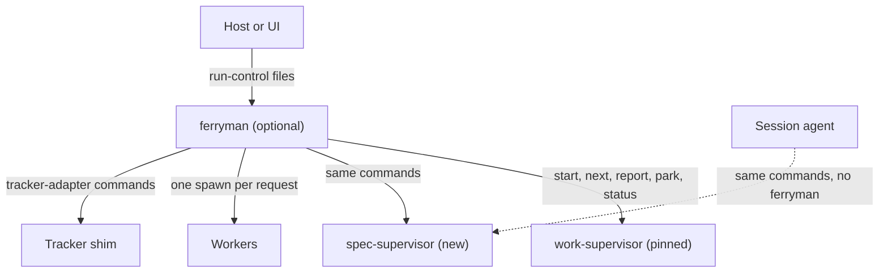

# RFC-0115: Mechanized delivery: sibling supervisors and an optional controller

- **Status:** Draft
- **Author:** eugenelim
- **Date opened:** 2026-11-08
- **Date closed:**
- **Decision weight:** heavy — it adds a command contract and a package, and it touches the work-loop, discovery-loop, tracker and control-plane owners
- **Related:** ADR-0144 (the supervisor owns procedure), ADR-0157 (approval gates park instead of halting), ADR-0159 (the brief-level runner), RFC-0113 (one run grant at brief Ready), RFC-0053 (the discovery loop and its no-engine rule); siblings RFC-0116 (the discovery supervisor) and RFC-0117 (the approval and trust model), which this RFC does not restate

## Summary

Add a second supervisor, `spec-supervisor`, beside the pinned `work-supervisor`, and ship an optional foreground program, `ferryman`, that drives supervisors without an agent session. A **supervisor** is a script that owns a loop's procedure and answers `start`, `next`, `report`, `park` and `status` as JSON. **Pinned** means the installed script's digest is recorded when a run starts, and a run refuses `supervisor-changed` if the script changes later [4]. Supervisors work in an ordinary session first, so everyday users gain mechanized spec work before any controller exists. The design is the architecture set [1], with the capability intent and three delivery briefs [2].

The decider is the repository maintainer (eugenelim). Affected owners: work-loop, discovery-loop, tracker-pack and control-plane owners. Each decision is one claim and can be accepted alone. Links: D2 depends on D1, D3 depends on D1 and D2, D4 depends on D3, D6 and on the maintainer's confirmation below, D5 to D7 depend on D3, and D8 orders D1 to D3.

- **D1:** Add `spec-supervisor` as a sibling of `work-supervisor` under one command contract, shipped inside the existing `new-spec` skill and driven by `work-loop`. The pinned script stays unedited. Recommended: yes.
- **D2:** Supervisors work in an ordinary session with the session agent as controller, and ship before any controller. This claims the `in-session` approval level and nothing more. Recommended: yes.
- **D3:** Ship `ferryman`, an optional foreground standard-library controller under `packages/`, separate from the installer. It calls supervisors only through their JSON commands, checks supervisor provenance, and committed records stay authoritative. Recommended: yes.
- **D4:** Light mode (a small change with no spec and no plan) runs as a supervisor-less `ferryman session` route. A human launches it, it never commits, a pool refuses it, and ticket text is data. Recommended: yes. The maintainer confirms that a local human launch is an explicit trusted invocation, and a follow-on change to `light-mode.md` records it.
- **D5:** Trackers get two independent one-way flows, import by human-selected bring-over and a display-only mirror whose policy RFC-0117 D5 owns. There is no continuous two-way sync, and `ferryman` creates no tickets. Recommended: yes.
- **D6:** The default worker floor is a per-profile tool allow list plus credential stripping, with an enforcement level per attempt and a probe record. A container executor kind stays a later alternative. Recommended: yes.
- **D7:** Pool support is seams and conformance tests only. A separate effort builds the control plane (the outside service that schedules runs on a pool of nodes). Recommended: yes.
- **D8:** Roll out in this order: spikes (checks of unverified premises, S0 to S3), the everyday-user phases (E0 to E3), then the controller phases (P0 onward), as three delivery briefs. Recommended: yes.

Reversal needs no migration. Removing `ferryman` and its run directories leaves every committed record valid, and each supervisor still works alone [1].

## Motivation

Intent-to-spec work runs on prose procedure today, and nothing drives it unattended. Only the work supervisor has an engine. Phases before spec approval have none, and the discovery loop chose no engine in RFC-0053 [3]. The pinned `work-supervisor` cannot absorb them: once the installed skill changes, a run in flight refuses `supervisor-changed` (the work-loop supervisor reference, section "The product ref") [4]. ADR-0144 makes that supervisor the single owner of full-mode delivery procedure, and it names no pre-approval phase [5]. Nothing calls `next` then `report` without an agent session [1].

Everyday users hit this first, because a session agent follows a long procedure from memory and loses it when its context ends. A supervisor holds the procedure in a script and the state in committed records, so a fresh session can resume.

### Goals

- A user in an ordinary session drives spec work through `spec-supervisor`, with a human at each gate.
- An optional program runs the same commands unattended and stops at every **parked gate** (an approval point where a run stops and waits for a human).
- No pinned script changes, and no committed record depends on `ferryman`.

### Non-goals

- The discovery supervisor (RFC-0116) and the approval and trust model, such as who counts as an approver (RFC-0117).
- A daemon, a run registry, or a control plane. ADR-0062 reads Charter Principle 3 ("a habit, not a tool") as barring a daemon, and holds workspace tooling to one session [1][6].

## Proposal

Supervisors carry procedure. `ferryman` carries only the mechanical half of a controller: it calls a command, starts one worker for the request, and reports the result. A worker does the judgment half.

**D1.** `spec-supervisor` sits in the existing core skill `new-spec` at repository scope, with its own `supervisor.toml`, policy file and store, and `work-loop` stays the only front door. A separate script means the pinned `work-loop` copy stays byte-identical [1][4]. A sibling shares only the command contract.

**D2.** Without `ferryman`, the session agent calls the commands itself, carries out each request, and parks at a gate. A fresh session calls `status` first and re-takes the same request id. This was driven on the real `work-supervisor`: a killed session was resumed by a fresh one in 4 of 4 resume-capable tries across three CLIs, single runs [7]. `spec-supervisor` does not exist, so this is a proxy, and the real test is the first slice of the first brief. The `in-session` level is a human answer with no identity check. D2 claims that level only, takes its approval wording from RFC-0117, and no unattended run admits on in-session evidence [8].

**D3.** `ferryman` is a foreground command the user starts. It uses the standard library only, imports no installer module, and re-derives state from committed records and `HEAD`. Its run directory holds a projection it never reads to decide. It never merges, pushes only to its own ref namespace, and starts no background process [1][9]. Two controls apply:

- Before running a repository-resident supervisor or manifest, `ferryman` compares their hashes with a release-time record and refuses on a mismatch. This is a new mechanism, and record 10's ADR designs it. The candidate artifact is the per-file SHA-256 that the install state records for each installed pack (`PackState.file_sha`, used today by drift checks) [18]. Its trust root is the state file, which the same user can write, so the comparison catches an edited supervisor and not a worker that also rewrites the record. A stronger root, such as a digest published with the catalogue release, is an open design item for record 10's ADR. A repository copy is never checked only against digests taken at its own first start.
- Argv comes from built-in descriptors only, never from repository manifest text.

The user config (`~/.ferryman/config.toml`) is part of the trusted configuration pinned per run under RFC-0117 D6, which also discloses that a same-user worker can rewrite it [17].

**D4.** `ferryman session` runs one worker for one light request, leaves an uncommitted tree and a checkpoint ref, and has no resume. A kill parks it as `session-interrupted`. `work-loop` light mode treats an explicit trusted invocation as its authority, and the maintainer confirms that a local human launch counts, so the route ships once `light-mode.md` records that [1][10]. A `--ticket` run gives a headless worker the user's authority, steered by ticket text, so it carries these requirements:

- Ticket fields are data, never instructions. The worker's prompt labels them as data, and they never fill the order's declared files or allow list.
- The run refuses an `unenforced` or `unverifiable` enforcement level, and refuses a profile that grants a shell or network tool, unless the user passes an explicit acknowledgement that is recorded, or a contained floor exists.
- The allow list is the only limit on what a local worker can do. It is not a sandbox.
- A pool refuses the route (`session-pool-refused`). A node marker is sufficient and a branch cannot disable it, and a committed `[pool]` table also refuses. Both fail closed [11].

**D5.** Import runs through `work-intake`, which a human drives per ticket. The mirror writes under the standing policy of RFC-0117 D5, and never the ticket body. Mirror comments use fixed templates only, so worker-derived text never reaches the tracker (RFC-0117 D5). A verified label vouches for who picked the ticket, not for what it says. Each flow works alone, and a ticket edited after import parks the run as `source-revision-drift`. Page 06 lists scenarios A to I, among them import-only, import plus mirror, and a repository-first team whose ideas stay out of the tracker [12].

**D6.** A launch fixes the CLI's allow list, a pinned version, a named model, null stdin and project-only settings. It strips `GH_*`, `GITHUB_TOKEN` and `SSH_AUTH_SOCK`, and Git inside the worker reads a run-owned config with `[protocol] allow = never`. That setting is an accident guard, not a security boundary: a worker can override it with `git -c` or edit the repository's own `.git/config`, and can plant hooks, `core.hooksPath` or `core.fsmonitor` that run when a human later commits. RFC-0117 D6 owns the one Git-state integrity check that catches this: a hash taken before and after each attempt, refusing the handoff if any changed [17]. Each attempt records `enforced`, `unenforced` or `unverifiable`, and a run refuses `profile-unprobed` without a probe record. The floor narrows same-user credential risk and does not remove it [13].

**D7.** The seams are an executor kind, signed commands, checkpoints and a signal relay. They have conformance tests, and no scheduler ships here [14].

**D8.** Spikes S0 to S3 are recorded first. Phases E0 to E3 follow (records, `spec-supervisor`, the discovery supervisor under RFC-0116, then routing and how-to guides), then P0 onward for `ferryman`. Three delivery briefs carry the build: everyday supervisors, local `ferryman` delivery, and authority and scale [2][15].

**Follow-on work.** RFC-0115 owns architecture records 1, 2, 3, 4, 5, 6, 9, 10, 16, 17, 19, 20 and 22; RFC-0117 owns records 7, 8, 11, 12, 13, 14, 15 and 18, and record 21 is RFC-0116 itself [15]. Acceptance calls for:

- ADRs for record 1 (foreground `ferryman` and the controller split), 2 (neutral run-state, event and control contracts), 3 (sibling supervisors and the shared command contract, claimed only here), 4 (the spec supervisor), 5 (the frontier, the set of work items ready to dispatch, in `ferryman`), 6 (worktree ownership), 9 (the tracker-adapter seam), 10 (repository copy of supervisors, detection and installer separation), 16 (concurrent attempts as a blocking verb), 17 (reconciliation with the brief-level runner and run grant), 19 (distribution channel and compatibility), 20 (configuration provenance and the first-run consent display) and 22 (the supervisor-less session route, claimed under D4).
- One spec per brief slice, with `spec-supervisor` first.
- Guide updates: one how-to per supervisor and the routing text.

## Costs and what could go wrong

- **A second supervisor to maintain.** It shares the command contract and no code with `work-supervisor`, and a pinned-script bump needs a new descriptor. A manifest test catches drift [1].
- **An optional package.** `ferryman` adds a release unit, a compatibility policy and a distribution channel, which records 19 and 20 settle [1].
- **Spike results are single runs.** Each CLI fact comes from one run on 2026-11-07. A CLI upgrade can change it, so the probe re-runs per version [7][13].
- **Untested premises.** `spec-supervisor`, parked-gate and approval flows under resume, resume after `attempt-residue` or `supervisor-changed`, and a kill during `report` are untested. Claude Code's headless login failed intermittently, so its stripped-environment result is inconclusive. Codex reviewer dispatch, GitHub event retention and actor identity are unverified [7][13].
- **Self-approval in a session.** The agent could write an approval. The ADR-0157 rule and the `no-human-answer` refusal limit it, and RFC-0117 owns the rest [1][8].
- **A same-user worker has the user's authority.** It can read home files and edit user config. The allow list, credential stripping, and RFC-0117 D6's Git-state and configuration pins narrow this and do not remove it. A container or separate user is the later alternative [13][14].

## Alternatives

- **Do nothing, keep prose procedure.** The upside is no new package and no added maintenance. The cost is a long procedure a session agent holds from memory, and no unattended path. Rejected.
- **Extend the pinned work supervisor.** The architecture alternatives table records that this needs an edit to a pinned script, which voids runs. Rejected [1][4].
- **A separate `spec-loop` skill, or the script in `work-loop/scripts/`.** The first adds a name and overlaps `work-loop`'s spec-plan mode. The second is the work supervisor's pin set, so an edit there voids runs. Neither chosen.
- **A controller first.** It delays everyday users, and it puts untested procedure under unattended runs. D2's test comes first.
- **Embed the controller in a host or UI.** The table records this as the strongest alternative: a team with no host has no unattended path, and each host reimplements the controller. The contracts stay host-neutral so a host can still adopt them [1][16].
- **A persistent daemon with a run registry.** The table records it as excluded by ADR-0062 and Charter Principle 3 until a charter decision [16].
- **An agent-only controller.** The table records that a long-lived agent session has no durable stop rule [16].
- **A container floor now.** It needs a container runtime, a VM on macOS and image builds, which conflicts with the install-nothing posture. It stays recorded for later [14].

## How we will know it works

The kill-condition test: a fresh session fails to resume a real `spec-supervisor` run from `status` alone, reaching the same request id with no lost record, in at least two of three tries across different CLIs. Failure means the supervisors need a controller, and D2's order is wrong. The proxy run on `work-supervisor` passed 4 of 4, and the same test on `spec-supervisor` is the first slice of the first brief [2][7].

Later checks per phase: refusals replay against the real supervisor, a forged-approval corpus passes, and a real spec goes Draft to plan-approved in a live session [15]. A spec for this RFC meets these acceptance criteria:

- A `git -c` fixture test passes only when the override is caught by RFC-0117 D6's Git-state hash and the handoff refuses.
- A supervisor or manifest whose hash differs from the pack's release digest never runs.
- A repository manifest naming different argv is refused or ignored, and argv comes from built-in descriptors.
- A ticket body containing instructions never changes the order's allow list or declared files.
- A `--ticket` run refuses `unenforced`, `unverifiable` and shell or network profiles without a recorded acknowledgement, and a node marker refuses a session run whatever a branch holds.
- A mirror comment comes from a fixed template.

## Evidence

[1] Architecture set `docs/architecture/unattended-delivery-runner/`: README.md, 02, 03, 03b, 04, 05, 06, 11, 13. Read for the pages cited. Statuses are Draft, last updated 2026-11-07.

[2] `docs/product/intents/CAP-0013-mechanized-delivery.md` (riskiest assumption and kill condition) and the briefs `docs/product/briefs/everyday-supervisors-delivery.md`, `ferryman-local-delivery.md` and `authority-and-scale-delivery.md`. All Draft. Read.

[3] `docs/rfc/0053-*.md` (Accepted) states the no-engine rule for the discovery loop. `docs/rfc/0116-the-discovery-supervisor.md` and `docs/rfc/0117-approval-and-the-trust-model-for-unattended-delivery.md` are sibling drafts, read to avoid contradiction.

[4] `packs/core/.apm/skills/work-loop/references/supervisor.md`, section "The product ref" and the refusals table: any run other than one eligible for `regenerate` refuses `supervisor-changed` once the installed skill differs from the pins taken at `start`. Read.

[5] `docs/adr/0144-work-loop-supervisor-owns-procedure.md` (Accepted), decision D1: the supervisor owns procedure for full-mode runs. D4 ends `spec-plan` runs after initial review. Read in full. It says nothing about pre-approval phases. ADR-0157, ADR-0159 and `docs/rfc/0113-run-grant-at-brief-ready.md` are Accepted, read for status and header.

[6] `docs/adr/0062-workspace-mcp-per-session-only-constraint.md` (Accepted), Because: Principle 3 distinguishes primitives from infrastructure, and a persistent daemon would be infrastructure. `docs/CHARTER.md` states Principle 3 as "A habit, not a tool". Read.

[7] Spike S3, architecture page 13 and page 05 note 9: the unedited pinned `work-supervisor.py` was driven by a session that was killed with a request open, and a fresh session re-took the same request id in 4 of 4 resume-capable tries (Claude Code twice, Codex, Copilot). Single runs, 2026-11-07. Two further Claude tries were not counted after harness changes. Tested, single run.

[8] Architecture page 05, sections on driving a sibling in a session and attribution in a session; RFC-0117 D1 and D2 define the levels. Design items for `spec-supervisor`, untested.

[9] Architecture README section 4 invariants and page 03. Design, untested.

[10] Architecture page 05 (session route) and page 13 note 9, and `packs/core/.apm/skills/work-loop/references/light-mode.md` as cited by page 05. The maintainer's confirmation that a local human launch counts is given in this RFC's review, and `light-mode.md` does not yet say so.

[11] Architecture page 03, pool refusal on a committed `[pool]` table or a node marker, and page 11 section on pool mode. Design. Both refusals fail closed.

[12] Architecture page 06, section "Backlog bring-over and direction", scenarios A to I.

[13] Architecture page 03b: launch facts for Claude Code 2.1.311, Copilot CLI 1.0.103, Pi 1.5.0 and Codex 0.164.0, single runs, 2026-11-07, scratch repositories. Stripped-environment test on git 2.56.0. The release-digest comparison is a new, untested mechanism.

[14] Architecture page 11, section "Alternative: container executor kind", and the node table.

[15] Architecture page 10 (record list, numbered 1 to 22) and page 13 (phases S0 to S3, E0 to E3, P0 onward). RFC-0117 Follow-on work lists its records.

[16] Architecture page 10, section 2 shapes table (rows B to E). Read.

[17] `docs/rfc/0117-approval-and-the-trust-model-for-unattended-delivery.md` D6 (trusted configuration pin and Git-state integrity) and D5 (mirror policy). Sibling draft, read.

[18] `packages/agentbundle/agentbundle/commands/_common.py`, `count_drifted_files`: compares each installed file's on-disk SHA-256 with the SHA-256 recorded in the pack's install state (`PackState.file_sha`). Method: read. Whether the catalogue carries a release digest was not checked.
