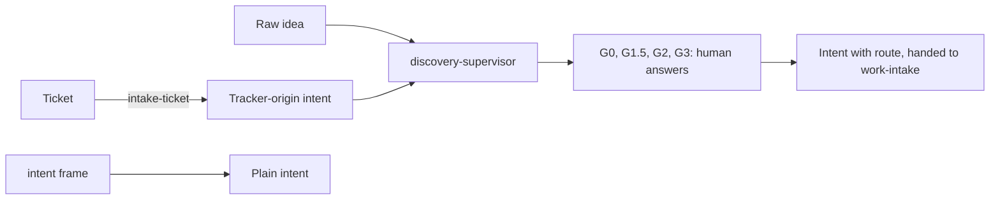

# RFC-0116: The discovery supervisor

- **Status:** Accepted
- **Author:** eugenelim
- **Date opened:** 2026-11-08
- **Date closed:** 2026-11-10
- **Decision weight:** heavy — it supersedes in part D1, the backbone decision of a heavy RFC, and adds a script to a shipped skill
- **Supersedes in part:** RFC-0053 D1 (three passages: "no new engine, scheduler, or service", "`discovery-lead` is the human-facing upstream supervisor", and "resuming them across sessions, stays the harness's job")
- **Related:** RFC-0053 (the discovery loop: the `discovery-lead` agent, the typed sidecar and the no-engine coordinator contract), RFC-0115 (the mechanized-delivery program RFC, a sibling draft that frames the unattended runner this supervisor plugs into and owns the shared command contract), RFC-0117 (the approval and trust model, a sibling draft that owns approval levels), ADR-0144 (the work-loop supervisor owns procedure and the agent keeps judgment), ADR-0157 (approval gates park for a human and bind to exact digests)

## Summary

Allow a small deterministic script, `discovery-supervisor`, to ship with the `discovery-loop` skill. It routes the loop by file state, and every judgment stays with a worker session. Today the discovery loop runs on prose alone because RFC-0053 D1 chose "no engine", so a run cannot resume from files, report its state, or take a ticket as input [1][2]. The decider is eugenelim, the repository maintainer. Affected owners are the discovery-loop owners and the work-loop owners. D1 stands alone, D2 to D4 depend on it, and D5 limits all four.

- **D1:** Allow a deterministic `discovery-supervisor` script shipped with `discovery-loop` that routes by file state while all judgment stays with a worker session. This supersedes in part three passages of RFC-0053 D1: "no new engine, scheduler, or service"; "`discovery-lead` is the human-facing upstream supervisor", a name this RFC retires; and "resuming them across sessions, stays the harness's job", which the supervisor now owns for one initiative. The typed sidecar schema stays. The agent definition and the skill text change in wording only (see Follow-on work). Recommended: yes.
- **D2:** Keep two doors into shaping. `intent frame` stays standalone and writes a plain intent. `discovery-loop` is the door for raw ideas and tickets that need shaping. The supervisor covers only initiatives that have a sidecar. Recommended: yes.
- **D3:** State lives in the initiative's own directory under the resolved discovery root (configuration, then a repository default, then discovery by marker), never in the directory the skill is installed into, in two tiers: a committed ledger (tier A), and a local durable ledger (tier B), which the supervisor writes in a plain session as under `ferryman`, the optional foreground controller from RFC-0115. `ferryman` refuses tier B in a pool and for any approval level but its terminal prompt. Approval levels are RFC-0117's. Recommended: yes.
- **D4:** Ticket intake: the supervisor's `intake-ticket` request turns a human-selected ticket into a tracker-origin intent (an intent that records its ticket as source) through the existing intake transaction (the script that commits, rolls back or reports reconciliation for one intake). In a session the human answers the `intake-confirm` consent, so no `ferryman` is needed; until the supervisor ships, a ticket becomes an intent through manual `work-intake`. Recommended: yes.
- **D5:** The supervisor is optional. It is not a dependency of the spec supervisor or of any controller phase. Recommended: yes.

Reversal removes the script and its ledgers and restores the agent and skill wording edited under Follow-on work. Reverting the script alone leaves that wording contradicting RFC-0053 again.

## Motivation

The discovery loop has no way to be driven, resumed or observed by a program. Three gaps follow from "no engine". The four human sign-off gates G0, G1.5, G2 and G3 run on prose. A **sidecar** is the typed set of working files that holds a discovery's state. A **pool** is a set of nodes an outside control plane assigns runs to. RFC-0053 gives two reasons for it: CHARTER Principle 3 ("a habit, not a tool", so the same instructions run unchanged on whatever tool an adopter uses) and a study of manager-agent thrash [1][10].

**State lives only in an agent's head and its edits.** RFC-0053 D1 ships discovery "as instructions, not software", with "no new engine, scheduler, or service" [1]. The `discovery-lead` agent holds the sidecar in one reasoning context. Its own definition says every transition is a file edit plus, at most, the connectedness lint [9]. Nothing outside that session can ask which gate is open or whether a resume is safe.

**A ticket has no path in.** The unattended-delivery design needs a human-selected tracker ticket to become an intent. Today the only route is manual `work-intake`, and a headless worker has no human to confirm the destination [2][4].

**The delivery side already shows the pattern.** The work-loop supervisor owns procedure as a script and leaves judgment to the agent (ADR-0144). Its approval gates park until a human answers (ADR-0157). Its decision section makes that supervisor the single owner of delivery procedure and runs it from the installed skill directory on the Python standard library alone, and ADR-0157 D4 lets only `approve` from the gate's named human advance a gate [5]. A resume test on that real supervisor, as a proxy because no discovery supervisor exists, re-took the same request id with no gap, duplicate or lost report in 4 of 4 resume-capable tries across three CLIs, single runs [6].

### Non-goals

- Changing the agent's role, the skill's gates, the verdict set or the sidecar schema. Only the wording that says "no engine" changes, in the skill and the agent definition.
- Making discovery mandatory, or the single route to an intent.
- A controller. The supervisor works in a live session without one.

## Proposal

The supervisor is a script with the same command contract as the other supervisors in the design (`start`, `next`, `report`, `status`, `park`, `gates`) [2]. It reads the sidecar's slot statuses, the verdict rows and the connectedness lint, and returns the next request. A worker session does the work. A human answers each consent gate, a stop that only a typed human verdict clears.

**D1. A deterministic router.** The script decides only from files: which slot is missing, which lint failed, which verdict is recorded. It never writes a verdict, approves a gate or edits a slot. A worker writes slots, and the supervisor checks the result (slot present, status `proposed`, lints green) [2]. RFC-0053's thrash finding concerns manager agents that choose the next step by reasoning [1]. A router that chooses by file state makes no such choice, but that has not been tested against the finding, and no evidence here shows it avoids thrash.

Principle 3 is honoured on three counts. The script is text the host runs when the session calls it, and no host runs it as a service or scheduler. It runs from the installed skill directory on the Python standard library alone, as the work supervisor does (ADR-0144 D2) [5]. D5 keeps it optional, so a host that cannot run it keeps the prose loop. The cost is accepted openly: "runs unchanged on whatever tool" narrows to "on any host that can run a standard-library script, and in prose elsewhere".

The names stay apart. `discovery-lead` is the agent, a worker role that holds the sidecar and exercises judgment. `discovery-supervisor` is the script that routes by file state. The agent definition stops calling itself the upstream discovery supervisor.

**D2. Two doors.** `intent frame`, `de-risk` and `decompose` stay in the intent skill with progress in the intent's headers and no supervisor. `discovery-loop` is the door for raw ideas and tickets that need shaping, and `start --adopt <intent-ref>` opts a committed intent in by creating its sidecar [2]. The supervisor never runs for an intent with no sidecar.

**D3. State in the initiative's directory, in two tiers.** The directory sits under the resolved discovery root: the `[discovery] output_dir` configuration, then `docs/discovery/` in a repository or `.context/discovery/` outside one, then discovery by marker [4][7]. Tier A is a Git-tracked directory with a committed `ledger.jsonl`; state derives from committed records and survives machine loss, and a pool may use it. Tier B lives at `.context/discovery/` and is a local ledger written append-only with `fsync` and a hash chain, so a torn write is detectable; it survives restarts on one machine only. The tier follows the directory: a Git-tracked directory is tier A and an untracked one such as `.context/discovery/` is tier B. In a repository the default root is `docs/discovery/`, so a repository run is tier A unless `[discovery] output_dir` names an untracked directory. Outside Git the default root is `.context/discovery/`, so the run is tier B. The architecture pages state the root order and the two tiers, and this rule is the RFC's proposal for how they combine [3][7]. The supervisor always writes the ledger of its tier, in a plain session as under `ferryman`, so tier B's hash-chained ledger is written in a session too. Resume, and the adopt handover that rewrites nothing, work the same way in both. The tier B refusals stay `ferryman`'s: a pool (`local-tier-pool-refused`), any approval level other than `session-attested` (`local-tier-level-refused`) and a ledger whose hash chain breaks before its tail (`local-ledger-corrupt`) [3]. In a session nothing enforces them, and the approval-fields contract does not apply. A session answer is the `in-session` level, a human answer with no identity check, and is not recorded as that level, because `in-session` is not a value in the attribution record [2]. The `answer` command needs a controlling terminal (`no-tty` otherwise), and its record states that the identity was not verified: a name, not a check. RFC-0117 owns the levels.

**D4. Ticket intake.** The `intake-ticket` request returns a normalized intake envelope. The supervisor, not the worker, assigns the intent ordinal and runs the existing `intake_transaction.py`, which commits, rolls back or reports that reconciliation is required. Destination, authority mode and a per-day cap come from the `[intake]` configuration, which sits in `ferryman.toml` and is pinned per run, so a worker cannot widen it. When `[intake]` is absent or `allow` is false, the request becomes a consent gate, `intake-confirm` (a gate only a human answers), that a human answers for that ticket only. The answer passes the same validation as `[intake]`, a closed candidate destination and the allowed authority set, and ticket-derived values are never offered as defaults. `intake-confirm` works in a session without `ferryman`: the human answers it with the destination and authority mode on a controlling terminal, at the `in-session` level, and the supervisor validates the answer as it does `[intake]`. A session reads no `[intake]` section, so pre-authorizing intake (`allow = true`) needs `ferryman`. G0 to G3 consent stays usable in a session at the `in-session` level. The discovery directory is created in a second commit, so a crash between the two commits has a named recovery [2][4]. Before the supervisor ships, a person runs `work-intake` by hand [8].

**D5. Optional.** The spec supervisor and every controller phase run without it. A discovery-free repository is unchanged [4].

**Follow-on work.** A supervisor spec; the `discovery-loop` skill text change that drops "no engine" and names the script; and the `discovery-lead` agent definition edit that drops "No engine" and "the upstream discovery supervisor". The shared command contract is RFC-0115's to record.

## Costs and what could go wrong

- **A second engine, against RFC-0053's reasons.** Accepting D1 narrows the portability of Principle 3, as D1 states. The limit is the router rule: no judgment, no verdict, no slot edit in the script. A review of the spec rejects any branch that needs reasoning. The thrash finding concerns reasoning managers, and no test has run a file-state router against it [1].
- **Tier B guarantees are weaker.** Its ledger is lost on machine loss, a clone deletion or a node change, and a same-user process can rewrite it whole [3]. Limits under `ferryman`: terminal approvals only, no pool, and the discovery restarts from the committed intent, if one exists, when the ledger is gone. A raw-idea discovery has no committed intent and starts over [3].
- **Nothing is built and nothing is tested for discovery.** The 4 of 4 resume result is a proxy on another supervisor [6]. The claim that discovery resumes the same way is an assumption until the fixtures run.
- **Drift between sidecar and ledger.** In tier B, state derives from the sidecar and the local ledger together [2]. A mismatch refuses and never picks a winner, so the supervisor fails closed (acceptance criterion 4).
- **Trust boundaries.** A tracker ticket is untrusted input to `intake-ticket`. The destination, authority mode and cap come from pinned configuration and not from the ticket, and a human answers the consent gate when that configuration is absent [2]. A worker could forge a slot status or a verdict row that the router trusts. Page 05 says the supervisor accepts a worker's request when the slot file is present, its status is `proposed` and the lints are green, and it runs the connectedness lint itself; acceptance criterion 2 adds the schema, size and answer-record checks [2]. A verdict row at a consent gate counts only as a human's typed answer, and RFC-0117 owns that rule. Tier B's hash chain detects a torn or mid-edited ledger and not a full rewrite by a same-user process [3]. One spec-stage `security-reviewer` pass ran on this RFC, and its findings are acceptance criteria 1 to 6 below. They are design targets, not built, and this RFC does not claim a clean pass [11].
- **Maintenance.** One more script to version and pin beside `discovery-loop`.

## Alternatives

- **Do nothing: prose coordination only.** Zero cost, but no resume, no status and no ticket route. Rejected for those three gaps.
- **A single mandatory door through `discovery-loop`.** One path, but every intent pays for a sidecar, and `intent frame` becomes its first step. Rejected on the assumption that most intents need no sidecar; no count of intents backs it.
- **Fold discovery into the spec supervisor.** One script, but a spec supervisor then cannot be installed or tested without discovery, and the two have different gates and request kinds. Rejected.

## How we will know it works

Discovery fixtures pass in the supervisor's test suite. A discovery then runs G0 to G3 in a live session, with a human answering each gate, and resumes after the session's context is lost, taking the same request again with no duplicate and no lost report. Failure: a resume needs a controller, or a sidecar and ledger mismatch picks a winner instead of refusing.

The supervisor spec meets these requirements, each an acceptance criterion with a refusal test. They are design targets, not built [11]:

1. **Confined discovery.** Discover-by-marker is read-only, and any ambiguity refuses. Every read and write goes through the confinement helpers under the resolved root (page 02 shows `ferryman` carries its own copy because it imports no `agentbundle`), refusing symlinks and non-regular files. The `<intent-slug>` matches a strict pattern. The discovery layout file, `agentbundle-layout.toml`, joins the pinned trusted set (page 05b, RFC-0117 D6).
2. **Validated slots.** Each slot is validated against the sidecar schema with a size limit, and the supervisor runs the connectedness lint from its pinned copy. A verdict row is ignored unless an answer record with a matching digest exists.
3. **Pinned scripts.** `start` records the digests of the supervisor script and of the scripts it calls from another pack, the intake transaction and the ordinal allocator, and checks them against the install state's per-file record. The copy that runs is the one installed with the `core` pack at repository scope, which `work-intake` also runs (an assumption the spec confirms). `next` and `report` refuse on a change.
4. **Fail closed on drift.** A sidecar and ledger mismatch refuses and never picks a winner. This settles the drift assumption.
5. **Bounded intake.** The intake envelope has a schema with field-length limits, and the intent body from a ticket is marked untrusted. The `max_per_day` counter lives in a store workers cannot write.
6. **Honest answer records.** Every answer record states that the identity was not verified.

## Evidence

No external prior art was used. Every item cites a file in this repository, and item 1 quotes an outside figure as RFC-0053 states it.

1. RFC-0053 D1 reads "Ship the discovery process as instructions, not software … with no new engine, scheduler, or service", and its Reviewer brief gives two reasons: CHARTER Principle 3 and a 2025 study of coordinator-engine failure rates (41 to 86 percent), a figure quoted from RFC-0053 and not checked against the original paper. Source: `docs/rfc/0053-the-discovery-loop.md`, decisions table and Reviewer brief. Method: read.
2. The supervisor set, discovery doors, request kinds and ticket intake. Source: `docs/architecture/unattended-delivery-runner/05-supervisors-and-gates.md`, sections "Discovery doors (D3)", "Discovery shape" and "Intake from a ticket". Method: read. The page is design, not shipped behaviour.
3. Tiers A and B, their refusals and limits. Source: `docs/architecture/unattended-delivery-runner/03c-run-chain-locks-and-process-boundary.md`, "Supervision tiers (D9)". Method: read.
4. Owner decisions D3, D5, D9 (`10c-review-decisions.md`) and D16, D64 (`10d-folded-decisions-and-defaults.md`) in the same directory. D5 there says a new RFC supersedes RFC-0053's no-engine constraint in part. Method: read.
5. ADR-0144 and ADR-0157, both Accepted. ADR-0144's decision and D2 make a supervisor inside `work-loop` the single owner of delivery procedure and run it on the Python standard library alone from the installed skill directory. ADR-0157 D4 lets only `approve` from the gate's named human advance a gate. Source: `docs/adr/0144-work-loop-supervisor-owns-procedure.md`, `docs/adr/0157-work-loop-approval-gates-park-instead-of-halting.md`, Decision sections. Method: read.
6. Resume test, tested, single run each: a session agent drove the unedited pinned `work-supervisor.py`, was killed with a request open, and a fresh session re-took the same request id in 4 of 4 resume-capable tries (Claude Code twice, Codex, Copilot). Source: footnote 9 of `docs/architecture/unattended-delivery-runner/05-supervisors-and-gates.md`. Method: read. A proxy, because the discovery supervisor does not exist.
7. The `[discovery] output_dir` key and its default. Source: `packs/product-engineering/.apm/skills/discovery-loop/references/agentbundle-layout.md`. Method: read.
8. A tracker candidate reaches an intent through manual `work-intake` before the supervisor ships. Source: `docs/architecture/unattended-delivery-runner/04-frontier-and-waves.md`, `shape-intent` rows. Method: read.
9. The `discovery-lead` agent definition states "No engine: every transition is a file edit on the sidecar plus, at most, the connectedness lint". Source: `packs/product-engineering/.apm/agents/discovery-lead.md`. Method: read.
10. CHARTER Principle 3 reads "A habit, not a tool. Captures a way of working, not a piece of infrastructure." Source: `docs/CHARTER.md`. Method: read.
11. A spec-stage secure-design pass by the `security-reviewer`, one pass, on this RFC. Its findings are acceptance criteria 1 to 6 under "How we will know it works". Method: reviewed. Not a clean pass, and not built.

## Errata

This RFC is Accepted: the body above is preserved as the original decision
record. Corrections are appended here, signed by the merge of a maintainer the repository's rules name.

- **2026-11-10 — Owner groups.** The body names separate owner groups (work-loop, discovery-loop, tracker-pack, control-plane, run-grant) as affected, as owners of slices, or as recipients of a request. The repository owner, eugenelim, holds each of those roles, so no separate group reviews, owns or is asked. Read each such phrase as the repository owner. The requested wording of the run-grant push exclusion is a change the repository owner makes to RFC-0113 and spec `run-grant`.
