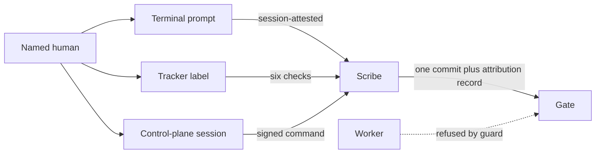

# RFC-0117: Approval and the trust model for unattended delivery

- **Status:** Draft
- **Author:** eugenelim
- **Date opened:** 2026-11-08
- **Date closed:**
- **Decision weight:** heavy (a security trust model: who may approve a gate, by what evidence, and what a worker, a tracker and a control plane may do)
- **Related:** [ADR-0157](../adr/0157-work-loop-approval-gates-park-instead-of-halting.md) (approvals wait for a named human, D4 limits what advances a gate), [RFC-0113](0113-run-grant-at-brief-ready.md) (a run grant carries no authority, D5), [ADR-0159](../adr/0159-brief-level-runner-chains-slices-from-committed-records.md) (the read-only brief-level runner keeps approvals human), [RFC-0115](0115-mechanized-delivery.md) (the mechanized-delivery program, a sibling draft), [RFC-0116](0116-the-discovery-supervisor.md) (the discovery supervisor, a sibling draft that owns gates G0 to G3)

## Summary

Unattended delivery, where a program called `ferryman` (the foreground controller of the unattended-delivery-runner architecture set [1]) drives agents through spec and plan gates with nobody watching, needs a rule for who may approve a gate and by what evidence. Today only `approve` from the gate's named human advances a gate (ADR-0157 D4 [2]), and the only evidence is a typed name. This RFC names four approval levels plus an advisory `in-session` answer, fixes what is never an approval, and sets trust boundaries that keep a worker, a tracker and a control plane (an outside service that assigns work to agent nodes) from approving by accident or forgery. Every level beyond the first needs a superseding ADR, the common gate named under Proposal.

Decisions, each recommended as stated. D2 governs the rest: every level only proves one named human's answer.

- **D1.** Name four levels, `session-attested`, `host-attested`, `tracker-verified` and `control-plane-signed`, plus an advisory `in-session` answer. `ferryman` v1 accepts only `session-attested`. Recommended: yes. Stands alone.
- **D2.** An approval is only a verified named human's answer bound to the exact gate digest. A worker, tracker text, an unverified actor's label and a controller default are never approvals. A model judge or an unverified rejection only parks the gate (new here). Recommended: yes. Governs D3 to D5.
- **D3.** A verified tracker label approves one gate only when the repository enables that gate by name, off by default, after six checks. Recommended: yes. Needs D1, D2, D6.
- **D4.** Signed commands from a control plane are verified by public key through `ssh-keygen -Y verify`, with signer principals from committed configuration (page 01 D68), never from the signed file. The control plane re-checks every relayed tracker signal. Recommended: yes. Needs D1, D2, D6.
- **D5.** A bounded standing mirror policy, `[authorization.mirror]`, writes only display status, comments, trace links and pull-request links, from fixed templates, never closure, ticket fields or authority labels. Recommended: yes. Needs D6.
- **D6.** The trusted configuration, every file that decides who may approve or what the supervisors enforce, is pinned per run, and a change refuses. Decides the pin part of architecture record 12. Recommended: yes. Stands alone.
- **D7.** In a pool (a set of remote agent nodes), controller and agent run in separate sandboxes, and the control plane alone pushes checkpoints, so no node holds a checkpoint credential. Recommended: yes. Needs D4.

The decider is the repository maintainer, eugenelim. Affected owners: work-loop, tracker-pack and control-plane owners. The only external source was the OpenBSD `ssh-keygen(1)` manual page [13].

## Motivation

The gap is evidence. ADR-0157 D4 bars every default, timeout, stale record and flag, and its approval entry holds the handle an approver gave, not a checked identity [2]. That suffices while an attached human types the answer. It does not once an answer can arrive from a ticket label, a signed command from a service, or a prompt a worker could imitate. The architecture set designs those channels [4][5], and its pool and tracker phases wait on records for this rule [10]. Tracker content is today never authorization evidence under `work-intake` [11], so the tracker route needs a bounded exception.

Goals: a named human is the only source of an approval at every level, each level names its proof, a forged or stale signal parks a gate, and each level can be switched off per gate. Non-goals: merge, which stays human (RFC-0113 D5, ADR-0159 [3]); control-plane internals (key custody, user authentication, scheduling); verifying a typed identity in an ordinary session.

## Proposal

A gate accepts only the levels its repository lists. The default is `session-attested` alone [5].

The **scribe** is the one non-supervisor committer in `ferryman`. The **guard** refuses any attempt in which a worker edited an approval field, a protected file or Git state [5]. The **gate digest** is the canonical contract digest of the artifact under approval (ADR-0157 D5 [2]). The **common gate** for levels 2 to 4 is architecture record 18, a superseding ADR that narrows ADR-0157 D4 in part: a recorded answer carrying a verified named-human approve through an enumerated channel counts, and every other D4 bar stands [5]. D3 also needs record 8 (tracker approval), and D4 needs records 13 and 15 (signed commands, relayed signals). The follow-on updates architecture pages that differ.

### D1. Approval levels

1. `session-attested`: `ferryman`'s own terminal prompt. The actor is the Git `user.email` matched against a committed identity table [5].
2. `host-attested`: a control command where the host vouches for the actor.
3. `tracker-verified`: a tracker event `ferryman` itself checked (D3).
4. `control-plane-signed`: a command signed by the control plane's key (D4). A relayed tracker signal is recorded at this level with its evidence [5].

`in-session` is a level only on page 05, not a value in the attribution record: a human answer in an ordinary session with no identity check [6]. It never appears in an accept list, and an unattended run records it as advisory only. A repository lists any subset of the four per gate.

### D2. What an approval is

An approval is a verified named human's answer bound to the exact gate digest. Four refusals follow:

- A changed digest refuses `stale-digest`.
- A worker is never an approver. The guard corpus covers approval edits, trusted-file edits, Git-state edits, returned patches, the control channel and the session route [5].
- Tracker text, an unverified, bot or app actor's label, and a controller default are never approvals.
- A model judge or an unverified rejection or `changes-requested` only parks the gate, because the revert writes the repository [4]. A scribe rejection needs a verified human. The judge rule is new here.

A loosening signal needs a verified identity. A tightening signal (`hold`, drift, an unverified `changes-requested`) needs none, because a false pause costs time and a false approval costs trust [4].

### D3. Tracker-verified approval

A label such as `approve:spec` counts for one gate only when `ferryman.toml` lists `tracker-verified` for that gate. The verifier accepts only when all six checks pass [4]:

1. The label names the current parked gate.
2. The latest event for it is `labeled`, with no later `unlabeled`.
3. The event is later than the prompt comment.
4. The actor resolves through a committed identity table to the gate's approvers, with kind `user`.
5. The gate digest equals the digest in the prompt.
6. A fresh read just before the scribe write still shows the label.

A comment never counts: page 06 treats a reply as untrusted data (`untrusted-reply`) [4]. Requirements for the follow-on spec:

- Only `labeled` events from an actor with a numeric id count. Page 06 allows a `login` fallback; this RFC refuses without a numeric id, so a renamed account cannot pass.
- The verifier refuses an event whose actor is the mirror or poller token's own identity. In v1 `gh` runs as the owner, the only approver (D65 [5]), so `tracker-verified` is unreachable until a separate mirror or poller identity exists. That identity is a precondition for D3.
- `status_label_prefix` is disjoint from `approve:`, `changes-requested:` and `rejected:`, and the shim's argument allowlist refuses authority labels.
- The prompt is bound to the comment id `ferryman` posted, and that comment's author id is checked.

### D4. Signed commands and relayed signals

The control plane holds the private key. Nodes hold public keys in an allowed-signers file that provisioning delivers outside the work tree. `ferryman` verifies each command with `ssh-keygen -Y verify` as a subprocess, A command binds run, epoch, a nonce, a short expiry and the gate digest [7]. Principals come from committed configuration, never from the signed file (page 10d D68, provisional, is the decision taken here) [7]. For a relayed signal the control plane runs the six checks, recomputes the gate digest from the repository at the parked commit, and signs the evidence [9]. Requirements for the follow-on spec:

- The call uses a dedicated namespace (`-n ferryman-run-control`; page 10d D43 names a different string, which the follow-on aligns), a principal (`-I`) from committed configuration, a provisioned allowed-signers file (`-f`), a present revocation file (`-r`) [13], an argument list with no shell, the message on standard input, and parsing of only the verified bytes.
- The control plane keeps the authoritative consumed-nonce set and checks it before relaying. The checkpoint carries a copy of that set only, so a stale checkpoint cannot roll a nonce back.

### D5. Standing mirror policy

`[authorization.mirror]` in `.work-intake.toml` lists allowed actions, one status-label prefix, a write rate, one retry and an accepted decision record. A policy without a record is invalid, and a repository without the table keeps per-mutation confirmation [4]. Mirror comments use fixed templates only, so worker-derived text never reaches the tracker. A `question` comment carries only the gate, a ref, the digest and fixed prompt text. No human-release exception exists.

### D6. Pinned trusted configuration

`ferryman` pins the trusted configuration at run start, one digest per file in memory: the configuration and policy files, the user config, the installed supervisor scripts, the pinned launcher and the approval-fields contract copy [5]. It refuses `trust-set-dirty` at start and `trust-set-changed` after. A change is a human-only commit that takes effect at the next run. On restart `ferryman` recomputes the user-config hash. A same-user worker can rewrite both the config and its recorded hash, so the check catches accidental and cross-restart changes only. A stronger guard needs a separate OS user (page 10c D23's alternative).

One Git-state integrity mechanism: before and after each attempt, `ferryman` hashes the common-directory `.git/config`, `config.worktree`, the hooks path in effect, `.git/info/` and the user Git config files, and refuses the handoff if any changed [9]. Page 05b updates to match.

D6 decides only the pin part of record 12. The push and branch-delete allowlist (D17, D23) and record 11, which phase P0 needs [10], are left to the follow-on.

### D7. Pool trust

A pool node runs `ferryman` and the agent in separate sandboxes, across trust boundaries TB1 to TB5 [8]. A checkpoint (run state held under `refs/ferryman/` in a dedicated repository) carries an epoch, a counter that makes a stale writer's push fail, and rebuilds `.git/config` from a fixed template, never from the store [9]. The control plane pushes checkpoints and a node holds no checkpoint credential: the node returns a bundle (head, product, store content and the manifest) through the sidecar at each boundary where no attempt is open, and the control plane validates it against the manifest and writes the refs with `git push --atomic` and per-ref `--force-with-lease` [12]. The control plane is the only writer and the only holder of the push credential, so one node cannot rewrite another run's checkpoint, and its record of what it wrote is the integrity basis, with no host push audit needed. A restoring node receives the checkpoint from the control plane, never with a write credential. Atomic pushes with per-ref leases fenced a stale writer on a real host [14]. A grant that keeps push human-only does not hold node checkpoints back, because the control plane's writes go to a separate repository and are not the run's push (page 10d D57) [12]. The pool sandbox attestation (gateway-only egress, no Git credential, a digest-pinned image) is unproven: no record defines how a node proves it to `ferryman` [8]. Until a verifier is named, it is trust in the control plane. The follow-on defines the verifier and its evidence: a signed runtime measurement bound to run, attempt, nonce and image digest.

The secret scan covers the per-attempt model token as well as the controller's environment, runs before any bundle return or control-plane return, and uses an established scanner, not hand-written patterns [5].

## Costs and what could go wrong

- **A larger trust surface.** Once a tracker or control plane can approve, a compromised token or key approves. Bounds: off by default per gate, six checks or a signature plus a signer-in-approvers check, and a control plane that can sign any command is accepted [8]. Reversal: remove the level from the gate's accept list. Approvals recorded at a level later found compromised need re-review, which the follow-on defines.
- **`session-attested` is weak.** It is the only v1 level and identifies the actor by Git `user.email`, which any local process can set (D65, provisional) [5]. A same-user process could also feed the prompt. Both are accepted for v1.
- **The control plane's checkpoint credential.** The control plane alone holds it, so a node's compromise cannot write a checkpoint, and a compromised control plane is already an accepted risk. Bound: the epoch fence and the control plane's record of the refs it wrote. Reversal: per-run credentials, one repository per run.
- **Open threats.** Mirror writes may disclose private spec text into a public tracker.
- **Compatibility.** A repository with no `ferryman.toml` keeps ADR-0157 behaviour.
- **Untested.** A real GitHub App token, a third-party comment editor, event persistence, the signature path, rulesets on a paid or public repository, the control-plane checkpoint writer and the sandbox attestation. The checkpoint race (20 of 20 trials) and the config rebuild were tested on a local bare repository [9]. Actor ids, atomic pushes, deploy-key scope and the missing push audit were tested once on a free private repository [14]. *Wrong if* a real tracker returns no stable actor id.

## Alternatives

- **Do nothing.** Keep ADR-0157 D4 and the terminal prompt only. A human stays at a terminal for every gate, unattended and pool paths stay blocked, and the guard and the pin are given up.
- **Terminal only, forever.** Keep D1 at v1, D2 and D6, and drop D3, D4, D5 and the pool. It keeps the guard and the pin, adds no token or key approval path, and needs no change to ADR-0157 D4 [5]. Cost: no unattended approval. It is the fallback if validation fails.
- **Tracker approval by comment.** Rejected: a reply is untrusted data [4].
- **A shared-secret control plane.** Rejected: a node holding the secret can forge commands, and public keys leave nodes unable to forge [7].
- **Approval by a model judge.** Rejected: not a named human, and ADR-0157 D4 bars inferring an approval.

## How we will know it works

Counts below are design targets: no shape has run.

- **Forged-signal corpus** (forged, replayed, wrong digest, wrong actor, actor swapped, tag off gate, event before prompt, bot actor): every shape refused [8].
- **Forged-command corpus:** the 11 shapes on page 11 plus a wrong-namespace shape, 12 in all, each refused [7].
- **Guard corpus:** every shape refused, and every trusted-configuration edit refused with a start refusal on a dirty tree [5].
- **Added requirement tests**, each refused: a login-only actor, a self-actor, a forged prompt author, a checkpoint-nonce rollback, a missing revocation file, a Git-state hash change, a model token in a diff before any push, and a mirror comment with worker text. The architecture pages' corpus counts update in the follow-on.
- **Failure:** any shape that approves, or any approval without a matching attribution record and exact digest, blocks the level and removes it from the accept list.

| Item | Check | Pass | Default if it fails |
| --- | --- | --- | --- |
| Tracker identity | Real issue events show a numeric actor id, retention and an app-applied label (id and `GITHUB_TOKEN` bot shape tested once [14]) | Stable id present | D3 stays off |
| Separate mirror identity | `ferryman` polls and mirrors under a non-approver identity | Identity differs from every approver | D3 stays off |
| Checkpoint integrity (decided) | A node holding no checkpoint credential tries to write the checkpoint repository (a corpus case) | The write is refused | no pool checkpoints |
| Sandbox attestation | A named verifier checks the signed measurement | Forged measurement refused | pool spawn refused |

## Follow-on work

On acceptance: record 18 narrows ADR-0157 D4 in part. This RFC owns records 7 (mirror policy), 8 (tracker approval), 11 (scribe, guard, attribution), 12 (trusted configuration pin, D6), 13 (pool node seams), 14 (checkpoints and digests), 15 (relayed signals) and 18. RFC-0115 owns records 1 to 6, 9, 10, 16, 17, 19, 20 and 22. One spec covers the approval contracts and the requirements above. This RFC does not edit ADR-0157.

## Evidence

1. `ferryman`, its sibling supervisors and the gates are designed in `docs/architecture/unattended-delivery-runner/README.md`. Method: read.
2. ADR-0157 D4 states the approver rule. D5 states the gate digest and the entry form `approved by <handle>`. Source: [ADR-0157](../adr/0157-work-loop-approval-gates-park-instead-of-halting.md). Method: read.
3. A grant carries no authority and merge stays human. Source: [RFC-0113](0113-run-grant-at-brief-ready.md) D5 and [ADR-0159](../adr/0159-brief-level-runner-chains-slices-from-committed-records.md). Method: read.
4. The six checks, `untrusted-reply`, mirror policy keys, the `login` fallback and the tightening rule. Source: `06-tracker-integration-and-authority.md` §§ 3 to 4. Method: read. Tested once: the numeric actor id and the `GITHUB_TOKEN` bot actor [14].
5. Levels, default accept list, attribution record, D65 actor, guard corpus, trusted set and pin, secret scan, the v1 note that no ADR-0157 D4 change is needed, and the record 18 route (D35). Source: `05b-approval-integrity-and-trusted-configuration.md` §§ 2 to 4 and `10d-folded-decisions-and-defaults.md`. Method: read. Counts are design targets.
6. `in-session` is a human answer with no identity check. Source: `05-supervisors-and-gates.md`, "Attribution in a session". Method: read.
7. `ssh-keygen -Y verify`, the committed principal, the signed bytes, the 11-shape forged-command corpus and consumed nonces in the checkpoint manifest. Source: `10d-folded-decisions-and-defaults.md` D43, `01-contracts-and-data.md` `run-control.v1` row, `11-remote-agent-pool-seams.md` § 4. Method: read. Tested: none.
8. TB1 to TB5, the pool sandbox attestation (the control plane's assertion, no defined proof), the control-plane-compromise limit and the forged-signal corpus. Source: `11-remote-agent-pool-seams.md` §§ 2 to 4 and `12-pool-state-integrity-and-signals.md` § 7. Method: read.
9. Checkpoint refs, template config rebuild, epoch compare-and-swap and relayed signals. Source: `12-pool-state-integrity-and-signals.md` §§ 3 to 5. Method: read. Tested (single run, local bare repository): race trials 20 of 20 and a hostile config dropped.
10. The pool and tracker phases wait on records 7, 8, 13 to 15 and 18, and P0 needs records 11 and 12. Source: `13-rollout-spikes-and-risks.md` rollout section. Method: read.
11. "Tracker content is never authorization evidence." Source: `packs/core/.apm/skills/work-intake/SKILL.md` line 492. Method: `grep` and read.
12. D45 (10c, revised) decides the control-plane-pushed checkpoint, with per-run credentials and control-plane observations only as the alternatives, and D23 names the separate-OS-user alternative. D57 (10d) keeps checkpoints local when push is human-only, except for a checkpoint remote that accepts refs in one namespace only, which the merged run-grant spec excludes from "push". Source: `10c-review-decisions.md` and `10d-folded-decisions-and-defaults.md`. Method: read.
13. `ssh-keygen -Y verify` takes `-f`, `-I`, `-n` and `-s`, and reads the message on standard input. Source: OpenBSD `ssh-keygen(1)` at https://man.openbsd.org/ssh-keygen.1, as recorded in `10d-folded-decisions-and-defaults.md` footnote 6. Method: read. Unverified: the `-r` revocation-file option, which no repository page records.
14. Tests on a free personal account, a private repository, git 2.56.0 and gh 2.103.3. Issue events carry an actor `{id, login, type}` and a `GITHUB_TOKEN` label shows a `Bot` actor. Atomic pushes with `--force-with-lease` to `refs/ferryman/checkpoints/<run>/*` failed 0 of 30 times, a stale lease rejected all three refs in 20 of 20 trials, and two racing writers had one winner in 20 of 20. A deploy key reached only its own repository and could write any ref in it, no push audit existed for custom refs, and rulesets returned HTTP 403. Method: verified (tested, single run, 2026-11-08).
