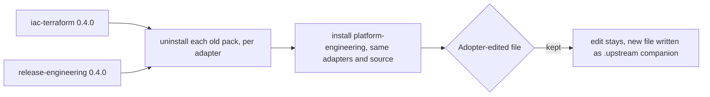

# RFC-0118: Consolidate the Terraform and release packs into one platform-engineering pack

- **Status:** Accepted
- **Author:** eugenelim
- **Date opened:** 2026-11-22
- **Date closed:** 2026-11-22
- **Decision weight:** standard
- **Related:** RFC-0110 (the `repo-governance` rename), ADR-0038 (an alias-free pack rename), specs `platform-engineering-interchange-contracts`, `platform-engineering-terraform-independence`, `platform-engineering-release-admission-review`, `platform-engineering-github-actions-execution`

## Summary

Replace `packs/iac-terraform` and `packs/release-engineering` with one `platform-engineering` pack that installs without core or repo-governance. Existing installs migrate by uninstalling the old packs and installing the new one, a path that already keeps adopter edits. The four earlier platform-engineering specs built the capabilities as independent workflows; this RFC decides how they ship.

- **D1.** Ship the workflows as one pack named `platform-engineering`, not as two packs.
- **D2.** Delete both old pack directories and add two rename-map entries that point each old name at `platform-engineering`.
- **D3.** Migrate in two phases: first uninstall every old-pack row for every adapter and scope, then install `platform-engineering` for the same adapters and scopes from a catalogue source that contains it.
- **D4.** Roll back by uninstalling every `platform-engineering` row, then reinstalling the old packs from a pinned catalogue ref that still holds them.
- **D5.** Leave automatic install backup out of scope and state it as a limit.
- **D6.** Declare no required dependency, keeping core as an optional integration, once core-absent fixtures pass in the combined pack.
- **D7.** Start the new pack at version 1.0.0.
- **D8.** Keep every skill, agent and interchange-contract name unchanged.

D2 depends on D1. D3 and D4 depend on D2 and D8: unchanged names keep the old install paths, so the installer refuses `platform-engineering` while any old-pack row remains. D5, D6 and D7 stand alone.

The repository owner decides.

## Motivation

Adopters cannot install the platform-engineering workflows as one capability, and every install still drags in core. `iac-terraform` 0.4.0 requires core and repo-governance, and `release-engineering` 0.4.0 requires core [1]. The earlier specs proved each workflow runs without those packs [2], so the requirement now costs adopters an install they do not need. Two pack names, two guide trees and two journeys also split one platform-engineering job.

### Goals

- One install gives Terraform authoring and drift review, release collection, admission, focused review and protected GitHub Actions execution.
- An existing install upgrades without duplicate skill or agent activation and without losing adopter-edited files.
- No hard dependency on core or repo-governance.

### Non-goals

- New installer features: aliases, merge, pruning upgrade or install backups.
- New capabilities beyond those the four earlier specs shipped.
- Changes to core, its hooks or adopter workflow policy.

## Proposal

Move both packs' source assets under `packs/platform-engineering/`, delete the old directories, and register the new pack everywhere the catalogue lists packs. Add two `[[rename]]` entries to `contracts/renames/pack-renames.toml`. Remove the `[[pack.dependencies.required]]` tables. Publish the migration and rollback steps in the pack README and guide.

Follow-on work: a spec for the consolidation and its five fixtures, guide and journey moves, and an ADR only if implementation finds a decision this RFC does not settle.

### D1: one pack

One pack matches the job: Terraform plans feed release candidates through the plan-bundle contract, and the end-to-end path binds a plan, admits it and deploys it. Two dependency-free packs are also installable and keep selective installation [11]. One pack costs a Terraform-only adopter the release skills, which never run unless invoked; two packs cost every end-to-end adopter a second install and keep the contract split across owners.

### D2: delete the old directories and map their names

`tools/lint-pack-renames.py` fails while a renamed pack's directory still exists, so the map and the old directories cannot coexist [3]. The map takes several old names to one target, and when an adopter asks for a pack that no longer exists the installer prints the steps for that one pack [5].

### D3: two-phase migration

No installer mechanism merges two packs [6]. The installer refuses to install a pack whose paths another installed row owns, even for another adapter that projects the same skill path [4], so every old-pack row must go before any new row is installed. `uninstall` refuses a pack installed for several adapters unless `--adapter` names one [12]. Both old packs allow repo scope, and the installer also accepts the personal, git-excluded `local` variant [13]. The documented sequence:

1. For each installed old pack, each adapter `<a>` and each scope `<s>` it was installed at: `agentbundle uninstall --pack <old> --adapter <a> --scope <s>`.
2. Then, for each of those adapters and scopes: `agentbundle install <catalogue> --pack platform-engineering --adapter <a> --scope <s>`.

One pack cannot be installed at both repo and `local` scope [14]. An adopter whose old packs sit at different scopes for one adapter chooses one scope for `platform-engineering` before phase 1, and the README says so. `<catalogue>` must contain `platform-engineering`: the default source, or a ref at or after the consolidation. An adopter pinned to an older ref moves the pin forward; that source change is part of the migration. Uninstall removes files whose content matches the recorded hash and keeps edited ones; the install then writes the new content beside each kept edit as a `.upstream` companion [7]. The printed hint covers one old pack and one adapter at a time, so an adopter with several rows follows the README sequence.

### D4: rollback from a pinned ref

Rollback runs D3 in reverse with the same two phases: uninstall every `platform-engineering` row, then install each old pack for each adapter and scope from a catalogue ref that still holds it, `git+https://github.com/<owner>/<repo>@<ref>` [8]. The pack README names that ref. Edits kept by either uninstall survive both directions [7].

### D5: no automatic backup

No install backup or snapshot exists [6]. Building one is installer-framework work outside this consolidation. The README states that the uninstall-kept edits and the pinned-ref reinstall are the recovery, and that a file an adopter deletes during migration is not recovered.

### D6: no required dependency

The four specs proved Terraform authoring and drift review with adopter-native governance and no core or repo-governance, and release collection, admission, review and GitHub Actions execution with no core [2]. The consolidation spec re-runs those paths against the combined pack before the dependency tables go. An installed core capability stays an optional addition that never replaces or weakens a required check.

### D7: version 1.0.0

The pack starts at 1.0.0 because removing two published pack names breaks every existing install command.

### D8: names unchanged

Skill names `generate-iac`, `reconcile-iac`, `define-slo`, `prepare-release-handoff` and `release-loop`, agent names `release-lead`, `release-reliability-reviewer` and `release-security-reviewer`, and the contracts `iac-plan-bundle.v1` and release-handoff schema `2.0` keep their names. Unchanged names keep identical projected paths, so the installer refuses `platform-engineering` while an old pack is installed [4]. That refusal is the duplicate-activation guard.

## Costs and what could go wrong

- **Migration is manual.** Adopters run one uninstall per old-pack row, then one install per adapter and scope, and the printed hint covers one row at a time. The rename map's printed steps and the README limit the cost. Failure signal: the migration fixture ends with a missing skill or a duplicated one.
- **No automatic backup.** An adopter who removes a kept edited file loses it. Uninstall keeps every edited file and the pinned-ref reinstall restores the shipped content, which limits the loss to edits the adopter deletes themselves.
- **Stale files.** `upgrade` never prunes, so files the old packs shipped and the new pack does not stay on disk until uninstall [6]. The documented path uninstalls first.
- **Registration churn.** About fifteen surfaces pin the old names, including the plugin roster, CI parity lists, the skill census and site navigation [9]. Their lints and tests catch an omission.
- **A dependency removal that is wrong.** If a core-absent fixture fails, D6 does not ship and the dependency stays.

## Alternatives

- **Do nothing.** Adopters keep two packs and the core requirement. Rejected: it leaves the earlier specs' independence unusable.
- **Keep two packs and drop their dependencies.** Supported and keeps selective installation [11]. Rejected for D1's reason: the plan-bundle contract and the end-to-end path span both packs.
- **Keep the old packs as deprecated shims.** Rejected: the rename lint fails on a surviving directory, and shared paths make the installer refuse the new pack beside a shim [3][4].
- **Build installer merge and backup support.** Rejected: it is installer-framework development outside this consolidation; the existing path already preserves edits [7].
- **Keep core as a required dependency.** Rejected: the earlier specs proved the workflows run without it [2].

## How we will know it works

The consolidation spec passes five fixtures, each in an isolated repository with the real CLI:

- **Terraform-only:** adopter-native governance, live provider schema, full review and a plan bundle, with no core, repo-governance or release tooling.
- **Release-only:** an external candidate, focused review and authorized GitHub Actions execution, with no core or Terraform tooling.
- **End-to-end:** plan binding, admission, deployment, runtime review, recovery and readiness together.
- **Core installed:** optional reuse keeps every required check and the adopter's workflow policy.
- **Migration:** both old packs installed for two adapters sharing skill paths, including one adapter with the packs at different scopes, from a pre-consolidation pinned source, with an edited file. Then the D3 sequence. Expect no duplicate skill or agent, the edit kept with a `.upstream` companion, a refusal when the new pack is installed while any old row remains, and the D4 rollback restoring both old packs.

Failure on any fixture blocks the matching decision.

## Migration

Adopters on `iac-terraform` or `release-engineering` run the D3 steps and can undo them with D4. An adopter on an older CLI without the rename hint follows the pack README and the changelog. The rename entries stay in the map permanently, as RFC-0110 keeps its entry [10].

## Evidence

1. `iac-terraform` requires core `^5.0` and repo-governance `^2.0`; `release-engineering` requires core `^5.0`. Source: `packs/iac-terraform/pack.toml` and `packs/release-engineering/pack.toml`, `[[pack.dependencies.required]]` tables. Method: read on 2026-11-22.
2. Core-absent proofs: Terraform authoring and drift with adopter-native governance (`docs/specs/platform-engineering-terraform-independence/`), collection, admission and focused review (`docs/specs/platform-engineering-release-admission-review/`), and GitHub Actions execution with live runs (`docs/specs/platform-engineering-github-actions-execution/notes/verification-ledger.md`). Method: each spec's Shipped acceptance criteria and ledger.
3. `tools/lint-pack-renames.py` fails while `packs/<old>/` exists or a map target is not a pack. Source: that file's module docstring. Method: read.
4. A path owned by another pack, even at equal content, classifies as `conflict` and install refuses. Source: `packages/agentbundle/agentbundle/config.py` `classify_incoming_path` and `commands/install.py` footprint refusal. Method: read.
5. One old name maps to exactly one target, several names may share a target, and the hint prints uninstall and install steps. Source: `packages/agentbundle/agentbundle/pack_renames.py`, the target lookup and the hint builder. Method: read.
6. No pack merge, alias or install backup exists, and `upgrade` adds files without pruning. Source: `docs/adr/0038-rename-design-craft-pack-to-experience.md` ("No pack-level rename/alias field exists"), `packages/agentbundle/agentbundle/commands/upgrade.py` projection loop. Method: read.
7. In an isolated repository with the current CLI, installing core and `release-engineering`, editing `.claude/skills/release-loop/SKILL.md`, uninstalling and reinstalling gave `uninstall: 31 removed, 1 kept`, the edit intact, and a new `SKILL.upstream.md`. Method: throwaway spike on 2026-11-22.
8. Catalogue URIs accept `git+https://github.com/<owner>/<repo>[@<ref>]`. Source: `packages/agentbundle/agentbundle/catalogue.py` module docstring and URI pattern. Method: read.
9. Surfaces pinning the old names include `site.toml`, `tools/lint-plugin-roster.py`, `tools/lint-plugin-route-docs.py`, `Makefile` and `.github/workflows/build-check.yml` pack-suite lists kept in step by `tools/lint-ci-parity.py`, `packs/agent-skill-engineering/tests/fixtures/skill-census.json`, `tests/roster/test_registry_upgrade_notes.py`, web and docs-site navigation, and `guide-nav-baseline.toml`. Method: `git grep` for both names outside their pack directories.
10. RFC-0110 keeps `governance-extras` in the rename map permanently. Source: `docs/rfc/0110-repo-governance-pack.md`, decision D3 ("The old name stays in the rename map permanently"). Method: read.
11. Each pack's skills run without the other: Terraform authoring and drift need no release pack, and release collection, admission and execution need no Terraform tooling. Source: the same specs as [2]. Method: their isolated-root journeys.
12. `uninstall` refuses a pack installed for multiple adapters at one scope unless `--adapter` names one. Source: `packages/agentbundle/agentbundle/commands/uninstall.py`, the multi-adapter disambiguator. Method: read.
13. Both packs set `allowed-scopes = ["repo"]`, and the installer accepts `--scope local` for a repo-scoped pack inside a Git repository. Source: each `pack.toml` `[pack.install]` table and `packages/agentbundle/agentbundle/commands/install.py`, the local-scope branch. Method: read.
14. The installer refuses a pack already installed at the opposite scope unless `--force` is passed. Source: `packages/agentbundle/agentbundle/commands/install.py`, the cross-scope refusal. Method: read.
