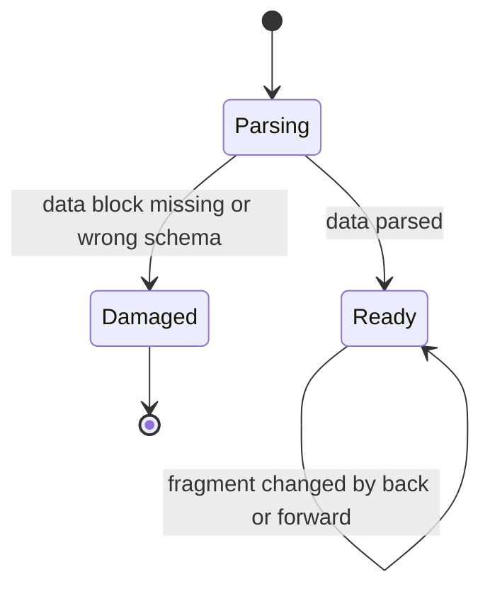

# Intent graph view: structure and behaviour

Advisory design for the `navigate-intents` offline HTML view. Under RFC-0105 D5
it guides the build but is not contract: the spec's acceptance criteria are. It
follows FEAT-0002's design route — `information-architecture` (analytical
genre), then `interaction-design`; `frontend-engineering` craft applies during
the build.

## Job, audience, and success

- **Job:** let a maintainer or reviewer see the whole intent graph from one file
  opened offline, find the part that matters, and open its source.
- **Audience:** repository maintainers and reviewers who received the file, or
  generated it, and may not have the repository checked out.
- **Success metric:** the FEAT-0002 validation hook — a reader answers "what
  sits under this capability and in what state?" and "which feature intents have
  no parent?" correctly and faster than with repository search.

## Domain model

- **Objects:** intent (altitude `Level:`, `Kind:`, status, heading), brief,
  spec.
- **Relationships:** parent (`Parent intent:`), pointer (spec `Brief:` and
  `Discovery:`), delivery relation (from the delivery resolver), related
  (`Related intents:`, written on one side, shown from both), refused edge (a
  pointer that names no single live target, with its named state).
- **Actions:** filter, search, expand a subtree, select a node to see its
  facts and edges, open its source.

## Business questions

1. A maintainer needs to know what sits under a capability and in what state, so
   they can decide what to pick up or close.
2. A maintainer needs to know which intents have no parent, so they can place
   them or leave them knowingly parentless.
3. A maintainer needs to know what work is outstanding and under which intent,
   so they can see open work without `workspace.toml`.
4. A maintainer needs to know which pointers are broken and why, so they can
   repair the source file.

## Widget hierarchy

- **Tier 1, the summary strip (top, always visible):** outstanding items,
  refused edges, parentless intents, and intent, brief, and spec counts. Each
  count is also a way in: activating it opens the view that lists those items.
- **Tier 2, the worklist (left):** one of four views — Tree, Outstanding,
  Refused edges, Parentless — with the search box and filters (level, kind,
  exact status, text) directly above the list they filter.
- **Tier 3, the detail panel (centre):** the selected node's header facts and
  every edge it carries, grouped by edge type, each group under a fixed label,
  with a legend and the source link.

Reading pattern: F-pattern. The surface is dense and scanned, not read.
Disclosure: the tree opens at its roots; a subtree opens on demand. Detail
appears only for the selected node.

## Wayfinding

- The current view and selection live in the URL fragment, so the browser's
  back and forward buttons move between them and a fragment can be shared.
- The view switcher marks the current view. The detail panel's heading names
  the selected node. Every node id in an edge list is a link that selects that
  node.
- A banner states the export's scope (whole corpus, or the subtree under one
  intent), its generation time, and that it is a read-only snapshot.

## Per-state layout

| State | What the reader sees |
| --- | --- |
| First run, no intents | The tree view says no intents were found and names the folder read. |
| No results | The list says which filters emptied it and offers to clear them. |
| Outstanding unavailable | The Outstanding view says delivery mapping was incomplete, with its reason, instead of a list. |
| Nothing refused | The Refused edges view says every pointer resolved. |
| Damaged data | The page shows one alert saying the file is damaged and must be exported again. |
| Script disabled | A notice says the view needs JavaScript and the file is otherwise inert. |

Loading needs no skeleton: the data is in the file and renders in one pass.

## Behaviour

- **Tree disclosure:** each intent with children has a button that toggles its
  subtree; `aria-expanded` follows it. Collapsed is the default below the
  roots.
- **Selection:** activating a node id selects it, updates the fragment, fills
  the detail panel, and moves focus to the panel's heading.
- **Filtering:** changes apply as the reader types, with no submit step. A
  polite live region announces the result count after each change.
- **View switch:** moves focus to the new view's heading and announces it.
- **Motion:** none. Every change is a frequent or keyboard-initiated action, so
  it is instant, and reduced-motion needs no alternative.
- **Keyboard:** every control is a native button, link, input, or select, in
  document order. No custom key handling is needed beyond native behaviour.
- **Cognitive fit:** four views keeps the choice small (Hick's law); the
  summary counts double as entry points; edge types use one fixed label set
  everywhere.
