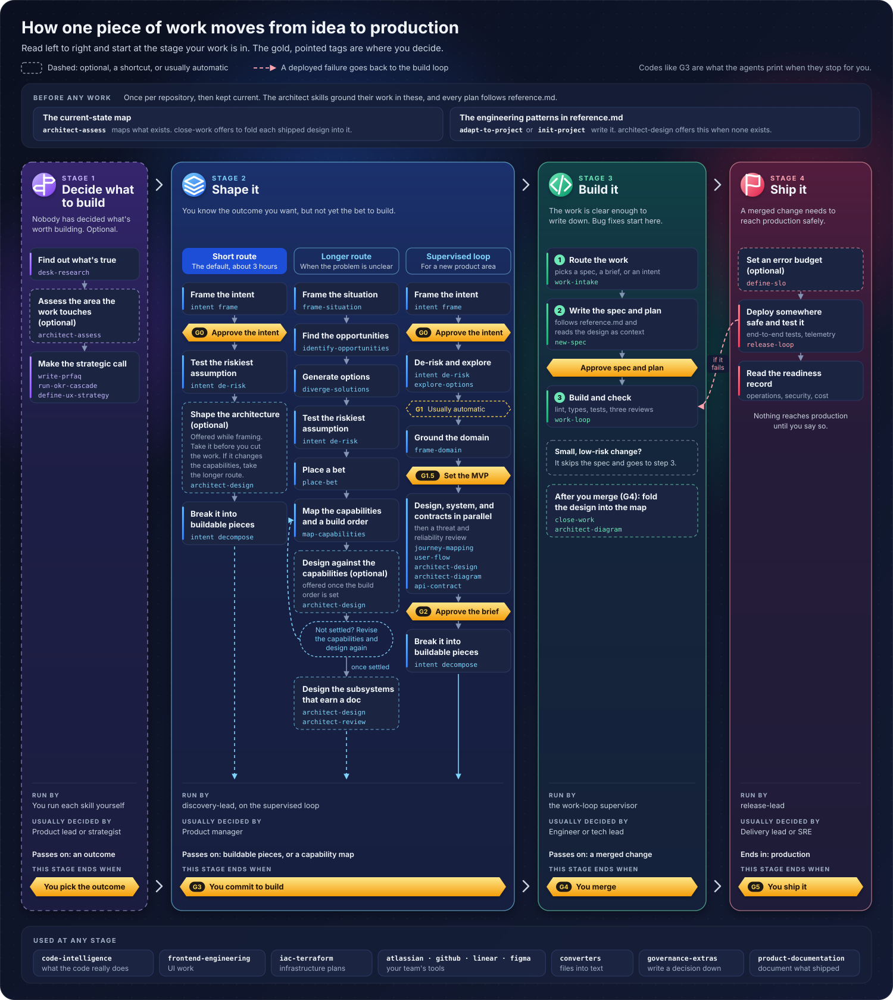

# Detailed operating model

Use this page to find the exact route through a stage, the order of its skills, and where the agent stops for you. For the four stages at a glance, see the [Operating model](../explanation/the-operating-model.md).

## The map

Select the map to open it at full size.

## Before any work

Once per repository, then kept current. `architect-assess` maps what exists, and `close-work` offers to fold each shipped design into that map. `adapt-to-project` or `init-project` writes `reference.md`, the file that names your stack and standards, and `architect-design` offers this when none exists. Every plan follows `reference.md`.

## Stage by stage

Dashed boxes on the map are optional, a shortcut, or usually automatic. A gold, pointed tag is where you decide, and its code, such as G3, is what the agent prints when it stops for you.

1. **Decide what to build** (optional). `desk-research` finds out what is true. If the work touches a system that already exists, `architect-assess` can assess that area first. `product-strategy` then makes the strategic call with `write-prfaq`, `run-okr-cascade`, or `define-ux-strategy`. You run each skill yourself, and a product lead or strategist usually decides. The stage ends when you pick the outcome.
2. **Shape it**, by one of three routes. Each ends at G3, when you commit to build, and passes on buildable pieces or a capability map. A product manager usually decides.
   - *Short route*, the default, about three hours: `intent frame`, then you approve the intent (G0), then `intent de-risk` tests the riskiest assumption. While you frame, `architect-design` is offered to shape the architecture. Take it before you cut the work, and if it changes the capabilities, take the longer route. `intent decompose` breaks the work into buildable pieces.
   - *Longer route*, when the problem is unclear: `frame-situation`, `identify-opportunities`, `diverge-solutions`, `intent de-risk`, `place-bet`, then `map-capabilities` for the capabilities and a build order. Once the order is set, `architect-design` is offered to design against the capabilities. If the design is not settled, revise the capabilities and design again. Then `architect-design` designs the subsystems that earn a doc, and `architect-review` checks them.
   - *Supervised loop*, for a new product area, run by `discovery-lead`: `intent frame` and G0, then `intent de-risk` and `explore-options`. G1 usually passes on its own. `frame-domain` grounds the domain, and you set the MVP (G1.5). Design, system, and contract work run in parallel with `journey-mapping`, `user-flow`, `architect-design`, `architect-diagram`, and `api-contract`, then a threat and reliability review. You approve the brief (G2), and `intent decompose` breaks it into buildable pieces.
3. **Build it**, run by the work-loop supervisor. An engineer or tech lead usually decides. `work-intake` routes the work to a spec, a brief, or an intent. `new-spec` writes the spec and plan, following `reference.md` and reading the design as context, and you approve both. `work-loop` builds and checks: lint, types, tests, and three reviews. A small, low-risk change skips the spec. The stage ends at G4, when you merge. After the merge, `close-work` and `architect-diagram` fold the design into the current-state map.
4. **Ship it**, run by `release-lead`. A delivery lead or SRE usually decides. `define-slo` sets an error budget if you want one. `release-loop` deploys somewhere safe, then runs end-to-end tests and watches telemetry. A failure goes back to the build loop. You read the readiness record on operations, security, and cost, and the stage ends at G5, when you ship it. Nothing reaches production until you say so.
