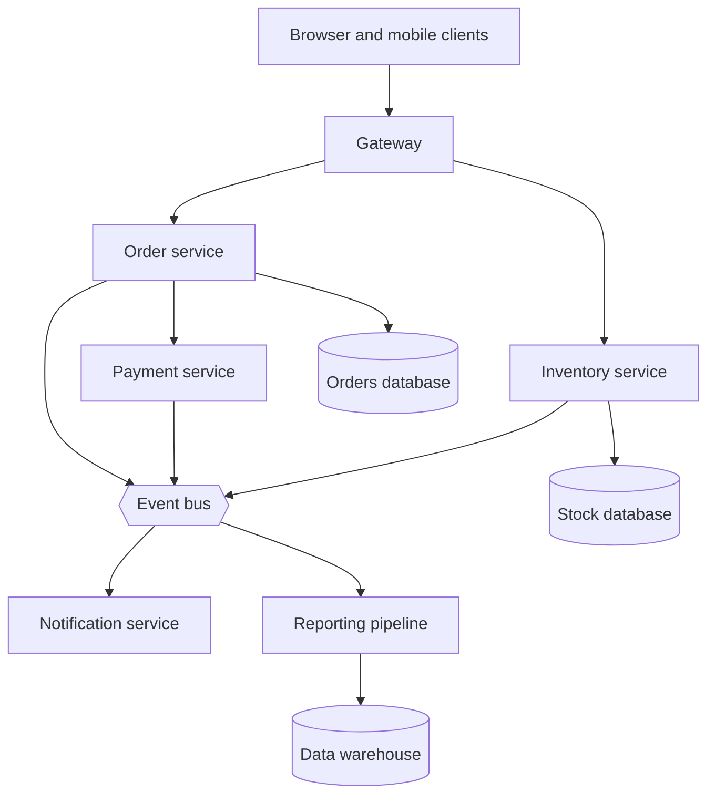
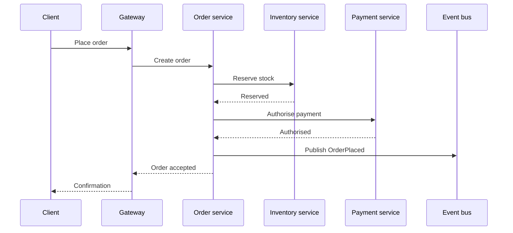

# Architecture assessment: Meridian orders platform

## Bottom line

Meridian is a nine-service order platform built around one event bus. The structure is clear, but the bus, the order service, and the payment adapter each carry more consequence than the evidence for their verification supports. **The single broker is the first thing to look at.** The report is built from a static read of the repository, so runtime behaviour, deployment topology, and traffic are not assessed.

## Assessment charter

Target: the Meridian monorepo, services and jobs only
Primary intent: baseline and understanding
Mode: standard
Decision supported: where to invest first, for the platform owner
Checkpoints: accepted-without-pause

## Conceptual current state

Context for the reader. Services communicate through HTTP at the edge and through events inside the platform.

### Overall architecture

Customers reach the system through one gateway. The gateway routes to the order and inventory services. Order and payment changes are published to a shared event bus, which feeds notifications and a nightly reporting pipeline.

The same flow, as the main happy path, reads as follows.

Sources checked:

| Source | Locator | Evidence class | Limit |
| --- | --- | --- | --- |
| Repository README | `README.md` | observed | States purpose only; no diagrams |
| Architecture notes | `docs/architecture/overview.md` | reported | Written two releases ago; not dated |
| Service manifest | `deploy/services.yaml` | observed | Lists nine services; replicas not read |
| Order service entry point | `services/orders/src/main.ts` | observed | Static read; not run |
| Event schema registry | `contracts/events/` | observed | Schemas present; consumers not traced |
| Gateway routes | `services/gateway/routes.yaml` | observed | Routes read; auth rules not traced |
| Payments adapter | `services/payments/src/adapter.ts` | inferred | Provider chosen from import names |
| Inventory sync job | `jobs/inventory-sync/` | inferred | Schedule inferred from a cron string |
| Notification fan-out | `services/notify/src/fanout.ts` | inferred | Retry policy inferred from constants |
| Runbook index | `docs/runbooks/README.md` | reported | Operational claims not verified |
| On-call rota | `docs/ops/rota.md` | reported | Names omitted; ownership unverified |
| Production topology | `none found` | unknown | No deployment evidence in the repository |
| Customer traffic | `none found` | unknown | No metrics or logs available |
| Data retention policy | `none found` | unknown | Referenced in notes; document missing |

### Architecture by subsystem

Six subsystems have their own deployable and responsibility. Each entry gives its purpose; the two with the most coupling carry interface and failure notes.

#### Gateway

Terminates TLS, authenticates callers, and routes requests to the order and inventory services.

#### Order service

Owns the order lifecycle from cart to fulfilment and emits an event at every state change.

##### Interfaces

The order service exposes a documented HTTP surface and publishes events to the shared bus.

##### Failure modes

Retries are bounded; a poison message is parked after three attempts and surfaces on the dead-letter queue.

#### Payment service

Authorises and captures payment through one external provider behind an adapter.

##### Interfaces

The payment service exposes a documented HTTP surface and publishes events to the shared bus.

##### Failure modes

Retries are bounded; a poison message is parked after three attempts and surfaces on the dead-letter queue.

#### Inventory service

Holds stock levels per warehouse and reserves stock when an order is placed.

#### Notification service

Sends email and push messages from order and payment events.

#### Reporting pipeline

Batches events into a warehouse each night for finance and operations reports.

Sources checked:

| Source | Locator | Evidence class | Limit |
| --- | --- | --- | --- |
| Service manifest | `deploy/services.yaml` | observed | Lists nine services |
| Order service entry point | `services/orders/src/main.ts` | observed | Static read |
| Architecture notes | `docs/architecture/overview.md` | reported | Undated |
| Payments adapter | `services/payments/src/adapter.ts` | inferred | Provider inferred |

### Physical architecture

not assessed

The repository holds service manifests but no infrastructure code, cluster definitions, or cloud accounts, so where the services run is not shown.

Sources checked:

| Source | Locator | Evidence class | Limit |
| --- | --- | --- | --- |
| Deployment manifests | `deploy/` | observed | Describe services, not hosts |
| Infrastructure code | `none found` | unknown | No Terraform, Helm, or cloud templates |
| Hosting documentation | `none found` | unknown | No hosting notes |

### Map checkpoint

not user-confirmed

## Evidence coverage

| Surface | Status | Evidence pointer | Confidence / limit |
| --- | --- | --- | --- |
| Documentation | observed | `docs/` | Notes are undated |
| Source | observed | `services/` and `jobs/` | Read, not executed |
| Tests | observed | `services/orders/test/orders_service_integration_test_suite_for_checkout_flow_v2_contract_verification.spec.ts` | One suite per service; not run |
| CI/CD | missing | none found | Pipeline definitions absent |
| Deployment | missing | none found | See Physical architecture |

## Attention heat map

**Legend:** Heat selects drill-down priority. It is not proof of a defect and is not finding severity. Each dimension is `low`, `medium`, `high`, or `unknown`.

| Area | Consequence | Pressure | Concentration / coupling | Verification weakness | Ops/data/security exposure | Confidence | Evidence |
| --- | --- | --- | --- | --- | --- | --- | --- |
| Order service | high | medium | high | high | medium | moderate | 151 changes in 90 days |
| Payment service | high | low | medium | medium | high | moderate | One provider, no fallback |
| Gateway | medium | medium | low | low | high | high | Auth rules centralised |
| Inventory service | medium | high | medium | medium | medium | moderate | Reservation races possible |
| Notification service | low | low | low | medium | low | high | Stateless fan-out |
| Reporting pipeline | low | unknown | low | high | medium | low | No tests found |
| Shared event bus | high | unknown | high | unknown | high | low | Single broker, no failover seen |
| Schema registry | medium | low | low | low | medium | moderate | Backward compatibility unchecked |

### Focus checkpoint

not user-confirmed

## Findings

### F-1: One broker carries every cross-service event

Classification: risk
Severity: major
Confidence: moderate

Every cross-service event passes through one broker, and no failover or replication configuration appears in the repository. **If the broker is unavailable, order, payment, and notification updates stop together.**

## Next decision

Decide whether broker failover is in scope before the next release, and whether the missing deployment evidence can be supplied.
